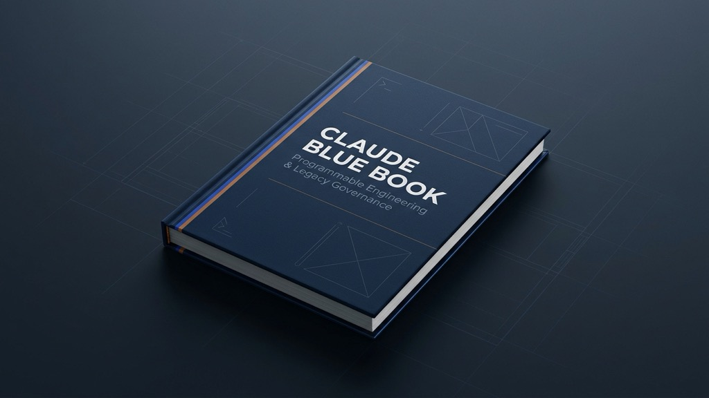

# 《Claude 实战蓝皮书：可编程工程原语、画布协同与复杂系统重构指南》

> **版本**：v1.0.0 已上线 · 资料核对至 **2026 年 11 月 26 日**  
> **核心定位**：吃透 **Claude 5.5（Opus / Sonnet / Haiku 5.5）+ Fable 5.2** 与 **Claude Code v2.1.323+** 五大可编程原语，打通 **Whiteboards → `/design` 画板 → 百万上下文存量重构 → `/ship` 自动合并** 全链路。

- [立即从第一章开始阅读](/claude/ch01_programmable_platform)
- [下载中文版 PDF](/downloads/claude_blue_book_zh.pdf) · [Download English PDF](/downloads/claude_blue_book_en.pdf)
- [配套 Hooks 与子代理可运行套件](https://github.com/aipmer/codex-blue-book/tree/main/examples/claude-hooks-kit)
- [生成 Claude `CLAUDE.md` + `Hooks` 规约](/generator) · [四书横向对比](/compare)

---

## 全书 10 章导航

### 第一部分：心智跃迁与五大工程原语
- [Ch.01 从对话编程到可编程工程平台：Claude 5.5 体系与全景心智](/claude/ch01_programmable_platform)
- [Ch.02 上下文经济学：精简 `CLAUDE.md` 与按需加载 `Skills` 体系](/claude/ch02_context_economics)
- [Ch.03 确定性防线：`Hooks` 生命周期门禁与实验性 Code Mode 批处理](/claude/ch03_hooks_code_mode)

### 第二部分：视觉画布与持久工作区协同
- [Ch.04 从混沌脑暴到架构定稿：Claude Whiteboards 与结构化文档矩阵](/claude/ch04_whiteboards_docs)
- [Ch.05 终端直通画板：`/design`（Claude Design）交互原型与源码回流实战](/claude/ch05_design_canvas)

### 第三部分：百万上下文与大型存量系统治理
- [Ch.06 存量巨石系统逆向与微创技术债清理](/claude/ch06_legacy_governance)
- [Ch.07 多子代理分治（Subagents）与长时自主重构实战](/claude/ch07_subagents_refactoring)

### 第四部分：自动化合并上线与 ToB 商业闭环
- [Ch.08 最后一公里自动化：`/ship`、PR Steward 与团队治理防线](/claude/ch08_ship_pr_steward)
- [Ch.09 商业化实战：基于 Claude 打造高客单价企业级审计与情报 SaaS](/claude/ch09_enterprise_saas)

### 第五部分：产品审视与前沿路线图
- [Ch.10 2026 前沿瞭望与产品冷思考：Claude Cowork 锐评与异步记忆演进](/claude/ch10_frontier_cowork_critique)
