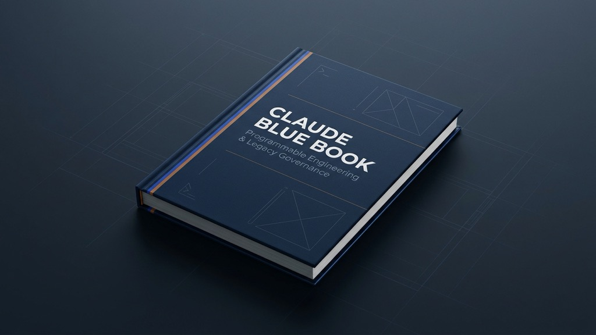

# 《Claude 实战蓝皮书：可编程工程原语、画布协同与复杂系统重构指南》

**v1.0.0 · 资料核对至 2026 年 11 月 26 日**




主理人: [Hunk Wu](https://pmer.cn) (X: [@ai_pmer](https://x.com/ai_pmer))

[ 🌐 English PDF Version ](./claude_blue_book_en.pdf) | [ 🌐 在线阅读站 ](https://book.pmer.cn/claude/)

## 🧭 目录 (Table of Contents)

### 第一部分：心智跃迁与五大工程原语
- Ch.01 从对话编程到可编程工程平台：Claude 5.5 体系与全景心智
- Ch.02 上下文经济学：精简 `CLAUDE.md` 与按需加载 `Skills` 体系
- Ch.03 确定性防线：`Hooks` 生命周期门禁与实验性 Code Mode 批处理

### 第二部分：视觉画布与持久工作区协同
- Ch.04 从混沌脑暴到架构定稿：Claude Whiteboards 与结构化文档矩阵
- Ch.05 终端直通画板：`/design`（Claude Design）交互原型与源码回流实战

### 第三部分：百万上下文与大型存量系统治理
- Ch.06 存量巨石系统逆向与微创技术债清理
- Ch.07 多子代理分治（Subagents）与长时自主重构实战

### 第四部分：自动化合并上线与 ToB 商业闭环
- Ch.08 最后一公里自动化：`/ship`、PR Steward 与团队治理防线
- Ch.09 商业化实战：基于 Claude 打造高客单价企业级审计与情报 SaaS

### 第五部分：产品审视与前沿路线图
- Ch.10 2026 前沿瞭望与产品冷思考：Claude Cowork 锐评与异步记忆演进

---

## 🔌 配套开源套件

*   **[Claude Hooks & Subagents Kit](https://github.com/aipmer/codex-blue-book/tree/main/examples/claude-hooks-kit)**：包含防危命 `PreToolUse` Bash 拦截脚本、敏感文件写保护与只读架构评审子代理配置。

*   **[多智能体通用规约生成器](https://book.pmer.cn/generator)**：一键导出 `CLAUDE.md`、`settings.json` Hooks 与 `AGENTS.md` 跨工具规约。

---

# Ch.01 从对话编程到可编程工程平台：Claude 5.5 体系与全景心智

> 🎯 **具体工程麻烦**：把 Claude Code 当成命令行版聊天窗口，全量规则硬塞进对话，模型选错导致账单飙升或长任务跑偏。  
> 💡 **可运行实战代码与落地收益**：掌握 Claude 5.5 / Fable 5.2 分级选型与缓存账本；厘清五大工程原语触发权；10 分钟完成十万行存量仓库诊断。  
> ⚡ **社交传播 / 截图金句**：“聊天窗口只能写片段，可编程原语才能管住十万行老代码。驾驭 Claude Code 的分水岭，在于分清谁来拉动扳机。”

很多工程师装上 Claude Code 之后，用法和网页版聊天几乎没有区别：开一个终端，贴一段报错，等它改完，再贴下一段。面对三五个文件的 Demo，这套用法没问题；一旦进入几十个模块、跨团队维护的存量仓库，上下文很快被日志撑爆，同一条代码规范要反复提醒五六遍。

截至 **2026 年 11 月 26 日**，Anthropic 的 Claude 5.5 家族（Opus / Sonnet / Haiku 5.5）与 Fable 5.2 全系具备 **100 万 Token 上下文窗口与 128K 输出上限**，Claude Code 本身也演进成了具备明确分层机制的可编程工程平台。本章先立住地基：怎么选模型、怎么接管环境，以及五大原语各自归谁触发。

---

## 🎯 生活化直觉隐喻：从“雇外包写手”到“搭自动化工厂流水线”

不要把 Claude Code 当成一个会打字的聊天机器人，把它看成一座分岗位运转的精密车间：

```text
【普通对话模式】    ──> 你站在单人工作台旁口头指挥，每次换班都要重新交代工艺与禁忌。
【Claude Code 工厂】──> 五套独立机制各司其职：
                        - CLAUDE.md  ：贴在墙上的厂规（每次开工自动读取，贵在极简）
                        - Skills     ：工位旁的专项工艺卡（遇到特定工序才按需翻开）
                        - Subagents  ：独立隔间的专职班组（各用各的上下文，做完只交摘要）
                        - Hooks      ：断电保护闸（程序确定性拦截，不管 AI 同不同意）
                        - MCP        ：直连外部物料库与工单系统的管道
```

理解这五层的分工后，你就不会再把所有规则都往一个大 Prompt 里塞。

---

## 🚀 新手极速上手 3 步走（无痛起步）

1. **步骤一：安装并核对 Claude Code CLI 版本**
   ```bash
   npm install -g @anthropic-ai/claude-code
   claude --version
   ```
2. **步骤二：在项目根目录启动只读体检**
   进入目标存量仓库，先用只读探索模式梳理架构，不触碰任何文件：
   ```bash
   claude --permission-mode plan "扫描当前仓库的目录结构、核心入口、数据库层与测试命令，输出架构清单"
   ```
3. **步骤三：实时审查 Diff 与跨端接续**
   在交互会话中随时输入 `/diff` 打开实时双栏差异视图；需要切到桌面端继续审阅时，运行 `/resume` 接续同一会话历史。

---

## 1.1 Claude 5.5 与 Fable 5.2 模型选型与成本账本

选错模型是工程团队账单失控的首要原因。下表为截至 **2026 年 11 月 26 日** 的标准 API 文本参考定价（每百万 Token，不含订阅套餐额度折算，最新细则以 [Anthropic 官方定价](https://www.anthropic.com/pricing) 为准）：

| 模型层级 | 典型定位 | 参考输入 | 参考输出 | 推荐工程分工 |
| :--- | :--- | ---: | ---: | :--- |
| **Claude Fable 5.2** | 极限架构与长程推理 | $8.00 | $40.00 | 跨系统架构定案、极端疑难根因定位（当 Opus 高档推理仍不满意时升级） |
| **Claude Opus 5.5** | 重度研发默认旗舰 | $4.00 | $20.00 | 复杂多文件重构、存量业务解耦、高可靠工程交付（较 Opus 5 降本约 40%，缓存读极低） |
| **Claude Sonnet 5.5** | 高速日常主力 | $2.00 | $10.00 | 常规功能迭代、Bug 修复、单测补齐（比 Opus 快 30%+ 且成本减半） |
| **Claude Haiku 5.5** | 极速路由与轻量子代理 | $0.10 | $0.50 | 代码库只读检索、日志分类、批量文本提取与轻量并行子代理 |

选型铁律：**不要全程锁死最贵模型。** 主会话用 `Opus 5.5` 或 `Sonnet 5.5` 把控规划与改动，把只读搜索和格式扫描下放给 `Haiku 5.5` 子代理，单任务成本通常可压低一半以上。

---

## 1.2 透视触发权：五大工程原语决策表

掌握 Claude Code 扩展体系最快的方法，是看**谁拉动扳机**（程序壳子 Harness、大模型本身，还是开发者本人）：

| 工程原语 | 触发方 | 核心职责 | 上下文占用 |
| :--- | :--- | :--- | :--- |
| **`CLAUDE.md`** | Harness（每次会话启动自动载入） | 常驻项目边界、构建测试命令、绝对禁区 | 高（每轮请求均消耗，必须极简） |
| **`Skills`** | 模型按语义匹配，或用户 `/skill` | 可复用的领域 SOP（如数据库迁移、发布检查） | 低（仅在命中时按需加载） |
| **`Subagents`** | 模型分派或用户指定 | 在独立上下文窗口内并行探索、重构或评审 | 隔离（仅向主会话回传精炼摘要） |
| **`Hooks`** | Harness（生命周期事件强制触发） | 确定性安全拦截、自动格式化、审计留痕 | 零（以本地 Shell/HTTP 脚本运行） |
| **`MCP`** | 模型按需调用 / 服务端暴露 | 连接外部数据库、Figma、工单与远端 `server:skill` | 视工具返回体积而定 |

---

## 1.3 实战：10 分钟生成十万行存量仓库全景诊断报告

接手一个陌生仓库时，先让 Claude Code 在计划模式下输出可落盘的诊断文档，不要一上来就让它改代码：

```bash
claude --permission-mode plan -p "
分析当前仓库并输出一份 Markdown 诊断报告（不修改任何业务源码）：
1. 识别主要运行时、框架版本与包管理器；
2. 列出前 5 个核心业务入口文件与数据访问层位置；
3. 汇总 package.json / Makefile 中的构建、lint 与测试命令；
4. 标出存在循环依赖、缺少测试覆盖或直接拼接 SQL 的高风险目录。
" > docs/repo-diagnosis.md
```

拿到 `docs/repo-diagnosis.md` 后，人工核对一遍构建命令与高危目录，下一章直接把它提炼为精简的 `CLAUDE.md`。

---

## 🛡️ 翻车自救与避坑速查表

| 常见踩坑现象 | 致命原因 | 极速自救方案 |
| :--- | :--- | :--- |
| **单次会话聊了 40 轮后 AI 忘记开头规则** | 终端日志塞满窗口，触发多次压缩稀释指令 | 用 `/compact` 显式保留关键约束，或把核心指令迁入 `CLAUDE.md` 与 `Hooks` |
| **所有子任务全用 Opus/Fable 导致配额秒空** | 未按任务复杂度分层路由模型 | 常规任务用 `/model` 切至 Sonnet 5.5，检索类子代理在 frontmatter 指定 Haiku 5.5 |
| **改完 12 个文件才发现方向理解错** | 未先跑 `--permission-mode plan` 与 `/diff` | 先在 plan 模式确认修改清单，改动过程中随时用 `/diff` 双栏核查 |

---

---

# Ch.02 上下文经济学：精简 `CLAUDE.md` 与按需加载 `Skills` 体系

> 🎯 **具体工程麻烦**：把所有规范、数据库文档和部署手册全堆进 `CLAUDE.md`，导致每轮请求 Token 飙升、模型注意力被稀释，关键禁令反而失效。  
> 💡 **可运行实战代码与落地收益**：150 行 `CLAUDE.md` + `@AGENTS.md` 跨工具复用结构；标准 `SKILL.md` 渐进式披露模板；`claude plugin eval` 评测命令。  
> ⚡ **社交传播 / 截图金句**：“往 `CLAUDE.md` 塞 1000 行规范，等于把禁烟标志贴满整面广告墙——真正致命的那条，AI 反而看不见。”

很多团队用完一周 Claude Code 后，会把踩过的每一个坑都追加到 `CLAUDE.md` 里。一个月后，这个文件膨胀到上千行，涵盖前端规范、数据库迁移、发布流程和客服文案。结果每发一句“帮我改个按钮颜色”，模型都要先吞下上千行无关背景，既烧缓存写入费，又让核心约束被噪音淹没。

解决这个问题的思路叫**渐进式披露（Progressive Disclosure）**：常驻规则只留全仓库通用的极简硬约束，专项流程全部拆成按需加载的 **Skills**。

---

## 🎯 生活化直觉隐喻：口袋卡片 vs 挂墙维修手册

```text
【臃肿 CLAUDE.md】 ──> 要求技师每天背着 20 斤重的全厂百科全书上班，拧一颗螺丝也要翻半小时。
【分层上下文体系】 ──> 1. 胸牌背面（CLAUDE.md / @AGENTS.md）：只印 10 条绝对不能碰的安全红线和常用命令；
                       2. 工具箱抽屉（.claude/skills/*/SKILL.md）：修数据库才抽《迁移手册》，
                          做发版才抽《上线检查单》，平时只露出抽屉标签（name + description）。
```

---

## 🚀 新手极速上手 3 步走（无痛起步）

1. **步骤一：用 `@AGENTS.md` 实现四工具共享一套项目规则**
   如果你的仓库已经有面向 Codex / Antigravity / Kimi 的 `AGENTS.md`，在项目根目录创建极简 `CLAUDE.md`：
   ```markdown
   @AGENTS.md

   ## Claude Code 专属约定
   - 复杂重构先进入 plan 模式输出变更文件清单，再修改代码。
   - 提交前必须通过 `.claude/settings.json` 中的 Hooks 校验。
   ```
2. **步骤二：创建第一个按需加载的 Skill 目录**
   ```bash
   mkdir -p .claude/skills/db-migration
   ```
3. **步骤三：用 `/db-migration` 或自然语言触发验证**
   在 Claude Code 中输入“帮我给 User 表加一个索引”，观察模型自动发现并按需读取 `.claude/skills/db-migration/SKILL.md`。

---

## 2.1 `CLAUDE.md` 的黄金 150 行法则

`CLAUDE.md` 在每次会话启动时自动注入，因此只适合放**几乎每次任务都会用到**的信息：

- **项目指纹**：技术栈、包管理器、核心目录划分（不超过 15 行）；
- **标准命令**：`build`、`lint`、`typecheck`、`test` 的确切可执行命令；
- **硬性禁区**：禁止修改的历史目录、禁止泄露的凭据前缀、禁止绕过的测试步骤。

**什么不该写进 `CLAUDE.md`？**
- 只有特定场景才用的长流程（比如 Stripe Webhook 排错、数据库迁移步骤）→ 拆到 `.claude/skills/`；
- 必须 100% 强制执行的规则（比如禁止 `rm -rf`、保存后自动跑 Prettier）→ 下沉到 Ch.03 的 `Hooks`；
- 冗长的代码风格说教 → 交给 ESLint / Biome / Ruff 等确定性静态检查工具。

---

## 2.2 编写符合开放标准的模块化 `SKILL.md`

遵循开放的 Agent Skills 规范，一个 Skill 是一个独立文件夹，启动时 Claude 只加载 `name` 与 `description` 元数据，命中场景时才读取完整正文与附属脚本：

```text
.claude/skills/
└── db-migration/
    ├── SKILL.md
    └── scripts/
        └── check-lock-risk.sh
```

以下是可直接落盘的 `.claude/skills/db-migration/SKILL.md` 示例：

```markdown
---
name: db-migration
description: 编写与校验生产级 Prisma / PostgreSQL 数据库迁移。当任务涉及修改 schema.prisma、新增索引或表结构变更时触发。
model: inherit
allowed-tools:
  - Read
  - Edit
  - Bash
---

# 数据库安全迁移流程

执行任何表结构修改前，严格按以下 4 步推进：

1. 先运行 `npx prisma validate` 确认 schema 语法无误。
2. 生成迁移 SQL 但不直接应用生产库：`npx prisma migrate diff --from-schema-datasource prisma/schema.prisma --to-schema-datamodel prisma/schema.prisma --script`。
3. 审查生成的 SQL，拦截以下高危锁表操作：
   - 大表直接 `ADD COLUMN ... NOT NULL` 未提供 `DEFAULT`；
   - 未带 `CONCURRENTLY` 的大表 `CREATE INDEX`。
4. 在本地测试库跑通迁移并执行 `npm run test:db`，退出码为 0 后才交付。
```

---

## 2.3 MCP 进阶：使用 `server:skill` 挂载远端团队工作流

2026 年 11 月的 Claude Code 更新支持 **MCP Server 直接分发 Skills（`server:skill`）**。

过去接入一个包含 15 个接口的内部 MCP 服务，模型常常不知道该按什么顺序串联调用。现在服务端可以直接把标准操作流打包为 Skill 随工具一起暴露：

```bash
# 查看已连接 MCP 服务及其暴露的远程 Skill
claude mcp list

# 在交互会话的斜杠菜单中直接调用远端 MCP 技能
# 格式：/<server-name>:<skill-name>
/sentry:triage-production-spike
```

这种方式有两个直接工程收益：
1. 团队更新发布或排障流程时，只需更新远端 MCP Server 里的 Skill，所有工程师终端即时生效，不用挨个同步本地 Markdown；
2. 配合下一章的 `PreSkillShellCommand` 钩子，可以拦截未经审核的远端 Skill 注入恶意 Shell 命令。

---

## 2.4 用 `claude plugin eval` 量化检验 Skill 真实收益

写完一套 Skill 或自定义插件后，别靠主观感觉判断“好像变好用了”。使用 Claude Code 内置评测命令，将挂载插件后的表现与无插件基线做对照：

```bash
# 为自定义插件自动生成评测集并对比无插件基线
claude plugin eval ./plugins/db-migration-kit --baseline none
```

评测会输出任务通过率、工具调用步数与 Token 消耗对比。如果某个 Skill 增加了 30% Token 却没有拉高通过率，说明指令过于啰嗦，应当立刻删减。

---

## 🛡️ 翻车自救与避坑速查表

| 常见踩坑现象 | 致命原因 | 极速自救方案 |
| :--- | :--- | :--- |
| **写好了 `SKILL.md` 却从不被自动触发** | `description` 写得太抽象，缺少明确触发关键词 | 在 `description` 写明具体文件后缀与场景动词（如“修改 `schema.prisma` 时使用”） |
| **多人协作时 `CLAUDE.md` 与 `AGENTS.md` 内容打架** | 两份文件各自维护，规则互相覆盖 | 统一以 `AGENTS.md` 为唯一事实源，`CLAUDE.md` 首行只写 `@AGENTS.md` |
| **引入第三方 Skill 后被暗藏脚本改坏环境** | 未启用 `PreSkillShellCommand` 拦截与来源审查 | 接入第三方插件前先人工读 `SKILL.md`，并在 `.claude/settings.json` 配置门禁钩子 |

---

---

# Ch.03 确定性防线：`Hooks` 生命周期门禁与实验性 Code Mode 批处理

> 🎯 **具体工程麻烦**：在 Prompt 里写十遍“严禁执行 `rm -rf` 或强推 `main`”，模型在复杂排障时仍可能误触发高危命令；逐个文件串行调工具改 30 个文件又慢到让人崩溃。  
> 💡 **可运行实战代码与落地收益**：配套可运行样例 [examples/claude-hooks-kit](https://github.com/aipmer/codex-blue-book/tree/main/examples/claude-hooks-kit)（含 `.claude/settings.json` 与危险命令拦截脚本）；掌握 v2.1.323+ Code Mode 并行编排。  
> ⚡ **社交传播 / 截图金句**：“靠 Prompt 劝 AI 别删库，是把生产安全押在概率上；用 Hooks 拦在工具执行前，才是确定性工程。”

任何大模型的指令遵循本质上都是概率性的。即使 99.5% 的时候它都乖乖听话，只要在高并发调试的第 200 次误删了目录或把 `.env` 打印进了日志，一次事故就足以抵消一个月的效率红利。

Claude Code 给出的工程解法是 **Hooks（确定性生命周期门禁）**——由宿主程序在固定节点强制执行本地脚本，**不依赖模型是否记得规则，也不消耗任何上下文 Token**。与此同时，Claude Code `v2.1.323+` 引入的实验性 **Code Mode** 把原本串行的一连串工具调用压缩成脚本化并行执行，大幅拉高批量改造速度。

---

## 🎯 生活化直觉隐喻：工地安全员的“物理门禁闸机”

```text
【只靠 Prompt 叮嘱】 ──> 在门口贴标语“请勿带火种进仓库”，工人忙昏头时仍可能顺手带进去。
【配置 Hooks 门禁】  ──> 门口装上金属探测闸机（PreToolUse）：
                         - 只要工具入参命中 `rm -rf`、`git push --force` 或 `.env` 读取，
                           闸机直接亮红灯拦截（exit 2），把拒绝理由原样退回给模型；
                         - 每次改完 `.ts` 文件出门自动刷一遍格式化（PostToolUse）。
```

---

## 🚀 新手极速上手 3 步走（无痛起步）

1. **步骤一：在项目创建 `.claude/hooks/` 目录并放入拦截脚本**
   参考本仓库配套可运行工具包 `examples/claude-hooks-kit/`，将拦截脚本设为可执行：
   ```bash
   mkdir -p .claude/hooks
   chmod +x .claude/hooks/block-dangerous-bash.sh
   ```
2. **步骤二：写入 `.claude/settings.json` 挂载钩子**
   利用 2026 版支持的 `if` 条件过滤语法，只拦截命中的工具调用，避免无谓开销。
3. **步骤三：故意触发一条被禁命令做红队自测**
   在测试分支对 Claude 说“运行 `git push --force`”，确认钩子在真正执行前立即拦截并输出拒绝原因。

---

## 3.1 生产级 `.claude/settings.json` 三层门禁配置

下面是一套真实可落盘的项目级配置，覆盖 `PreToolUse`（防高危命令与密钥泄露）、`PostToolUse`（改完源码自动格式化）和 `PreSkillShellCommand`（防第三方 Skill 注入未授权 Shell）：

```json
{
  "$schema": "https://json.schemastore.org/claude-code-settings.json",
  "hooks": {
    "PreToolUse": [
      {
        "matcher": "Bash",
        "hooks": [
          {
            "type": "command",
            "if": "Bash(*)",
            "command": "\"$CLAUDE_PROJECT_DIR\"/.claude/hooks/block-dangerous-bash.sh"
          }
        ]
      },
      {
        "matcher": "Read|Edit|Write",
        "hooks": [
          {
            "type": "command",
            "command": "\"$CLAUDE_PROJECT_DIR\"/.claude/hooks/protect-secrets.sh"
          }
        ]
      }
    ],
    "PostToolUse": [
      {
        "matcher": "Edit|Write",
        "hooks": [
          {
            "type": "command",
            "if": "Edit(*.ts)",
            "command": "\"$CLAUDE_PROJECT_DIR\"/.claude/hooks/format-on-edit.sh"
          }
        ]
      }
    ],
    "PreSkillShellCommand": [
      {
        "hooks": [
          {
            "type": "command",
            "command": "\"$CLAUDE_PROJECT_DIR\"/.claude/hooks/block-dangerous-bash.sh"
          }
        ]
      }
    ]
  }
}
```

### 配套拦截脚本：`.claude/hooks/block-dangerous-bash.sh`

Claude Code 执行命令型 Hook 时，会通过 `stdin` 传入包含 `tool_name` 与 `tool_input` 的 JSON。以下脚本使用 `node` 解析输入（无需额外安装 `jq`），命中危险模式时以退出码 `2` 阻断执行并把明确提示退回给模型：

```bash
#!/usr/bin/env bash
set -euo pipefail

PAYLOAD="$(cat)"

node -e '
const input = JSON.parse(process.argv[1] || "{}");
const cmd = String(input?.tool_input?.command || input?.command || "");
const blocked = [
  { re: /\brm\s+-[a-zA-Z]*r[a-zA-Z]*f\b|\brm\s+-[a-zA-Z]*f[a-zA-Z]*r\b/, reason: "Blocked recursive force delete (rm -rf)" },
  { re: /\bgit\s+push\b.*(--force|-f)\b/, reason: "Blocked force push to remote repository" },
  { re: /\bgit\s+reset\s+--hard\b/, reason: "Blocked destructive git reset --hard" },
  { re: /\b(DROP\s+TABLE|TRUNCATE\s+TABLE)\b/i, reason: "Blocked destructive SQL DDL statement" },
  { re: /curl\b.*\|\s*(sh|bash)\b/, reason: "Blocked piping remote script directly to shell" }
];
for (const rule of blocked) {
  if (rule.re.test(cmd)) {
    console.error(`[Claude Hook Blocked] ${rule.reason}: ${cmd}`);
    process.exit(2);
  }
}
' "$PAYLOAD"
```

### 配套密钥保护脚本：`.claude/hooks/protect-secrets.sh`

防止智能体在排错过程中误读或改写 `.env`、私钥与云厂商凭据文件（同时规避加密命名管道挂死风险）：

```bash
#!/usr/bin/env bash
set -euo pipefail

PAYLOAD="$(cat)"

node -e '
const input = JSON.parse(process.argv[1] || "{}");
const target = String(input?.tool_input?.file_path || input?.tool_input?.path || "");
if (/(^|\/)\.env(\.[^/]+)?$|credentials\.env$|\.pem$|\.key$/i.test(target) && !target.endsWith(".env.example")) {
  console.error(`[Claude Hook Blocked] Direct access to secret file is forbidden: ${target}`);
  process.exit(2);
}
' "$PAYLOAD"
```

---

## 3.2 实验性 Code Mode（v2.1.323+）：脚本化并行工具编排

在传统工具调用循环里，如果你要批量给 40 个接口文件补充参数校验、提取路由清单并统一校验导入路径，模型不得不发起几十轮“调用一次 Read → 等返回 → 调用一次 Edit → 等返回”的串行往返，每轮还要重发整段对话历史。

Claude Code `v2.1.323+` 推出的实验性 **Code Mode** 改变了执行路径：模型可以直接编写并执行一段轻量的 **JavaScript 编排脚本**，在单轮内并行调度多个读取、搜索、过滤与结构化改写调用，只把汇总后的关键结果回传主上下文。

**最适合开启 Code Mode 的三类重活：**
1. **跨目录批量结构化迁移**：例如把 50 个路由里的旧日志函数统一迁移到新结构化 Logger，并同步校验每个文件的 import。
2. **大规模日志与报错过滤**：在沙盒脚本内先对数万行测试输出去重聚合，只把 5 类独立根因送回模型，避免把主上下文瞬间打爆。
3. **跨文件一致性核对**：一次并行检查所有 i18n 字典文件的键集合差异，直接产出缺失键报告。

> [!IMPORTANT]
> **安全边界提醒**：Code Mode 提升了批量吞吐，也放大了单轮改动的爆炸半径。上线前务必先配好本节的 `PreToolUse` Hooks 与干净 Git 分支，确保所有批量脚本都在可控沙盒内运行。

---

## 🛡️ 翻车自救与避坑速查表

| 常见踩坑现象 | 致命原因 | 极速自救方案 |
| :--- | :--- | :--- |
| **写好了 Hook 脚本却提示权限不足或直接跳过** | 脚本缺少可执行位或路径未用 `"$CLAUDE_PROJECT_DIR"` | 执行 `chmod +x .claude/hooks/*.sh`，并在终端用 `echo '{"tool_input":{"command":"rm -rf /"}}' \| .claude/hooks/block-dangerous-bash.sh` 单测 |
| **`PostToolUse` 格式化脚本拖慢每次微小编辑** | 未加 `if` 条件过滤，连修改 Markdown 也触发 Prettier | 用 `"if": "Edit(*.ts)"` 或 `"if": "Edit(*.tsx)"` 精准限定后缀 |
| **读取外部工具托管的 `.env` 命名管道导致会话卡死** | 命名管道阻塞文件读取 | 升级至 Claude Code v2.1.308+，并通过 `protect-secrets.sh` 直接拦截 `.env` 读取 |

---

---

# Ch.04 从混沌脑暴到架构定稿：Claude Whiteboards 与结构化文档矩阵

> 🎯 **具体工程麻烦**：复杂需求还没想清楚就直接进终端写代码，聊天记录滚了上百屏，架构决策、字段口径和排期散落在不同角落，最后写出一堆返工代码。  
> 💡 **可运行实战代码与落地收益**：Whiteboards → Claude Docs / Sheets → 仓库 `docs/adr/` 双向锚定工作流；可直接落盘的 ADR 架构决策模板。  
> ⚡ **社交传播 / 截图金句**：“聊天框是线性的，真实业务是网状的。先把混沌想法摊在白板上收敛，再让 Claude Code 动第一行代码。”

很多软件返工不是因为模型代码写得烂，而是需求本身在动工前就是一团浆糊。把未成型的业务流程、权限矩阵和异常分支塞进一维聊天框里来回讨论，翻十几屏之后，连人自己都忘了最终拍板的是第几版方案。

Anthropic 在 2026 年补齐了一套非线性的持久工作区矩阵——**Claude Whiteboards（无限画布白板）**、**Claude Docs**、**Claude Sheets** 与 **Claude Data**。这一章讲清楚怎么在动代码前，把白板上的脑暴一步步收敛成能直接喂给 Claude Code 的硬规格。

---

## 🎯 生活化直觉隐喻：先在白板墙上拉红线，再进施工现场

```text
【线性聊天直出代码】──> 边画图纸边砌墙，聊到第 30 句改了承重墙位置，前面砌的全得砸。
【持久工作区接力流】──> 1. Whiteboards（作战室白板）：把语音、便签、业务异常全倒上去，让 Claude 聚类连线；
                        2. Claude Docs / Sheets（施工蓝图与预算表）：一键从白板转成 PRD 与容量成本表；
                        3. 仓库 docs/adr/（落地契约）：提交进 Git，Claude Code 按契约写代码并双向同步。
```

---

## 🚀 新手极速上手 3 步走（无痛起步）

1. **步骤一：把碎片想法直接倒进 Claude Whiteboards**
   打开 Claude Whiteboards，不用整理格式，直接用口语或粘贴会议纪要输入核心业务目标、角色与顾虑，让 Claude 自动按泳道分组、生成用户主流程与异常分支。
2. **步骤二：框选白板局部区域定向深挖**
   选中白板上的“支付回调与退款”区块，只针对这一块追问边界条件和状态机，避免改动已经定稿的其他模块。
3. **步骤三：一键转化为 Docs / Sheets 并导出至项目仓库**
   白板定稿后，直接转换为 Claude Docs 技术规格书（或导出至 Miro / Lucid 供跨团队评审），再将最终 ADR 文档落盘到仓库 `docs/adr/` 目录。

---

## 4.1 Claude Whiteboards 实战：把混乱业务流收敛为架构图

Whiteboards 最有价值的阶段不是画精美的汇报图，而是**早期混沌发散与收敛**：

- **多人实时同屏编辑**：产品、研发与测试可以同时在白板上拖放卡片、圈选待决问题，让 Claude 基于当前选中区域补全缺失分支；
- **结构化重排**：面对几十条杂乱的头脑风暴便签，一条指令即可让 Claude 按“用户旅程 / 微服务边界 / 风险等级”重新分组；
- **状态机校验**：在白板上明确列出订单或审批流的所有终态，提前揪出“已退款还能再次发货”这类状态死角。

---

## 4.2 持久工作区串联：Docs、Sheets 与 Data 协同

白板拍板后，最容易丢上下文的环节是“把画出来的图重新抄进文档和表格”。Claude 持久工作区的价值在于**零复制粘贴的无损转化**：

| 工作区载体 | 解决什么工程问题 | 进入研发流的方式 |
| :--- | :--- | :--- |
| **Claude Whiteboards** | 早期脑暴、业务泳道、跨模块依赖与复盘行动项 | 选中模块收敛后转 Docs，或导出至 Miro / Lucid |
| **Claude Docs** | 正式 PRD、API 契约与技术设计说明书 | 导出 Markdown 存入仓库 `docs/specs/`，供 Claude Code 读取 |
| **Claude Sheets** | 多标签页容量估算、API Token 成本测算与权限矩阵（含公式与下拉项） | 导出 CSV/JSON 作为测试用例输入与计费配置依据 |
| **Claude Data** | 连接 Snowflake / Salesforce / Mixpanel / Amplitude 查线上真实指标 | 用真实线上漏斗与报错分布反推重构优先级 |

---

## 4.3 文档与代码双向锚定：仓库级 ADR 落盘规范

白板和云端文档再好用，最终必须回到 Git 仓库里变成**版本化事实**，Claude Code 才不会在三个月后把当初的架构决策推翻重来。

在项目根目录建立 `docs/adr/`，每项重大决策落盘一份简明 ADR（Architecture Decision Record）：

```markdown
# ADR-004: 订单状态机采用显式事件表而非直接覆盖 status 字段

- **日期**：2026-11-26
- **状态**：已定稿（来源：Claude Whiteboard 订单重构评审板）
- **决策**：新增 `order_events` 仅追加事件表，所有状态变更必须通过 `transitionOrder()` 纯函数校验前置状态。
- **拒绝方案**：在业务 Controller 中直接 `UPDATE orders SET status = ...`（会导致并发回调覆盖状态）。
- **代码锚点**：
  - `src/domain/order/stateMachine.ts`
  - `src/domain/order/stateMachine.test.ts`
```

随后在 `CLAUDE.md` 中加一行索引，让 Claude Code 每次修改订单域代码前先核对 `docs/adr/004-order-state-machine.md`：

```markdown
## 架构决策索引
- 修改订单状态流转前，必读 `docs/adr/004-order-state-machine.md`，严禁绕过 `transitionOrder()` 直接写库。
```

通过 Git 提交把白板结论锁死在代码仓里，再配合下一章的 `/design` 画板，需求和界面就彻底告别了口口相传。

---

## 🛡️ 翻车自救与避坑速查表

| 常见踩坑现象 | 致命原因 | 极速自救方案 |
| :--- | :--- | :--- |
| **白板越画越大，最后没人能看懂全貌** | 把所有细节字段都堆在同一张画布上 | 白板只放模块边界、主链路与状态机；接口字段细节转入 Claude Docs 与 Sheets |
| **文档写了，但 Claude Code 写代码时完全没遵守** | 文档留在云端未同步进 Git，且 `CLAUDE.md` 未建立路径索引 | 将定稿导出为 `docs/adr/*.md` 入库，并在 `CLAUDE.md` 加 1 行明确路径指引 |
| **代码后来改了逻辑，ADR 文档却过期误导 AI** | 缺少代码变更同步文档的收尾检查 | 在 PR 检查 Skill 中加入断言：“修改核心域接口时必须同步更新对应 `docs/adr/`” |

---

---

# Ch.05 终端直通画板：`/design`（Claude Design）交互原型与源码回流实战

> 🎯 **具体工程麻烦**：纯靠终端文字描述改前端界面，反复盲猜间距与配色十几个来回，改出来的页面还是充满廉价“AI 紫渐变”模板味。  
> 💡 **可运行实战代码与落地收益**：掌握 Claude Code `/design` 技能完整闭环；配置团队 Design System 约束文件；复现官方“画板定稿 → 单日落地生产组件”流程。  
> ⚡ **社交传播 / 截图金句**：“别在命令行里用文字盲猜界面排版。敲一行 `/design`，在实时代码画板上挑好定稿，直接回流仓库写进源码。”

前端界面开发一直是命令行智能体的天然短板：终端里看不见视觉层次，只靠纯文字形容“卡片再克制一点、留白再透气一点”，往往要来回返工七八次。

Anthropic 推出的 **Claude Design（`claude.ai/design`）** 与 Claude Code 内置的 **`/design` 命令**，把终端工程流与可视化画板彻底接通了。关键在于：**Claude Design 生成的不是一张死图，而是运行在实时画板上的真实 HTML / CSS / JavaScript 交互界面**，带图层面板、多页面切换、行内批注与属性微调，选定画板后直接回流 Claude Code 落地为项目组件。

---

## 🎯 生活化直觉隐喻：设计师的“带电样板间”

```text
【传统纯文本改 UI】 ──> 你蒙着眼睛用对讲机指挥装修队“沙发往左挪 10 厘米”，挪完拍照再猜。
【图片生图再切图】  ──> 给你画一张精美的效果图，但尺寸比例全靠前端手工重新量、重新写 CSS。
【/design 代码画板】──> 在 Claude Code 敲 `/design`，直接搭出 3 套可点击交互的“带电样板间”：
                        你推开门点按钮、拉滑块调留白、批注删掉多余装饰，
                        拍板“就用 2 号方案”，Claude Code 直接把样板间结构落成你的 React/Vue 组件。
```

---

## 🚀 新手极速上手 3 步走（无痛起步）

1. **步骤一：在 Claude Code 会话中调用 `/design`**
   直接描述要改造的页面或组件，同时指明现有样式文件供其参考：
   ```text
   /design 重新设计移动端导航栏与定价卡片区域，参考 src/styles/tokens.css 的中性色板，给出 3 套高信息密度的专业工程风方案
   ```
2. **步骤二：打开伴生画板链接，用批注与滑块精修**
   终端会输出一个交互式画板链接（`claude.ai/design`）。在浏览器中直接对比多套画板，通过行内评论（Inline Comments）或滑块微调圆角、间距和排版层级。
3. **步骤三：指定选中画板回流源码并跑构建验证**
   回到终端告诉 Claude Code：“采纳画板 B，按现有 Tailwind 与组件目录规范落地到 `src/components/PricingSection.tsx`，运行 `npm run build` 验证通过。”

---

## 5.1 绑定团队 Design System：根治“AI 模板味”

不做约束时，模型默认容易产出泛滥的紫色发光按钮和过厚阴影。Team 及以上套餐支持在 Claude Design 中绑定持久化 **Design System**；独立开发者也可以在仓库中维护一份极简 `docs/design-tokens.json`，调用 `/design` 时显式引用：

```json
{
  "brand": "Acme Engineering Console",
  "palette": {
    "bgCanvas": "#0F172A",
    "bgSurface": "#1E293B",
    "textPrimary": "#F8FAFC",
    "textSecondary": "#94A3B8",
    "accentPrimary": "#2563EB",
    "borderSubtle": "rgba(148, 163, 184, 0.18)"
  },
  "typography": {
    "sans": "Inter, -apple-system, BlinkMacSystemFont, sans-serif",
    "mono": "JetBrains Mono, ui-monospace, monospace",
    "minBodyPx": 14,
    "minCaptionPx": 12
  },
  "layout": {
    "radiusCard": "10px",
    "radiusButton": "6px",
    "banPatterns": [
      "No neon purple gradients",
      "No bounce/translateY jump on card hover",
      "No text smaller than 12px"
    ]
  }
}
```

把这份 Token 清单传给 `/design` 后，生成的多个候选画板从第一稿起就会对齐你的品牌色、圆角与字号下限，不用事后再手工返工。

---

## 5.2 官方案例路径复现：从 Whiteboards 到单日落地前端模块

结合 Anthropic 2026 年公开的 Design-to-Code 团队实践（将原本数周的“需求 → 静态原型 → 前端切图 → 联调”压缩到单日闭环），推荐采用以下标准四步接力：

```text
Step 1: Whiteboards 梳理用户路径与信息架构（Ch.04）
          ↓
Step 2: Claude Code 敲 `/design` 生成 3 套可交互高保真画板
          ↓
Step 3: 浏览器画板内行内批注定稿（可选导出 HTML / PPTX / Canva 同步利益方）
          ↓
Step 4: Claude Code 读取定稿画板结构 → 拆分为项目组件 → 跑通单测与响应式验收
```

### 回流落地时的硬核约束 Prompt

画板定稿后，回流源码时别只说“照着写出来”，加上组件复用与无障碍红线：

```markdown
按已确认的画板方案 B 落地到项目源码：
- 仅修改 `src/components/PricingGrid.tsx` 与 `src/app/pricing/page.tsx`；
- 复用现有 `src/components/ui/Button.tsx`，禁止新建重复按钮组件；
- 覆盖 390px（移动端单列）、768px（平板双列）、1440px（桌面三列），严禁横向溢出；
- 所有外部链接保留下划线与可读对比度，完成后执行 `npm run lint && npm run build`。
```

---

## 5.3 多格式交付：一套画板兼顾研发与对外沟通

除了回流代码库，Claude Design 还支持把同一套画板直接导出为：
- **独立 HTML**：发给客户或投资人零环境点开体验交互；
- **PPTX / Google Slides / Canva 交接**：产品经理直接把功能原型页放进周会汇报或营销单页，彻底消除“研发做一套、市场重画一套”的内耗。

---

## 🛡️ 翻车自救与避坑速查表

| 常见踩坑现象 | 致命原因 | 极速自救方案 |
| :--- | :--- | :--- |
| **画板很好看，回流代码后硬编码了一堆内联样式** | 回流指令未要求映射到项目现有的 Tailwind / CSS Tokens | 明确要求“将画板色值与间距映射到 `tailwind.config.ts` 中既有 token，禁止写死 hex 色值” |
| **桌面端精美，手机端 390px 按钮被挤出屏幕** | 画板评审只看了默认宽屏视口 | 在画板批注中显式要求生成移动端断点视图，回流后用浏览器实测 390px 与 768px |
| **一次改整站导致组件职责混乱** | 单次 `/design` 范围过大 | 按页面区块粒度拆分（如先定导航栏，再定核心业务表格或定价区），逐块落地 |

---

---

# Ch.06 存量巨石系统逆向与微创技术债清理

> 🎯 **具体工程麻烦**：接手运行五年以上的无文档巨石仓库，一处看似无害的字段修改引发生产雪崩；想升级老旧框架，满屏破坏性变更无从下手。  
> 💡 **可运行实战代码与落地收益**：1M 上下文按链路切片导入法；重构风险四级分类清单；特征快照测试（Characterization Tests）自动化补齐命令。  
> ⚡ **社交传播 / 截图金句**：“老代码之所以不敢动，不是因为写得烂，而是没人知道它在保护什么隐性契约。重构的第一步永远不是删代码，是先把现有行为锁进快照测试。”

从零写一个新项目，几乎所有主流 AI 工具都能跑得很快；真正拉开差距的战场，是**几十万行、经过五任离职工程师手、业务还在持续收钱的存量系统**。

Claude Opus 5.5 与 Sonnet 5.5 的 **100 万 Token 上下文**配合极低的缓存读取成本，让它非常擅长吞吐跨模块调用链、揪出隐性副作用。但窗口大不等于可以无脑把整个仓库 `cat` 进去——本章给出经过大型仓库验证的三步微创治理流。

---

## 🎯 生活化直觉隐喻：给百年老桥做不停航加固

```text
【直接推倒重建】 ──> 封路半年拆桥重盖，业务断流，新桥通车后才发现漏掉了 30 个历史特殊路口。
【微创治理三步】 ──> 1. 红外探伤（只读扫描）：先摸清哪根主梁承重、哪几根锈蚀最严重（风险分级）；
                     2. 架设临时钢架（特征快照测试）：把老桥目前的承重表现原封不动录成基线；
                     3. 逐段替换构件（防腐层剥离）：每次只换一段，过了静载测试再动下一段。
```

---

## 🚀 新手极速上手 3 步走（无痛起步）

1. **步骤一：用只读模式按核心链路切片扫描**
   别把 `node_modules`、编译产物和静态资源喂给模型，只扫描源码入口与数据模型：
   ```bash
   claude --permission-mode plan "沿着 src/routes/billing.ts 向下追踪全部 service、repository 与 DB model，输出调用图与外部副作用清单到 docs/billing-map.md"
   ```
2. **步骤二：零业务改动下先补特征快照测试**
   要求 Claude Code 只新增 `*.characterization.test.ts`，锁定老代码当前真实输入输出（哪怕包含历史怪异边界值）。
3. **步骤三：用防腐层（Anti-Corruption Layer）隔离旧接口**
   先在旧模块外围包一层清晰的新接口适配器，通过全部快照测试后，再分批替换内部实现。

---

## 6.1 1M 上下文切片法与重构风险四级表

哪怕上下文窗口有 100 万 Token，一次性灌入无关测试固件和生成产物也会拉低检索精度。按**垂直业务链路**切分上下文（入口路由 → 领域服务 → 持久层 → 异步任务），同时对排查出的技术债做四级分类，按风险从低到高清理：

| 风险级别 | 典型坏味道 | 推荐处理方式 | 审批门禁 |
| :--- | :--- | :--- | :--- |
| **L1 零风险** | 死代码、未引用导出、重复工具函数、缺失类型标注 | 交给 Sonnet 5.5 批量清理，单测与类型检查全绿即合 | 自动单测通过即可 |
| **L2 低风险** | 超长函数拆分、重复校验抽取、查询 N+1 优化 | 补齐单元测试后由 Opus 5.5 执行局部分拆 | `/diff` 人工抽查 |
| **L3 中风险** | 框架大版本升级（如 Next.js / React / ORM 跨代）、公共中间件替换 | 拆分为独立升级分支 + 冒烟测试 + 分阶段发布 | 必须附迁移回滚方案 |
| **L4 高风险** | 计费核心、权限鉴权、数据库主表结构变更 | 禁止一次性重写；采用双写/影子流量与特征快照锁死契约 | 人工逐行审查 + 灰度 |

---

## 6.2 特征快照测试：给无文档老代码装上防崩护栏

传统单元测试测的是“文档规定应该怎样”，但老代码根本没有文档。**特征测试（Characterization Test）**测的是“线上老代码现在实际上怎么表现”——只要重构后所有边界行为一字不差，就不算破坏兼容。

向 Claude Code 下发以下规范：

```markdown
# 目标
为 `src/legacy/invoiceCalculator.ts` 补齐特征快照测试 `tests/invoiceCalculator.char.test.ts`。

# 约束
- 严禁修改 `src/legacy/invoiceCalculator.ts` 的任何一行代码。
- 必须覆盖：普通订单、负金额退款、零税率免税区、货币四舍五入边界（如 10.005）、缺失折扣字段。
- 如果发现老代码存在明显历史怪异逻辑，在测试注释中标记 `LEGACY_BEHAVIOR`，先锁定现状不要私自修复。

# 验收
- 运行 `npm test -- invoiceCalculator.char.test.ts` 全部通过（退出码 0）。
```

测试跑绿并提交一次独立 Git commit 后，才允许进入正式重构。

---

## 6.3 老旧框架平滑升级：把破坏性变更做成清单流水线

面对跨两三个大版本的框架升级，切忌一句“帮我把 React 17 升级到 19”。正确做法是让 Claude Code 先读官方迁移指南，再生成仓库专属的受影响文件清单：

```bash
claude -p "
扫描 src/ 下所有不符合目标框架新规范的旧 API 调用，输出 Markdown 清单到 docs/upgrade-checklist.md：
- 按文件分组，标出行号、旧写法、建议替换写法；
- 按 L1-L4 标明每处替换的风险等级；
- 先不修改任何业务源码。
"
```

随后按目录分批执行迁移，每迁完一个目录立刻跑 `npm run typecheck && npm test` 并提交一个原子 commit。一旦某个批次踩雷，一条 `git revert` 就能精准回退，绝不波及已完成进度。

---

## 🛡️ 翻车自救与避坑速查表

| 常见踩坑现象 | 致命原因 | 极速自救方案 |
| :--- | :--- | :--- |
| **重构顺手“修”了一个历史 Bug，结果把上游调用方搞崩了** | 上游系统实际依赖了旧代码的怪异返回值 | 先写特征测试锁定 `LEGACY_BEHAVIOR`，行为变更与结构重构分成两个独立 PR |
| **大框架升级改了 60 个文件后编译报上百个类型错** | 一次性跨模块改动面过大 | `git reset --hard HEAD` 回退，按目录分批迁，每次改动控制在 5–8 个文件以内 |
| **长上下文会话跑了一半开始答非所问** | 把大量 `lockfile` 和构建日志读进了上下文 | 在 `.claudeignore` 排除 `dist/`、`coverage/`、`*.lock`，只按业务链路读核心源码 |

---

---

# Ch.07 多子代理分治（Subagents）与长时自主重构实战

> 🎯 **具体工程麻烦**：主会话一边搜代码、一边改实现、一边跑测试、一边做安全评审，上下文很快变成一锅粥，既互相干扰又让“自己审自己”形同虚设。  
> 💡 **可运行实战代码与落地收益**：三套可直接落盘的 `.claude/agents/*.md` 配置（只读探索 / 领域重构 / 独立评审）；拆解官方 Rakuten 7 小时重构与 Anthropic Python→Rust 差分测试闭环。  
> ⚡ **社交传播 / 截图金句**：“别让写代码的同一个上下文去审自己的代码。把探索、执行与审查拆进隔离 Subagents，长时自主重构才稳得住。”

当单次重构涉及几十个文件、持续运行数小时，单线程对话必然撞上两个天花板：第一，中间搜索过程和海量测试日志迅速污染主窗口；第二，负责改代码的模型会天然偏袒自己刚写的假设，自我审查几乎抓不出盲区。

Claude Code 的 **Subagents（`.claude/agents/*.md`）** 正是为此而生——每个子代理拥有独立的系统提示词、独立的工具白名单、独立的模型选型以及**完全隔离的上下文窗口**，干完重活只把精炼结论回传给主协调者。

---

## 🎯 生活化直觉隐喻：把“全能一人岗”拆成“侦察兵 + 施工队 + 独立监理”

```text
【单会话大包大揽】──> 同一个人既画图、又施工、又自己签验收单，桌子堆满废纸，越干越糊涂。
【Subagents 分治】──> 主会话只当总指挥（Opus 5.5）：
                      ├── 侦察兵（repo-explorer · Haiku 5.5 · 只读）：翻遍百个文件，只回传 30 行定位摘要；
                      ├── 施工队（domain-refactor · Sonnet/Opus 5.5）：拿定位摘要在限定目录改代码跑单测；
                      └── 独立监理（arch-reviewer · Opus 5.5 · 禁 Bash）：零历史包袱审查 Diff，专挑架构与安全漏洞。
```

---

## 🚀 新手极速上手 3 步走（无痛起步）

1. **步骤一：在项目创建 `.claude/agents/` 目录**
   ```bash
   mkdir -p .claude/agents
   ```
2. **步骤二：放入只读探索与独立审查两个子代理 Markdown 文件**
   使用下节的标准 YAML frontmatter，明确声明 `model`、`tools` 与 `disallowedTools`。
3. **步骤三：在主会话中分派任务并验收回传摘要**
   向主会话下达指令：“先派 `repo-explorer` 找出所有直接操作 `orders` 表的调用点，再按结果分批重构，最后派 `arch-reviewer` 审查全部改动。”

---

## 7.1 三套生产级 `.claude/agents/*.md` 实战配置

### 1. 只读侦察兵：`.claude/agents/repo-explorer.md`（低成本 Haiku 5.5）

```markdown
---
name: repo-explorer
description: 高速只读扫描代码库依赖、接口定义与历史用法。当需要定位跨模块引用但不需要修改任何文件时使用。
model: claude-haiku-5-5
tools:
  - Read
  - Grep
  - Glob
disallowedTools:
  - Edit
  - Write
  - Bash
permissionMode: plan
---

# 只读代码侦察规范
1. 只返回确切的文件路径、行号与核心调用链摘要，严禁粘贴整段源码。
2. 汇总结果控制在 40 行 Markdown 以内，按风险从高到低排序。
```

### 2. 独立架构审查官：`.claude/agents/arch-reviewer.md`（隔离偏见）

```markdown
---
name: arch-reviewer
description: 审查代码 Diff 中的边界条件、并发隐患、安全漏洞与架构违例。每次阶段性改动完成或提 PR 前调用。
model: claude-opus-5-5
tools:
  - Read
  - Grep
  - Glob
disallowedTools:
  - Edit
  - Write
  - Bash
---

# 独立审查准则
你没有参与本次编码，请以挑刺的视角审阅所有变更：
1. 核查是否违反 `docs/adr/` 既有架构契约或修改了只读目录；
2. 核查鉴权、SQL 注入、空指针与异步竞态条件；
3. 仅输出可验证的问题清单（文件:行号 + 复现条件 + 修复建议），没问题直接回复 PASS。
```

---

## 7.2 官方标杆案例拆解（一）：Rakuten（乐天）7 小时自主重构启示录

Anthropic 公开的企业客户案例中，**Rakuten（乐天）**在横跨电商、金融科技与数字内容的 70 余条业务线中规模化部署了 Claude Code。其中最受关注的一次实战，是让 Claude Code 在复杂开源库上连续执行 **7 小时自主编码重构**，实现 **99.9% 数值精度**，并将整体新特性交付周期从 **24 天压缩至 5 天（缩短 79%）**。

很多团队照着跑长任务却撑不过 20 分钟就跑偏，核心差别在于三件事：
1. **结果断言（Outcomes）取代人工盯梢**：开工前先把目标写成可机器判定的数值/测试断言，不靠人每隔五分钟口头确认；
2. **主从分治隔离上下文**：由主协调代理拆解任务切片，派发后台子代理在各自窗口内完成编码与排错，主窗口始终清爽；
3. **验证闭环前置**：每一小步改动都强制跑自动化校验，一旦精度或断言偏差立刻在局部循环自愈，绝不把脏状态带进下一小时。

---

## 7.3 官方标杆案例拆解（二）：Anthropic 内部 Python → Rust 差分迁移法

在另一份引发广泛关注的内部工程实录中，Anthropic 团队使用多组 Claude 智能体，将核心 **Messages API 从 Python 完整迁移至 Rust**。跨语言重写最怕的不是编译不过，而是**细微的序列化、错误码与边界行为不一致**。

他们采用的核心武器叫 **差分测试（Differential Testing）**：

```text
同一批真实/合成请求流量
    ├──► 旧线上基线（Python 服务） ──► 响应 A（状态码 + Header + JSON 结构）
    └──► 新迁移实现（Rust 服务）   ──► 响应 B（状态码 + Header + JSON 结构）
                                            │
                                            ▼
                         差分比对器自动抓出任何字段偏差 ──► 派发 Claude 子代理定向修复
```

这套方法完全可以直接复用到你的存量重构或语言升级项目中：写一个轻量的 Node/Python 流量回放比对脚本，让 Claude 子代理持续“跑差分 → 看偏差 → 修新服务 → 再回放”，直到 100% 样本零差异。

---

## 🛡️ 翻车自救与避坑速查表

| 常见踩坑现象 | 致命原因 | 极速自救方案 |
| :--- | :--- | :--- |
| **并行开 5 个可写子代理同时改同一个模块，互相覆盖代码** | 多写者共享同一工作目录 | 写操作按互斥目录切分，或为每个写子代理分配独立 `git worktree` |
| **子代理回传了几千行原始日志，瞬间撑爆主会话** | 子代理提示词未限制输出格式与长度 | 在 `.claude/agents/*.md` 硬性规定“仅返回不超过 40 行的结构化摘要与文件路径” |
| **主代理从不自动调用你写好的自定义子代理** | `description` 缺少清晰分派条件 | 在 `description` 显式写明触发时机，或在主 Prompt 直接点名调用 `@arch-reviewer` |

---

---

# Ch.08 最后一公里自动化：`/ship`、PR Steward 与团队治理防线

> 🎯 **具体工程麻烦**：AI 十分钟写完代码，却因为 CI 偶发 lint 报错、测试漏跑、PR 没人审卡在合并队列三天，工程效率全耗死在“写完到上线”的最后一公里。  
> 💡 **可运行实战代码与落地收益**：掌握 2026 年 11 月发布的 **Claude Ship（`/ship`）+ PR Steward + Claude Approvals** 完整上线链路；配置 GitHub Actions 守卫与团队预算上限。  
> ⚡ **社交传播 / 截图金句**：“代码生成只是上半场，安全合并进主干才算交付。把 CI 报错自愈和策略审批交给 `/ship`，工程师只审真正高风险的变更。”

过去一年里，很多团队的真实瓶颈已经从“写代码慢”转移到了“**PR 审查与 CI 返工积压**”。智能体每天能提 20 个 PR，但只要 CI 挂一个格式化报错或漏一条边界测试，就得打回给开发者手动修、重推、再排队等人工 Review。

2026 年 11 月下旬，Anthropic 正式推出 **Claude Ship（`/ship` 命令）**、**PR Steward** 与 **Claude Approvals**，把 Claude Code 的能力从本地编辑器一直延伸到生产合并的最后一公里。

---

## 🎯 生活化直觉隐喻：机场的“全自动安检与值机通道”

```text
【传统手工合 PR】 ──> 开发者自己提 PR → 等 CI 挂了手动翻日志 → 改一行再推 → 等同事有空点 Approve。
【Claude Ship 通道】──> 在终端敲 `/ship`：
                        1. PR Steward（值机引导员）：盯着 CI 流水线，遇到失败检查自动拉日志修复并补推；
                        2. Claude Approvals（策略安检官）：对照团队成文治理策略核查 Diff、测试与安全基线，
                           符合低风险策略的变更自动放行，触碰高危目录（如支付/鉴权）强制转人工签字。
```

---

## 🚀 新手极速上手 3 步走（无痛起步）

1. **步骤一：本地先跑完 Hooks 与测试，确保工作树干净**
   ```bash
   git status --short
   npm run lint && npm test && npm run build
   ```
2. **步骤二：在 Claude Code 会话中执行 `/ship`**
   自动整理清晰 Commit 信息、创建结构化 PR 描述（含变更影响面与验证命令）并推送到远端分支。
3. **步骤三：为仓库启用 PR Steward 与审批策略分级**
   把 `docs/`、测试用例和 L1 重构设为自动条件审批，把数据库迁移、鉴权与计费路径锁定为必须人工二审。

---

## 8.1 打通 `/ship`、PR Steward 与 Claude Approvals

### 1. `/ship` 与 PR Steward 如何消除 CI 乒乓球

打开一个 PR 后，常见的时间黑洞是 CI 环境的细微差异（Node 版本差异、类型检查漏项、快照过期）。启用 **PR Steward（Beta）** 后：
- CI 检查失败时，PR Steward 自动拉取失败 Job 日志，定位根因并在原 PR 分支提交针对性修复；
- 修复必须依然受仓库 `.claude/settings.json` 与 Branch Protection 约束，禁止通过跳过测试或删断言“骗过”绿灯。

### 2. 用代码定义团队审批红线（Claude Approvals 治理策略）

不要口头约定“小改动可以自动合，大改动必须人审”。在仓库根目录或治理配置中把审批边界写死，例如：

```yaml
# .claude/approval-policy.yml (团队治理边界示例)
version: 1
auto_approve_eligible:
  paths:
    - "docs/**"
    - "tests/**"
    - "src/components/ui/**"
  require_checks:
    - "ci/typecheck"
    - "ci/unit-tests"
    - "ci/build"
  max_changed_lines: 300

mandatory_human_review:
  paths:
    - "prisma/migrations/**"
    - "src/auth/**"
    - "src/billing/**"
    - ".github/workflows/**"
    - ".claude/settings.json"
```

注意最后一行：**`.claude/settings.json` 与 `.github/workflows/**` 必须永久锁定人工审查**，防止任何自动化流程私自放宽自己的安全门禁。

---

## 8.2 团队级成本刹车与权限治理

当整个研发团队接入自动化 PR 与后台子代理，最现实的管理风险是**账单失控**。Anthropic 在 Team / Enterprise 体系中提供了三道必须提前打开的刹车：

1. **Efficient Mode（高效路由模式）**：限制非核心场景默认使用轻量高速模型（Sonnet / Haiku 5.5），把 Opus 5.5 与 Fable 5.2 留给明确需要深度推理的架构任务；
2. **三级消费硬上限（Spending Caps）**：分别在个人、项目组与组织层级配置月度额度封顶，触发阈值自动告警与降级；
3. **身份与审计闭环**：中大型团队对接 SAML SSO / SCIM 人员离职自动回收权限，并通过 Compliance API 将关键工具执行记录汇入 SIEM 审计管道。

---

## 🛡️ 翻车自救与避坑速查表

| 常见踩坑现象 | 致命原因 | 极速自救方案 |
| :--- | :--- | :--- |
| **PR Steward 为了让 CI 变绿，擅自删掉了一条失败的单测** | 未在仓库策略与 Hooks 中禁止弱化断言 | 在审批策略与 `arch-reviewer` 中强制拦截任何删除/跳过测试用例的 Diff |
| **高并发提 PR 导致单日 API 账单暴涨** | 未开启 Efficient Mode 与项目级 Spending Caps | 立刻在组织后台设置硬上限，CI 常规修复默认路由至 Sonnet 5.5 |
| **自动化流程误合了包含数据库锁表迁移的 PR** | `migrations/` 未列入强制人工审查目录 | 立即开启 GitHub CODEOWNERS + 强制人工审批规则保护所有 Schema 变更 |

---

---

# Ch.09 商业化实战：基于 Claude 打造高客单价企业级审计与情报 SaaS

> 🎯 **具体工程麻烦**：做了通用 AI 聊天套壳，客单价卖不到 $10 还被大厂免费功能碾压；做长文档或整仓分析产品，又怕百万 Token API 账单把毛利吃光。  
> 💡 **可运行实战代码与落地收益**：Claude 高毛利 ToB 选品三象限；基于 Prompt Caching 与严格 JSON Schema 的多租户审计引擎核心代码；企业合规交付清单。  
> ⚡ **社交传播 / 截图金句**：“别拿 Claude 去卷 $9.9 的泛聊天工具。把百万上下文和低价缓存封装进严肃业务审计流，企业客户愿意按年付高溢价。”

前面几章我们把 Claude Code 当成写代码的武器；这一章切换商业视角——怎么用 Claude 5.5 的核心长板，**做出别人愿意按席位或按审计量高价买单的商业产品**。

和《Codex 蓝皮书》Ch.10 主打“2 小时个人订阅 SaaS”不同，Claude 生态最值钱的商业落点在 **高客单价 ToB 专业工具**：代码安全与合规审计、跨文档合同/招标书风控、以及结合 Claude Agent SDK 与 Data 连接器的垂直行业情报台。

---

## 🎯 生活化直觉隐喻：从“街边算命摊”升级为“持牌会计师事务所”

```text
【泛聊天套壳产品】 ──> 用户问一句答一句，谁都能复制，毛利薄如纸。
【垂直审计工作台】 ──> 1. 固定行业知识库做 Prompt Cache 预热（一次写入，反复极低成本读取）；
                       2. 每次客户上传 PR 或百页合同，引擎自动逐条对照法规/安全基线；
                       3. 输出带原文行号证据、风险评级与整改脚本的结构化审计报告（支持审计留痕）。
```

---

## 🚀 新手极速上手 3 步走（无痛起步）

1. **步骤一：选定一个“错一次代价极高”的严肃审计场景**
   例如：SaaS 团队发版前 SOC2 / OWASP 代码安全门禁、跨境电商隐私条款合规核查、或建筑/软件招投标文档逐条偏离表生成。
2. **步骤二：用 Prompt Caching 把静态规则库缓存成本打下来**
   把长达数万字的行业规则手册放在带 `cache_control: { type: "ephemeral" }` 的系统区块，单次请求成本立降 80%+。
3. **步骤三：强制结构化 JSON 输出 + 租户级审计日志入库**
   严禁把自由发挥的散文直接展示给企业客户，每条结论必须附带 `source_file`、`line_range`、`severity` 与 `evidence_quote`。

---

## 9.1 核心引擎实现：Prompt Caching + 结构化审计输出（TypeScript）

以下是一段真实可运行的 Anthropic SDK 服务端模块，演示如何把静态审计规则库放进缓存层，按不同租户请求分级路由至 `Sonnet 5.5`（常规扫描）或 `Opus 5.5`（深度复核），并记录每次调用的真实缓存命中与 Token 成本：

```typescript
// src/server/auditEngine.ts
import Anthropic from '@anthropic-ai/sdk'

const client = new Anthropic({ apiKey: process.env.ANTHROPIC_API_KEY! })

export interface AuditFinding {
  ruleId: string
  severity: 'critical' | 'high' | 'medium' | 'low'
  filePath: string
  lineRange: string
  evidenceQuote: string
  remediation: string
}

export interface AuditResult {
  tenantId: string
  model: string
  findings: AuditFinding[]
  usage: {
    inputTokens: number
    cacheReadTokens: number
    outputTokens: number
  }
}

export async function runComplianceAudit(params: {
  tenantId: string
  policyManualMarkdown: string
  targetPayload: string
  deepReview?: boolean
}): Promise<AuditResult> {
  const model = params.deepReview ? 'claude-opus-5-5' : 'claude-sonnet-5-5'

  const response = await client.messages.create({
    model,
    max_tokens: 4096,
    system: [
      {
        type: 'text',
        text: 'You are a strict compliance auditor. Return ONLY a valid JSON object matching {"findings": AuditFinding[]}. Every finding must cite an exact verbatim evidenceQuote from the input.'
      },
      {
        type: 'text',
        text: params.policyManualMarkdown,
        cache_control: { type: 'ephemeral' }
      }
    ],
    messages: [
      {
        role: 'user',
        content: `Audit the following submission strictly against the cached policy manual:\n\n${params.targetPayload}`
      }
    ]
  })

  const rawText = response.content
    .filter((block) => block.type === 'text')
    .map((block) => block.text)
    .join('')

  const parsed = JSON.parse(rawText) as { findings: AuditFinding[] }

  return {
    tenantId: params.tenantId,
    model,
    findings: parsed.findings,
    usage: {
      inputTokens: response.usage.input_tokens,
      cacheReadTokens: response.usage.cache_read_input_tokens ?? 0,
      outputTokens: response.usage.output_tokens
    }
  }
}
```

### 结合 Claude Agent SDK 做多步自主审计

如果客户需求不止于单次文本比对，而是需要引擎自己翻仓库、跑静态扫描器再交叉核验，可以直接使用官方 **Claude Agent SDK（Python / TypeScript）**——它把 Claude Code 底层的文件读写、沙盒执行、Hooks 与 MCP 调度完整封装成了可编程库，让你不用从零重写 Agent Loop。

---

## 9.2 多租户毛利模型与企业交付清单

ToB 产品活下来的关键，是算清毛利账并过得了企业安全评审：

1. **分级路由保毛利**：
   - 预筛与切片分类走 `Haiku 5.5`（\$0.10 / \$0.50 MTok）；
   - 90% 常规审计走 `Sonnet 5.5` + Prompt Caching；
   - 仅当发现 `critical` 风险或客户勾选深度复核时才升级 `Opus 5.5`。
2. **硬性租户隔离**：每个企业租户独立存储规则手册与审计记录，严禁跨租户混用缓存上下文。
3. **企业采购敲门砖清单**：
   - 数据留存声明（明确不拿客户数据训练模型，支持按需开启零数据留存 ZDR）；
   - 完整操作审计日志导出（谁在何时跑了哪份文档、消耗了多少 Token）；
   - 按“基础席位费 + 超额审计包”阶梯报价，避免纯按次计费导致客户不敢高频使用。

---

## 🛡️ 翻车自救与避坑速查表

| 常见踩坑现象 | 致命原因 | 极速自救方案 |
| :--- | :--- | :--- |
| **Prompt Caching 命中率为 0，账单没降反升** | 把会随请求变化的时间戳或用户名放进了系统提示词前面 | 把完全静态的规则手册放在 `system` 最顶部，动态变量全部移到 `messages` 末尾 |
| **模型输出 JSON 偶尔带 Markdown 围栏导致 `JSON.parse` 崩溃** | 未做严格结构化约束或输出清洗 | 使用官方 Structured Outputs / Tool Use 强制 Schema，并在服务端加 Zod 校验与重试 |
| **客户质疑审计结论是 AI 编造的** | 报告缺少原文行号与原句摘录 | 强制每条 `AuditFinding` 返回 `evidenceQuote`，服务端校验该子串真实存在于原文后再展示 |

---

---

# Ch.10 2026 前沿瞭望与产品冷思考：从 Claude Cowork 锐评到异步记忆演进

> 🎯 **具体工程麻烦**：大厂每个月都在发新概念（Cowork、Computer Use、Dreaming），盲目全盘引入只会把团队拖进半成品泥潭，无视演进又会错失下一代杠杆。  
> 💡 **可运行实战代码与落地收益**：克制犀利的 Claude Cowork 产品形态评估矩阵；企业级 Computer Use 安全准入清单；2026 年底 Anthropic 官方 X 与更新追踪指南。  
> ⚡ **社交传播 / 截图金句**：“好工具值得押注，半成品必须讲真话。看懂 Claude Cowork 的野心和它的粗糙之处，才不会被概念演示带着跑。”

写技术蓝皮书最忌讳变成厂商通稿。前面九章我们把 Claude Code 已经跑通、能稳定省钱提效的硬核原语讲透了；最后一章，我们换上“实战产品说”的审视镜，客观评价几个处在演进中、甚至目前仍明显不成熟的前沿形态，帮你避开踩坑交学费。

---

## 🎯 生活化直觉隐喻：分清“已通车的高铁”与“还在试跑的磁悬浮试验线”

```text
【已通车高铁（放心上生产）】 ──> Claude Code 五大原语（CLAUDE.md / Skills / Subagents / Hooks / MCP）、
                                 `/design` 画板回流、1M 上下文特征快照重构、Prompt Caching。
【试跑试验线（小步观察）】   ──> Claude Cowork 云虚拟机异步协同、企业级桌面 Computer Use、异步 Dreaming 记忆。
                                 方向正确，但交互打磨、合规边界和成本可预测性尚未完全过关。
```

---

## 🚀 新手极速上手 3 步走（无痛起步）

1. **步骤一：给团队建立“生产稳定栈 vs 试验田”双清单**
   生产分支只允许用已经跑通 Hooks 与 CI 验证的 Claude Code 稳定链路；新特性统一放进独立沙盒仓库试用两周。
2. **步骤二：在试用 Cowork 或云端异步任务前先设消费封顶**
   云端后台任务脱离视线运行，最容易在异常重试里悄悄吃光配额，开工前先在后台锁死单任务或日额度上限。
3. **步骤三：订阅一手工程 Changelog 而非二手营销号**
   直接跟踪 `@AnthropicAI`、`@claudeai`、`@bcherny`（Claude Code 核心负责人）与官方文档更新日志，每次升级先看“减了什么旧提示词、加了什么新钩子”。

---

## 10.1 产品冷思考：客观拆解 Claude Cowork（为什么它目前仍是不成熟形态）

Anthropic 在 2026 年将聊天与 **Claude Cowork** 整合进了统一入口，核心卖点很诱人：每个任务跑在云端隔离虚拟机里，**哪怕合上笔记本电脑，它也能在后台继续改代码、做表格、出演示文稿**。

想法踩中了“异步后台交付”的大方向，但站在真实一线工程与产品视角，**现阶段的 Claude Cowork 依然是一个明显不成熟的过渡产品形态**，切忌盲目替代本地 Claude Code：

| 评估维度 | 亮点（值得肯定的方向） | 真实短板（现阶段劝退点） |
| :--- | :--- | :--- |
| **执行环境** | 云端沙盒天然隔离本机，合盖不中断长任务 | 环境黑盒感重；一旦依赖企业内网私有源、本地 Docker 数据库或特殊硬件驱动，配置摩擦远高于本地终端 |
| **人机交互** | 聊天直接升级为多步任务，对非技术岗友好 | 过程可见性与即时纠偏能力弱于本地 CLI（缺少本地极速 `/diff`、实时 `Ctrl+C` 打断与本地 IDE 联动体验），容易出现“等了半小时交回一份偏题产物” |
| **成本与可控性** | 后台自主跑完多轮迭代 | 异步长程循环如果缺少明确断言，容易在云端空转消耗大量配额，且排错回放链路不够透明 |
| **合规边界** | 统一 Web/桌面/移动入口 | 对严格要求代码不出内网、零数据留存（ZDR）或细粒度本地 Hooks 拦截的研发团队，难以直接通过安全审查 |

**实操建议**：
- **纯软件工程开发**：主力依然坚定用本地 **Claude Code + Hooks + `/design` + `/ship`**，可控、透明、毫秒级反馈；
- **非核心杂活与离线资料整理**：可以把公开资料汇总、轻量表格加工丢进 Cowork 体验异步能力，但务必设定清晰验收标准，不要把核心生产仓库直接托管给尚未成熟的云端交互形态。

---

## 10.2 企业级 Computer Use 的安全红线

Anthropic 为 Team 与 Enterprise 推出了桌面级 **Computer Use（Beta）**，支持截屏识别并模拟点击操作桌面软件。值得称赞的是官方在安全策略上相当克制：
- **默认严格关闭**：必须由组织管理员（Organization Owner）显式开启，并可按应用白名单管控、屏蔽密码管理器；
- **硬性合规不兼容**：因为涉及屏幕截图日志留存，Computer Use **明确不兼容严格零数据留存（ZDR）与 HIPAA 合规配置**。

工程判断：凡是能通过 **API、CLI 或 MCP** 解决的系统联动，绝不用视觉点击模拟（GUI 像素操作脆、慢且难审计）；Computer Use 只保留给真正没有 API 的老旧闭源桌面软件。

---

## 10.3 下一站演进：Harness 瘦身与异步“Dreaming”记忆

2026 年秋末，Claude Code 负责人 Boris Cherny 在公开分享中透露了一个极其关键的工程信号：**随着底层模型（Claude 5.5 / Fable）越来越强，Anthropic 反而主动删掉了高达 80% 用来给旧模型打补丁的系统提示词与外围胶水代码**。

这印证了整本蓝皮书的核心哲学——**别把架构押在花哨的 Prompt 技巧上，要把资产沉淀在清晰的项目边界、自动化测试与确定性 Hooks 里**。

与此同时，值得持续跟踪的两项路线图能力是：
1. **文件系统级持久记忆**：让跨会话的架构约定和踩坑经验以可审计的 Markdown 文件沉淀，而不是藏在不可见的黑盒向量库里；
2. **空闲期异步 Dreaming（记忆整理）**：智能体在非高峰时段回看历史会话，自动提炼重复模式、清理过期假设并提示潜在代码不一致。

---

## 🛡️ 翻车自救与避坑速查表

| 常见踩坑现象 | 致命原因 | 极速自救方案 |
| :--- | :--- | :--- |
| **把核心业务仓全搬进 Cowork，结果依赖内网库全报错** | 误把过渡期云端形态当成完整本地开发环境 | 回归本地 Claude Code CLI，配合本地 Docker 与 `Hooks` 保持完全可控 |
| **为了尝鲜打开团队 Computer Use，触发合规审计警报** | 忽略了截屏日志与 ZDR/HIPAA 的硬冲突 | 立刻在组织后台关闭非必要成员的 Computer Use，改用标准 MCP 连接器 |
| **每次 Claude Code 大版本升级后，自己写的超长旧 Prompt 反而变笨** | 过多“手把手教模型怎么思考”的旧补丁干扰了 Claude 5.5 自身规划 | 对照新版本精简 `CLAUDE.md`，删掉过程说教，只保留目标、红线与测试命令 |

---

---
