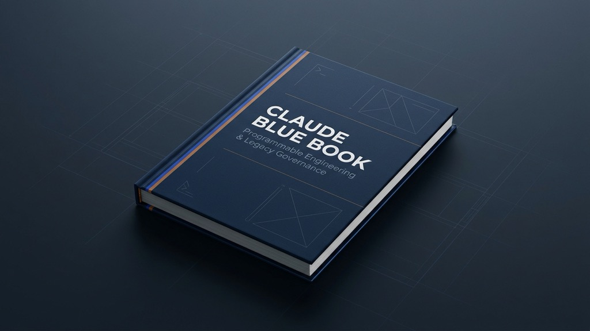

# Claude Practical Blue Book: Programmable Primitives, Canvases & Legacy Governance

> **Edition**: v1.0.0 Live · Verified **November 26, 2026**  
> **Focus**: Master **Claude 5.5 (Opus / Sonnet / Haiku 5.5) + Fable 5.2** and **Claude Code v2.1.323+** primitives across **Whiteboards → `/design` artboards → 1M-context legacy refactoring → `/ship` PR automation**.

- [Start Reading Ch.01](/en/claude/ch01_programmable_platform)
- [Download English PDF](/downloads/claude_blue_book_en.pdf) · [中文版 PDF](/downloads/claude_blue_book_zh.pdf)
- [Companion Runnable Hooks & Subagents Kit](https://github.com/aipmer/codex-blue-book/tree/main/examples/claude-hooks-kit)
- [Generate `CLAUDE.md` + `Hooks` Config](/en/generator) · [Compare All 4 Agents](/en/compare)

---

## All 10 Chapters

### Part 1: Programmable Engineering Primitives
- [Ch.01 From Chat Coding to Programmable Engineering: Claude 5.5](/en/claude/ch01_programmable_platform)
- [Ch.02 Context Economics: Lean `CLAUDE.md`, Skills & MCP](/en/claude/ch02_context_economics)
- [Ch.03 Deterministic Guardrails: `Hooks` & Experimental Code Mode](/en/claude/ch03_hooks_code_mode)

### Part 2: Visual Canvases & Persistent Workspaces
- [Ch.04 From Messy Brainstorms to Architecture: Claude Whiteboards & Docs](/en/claude/ch04_whiteboards_docs)
- [Ch.05 Terminal-to-Canvas: `/design` Artboards & Code Handoff](/en/claude/ch05_design_canvas)

### Part 3: 1M-Context Legacy Governance
- [Ch.06 Legacy Monolith Reverse Engineering & Safe Debt Cleanup](/en/claude/ch06_legacy_governance)
- [Ch.07 Isolated Subagents & Long-Horizon Autonomous Refactoring](/en/claude/ch07_subagents_refactoring)

### Part 4: Automated Shipping & Enterprise Monetization
- [Ch.08 Closing the Last Mile: `/ship`, PR Steward & Team Governance](/en/claude/ch08_ship_pr_steward)
- [Ch.09 Commercial ToB SaaS: Prompt-Cached Auditing & Agent SDK](/en/claude/ch09_enterprise_saas)

### Part 5: Critical Product Review & Frontier Watch
- [Ch.10 2026 Frontier & Honest Critique: Claude Cowork & Async Memory](/en/claude/ch10_frontier_cowork_critique)
