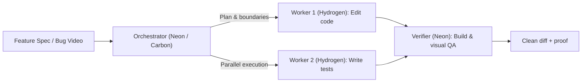

[Back to Gemini Hub](/en/gemini/) | [Next: Multimodal Rules & Custom Skills](/en/gemini/ch02_multimodal_rules_skills)

# Ch.01 Beyond Single-Loop CLIs: Google Antigravity & Gemini 4 Model Matrix

> **Engineering pain solved**: Facing four product names (`Antigravity App`, `Antigravity IDE`, `agy CLI`, and GCP `gemini` CLI) plus four elemental Gemini 4 model tiers leads teams to install the wrong runtime, burn through Pro quotas in 30 minutes, or miss the December 1, 2026 Argon rate step-up.
>
> **What you ship**: A clear boundary between Antigravity and enterprise GCP tooling, a verified November 26, 2026 Gemini 4 pricing ledger, runnable Orchestrator settings, and a 5-minute migration path from Cursor, Claude Code, or Codex rules.
>
> **Bottom line**: Single-loop CLIs serialize every edit through one context window; Antigravity unifies multi-model routing, Git worktree swarms, and browser visual audits under one control plane.

Most developers hit a naming wall the first day they evaluate Google's late-2026 developer stack. Desktop has Antigravity 2.x, the terminal has `agy`, and Google Cloud documentation talks about Gemini Code Assist and `gemini` CLI. Picking the wrong entry point cuts you off from `/swarm`, browser visual verification, and one-click AI Studio exports.

Treat them as two distinct products built for different organizational boundaries.

---

## 1.1 Choosing the Right Surface: Antigravity (`agy`) vs. GCP `gemini` CLI

GCP's `gemini` CLI and Code Assist target strict cloud-compliance environments centered on IAM auditing, VPC Service Controls, and centralized Vertex billing. **Google Antigravity (Desktop App + IDE + `agy` CLI)** is built for high-output product teams and solo builders shipping multimodal software.

| Dimension | Google Antigravity 2.x + `agy` CLI | GCP `gemini` CLI / Gemini Code Assist |
| :--- | :--- | :--- |
| **Primary Audience** | Indie builders, product engineering teams, multimodal apps | Strict GCP IAM-governed enterprises |
| **Multi-Model Routing** | Native **Orchestrator** (Neon/Carbon plans + Hydrogen executes) | Fixed endpoint bindings |
| **Concurrency** | Native **`/swarm`** (Coordinator + Git Worktrees + Adversarial Verifier) | Single-session or external CI scripting |
| **Multimodal & Preview** | Built-in browser subagent, native image gen, AI Studio export | Code completion and Cloud Shell workflows |
| **Auth & Identity** | Google AI Pro / Ultra subscription, or `AGY_ADC_AUTH` for enterprise gateways | GCP project IAM + Vertex AI billing | If your company mandates traffic through an internal Vertex AI gateway, you still do not have to abandon Antigravity: set `AGY_ADC_AUTH=1` to authenticate via Application Default Credentials while keeping local plugins and `/swarm`.

---

## 1.2 Gemini 4 Pricing & Tier Ledger (Verified November 26, 2026)

Gemini 4 replaces ambiguous `Pro / Flash / Ultra` naming with four elemental tiers, all sharing a **1M-token context window**:

| Model ID | Engineering Role | Standard Input (/1M) | Cached Read (/1M) | Output (/1M) | Key Operational Note |
| :--- | :--- | ---: | ---: | ---: | :--- |
| `gemini-4-hydrogen` | High-speed execution, swarm workers, batch ops | \$1.50 | Discounted | \$7.50 | Flat 1M pricing; default workhorse for edits and test fixes |
| `gemini-4-neon` | Coding sweet spot, default Orchestrator coordinator | \$3.00 | \$0.15 | \$15.00 | Configurable `Low / Medium / High / XHigh` thinking tiers |
| `gemini-4-argon` | Enterprise engineering and deep knowledge work | \$2.00 → **\$4.00** | \$0.10 → **\$0.20** | \$10.00 → **\$20.00** | **Deadline alert**: \$2/\$10 intro rate ends **2026-11-30**; doubles **2026-12-01** |
| `gemini-4-carbon` | Flagship long-horizon reasoning & hard debugging | \$2.00 (intro tier) | Discounted | \$10.00 (intro tier) | Consumes Pro/Ultra quota fastest; reserve for tough architecture or root-cause bugs | > **Cost guardrail**: Audit any production script pinning `gemini-4-argon` before **December 1, 2026**. Route routine PR checks and bulk edits to `gemini-4-hydrogen` (\$1.50/\$7.50) or `gemini-4-neon`, keeping Argon and Carbon for high-leverage reasoning.

Test the exact cost delta with the zero-dependency companion script [check_gemini_quota.mjs](https://github.com/aipmer/codex-blue-book/blob/main/examples/gemini-antigravity-kit/scripts/check_gemini_quota.mjs):

```bash
# Compare the same Argon workload before and after the December 1, 2026 rate change
node examples/gemini-antigravity-kit/scripts/check_gemini_quota.mjs \
  --model gemini-4-argon --date 2026-11-28 \
  --input-tokens 900000 --cached-tokens 300000 --output-tokens 150000 --budget 5

node examples/gemini-antigravity-kit/scripts/check_gemini_quota.mjs \
  --model gemini-4-argon --date 2026-12-05 \
  --input-tokens 900000 --cached-tokens 300000 --output-tokens 150000 --budget 5
```

The second command prints `BLOCKED_OVER_BUDGET` and exits with code `2`, making it drop-in ready as a CI or batch preflight gate.

---

## 1.3 Orchestrator Routing & Everyday `agy` CLI Commands

Teams complain about latency when they point a flagship reasoning model at one-line CSS tweaks. Antigravity's **Orchestrator** fixes that mismatch by pairing `gemini-4-neon` (or `carbon`) for planning and verification with `gemini-4-hydrogen` for routine file writes and test iterations—cutting end-to-end wall time by roughly 19% while stretching Google AI Pro (\$19.99/mo) quotas.



Six `agy` commands cover almost all daily terminal work:

```bash
# 1. Start the interactive Antigravity CLI TUI
agy

# 2. Headless single-shot print mode for scripts and CI
agy -p "Audit src/api/ routes for missing Zod validation and output a Markdown checklist"

# 3. Resume a prior conversation by ID without re-explaining context
agy -r 20f45382-2685-415c-a5a1-9b844d5893c7

# 4. Inspect cached release notes inside the TUI
# Inside agy, run: /changelog

# 5. List available Gemini 4 models for your current account
agy models

# 6. Authenticate against an enterprise GCP gateway via ADC
AGY_ADC_AUTH=1 agy -p "Audit terraform/iam.tf for overly broad wildcard roles"
```

Store persistent CLI defaults in `~/.gemini/antigravity-cli/settings.json`:

```json
{
  "defaultModel": "gemini-4-neon",
  "thinkingEffort": "medium",
  "orchestrator": {
    "enabled": true,
    "workerModel": "gemini-4-hydrogen"
  },
  "sandbox": {
    "autoApproveVersionControlled": true
  }
}
```

---

## 1.4 5-Minute Migration from Cursor, Claude Code, or Codex

Do not hand-port `.cursor/rules`, `.claude/commands`, or MCP server JSON by copy-pasting. Antigravity ships a built-in `migrate-agent-settings` flow that packages existing rules, skills, subagents, and MCP servers into one self-contained plugin without touching your original dotfiles:

```bash
agy -p "Run migrate-agent-settings on this repository to bundle .claude/, .cursor/, and AGENTS.md into a local Antigravity plugin without deleting source files"
```

Teammates staying on Codex or Claude Code continue reading their existing configs untouched.

---

## 3-Step Quickstart

1. **Verify CLI & models**: Run `agy --version && agy models` and confirm `gemini-4-hydrogen` and `gemini-4-neon` appear.
2. **Enable Orchestrator**: Write the `settings.json` snippet above to `~/.gemini/antigravity-cli/settings.json` so routine work offloads to Hydrogen.
3. **Run one headless audit**: Inside any Git repo, run `agy -p "Summarize build commands, test entrypoints, and top 3 technical risks"` and watch the split `Thinking...` and `Running command...` timers.

---

## Pitfall Recovery Table

| Failure Mode | Root Cause | Immediate Fix |
| :--- | :--- | :--- |
| Pro quota drains in 30 minutes | Default pinned to `gemini-4-carbon` with `XHigh` effort on trivial edits | Switch default to `gemini-4-neon` (`medium`) with Orchestrator offloading execution to `gemini-4-hydrogen` |
| API bill doubles in December | Production scripts hardcode `gemini-4-argon` past the Nov 30 intro rate | Run `check_gemini_quota.mjs --date 2026-12-01`, move routine jobs to `gemini-4-hydrogen`, and enable Context Caching |
| Migrated rules contradict each other | Duplicate legacy prompts coexist with newly generated `.agents/rules/` | Run `/plugin` to inspect loaded bundles and keep one source of truth (`AGENTS.md` + scoped `.agents/rules/`) | ---

[Back to Gemini Hub](/en/gemini/) | [Next: Multimodal Rules & Custom Skills](/en/gemini/ch02_multimodal_rules_skills)
