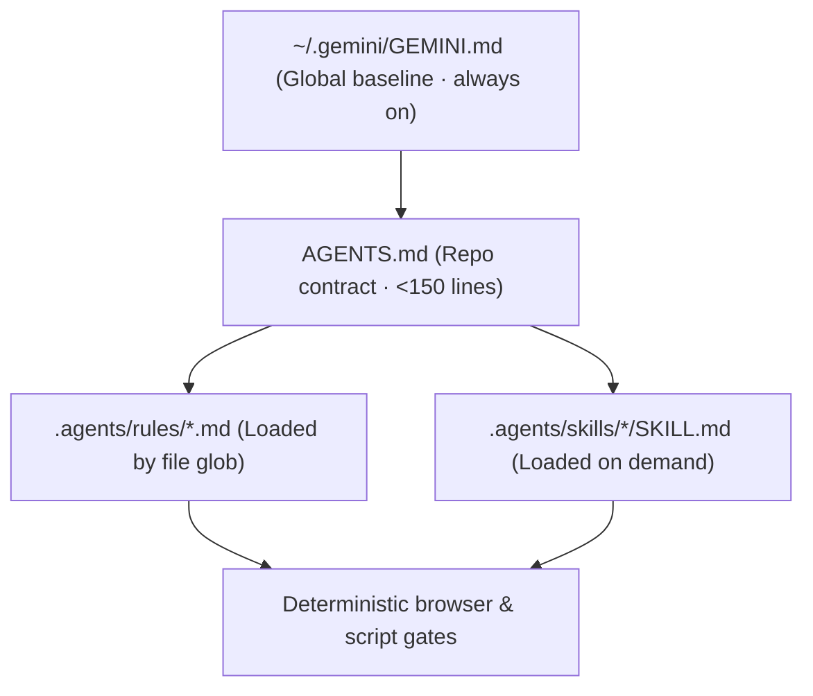

[Back to Gemini Hub](/en/gemini/) | [Prev: Antigravity & Gemini 4](/en/gemini/ch01_antigravity_gemini4) | [Next: AI Studio Handoff](/en/gemini/ch03_ai_studio_handoff)

# Ch.02 Multimodal Rules: `AGENTS.md`, `.agents/rules` & Custom Skills

> **Engineering pain solved**: Dumping CSS conventions, image pipelines, and deployment steps into one giant global prompt wastes thousands of input tokens every turn—while agents still declare "responsive layout complete" on pages that overflow mobile screens and render 9px micro-labels.
>
> **What you ship**: A clean four-tier Antigravity rule hierarchy, a runnable path-scoped multimodal rule + `visual-audit` skill, and strict isolation boundaries for read-only subagent attachment reviews.
>
> **Bottom line**: Good guardrails stay lean through lazy loading and enforce quality with computed browser metrics and exit codes, not adjectives.

Backend regressions usually fail loudly in compilation or unit tests. Multimodal frontend regressions fail silently: `npm run build` passes with zero warnings even when an image 404s, a table stretches a 390px phone viewport by 240px, or an unoptimized 8MB PNG stalls first paint.

Antigravity solves this by layering constraints so every rule loads only where it applies.

---

## 2.1 Four-Tier Customization Hierarchy

1. **Global baseline (`~/.gemini/GEMINI.md`)**: Repository-agnostic habits (language, never printing secrets, checking `git status` first). Keep it under 100 lines.
2. **Workspace contract (`AGENTS.md`)**: Shared build commands, directory ownership, and hard boundaries. Read natively by Antigravity, Codex, and Kimi Code (and imported by Claude Code via `@AGENTS.md`).
3. **Path-scoped rules (`.agents/rules/*.md`)**: Activated automatically only when the agent edits files matching YAML `globs`. Frontend typography constraints cost zero tokens during backend SQL work.
4. **On-demand skills (`.agents/skills/<name>/SKILL.md`)**: Only a two-line name and description sit in context until a task triggers the full procedure and companion scripts.



Inspect [examples/gemini-antigravity-kit/.agents/rules/ui-multimodal.md](https://github.com/aipmer/codex-blue-book/blob/main/examples/gemini-antigravity-kit/.agents/rules/ui-multimodal.md) for a production-ready frontend rule:

```markdown
---
description: Enforce responsive typography, zero overflow, and media hygiene on frontend components
globs:
  - "src/components/**"
  - "src/app/**"
  - "public/**"
---

# UI & Multimodal Asset Rules

1. **No microscopic labels**: Computed `font-size` for visible body, badge, table, and code text must stay `>= 12px`.
2. **Zero horizontal overflow**: Tables and code blocks inside narrow containers must use `overflow-x: auto` on a wrapper rather than stretching `documentElement.scrollWidth`.
3. **Structured multimodal outputs**: Any Gemini 4 vision/video extraction endpoint must declare an explicit `responseSchema` (JSON Schema) and validate output before persisting.
4. **Asset separation**: Store unoptimized source PNGs/MP4s in `assets-src/`; commit only compressed WebP/JPEG/MP4 runtime files under `public/`.
5. **Proof of visual pass**: After layout edits, capture computed overflow and min-font telemetry at `390x844`, `768x1024`, and `1440x900`.
```

---

## 2.2 Turning Visual Audits & Media Pipelines into Reusable Skills

Rules tell the agent *what* must hold; a `SKILL.md` tells it *how* to prove it. Pair your path rule with `.agents/skills/visual-audit/SKILL.md` so any layout edit triggers a deterministic three-viewport check (`390x844`, `768x1024`, `1440x900`) verifying zero overflow, `fontSize >= 12px`, and `img.complete && img.naturalWidth > 0`.

For generated covers, diagrams, and OG banners, keep raw sources and runtime media strictly separated:
- Save raw raster output under `assets-src/` (or an artifact directory) and visually inspect spelling and framing;
- Resize and compress deterministically before copying into `public/`:

```bash
# Crop and compress a raw generated banner into an exact 1200x630 social OG JPEG on macOS
sips -c 630 1200 -s format jpeg -s formatOptions 88 \
  assets-src/hero-raw.png --out public/social/og-cover.jpg
```

---

## 2.3 Isolating Read-Only Multimodal Reviews in Lightweight Subagents

Reviewing 20-page PDFs, a dozen competitor screenshots, or raw log bundles inside your main coding session pollutes attention and spikes token cost. Split the work:
- Delegate read-only synthesis, screenshot comparison, and spec extraction to a lightweight read-only subagent (`research` or `daily-flash`) that returns a compact structured summary;
- Never grant shell execution, file writes, or credential access to read-only review helpers, and never pass `.env` files or production cookies in prompt arguments.

---

## 3-Step Quickstart

1. **Export starter rules**: Open the [Multi-Agent Rules Generator](/en/generator), switch to the **Gemini Antigravity** tab, pick your stack, and save `AGENTS.md` + `.agents/rules/`.
2. **Install the visual audit skill**: Copy [examples/gemini-antigravity-kit/.agents](https://github.com/aipmer/codex-blue-book/blob/main/examples/gemini-antigravity-kit/.agents/skills/visual-audit/SKILL.md) into your repo root.
3. **Confirm rule activation**: Run `agy -p "List loaded project rules and state the minimum font size enforced on src/components"` and verify it cites `>= 12px` and the three-viewport check.

---

## Pitfall Recovery Table

| Failure Mode | Root Cause | Immediate Fix |
| :--- | :--- | :--- |
| `.agents/rules/ui-multimodal.md` never triggers | Invalid YAML frontmatter or mismatched `globs` (e.g., `src/app/**` vs `app/**`) | Validate YAML syntax and align `globs` to actual repo paths |
| Code blocks measure `11.375px` despite `13px` container | Nested theme rule applies `code { font-size: 0.875em; }` twice | Set explicit pixel size (`font-size: 13px;`) on the target code selector and re-measure in browser |
| `public/` balloons past 30MB | Uncompressed 4K generated PNGs committed directly to `public/images/` | Move raw art to `assets-src/` and commit only resized WebP/JPEG runtime assets | ---

[Back to Gemini Hub](/en/gemini/) | [Prev: Antigravity & Gemini 4](/en/gemini/ch01_antigravity_gemini4) | [Next: AI Studio Handoff](/en/gemini/ch03_ai_studio_handoff)
