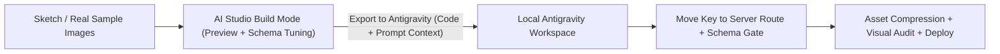

[Back to Gemini Hub](/en/gemini/) | [Prev: Multimodal Rules & Skills](/en/gemini/ch02_multimodal_rules_skills) | [Next: Video & Gemini Live API](/en/gemini/ch04_video_live_api)

# Ch.03 Idea to Production Repo: AI Studio Build Mode Context-Preserving Handoff

> **Engineering pain solved**: Browser playgrounds produce slick demos that turn into amnesiac ZIP archives the moment you export them—your local IDE loses all prompt tuning rationale, and client components leak `GEMINI_API_KEY` straight into browser bundles.
>
> **What you ship**: A clean **AI Studio Build Mode → Export to Antigravity** relay workflow, a production Next.js server-side `@google/genai` route with strict JSON Schema output, and an inline media asset workflow.
>
> **Bottom line**: Use AI Studio to prove multimodal feasibility at zero setup cost; use Antigravity to turn that prototype into a hardened, billable repository.

The biggest time sink in multimodal engineering used to be the handoff gap between browser prototyping and production code. Google closed that gap by connecting **AI Studio Build Mode** directly to **Antigravity**.

---

## 3.1 Validating Feasibility in 20 Minutes with AI Studio Build Mode

Before provisioning databases or auth, use Build Mode to de-risk three unknowns:
1. **Sketch-to-UI interaction**: Drop a whiteboard photo or screenshot into Build Mode with `gemini-4-neon` (`medium`) to generate a clickable prototype.
2. **Edge-case stress testing**: Feed five ugly real-world inputs (dim lighting, skewed text, cropped mobile screenshots) and verify **Structured Outputs (`responseSchema`)** accuracy before writing backend plumbing.
3. **Unit-economics preview**: Check real token counts per image/frame in the sidebar to verify your SaaS margin holds before committing engineering time.



---

## 3.2 Export to Antigravity & Immediate Security Hardening

Clicking **Export to Antigravity** transfers your file tree, package dependencies, `responseSchema`, and conversation rationale directly into a local workspace.

**Your first mandatory local action: strip every client-side API key.** Move all `@google/genai` calls behind a server-side route (`src/app/api/analyze-ui/route.ts`) using a server-only `GEMINI_API_KEY` (never `NEXT_PUBLIC_` or `VITE_`):

```typescript
import { GoogleGenAI, Type } from "@google/genai";
import { NextResponse } from "next/server";

const ai = new GoogleGenAI({ apiKey: process.env.GEMINI_API_KEY });

const auditSchema = {
  type: Type.OBJECT,
  properties: {
    overallScore: { type: Type.NUMBER },
    issues: {
      type: Type.ARRAY,
      items: {
        type: Type.OBJECT,
        properties: {
          severity: { type: Type.STRING, enum: ["high", "medium", "low"] },
          region: { type: Type.STRING },
          diagnosis: { type: Type.STRING },
          cssFix: { type: Type.STRING }
        },
        required: ["severity", "region", "diagnosis", "cssFix"]
      }
    }
  },
  required: ["overallScore", "issues"]
};

export async function POST(req: Request) {
  if (!process.env.GEMINI_API_KEY) {
    return NextResponse.json({ error: "Server GEMINI_API_KEY not configured" }, { status: 500 });
  }

  const { imageBase64, mimeType = "image/png" } = await req.json();
  if (!imageBase64 || typeof imageBase64 !== "string") {
    return NextResponse.json({ error: "Missing imageBase64 payload" }, { status: 400 });
  }

  const response = await ai.models.generateContent({
    model: "gemini-4-hydrogen",
    contents: [{
        role: "user",
        parts: [{ inlineData: { mimeType, data: imageBase64 } },
          {
            text: "Inspect this mobile UI screenshot for text clipping, low contrast, tiny labels (<12px), and overflow. Return concrete CSS fixes."
          }]
      }],
    config: {
      responseMimeType: "application/json",
      responseSchema: auditSchema,
      temperature: 0.2
    }
  });

  return NextResponse.json(JSON.parse(response.text || "{}"));
}
```

Use `gemini-4-hydrogen` (\$1.50/\$7.50) for high-volume first-pass audits and escalate to `gemini-4-neon` only for complex multi-screen critiques.

---

## 3.3 Inline Native Image Generation for Production Polish

Avoid shipping gray placeholder boxes while waiting days for design assets. Inside Antigravity, treat brand covers, empty-state illustrations, and OG social cards as versioned pipeline artifacts:
1. Lock palette, aspect ratio (`16:9` or `1200×630`), and safe crop margins in the brief;
2. Inspect every generated image visually for typography spelling and edge clipping;
3. Compress and lock exact `aspect-ratio` dimensions in CSS to keep Cumulative Layout Shift (CLS) at zero.

---

## 3-Step Quickstart

1. **Validate schema in AI Studio**: Upload one real mobile screenshot to Build Mode, run `auditSchema` with `gemini-4-neon`, and inspect the returned JSON.
2. **Export locally**: Click **Export to Antigravity**, add `GEMINI_API_KEY` to `.env.local` (verified git-ignored), and move model calls to `/api/analyze-ui`.
3. **Verify zero key exposure**: POST a test screenshot to `http://127.0.0.1:3000/api/analyze-ui` and verify in browser DevTools that no key appears in any client JS bundle or request header.

---

## Pitfall Recovery Table

| Failure Mode | Root Cause | Immediate Fix |
| :--- | :--- | :--- |
| API key appears in compiled frontend JS | Prototype `VITE_GEMINI_API_KEY` left in `.env` and client bundle | Rotate the leaked key immediately and route requests through a server-only API handler |
| Base64 image POST fails with `413 Payload Too Large` | Uncompressed 8MB PNG exceeds 4.5MB serverless body limits | Downscale client-side via `<canvas>` (`<= 1600px`, JPEG 0.82) or upload to GCS/R2 first |
| Local output quality degrades vs. AI Studio | Export dropped `systemInstruction` or defaulted `temperature` to `1.0` | Pin `systemInstruction`, `temperature: 0.2`, and `responseSchema` explicitly in server code | ---

[Back to Gemini Hub](/en/gemini/) | [Prev: Multimodal Rules & Skills](/en/gemini/ch02_multimodal_rules_skills) | [Next: Video & Gemini Live API](/en/gemini/ch04_video_live_api)
