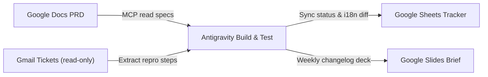

[Back to Gemini Hub](/en/gemini/) | [Prev: Video & Gemini Live API](/en/gemini/ch04_video_live_api) | [Next: Colab %%agy Pipelines](/en/gemini/ch06_colab_agy_pipelines)

# Ch.05 Workspace MCP Automation: Docs, Sheets, Slides & Commercial Add-ons

> 🎯 **Engineering pain solved**: PRDs sit in Google Docs, localization tables live in Sheets, bug reports pile up in Gmail, and weekly updates live in Slides—burning two hours a day on manual copy-paste and stale specs.
>
> 💡 **What you ship**: Least-privilege **Google Workspace MCP** integration inside Antigravity, three high-leverage bidirectional workflows (Docs→code, Sheets↔i18n JSON, Git→Slides), and a Cloud Run-backed Workspace Add-on skeleton.
>
> ⚡ **Bottom line**: Half of your product truth lives outside Git; connecting Workspace MCP gives your coding agent the business context without copy-paste drift.

---

## 5.1 Connecting Google Workspace MCP with Least-Privilege Scopes

Install the official Google Docs / Sheets / Slides / Gmail plugins from the Antigravity Marketplace (which isolate OAuth tokens inside your OS keychain), or mount a scoped Workspace MCP server:

```json
{
  "mcpServers": {
    "google-workspace": {
      "command": "npx",
      "args": ["-y", "@google/workspace-mcp-server"],
      "env": {
        "WORKSPACE_ALLOWED_SCOPES": "docs.readonly,sheets.readwrite,slides.readwrite,gmail.readonly"
      }
    }
  }
}
```

> **Security guardrail**: Keep Gmail at `gmail.readonly` or draft-only (`gmail.compose`) by default. Let the agent prepare replies as drafts so a human reviews every outbound customer email before clicking send.

---

## 5.2 Three High-Leverage Bidirectional Workflows



1. **Docs PRD → Typed Implementation + Ambiguity List**:
```bash
agy -p "Read Google Doc https://docs.google.com/document/d/EXAMPLE_DOC_ID/edit via Workspace MCP. Extract Section 3 billing states into src/billing/state-machine.ts with Vitest tests, and list 3 ambiguities in the PRD."
```

2. **Sheets ↔ Repo Localization Diff (`scripts/sync_i18n_diff.mjs`)**:
```typescript
import fs from "node:fs";

export function computeMissingKeys(sourcePath, targetPath) {
  const source = JSON.parse(fs.readFileSync(sourcePath, "utf8"));
  const target = JSON.parse(fs.readFileSync(targetPath, "utf8"));
  return Object.entries(source)
    .filter(([key]) => !(key in target) || String(target[key]).trim() === "")
    .map(([key, zhValue]) => ({ key, zhValue, status: "NEEDS_TRANSLATION" }));
}

if (process.argv[1]?.endsWith("sync_i18n_diff.mjs")) {
  const [src, dst] = process.argv.slice(2);
  if (!src || !dst) {
    console.error("Usage: node scripts/sync_i18n_diff.mjs <source.json> <target.json>");
    process.exit(1);
  }
  console.log(JSON.stringify(computeMissingKeys(src, dst), null, 2));
}
```

3. **Weekly Git Log → Slides Deck**: Pipe `git log --since="7 days ago"` and key benchmark deltas straight into a preset Slides template via MCP.

---

## 5.3 Packaging Internal Automation into Paid Workspace Add-ons

Once a Docs or Sheets workflow saves your team real hours, turn it into a commercial **Google Workspace Add-on** backed by your own Cloud Run Gemini 4 API (keeping prompts, keys, and Stripe billing off the Apps Script client):

```javascript
// Code.gs — Thin Sheets UI delegating audit logic to your Cloud Run Gemini 4 backend
function onOpen() {
  SpreadsheetApp.getUi()
    .createMenu("Gemini Audit")
    .addItem("Audit Selected Range", "auditSelectedRange")
    .addToUi();
}

function auditSelectedRange() {
  const sheet = SpreadsheetApp.getActiveSheet();
  const values = sheet.getActiveRange().getValues();
  const token = ScriptApp.getIdentityToken();

  const res = UrlFetchApp.fetch("https://api.yourdomain.com/v1/sheets-audit", {
    method: "post",
    contentType: "application/json",
    headers: { Authorization: "Bearer " + token },
    payload: JSON.stringify({ rows: values }),
    muteHttpExceptions: true
  });

  if (res.getResponseCode() !== 200) {
    SpreadsheetApp.getUi().alert("Service error: " + res.getContentText());
    return;
  }
  const data = JSON.parse(res.getContentText());
  SpreadsheetApp.getUi().alert("Flagged " + data.flaggedCount + " rows for review.");
}
```

---

## 🚀 3-Step Quickstart

1. **Grant minimal scopes**: Enable Google Docs and Sheets plugins in Antigravity first without outbound email send permissions.
2. **Test live PRD ingestion**: Point `agy` at one active Google Doc to generate TypeScript interfaces and verify edge cases match the spec.
3. **Verify draft-only safety**: Ask the agent to draft a reply to one test email and confirm it lands in Gmail Drafts without sending.

---

## 🛡️ Pitfall Recovery Table

| Failure Mode | Root Cause | Immediate Fix |
| :--- | :--- | :--- |
| `403 insufficientPermissions` on Sheets write | OAuth authorized with `readonly` scope only | Re-authorize the specific `sheets.readwrite` scope in Plugins Manager |
| Sheet formulas overwritten with raw text | Agent overwrote calculated columns instead of raw data ranges | Restrict write rules to non-formula columns (e.g., `A2:D100`) and inspect with `valueRenderOption=FORMULA` first |
| Marketplace OAuth review rejected | Requested broad `drive` scope without justification | Narrow scope to `drive.file` (user-opened files only) and submit a short OAuth demo video |

---

[Back to Gemini Hub](/en/gemini/) | [Prev: Video & Gemini Live API](/en/gemini/ch04_video_live_api) | [Next: Colab %%agy Pipelines](/en/gemini/ch06_colab_agy_pipelines)
