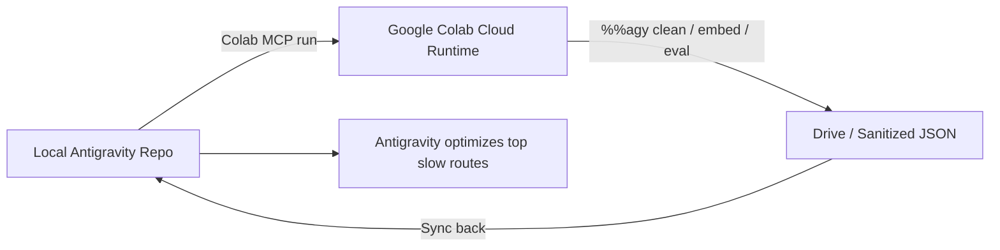

[Back to Gemini Hub](/en/gemini/) | [Prev: Workspace MCP Automation](/en/gemini/ch05_workspace_mcp) | [Next: /swarm & Alpine Peak Case Study](/en/gemini/ch07_swarm_alpine_peak)

# Ch.06 Cloud Compute Offload: Google Colab (`%%agy`) & Notebook Pipelines

> 🎯 **Engineering pain solved**: Running 200K-row telemetry clustering, batch embeddings, or LoRA tuning on a laptop stalls local dev work and wastes hours fighting Python/CUDA dependencies—while ad-hoc cloud notebooks drift completely out of sync with Git.
>
> 💡 **What you ship**: A repeatable **Google Colab (`%%agy` + Colab MCP Server)** compute-offload workflow that executes heavy data jobs on cloud runtimes and feeds sanitized JSON reports back into your local Antigravity repository.
>
> ⚡ **Bottom line**: Keep your local repo focused on clean application code; offload heavy batch data and GPU workloads to ephemeral Colab runtimes with versioned Python scripts.

---

## 6.1 Invoking Antigravity Inside Notebooks with `%%agy`

The `%%agy` cell magic lets you write natural-language pipeline instructions directly inside a Colab cell with live awareness of in-memory DataFrame schemas and shapes:

```python
%%agy --model gemini-4-neon
Load /content/drive/MyDrive/telemetry/nov2026_events.parquet:
1. Drop rows missing session_id or with lcp_ms <= 0, printing before/after counts;
2. Group by route and viewport_bucket to compute p50/p95 LCP and error_rate;
3. Export routes where p95 > 2500ms or error_rate > 2% to /content/drive/MyDrive/telemetry/slow_routes.json.
```

Once validated interactively, commit the deterministic Python module (`notebooks/telemetry_rollup.py`) to Git so CI and teammates can reproduce it identically:

```python
import json
from pathlib import Path
import pandas as pd

def build_slow_routes_report(parquet_path: str, output_json: str) -> list[dict]:
    df = pd.read_parquet(parquet_path)
    cleaned = df.dropna(subset=["session_id"]).query("lcp_ms > 0").copy()

    grouped = (
        cleaned.groupby(["route", "viewport_bucket"], as_index=False)
        .agg(
            p50_ms=("lcp_ms", "median"),
            p95_ms=("lcp_ms", lambda s: float(s.quantile(0.95))),
            error_rate=("is_error", "mean"),
            sample_count=("session_id", "count"),
        )
    )

    flagged = grouped[(grouped["p95_ms"] > 2500) | (grouped["error_rate"] > 0.02)]
    records = [
        {
            "route": row.route,
            "viewport": row.viewport_bucket,
            "p95_ms": round(float(row.p95_ms), 1),
            "error_rate": round(float(row.error_rate), 4),
            "sample_count": int(row.sample_count),
        }
        for row in flagged.itertuples(index=False)
    ]

    Path(output_json).parent.mkdir(parents=True, exist_ok=True)
    Path(output_json).write_text(json.dumps(records, indent=2, ensure_ascii=False), encoding="utf-8")
    return records

if __name__ == "__main__":
    result = build_slow_routes_report("data/events.parquet", "reports/slow_routes.json")
    print(f"Flagged routes: {len(result)}")
```

---

## 6.2 Closing the Loop with Colab MCP Server

Mounting the **Colab MCP Server** lets local Antigravity trigger cloud notebook execution, read logs, and pull aggregated artifacts back into the repo without manual downloads:



---

## 6.3 Low-Maintenance Offline Data Factory for Solo Builders

| Recurring Workload | Recommended Stack | Why It Wins |
| :--- | :--- | :--- |
| **Weekly SEO / search query clustering** | Sheets MCP → Colab `%%agy` → write back to Sheets | Zero local Python env churn |
| **100K-doc vector re-indexing** | Drive corpus → Colab GPU / Batch Embeddings | Survives laptop sleep with resumable Drive checkpoints |
| **Multimodal prompt regression evals** | Eval images/videos → Colab batch `gemini-4-hydrogen` → CSV diff | Quantitative pass/fail scores before every prompt rollout |

---

## 🚀 3-Step Quickstart

1. **Test the deterministic script**: Save `telemetry_rollup.py`, run it on sample Parquet/CSV telemetry, and confirm valid JSON output.
2. **Iterate visually with `%%agy`**: Generate P95 breakdown charts in Colab, then export clean transformation logic back into `notebooks/*.py`.
3. **Close the code loop**: Run `agy -p "Read reports/slow_routes.json and list concrete frontend fixes for the top 3 slowest routes"`.

---

## 🛡️ Pitfall Recovery Table

| Failure Mode | Root Cause | Immediate Fix |
| :--- | :--- | :--- |
| Colab disconnects at 90 minutes and loses progress | Intermediate outputs written to ephemeral `/content/` | Mount `/content/drive` at cell 1 and checkpoint every 500 records to Drive or GCS |
| `.ipynb` commit leaks `GEMINI_API_KEY` | Raw secret pasted into cell code or captured in stdout | Read secrets via `google.colab.userdata.get('GEMINI_API_KEY')` and enable `nbstripout` |
| Cloud notebooks diverge from Git repo | One-off browser edits never synced back to `.py` files | Enforce "explore in notebook, freeze in `scripts/*.py`"; notebooks import versioned modules only |

---

[Back to Gemini Hub](/en/gemini/) | [Prev: Workspace MCP Automation](/en/gemini/ch05_workspace_mcp) | [Next: /swarm & Alpine Peak Case Study](/en/gemini/ch07_swarm_alpine_peak)
