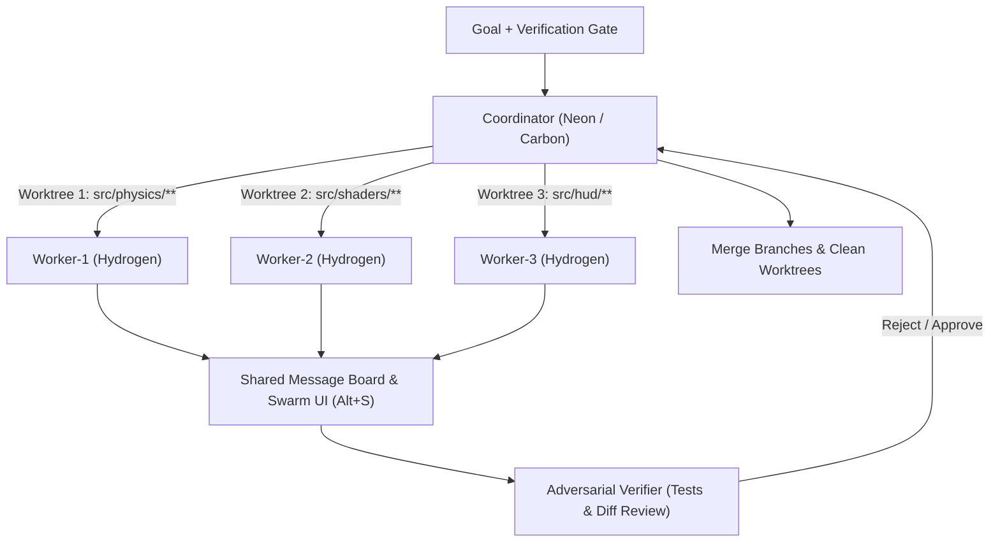

[Back to Gemini Hub](/en/gemini/) | [Prev: Colab Agent Extension Pipelines](/en/gemini/ch06_colab_agy_pipelines) | [Next: Browser QA & Cross-Platform Delivery](/en/gemini/ch08_browser_qa_cross_platform)

# Ch.07 Multi-Agent Collaboration Architecture & Official "Alpine Peak" Full-Stack Case Study

> **Engineering pain solved**: Serializing a four-subsystem feature through one agent is slow and loses context, while opening four terminal tabs by hand produces painful Git merge conflicts.
>
> **What you ship**: A clean mental model and copy-paste kickoff template for Antigravity **`/swarm`** (Coordinator + isolated Git worktrees + Adversarial Verifier + `Alt+S` Swarm Board), plus an end-to-end breakdown of Google's **Alpine Peak** 3D simulation showcase.
>
> **Bottom line**: Parallel agents only speed up shipping when file ownership is physically disjoint and an independent verifier challenges every diff with real test evidence.

---

## 7.1 The Three-Role `/swarm` Model & Git Worktree Isolation

Typing `/swarm` in Antigravity 2.x or `agy` CLI spins up a shared Message Board coordinating three specialized roles:

1. **Coordinator (`gemini-4-neon` or `gemini-4-carbon`)**: Freezes shared interfaces first, assigns non-overlapping directory ownership, merges verified worktrees, and never races workers on the same files.
2. **Parallel Workers (`gemini-4-hydrogen`, `workspace: "share"`)**: Each authoring worker runs inside its own isolated **Git worktree**, keeping branches, build outputs, and dirty edits completely separate.
3. **Adversarial Verifier (`gemini-4-neon`, read-only `inherit`)**: Writes no feature code; actively challenges worker diffs by running builds, boundary tests, and multi-viewport browser audits, rejecting incomplete work back on the board.



Press **`Alt + S`** (or run `/swarm board`) inside `agy` to monitor every member's live state (`working`, zero-cost `waiting`, or `stopped`).

### Production `/swarm` Kickoff Template

```markdown
/swarm Ship Real-Time Canvas v2 with strict file isolation:

- Coordinator (gemini-4-neon): Freeze message types in `src/shared/protocol.ts` first, then spawn 3 Git worktree workers, merge verified branches, and run full checks.
- Worker `backend-sync` (gemini-4-hydrogen, owns `server/sync/**`): Implement WebSocket room broadcast and reconnect unit tests.
- Worker `canvas-render` (gemini-4-hydrogen, owns `src/canvas/**`): Implement 60fps offscreen canvas pan/zoom rendering.
- Worker `ui-toolbar` (gemini-4-hydrogen, owns `src/components/toolbar/**`): Build toolbar + mobile drawer (font >= 12px, 0 overflow at 390/768/1440px).
- Verifier `qa-adversary` (gemini-4-neon, read-only): Never edit source; verify protocol parity, run full test suite and 3-viewport browser checks, and bounce defects back to the owning worker.
```

---

## 7.2 Case Study Dissection: Official "Alpine Peak" 3D Simulation

Google's **Alpine Peak** 3D ski-terrain simulation demonstrates how the full stack clicks together rather than acting as isolated demos:

1. **Phase 1 — AI Studio Rapid Framing**: Generate initial isometric terrain geometry, snow lighting mood, and Three.js scaffold in Build Mode, then **Export to Antigravity** with full prompt rationale intact.
2. **Phase 2 — Antigravity `/swarm` Parallel Optimization**:
   - `terrain-worker` (Hydrogen) builds procedural heightmaps and LOD chunking in an isolated worktree;
   - `shader-worker` (Hydrogen) tunes snow scattering, ski trails, and shadow budgets;
   - `physics-worker` (Carbon/Neon) calibrates slope friction, jump arcs, and collision bounds;
   - `perf-verifier` measures live FPS, draw calls, and memory inside the built-in browser, rejecting any shader diff that drops frame budget.
3. **Phase 3 — Colab + Workspace Sync**: Offload difficulty-curve telemetry fitting to Colab and sync release checklists to Sheets via Workspace MCP.

---

## 7.3 Four Anti-Deadlock Rules for Swarms

1. **Freeze shared contracts before fanning out**: Commit shared interfaces/schemas to the base branch before launching parallel workers.
2. **Single writer per resource**: Never assign two workers to the same file, `package.json`, or dev port; let the Coordinator handle shared manifest edits at merge time.
3. **Leverage zero-cost `waiting` state**: Idle members sleep on the board at zero token cost until `@mention`ed.
4. **Land before `kill`**: Always merge a worker's branch and verify tests on main before terminating the worker and deleting its worktree.

---

## 3-Step Quickstart

1. **Start small (2 workers + 1 verifier)**: Split a feature across `src/api/` and `src/ui/` with one read-only verifier to practice conflict-free merging.
2. **Inspect the live Swarm Board**: Press `Alt + S` (`/swarm board`) to track thinking/tool timings and message handoffs.
3. **Confirm clean teardown**: Run `git worktree list && git status` after merge to verify zero orphaned worktrees remain.

---

## Pitfall Recovery Table

| Failure Mode | Root Cause | Immediate Fix |
| :--- | :--- | :--- |
| Merge conflicts on `package.json` or `src/types.ts` | Shared files edited simultaneously by two workers | Pause workers, let Coordinator land shared types on base branch, then rebase workers |
| Entire swarm sits idle waiting on each other | Missing `@mention` wakeup chain between members | Post on the board targeting `@coordinator` to inspect blockers or release finished branches to the verifier |
| Verifier approves diff that breaks the build | Verifier only skimmed static diff without running commands | Require explicit command output and exit code `0` (`npm run build && npm test`) in the verifier brief | ---

[Back to Gemini Hub](/en/gemini/) | [Prev: Colab Agent Extension Pipelines](/en/gemini/ch06_colab_agy_pipelines) | [Next: Browser QA & Cross-Platform Delivery](/en/gemini/ch08_browser_qa_cross_platform)
