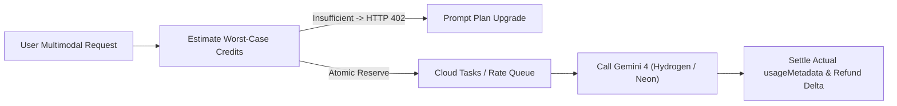

[Back to Gemini Hub](/en/gemini/) | [Prev: Browser QA & Cross-Platform Delivery](/en/gemini/ch08_browser_qa_cross_platform) | [Next: 2026 Frontier & Quota Economics](/en/gemini/ch10_frontier_quota_spatial)

# Ch.09 Commercial Multimodal SaaS: Credit Metering, Guardrails & Distribution

> **Engineering pain solved**: Flat \$19/month "unlimited" multimodal plans get wiped out when one power user uploads 200 HD videos and runs up an \$85 Gemini API bill—while standalone web apps struggle to get noticed after launch day.
>
> **What you ship**: A margin-verified multimodal product matrix, a runnable TypeScript **Reserve → Execute → Settle** credit-metering guard, and a three-channel distribution loop across Chrome Web Store, Workspace Marketplace, and GEO/SEO.
>
> **Bottom line**: Durable multimodal SaaS turns volatile per-second media costs into predictable unit margins and embeds inside high-intent daily surfaces.

---

## 9.1 Three High-Margin Multimodal Product Niches

Require at least a **5x safety cushion** between monthly subscription price and realistic peak API spend:

| Niche | Core Multimodal Lever | Target Buyers | Pricing & Margin Model |
| :--- | :--- | :--- | :--- |
| **Visual UI & Listing Compliance Auditor** | Images + short recordings + JSON Schema | Indie founders, e-commerce ops, frontend teams | \$29–\$79/mo; single image check on `gemini-4-hydrogen` costs < \$0.005 (>85% gross margin) |
| **Real-Time Audio/Video Coaching & QA** | Gemini Live API (16kHz PCM + 1 FPS frames) | Interview prep, sales teams, field technicians | Metered minute packs (e.g., \$19 for 120 live minutes)—never "unlimited live streaming" |
| **Vertical Google Workspace Add-ons** | Docs / Sheets / Slides sidebar + Cloud Run | Legal, finance, HR, cross-border catalog teams | \$15–\$49/seat/mo with high retention inside daily office tools | ---

## 9.2 Reserve → Execute → Settle Credit Metering (`src/billing/credits.ts`)

Never deduct usage *after* calling the model—concurrent requests will race past zero balance before writes commit. Use atomic reservation first, then settle against real `usageMetadata`:



```typescript
export interface MediaEstimateInput {
  model: "gemini-4-hydrogen" | "gemini-4-neon" | "gemini-4-carbon";
  promptChars: number;
  imageCount?: number;
  videoSeconds?: number;
  maxOutputTokens: number;
}

// 1 Credit = $0.001 USD (4x retail safety margin covering infra, payment fees, and gross margin)
const USD_PER_1M: Record<MediaEstimateInput["model"], { in: number; out: number }> = {
  "gemini-4-hydrogen": { in: 1.5, out: 7.5 },
  "gemini-4-neon": { in: 3.0, out: 15.0 },
  "gemini-4-carbon": { in: 2.0, out: 10.0 }
};

export function estimateRequiredCredits(input: MediaEstimateInput): number {
  const textTokens = Math.ceil(input.promptChars / 3.2);
  const imageTokens = (input.imageCount ?? 0) * 258;
  const videoTokens = Math.ceil((input.videoSeconds ?? 0) * 290);
  const totalInput = textTokens + imageTokens + videoTokens;

  const rate = USD_PER_1M[input.model];
  const rawUsd =
    (totalInput / 1_000_000) * rate.in +
    (input.maxOutputTokens / 1_000_000) * rate.out;

  return Math.max(1, Math.ceil((rawUsd * 4) / 0.001));
}

export async function withCreditGuard<T>(
  userId: string,
  requiredCredits: number,
  ledger: {
    reserve: (uid: string, amount: number) => Promise<{ ok: boolean; txId: string }>;
    settle: (txId: string, actualCredits: number) => Promise<void>;
    refund: (txId: string) => Promise<void>;
  },
  work: () => Promise<{ result: T; actualCredits: number }>
): Promise<T> {
  const hold = await ledger.reserve(userId, requiredCredits);
  if (!hold.ok) {
    const err = new Error("INSUFFICIENT_CREDITS");
    (err as Error & { status?: number }).status = 402;
    throw err;
  }
  try {
    const { result, actualCredits } = await work();
    await ledger.settle(hold.txId, Math.min(actualCredits, requiredCredits));
    return result;
  } catch (error) {
    await ledger.refund(hold.txId);
    throw error;
  }
}
```

Pair this with a database constraint `CHECK (balance >= 0)` on `user_wallets` so concurrent bursts cannot force negative balances.

---

## 9.3 Three-Channel Organic Distribution Loop

1. **Chrome Web Store + Google Workspace Marketplace**: Target problem-first store keywords (`Sheets Compliance Auditor`, `Video Bug Repro Summarizer`) where buyer intent is already high.
2. **Free Micro-Tools + GEO/SEO**: Extract one login-free slice of your app (such as a mobile screenshot layout checker or Gemini 4 token calculator) backed by `sitemap.xml`, `robots.txt`, `llms.txt`, and JSON-LD to capture both Google Search and AI answer citations.
3. **Shareable Read-Only Result Cards**: Give every audit report a clean share URL with subtle footer attribution so internal team sharing drives organic signups.

---

## 3-Step Quickstart

1. **Model unit economics first**: Run typical media workloads through `estimateRequiredCredits` or [check_gemini_quota.mjs](https://github.com/aipmer/codex-blue-book/blob/main/examples/gemini-antigravity-kit/scripts/check_gemini_quota.mjs) and verify >75% gross margin.
2. **Ship hard caps on day one**: Gate free tiers to small compressed images with strict daily quotas; expose live remaining credits in the UI.
3. **Publish across search + marketplaces together**: Launch your marketing site (`sitemap.xml` + `llms.txt`) alongside your Chrome or Workspace Marketplace listing.

---

## Pitfall Recovery Table

| Failure Mode | Root Cause | Immediate Fix |
| :--- | :--- | :--- |
| Free endpoint drained overnight by bots | Anonymous access with no rate limit and unrestricted video uploads | Enforce verified OAuth login + edge rate limits; restrict free tier to compressed images |
| Backgrounded browser tab leaves Live session billing indefinitely | Missing server-side silence and hard session timeouts | Close Live sockets automatically after 180s silence and enforce 15-minute metered renewals |
| Retried Stripe webhooks double-credit wallets | Webhook handler lacks idempotency key tracking | Insert `event_id` into `billing_webhook_events(event_id PRIMARY KEY)` inside the same DB transaction | ---

[Back to Gemini Hub](/en/gemini/) | [Prev: Browser QA & Cross-Platform Delivery](/en/gemini/ch08_browser_qa_cross_platform) | [Next: 2026 Frontier & Quota Economics](/en/gemini/ch10_frontier_quota_spatial)
