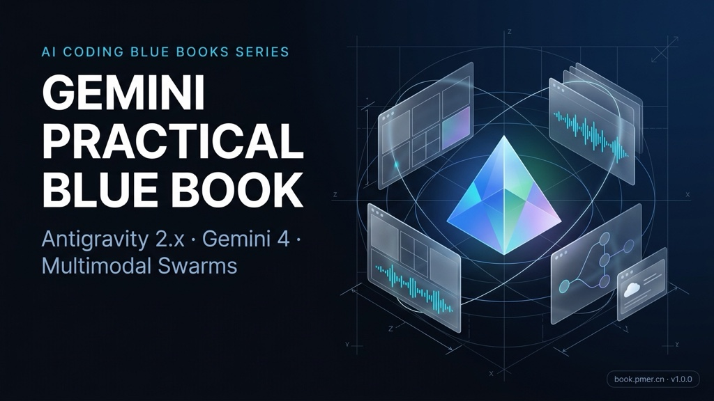

# Gemini Practical Blue Book: Multimodal Orchestration Across the Google Stack

> **Edition**: v1.0.0 Live · Verified **November 26, 2026**  
> **Focus**: Build multimodal, cross-platform products using **Google Antigravity 2.x + `agy` CLI + Gemini 4 (Carbon / Argon / Neon / Hydrogen)** wired end-to-end with **AI Studio Build Mode, Google Workspace MCP, Google Colab (`%%agy`), and `/swarm`**.

- [Start Reading Ch.01](/en/gemini/ch01_antigravity_gemini4)
- [Download English PDF](/downloads/gemini_blue_book_en.pdf) · [中文版 PDF](/downloads/gemini_blue_book_zh.pdf)
- [Companion Antigravity Rules & Quota Kit](https://github.com/aipmer/codex-blue-book/tree/main/examples/gemini-antigravity-kit)
- [Generate Antigravity Rules Now](/en/generator) · [Compare All 4 Agents](/en/compare)

---

## All 10 Chapters

### Part 1: Antigravity Cockpit & Gemini 4 Routing
- [Ch.01 Beyond Single-Loop CLIs: Google Antigravity & Gemini 4 Model Matrix](/en/gemini/ch01_antigravity_gemini4)
- [Ch.02 Multimodal Rules: `AGENTS.md`, `.agents/rules` & Custom Skills](/en/gemini/ch02_multimodal_rules_skills)

### Part 2: AI Studio × Antigravity Multimodal Flows
- [Ch.03 Idea to Production Repo: AI Studio Build Mode Context-Preserving Handoff](/en/gemini/ch03_ai_studio_handoff)
- [Ch.04 Video Understanding & Gemini Live API Real-Time Applications](/en/gemini/ch04_video_live_api)

### Part 3: Google Workspace × Colab Leverage
- [Ch.05 Workspace MCP Automation: Docs, Sheets, Slides & Commercial Add-ons](/en/gemini/ch05_workspace_mcp)
- [Ch.06 Cloud Compute Offload: Google Colab (`%%agy`) & Notebook Pipelines](/en/gemini/ch06_colab_agy_pipelines)

### Part 4: `/swarm` Orchestration & Visual QA
- [Ch.07 `/swarm` Architecture & Official "Alpine Peak" Full-Stack Case Study](/en/gemini/ch07_swarm_alpine_peak)
- [Ch.08 Automated Browser Visual QA, Chrome MV3 & Firebase / Cloud Run Delivery](/en/gemini/ch08_browser_qa_cross_platform)

### Part 5: Monetization & Frontier Watch
- [Ch.09 Commercial Multimodal SaaS: Credit Metering, Guardrails & Distribution](/en/gemini/ch09_multimodal_commercial_saas)
- [Ch.10 2026 Frontier Watch: Quota Economics, Web 3D & Official Release Tracking](/en/gemini/ch10_frontier_quota_spatial)
