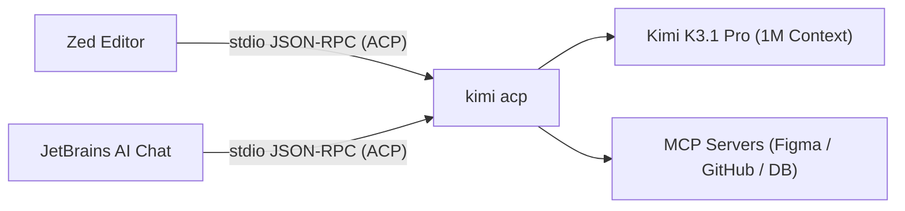

[Back to Kimi Hub](/en/kimi/) | [Prev: K3.1 Pro & CLI](/en/kimi/ch01_k31_architecture_cli) | [Next: Subagents & Multi-Agent Collaboration](/en/kimi/ch03_subagents_swarm)

# Ch.02 Protocol-First Connectivity: `config.toml`, `kimi acp` & Multi-Provider Failover

> **Engineering pain solved**: Teams split across Zed, JetBrains, and terminal CLIs waste days maintaining incompatible editor plugins—and stall completely whenever a single model provider hits a late-night rate limit.
>
> **What you ship**: A clean `~/.kimi-code/config.toml` paired with root `AGENTS.md`, one-line **`kimi acp`** integration for Zed/JetBrains, and instant multi-provider failover using **Codex Switch** or OpenAI-compatible endpoints.
>
> **Bottom line**: Lock project rules in `AGENTS.md`, connect any IDE over open `ACP`, and keep a warm backup provider ready so quotas never block a release.

---

## 2.1 `~/.kimi-code/config.toml` & Shared `AGENTS.md`

Kimi Code separates runtime behavior (`~/.kimi-code/config.toml`) from UI styling (`~/.kimi-code/tui.toml`) and reads root `AGENTS.md` natively—zero duplicate rule files alongside Codex or Antigravity:

```toml
default_model = "kimi-k3.1-pro"
approval_mode = "always_ask"

[providers.moonshot]
base_url = "https://api.moonshot.ai/v1"
api_key_env = "MOONSHOT_API_KEY"
prompt_caching = true

[swarm]
max_concurrency = 4
worktree_isolation = true

[subagents.explore]
model = "kimi-k3.1-pro"
read_only = true

[subagents.plan]
model = "kimi-k3.1-pro"
read_only = true

[subagents.coder]
model = "kimi-k3.1-pro"
max_retries_per_error = 3

[mcp.figma]
command = "npx"
args = ["-y", "figma-developer-mcp"]
env = ["FIGMA_API_KEY"]
```

Keep `approval_mode = "always_ask"` on local workspaces; pass `--auto` only inside isolated containers or disposable Git worktrees.

---

## 2.2 `kimi acp`: Driving Zed & JetBrains Over JSON-RPC

**Agent Client Protocol (ACP)** acts like LSP for coding agents: your editor owns code navigation, inline diffs, and approvals while `kimi acp` runs planning, editing, and shell tools over stdio JSON-RPC.



Register Kimi Code in **Zed** (`settings.json`):

```json
{
  "agent_servers": {
    "Kimi Code": {
      "command": "kimi",
      "args": ["acp"],
      "env": {
        "KIMI_CODE_AGENT_SWARM_MAX_CONCURRENCY": "4"
      }
    }
  }
}
```

In **JetBrains IDEs**, add a Custom ACP Agent pointing to `kimi` with argument `acp`.

---

## 2.3 Zero-Downtime Failover: Codex Switch & Multi-Cloud Endpoints

1. **1-second terminal failover**: Pair with **[Codex Switch](https://github.com/aipmer/codex-switch)** to switch across OpenAI, DeepSeek, and Kimi Code mid-session while preserving conversation continuity.
2. **Multi-host K3.1 Pro endpoints**: Beyond `api.moonshot.ai`, K3.1 Pro is hosted on OpenRouter and DeepInfra—swapping `base_url` and `api_key_env` in `config.toml` changes providers with zero application code changes.

---

## 3-Step Quickstart

1. **Generate configs**: Open the [Multi-Agent Rules Generator](/en/generator), select **Kimi Code**, and export `AGENTS.md` + `config.toml`.
2. **Connect one IDE over ACP**: Wire `kimi acp` into Zed or JetBrains and run a read-only route audit.
3. **Test failover**: Configure a secondary OpenAI-compatible provider key and verify switching takes under 5 seconds.

---

## Pitfall Recovery Table

| Failure Mode | Root Cause | Immediate Fix |
| :--- | :--- | :--- |
| `kimi acp` exits immediately inside Zed/JetBrains | GUI app did not inherit `.zshrc` `PATH` or `MOONSHOT_API_KEY` | Set the absolute path from `which kimi` in editor ACP settings and pass env vars explicitly |
| Figma MCP hangs on startup | `FIGMA_API_KEY` missing or first `npx` fetch blocked by proxy | Pre-warm with `npx -y figma-developer-mcp --help` in terminal, then re-test via `/mcp-config` |
| Cross-provider session resume fails schema validation | Reasoning-field formatting differs slightly across providers | Use [Codex Switch](https://github.com/aipmer/codex-switch) normalization or run `/compact` to carry a clean summary | ---

[Back to Kimi Hub](/en/kimi/) | [Prev: K3.1 Pro & CLI](/en/kimi/ch01_k31_architecture_cli) | [Next: Subagents & Multi-Agent Collaboration](/en/kimi/ch03_subagents_swarm)
