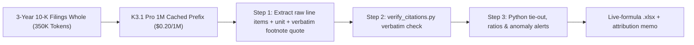

[Back to Kimi Hub](/en/kimi/) | [Prev: MoonViT-V2 & Figma MCP](/en/kimi/ch04_moonvit_video_figma) | [Next: Legal & Biomedical Citations](/en/kimi/ch06_legal_medical_citations)

# Ch.05 Financial Research & Modeling: 1M-Context Audits & Formula Spreadsheets

> **Engineering pain solved**: Chunked RAG splits income-statement tables away from Footnote 14 goodwill impairments, while asking LLMs to do mental arithmetic silently corrupts gross margins and free cash flow.
>
> **What you ship**: A zero-arithmetic-hallucination financial pipeline combining **Kimi K3.1 Pro 1M cached context (\$0.20/1M)** for full-filing extraction with deterministic Python balance-sheet tie-outs and live-formula `.xlsx` models.
>
> **Bottom line**: Let K3.1 Pro read entire filings and surface footnote discrepancies; let deterministic Python execute every single sum, growth rate, and backtest.

---

## 5.1 Whole-Filing Context vs. Fragmented RAG

Three consecutive 10-K filings typically total **250K–600K tokens**—fitting comfortably inside K3.1 Pro's 1M window. Once loaded, every follow-up audit query hits the **\$0.20/1M cached read tier**, eliminating chunk-boundary blindness at a fraction of traditional multi-query RAG costs.



---

## 5.2 Deterministic Financial Tie-Out & Anomaly Scanner (`scripts/financial_audit.py`)

```python
#!/usr/bin/env python3
import json
from dataclasses import dataclass

@dataclass
class PeriodMetrics:
    period: str
    revenue: float
    cogs: float
    operating_cash_flow: float
    capex: float
    total_assets: float
    total_liabilities: float
    total_equity: float
    receivables: float

def analyze_periods(periods: list[PeriodMetrics]) -> dict:
    report, alerts = [], []
    for i, cur in enumerate(periods):
        gross_margin = (cur.revenue - cur.cogs) / cur.revenue if cur.revenue else 0.0
        fcf = cur.operating_cash_flow - cur.capex
        bs_gap = abs(cur.total_assets - (cur.total_liabilities + cur.total_equity))
        dso_ratio = cur.receivables / cur.revenue if cur.revenue else 0.0

        row = {
            "period": cur.period,
            "gross_margin_pct": round(gross_margin * 100, 2),
            "free_cash_flow": round(fcf, 2),
            "balance_sheet_gap": round(bs_gap, 4),
            "receivables_to_revenue_pct": round(dso_ratio * 100, 2),
        }
        if bs_gap > 1.0:
            alerts.append(f"[{cur.period}] Balance sheet does not tie: gap={bs_gap:.2f}")
        if i > 0:
            prev = periods[i - 1]
            rev_g = (cur.revenue - prev.revenue) / prev.revenue if prev.revenue else 0.0
            rec_g = (cur.receivables - prev.receivables) / prev.receivables if prev.receivables else 0.0
            row["revenue_yoy_pct"] = round(rev_g * 100, 2)
            row["receivables_yoy_pct"] = round(rec_g * 100, 2)
            if rec_g - rev_g > 0.15:
                alerts.append(
                    f"[{cur.period}] Receivables growth ({rec_g:.1%}) outpaced revenue growth ({rev_g:.1%}) by >15pp."
                )
        report.append(row)
    return {"metrics": report, "alerts": alerts}

if __name__ == "__main__":
    sample = [PeriodMetrics("FY2024", 1200.0, 540.0, 260.0, 75.0, 2100.0, 950.0, 1150.0, 180.0),
        PeriodMetrics("FY2025", 1380.0, 648.6, 215.0, 90.0, 2420.0, 1140.0, 1280.0, 255.0),]
    print(json.dumps(analyze_periods(sample), indent=2))
```

When Python flags an alert (such as receivables outgrowing revenue by 26.7 percentage points), query the already-cached K3.1 Pro session to pull exact MD&A credit-policy footnotes for pennies.

---

## 5.3 Live-Formula Excel Deliverables

Enforce two rules when generating spreadsheets with `openpyxl`:
1. Keep raw extracted inputs separate from formula cells—every subtotal, YoY growth rate, and DCF output must be a real Excel formula (`=SUM(...)`, `=(C10-B10)/B10`), never a hardcoded float;
2. Recalculate headlessly before delivery to confirm zero `#REF!`, `#DIV/0!`, or `#VALUE!` errors.

---

## 3-Step Quickstart

1. **Run `financial_audit.py`**: Confirm it flags the receivables-vs-revenue divergence automatically.
2. **Extract one real public 10-K**: Load the full text into `kimi-k3.1-pro` with caching enabled, extract raw JSON line items + verbatim quotes, and verify quotes via [verify_citations.py](https://github.com/aipmer/codex-blue-book/blob/main/examples/kimi-k3-kit/scripts/verify_citations.py).
3. **Export live `.xlsx`**: Generate a formula-driven 3-year comparison workbook and verify zero formula errors.

---

## Pitfall Recovery Table

| Failure Mode | Root Cause | Immediate Fix |
| :--- | :--- | :--- |
| YoY numbers off by 1,000× | One filing reports `in thousands`, the next `in millions` | Require explicit `unit_multiplier` and `currency` in extraction JSON and normalize in Python |
| Non-GAAP adjustments mixed into GAAP operating profit | Prompt omitted GAAP vs. Non-GAAP separation | Extract `gaap_operating_income` and `non_gaap_adjustments[]` separately and verify reconciliation sums |
| PDF financial columns scrambled into one line | Plain-text PDF dump stripped table structure | Parse filings with table-preserving Markdown extractors or visually verify key tables with MoonViT-V2 | ---

[Back to Kimi Hub](/en/kimi/) | [Prev: MoonViT-V2 & Figma MCP](/en/kimi/ch04_moonvit_video_figma) | [Next: Legal & Biomedical Citations](/en/kimi/ch06_legal_medical_citations)
