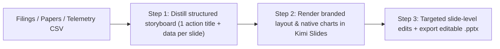

[Back to Kimi Hub](/en/kimi/) | [Prev: Legal & Biomedical Citations](/en/kimi/ch06_legal_medical_citations) | [Next: 3D Make, Blender & FreeCAD](/en/kimi/ch08_3d_make_blender_freecad)

# Ch.07 Executive Delivery with Kimi Slides: Structured Data to Editable `.pptx`

> **Engineering pain solved**: Teams spend days producing rigorous financial or engineering analysis, then lose an entire evening formatting slides—or get burned by AI deck tools that export flattened uneditable images.
>
> **What you ship**: A repeatable **Storyline Brief → Kimi Slides Native `.pptx` → Targeted Refinement** workflow plus a zero-dependency Python brief compiler that turns live metrics into board-ready slide specs.
>
> **Bottom line**: Treat slide decks as a presentation layer compiled from verified JSON—exporting native editable `.pptx` charts and text gives you AI speed without sacrificing final human control.

---

## 7.1 Three-Step Engineered Deck Pipeline



1. **Freeze the storyline first**: Enforce one data-backed Action Title per slide (e.g., *"K3.1 Pro prefix caching cut audit cost 78%"* instead of *"Cost Overview"*).
2. **Rebuild diagrams & charts natively**: Replace blurry PDF screenshots with native PowerPoint charts and clean vector boxes.
3. **Iterate per slide**: Refine individual dense slides via targeted instructions rather than regenerating the entire deck.

---

## 7.2 Automated Deck Brief Compiler (`build_deck_brief.py`)

```python
#!/usr/bin/env python3
import json
from pathlib import Path

def build_deck_brief(metrics: dict, out_md: str) -> None:
    lines = [f"# {metrics['title']}",
        f"- Audience: {metrics['audience']}",
        "- Style: Clean navy executive layout. One data-backed action title and source footnote per slide.",
        "",]
    for idx, slide in enumerate(metrics["slides"], start=1):
        lines.append(f"## Slide {idx}: {slide['action_title']}")
        lines.append(f"- Layout: {slide['layout']}")
        for pt in slide["bullets"]:
            lines.append(f"- Bullet: {pt}")
        if slide.get("table"):
            headers = slide["table"]["headers"]
            lines.append("")
            lines.append("| " + " | ".join(headers) + " |")
            lines.append("| " + " | ".join(["---"] * len(headers)) + " |")
            for row in slide["table"]["rows"]:
                lines.append("| " + " | ".join(map(str, row)) + " |")
        lines.append(f"- Source: {slide['source']}")
        lines.append("")
    Path(out_md).write_text("\n".join(lines), encoding="utf-8")

if __name__ == "__main__":
    sample = {
        "title": "Q4 Engineering Velocity & Multimodal Cost Review",
        "audience": "Executive & Architecture Committee",
        "slides": [{
                "action_title": "K3.1 Pro prefix caching cut long-document audit cost by 78%",
                "layout": "Left summary card + right comparison bar chart",
                "bullets": ["86% steady-state prefix cache hit rate", "P95 review time reduced from 42m to 6m"],
                "table": {
                    "headers": ["Approach", "Cost / Audit (USD)", "Human Review"],
                    "rows": [["Legacy RAG", "1.45", "42 min"], ["K3.1 Pro + Cache", "0.32", "6 min"]],
                },
                "source": "Internal Billing Telemetry (2026-11-26)",
            }],
    }
    build_deck_brief(sample, "deck_brief.md")
    print("Generated deck_brief.md")
```

---

## 7.3 3-Minute Pre-Send `.pptx` QA Checklist

1. Cross-check every chart figure against source JSON/Excel;
2. Verify cross-OS font fallback (Windows PowerPoint & macOS Keynote) causes zero text-box overflow;
3. Strip generic buzzwords and leave concrete numbers;
4. Keep `.pptx` for internal editing and send verified `.pdf` for external distribution.

---

## 3-Step Quickstart

1. **Compile a real brief**: Run `build_deck_brief.py` (or pipe Ch.05 audit JSON) to produce `deck_brief.md`.
2. **Generate & refine in Kimi Slides**: Upload `deck_brief.md`, tighten the densest slide by 40%, and export `.pptx`.
3. **Confirm native editability**: Open in PowerPoint/Keynote/Google Slides and edit one chart data cell directly.

---

## Pitfall Recovery Table

| Failure Mode | Root Cause | Immediate Fix |
| :--- | :--- | :--- |
| Slides look like dense walls of text | Raw 30K-word doc fed directly without per-slide word budgets | Distill into a structured storyboard (`<= 60 words / 3 bullets` per slide) before rendering |
| Titles wrap awkwardly on a client's Windows laptop | Non-standard font triggered wide fallback metrics | Lock master fonts to cross-platform families (Inter / Arial / Noto Sans) or send PDF |
| Chart numbers disagree with headline text | Headline edited without updating underlying chart table | Generate both headline and chart arrays from one canonical JSON file | ---

[Back to Kimi Hub](/en/kimi/) | [Prev: Legal & Biomedical Citations](/en/kimi/ch06_legal_medical_citations) | [Next: 3D Make, Blender & FreeCAD](/en/kimi/ch08_3d_make_blender_freecad)
