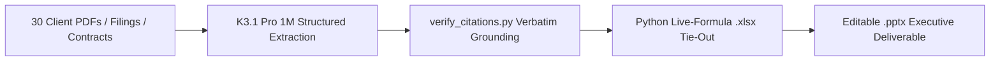

[Back to Kimi Hub](/en/kimi/) | [Prev: 3D Make, Blender & FreeCAD](/en/kimi/ch08_3d_make_blender_freecad) | [Next: Four-Agent Hybrid Finale](/en/kimi/ch10_four_agent_hybrid_frontier)

# Ch.09 Enterprise Self-Hosting with vLLM / SGLang & Vertical Agent SaaS

> **Engineering pain solved**: Regulated enterprise deals die on day one when legal or security blocks public-cloud LLM APIs, while thin chat wrappers struggle to command premium pricing.
>
> **What you ship**: Realistic **vLLM / SGLang** open-weight deployment sizing for K3.1 Pro and K2.5, zero-code-change internal endpoint wiring for Kimi Code CLI, and a high-ticket vertical deliverable architecture.
>
> **Bottom line**: Open weights let one OpenAI-compatible codebase serve both high-margin cloud SaaS and air-gapped enterprise deployments.

---

## 9.1 Sizing Open-Weight Clusters (vLLM / SGLang)

| Organization Tier | Open-Weight Model | Typical Infrastructure | Target Workload |
| :--- | :--- | :--- | :--- |
| **Large bank / enterprise platform** | **Kimi K3.1 Pro** (~2.8T MoE FP8) | Multi-node H200 / B200 + **vLLM / SGLang** (TP + EP + Prefix Caching) | Firm-wide research, 1M compliance audits, internal coding hub |
| **Mid-size law firm / hospital / R&D lab** | **Kimi K2.5** (or fine-tuned domain variant) | Single-node 8×H100 / H20 + **SGLang / vLLM** | Contract review, clinical extraction, private knowledge base |
| **Project-based strict isolation** | Dedicated customer VPC endpoint | On-demand isolated cloud GPU instances | M&A diligence sprints and peak annual audit windows | > **License check**: Always review the current **Open-Weights License** on Hugging Face `moonshotai/` for scale-based attribution terms prior to commercial rollout.

Launch an internal OpenAI-compatible gateway with prefix caching and tool parsing enabled (adjust `--tensor-parallel-size` and parser flags to match your cluster and vLLM version):

```bash
vllm serve /models/moonshotai/Kimi-K3.1-Pro \
  --served-model-name kimi-k3.1-pro \
  --host 127.0.0.1 \
  --port 8000 \
  --tensor-parallel-size 8 \
  --enable-expert-parallel \
  --enable-prefix-caching \
  --enable-auto-tool-choice \
  --tool-call-parser kimi_k2 \
  --max-model-len 262144 \
  --api-key "${INTERNAL_VLLM_KEY}"
```

Point Kimi Code CLI at the private gateway via `~/.kimi-code/config.toml`—zero application rewrites:

```toml
default_model = "kimi-k3.1-pro"

[providers.moonshot]
base_url = "https://llm-gateway.corp.internal/v1"
api_key_env = "INTERNAL_VLLM_KEY"
prompt_caching = true
```

---

## 9.2 Packaging High-Ticket Vertical Workspaces



Charge **per diligence case or per seat (\$299–\$2,000/mo or annual on-prem license)** for verified end-to-end packages—backed by immutable audit logs of source quotes and human sign-offs—rather than selling commodity chat tokens.

---

## 3-Step Quickstart

1. **Decouple provider config**: Read `LLM_BASE_URL`, `LLM_API_KEY`, and `LLM_MODEL` from env so cloud and private gateways swap cleanly.
2. **Benchmark prefix caching**: Run 5 sequential queries on one 200K-token filing and compare TTFT with and without `--enable-prefix-caching`.
3. **Ship one end-to-end demo bundle**: Chain JSON extraction → `verify_citations.py` → `financial_audit.py` → `deck_brief.md` to pitch pilot B2B buyers with tangible deliverables.

---

## Pitfall Recovery Table

| Failure Mode | Root Cause | Immediate Fix |
| :--- | :--- | :--- |
| Immediate GPU OOM when enabling 1M context | KV cache allocation exceeds VRAM under high concurrency | Start with `--max-model-len 262144`, enable FP8 KV cache + `--gpu-memory-utilization 0.90`, and scale with telemetry |
| Air-gapped security scanner flags outbound HTTPS calls | Container tried to fetch tokenizer files from Hugging Face Hub at boot | Pre-stage full weights and tokenizer locally and run with `HF_HUB_OFFLINE=1` |
| Tool calls return raw text instead of structured `tool_calls` | Missing `--enable-auto-tool-choice` or mismatched `--tool-call-parser` | Verify parser compatibility against the K3.1 Pro model card and smoke-test one tool call via `curl` | ---

[Back to Kimi Hub](/en/kimi/) | [Prev: 3D Make, Blender & FreeCAD](/en/kimi/ch08_3d_make_blender_freecad) | [Next: Four-Agent Hybrid Finale](/en/kimi/ch10_four_agent_hybrid_frontier)
