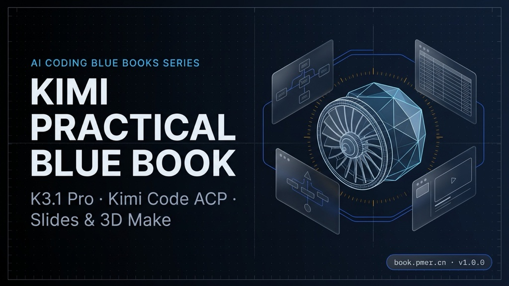

# Kimi Practical Blue Book: K3.1 Swarms, Regulated Verticals & Slides/3D Workflows

> **Edition**: v1.0.0 Live · Verified **November 26, 2026**  
> **Focus**: Harness **Kimi K3.1 Pro** (~2.8T MoE, 1M context, MoonViT-V2, open weights) and **Kimi Code (`kimi` / `kimi web` / `kimi acp` / `/swarm`)** across full-stack coding, **regulated finance/legal/medical verticals, Kimi Slides, and 3D Make spatial coding**.

- [Start Reading Ch.01](/en/kimi/ch01_k31_architecture_cli)
- [Download English PDF](/downloads/kimi_blue_book_en.pdf) · [中文版 PDF](/downloads/kimi_blue_book_zh.pdf)
- [Companion Kimi Config, Citation Verifier & FreeCAD Kit](https://github.com/aipmer/codex-blue-book/tree/main/examples/kimi-k3-kit)
- [Generate Kimi `AGENTS.md` + `config.toml`](/en/generator) · [Compare All 4 Agents](/en/compare)

---

## All 10 Chapters

### Part 1: K3.1 Foundation & Multi-Mode Cockpit
- [Ch.01 The 2.8T Open-Weight Generation: Kimi K3.1 Pro & Kimi Code CLI](/en/kimi/ch01_k31_architecture_cli)
- [Ch.02 Protocol-First Connectivity: `config.toml`, `kimi acp` & Multi-Provider Failover](/en/kimi/ch02_acp_config_failover)

### Part 2: Swarm Engineering & Video Debugging
- [Ch.03 Tiered Subagents (`explore / plan / coder`) & `/swarm` Parallel Refactors](/en/kimi/ch03_subagents_swarm)
- [Ch.04 MoonViT-V2 Visual Engineering: Video-to-Fix & Figma MCP Fidelity](/en/kimi/ch04_moonvit_video_figma)

### Part 3: Regulated Vertical Workflows (Finance · Legal · Medical)
- [Ch.05 Financial Research & Modeling: 1M-Context Audits & Formula Spreadsheets](/en/kimi/ch05_finance_audit_modeling)
- [Ch.06 Legal Compliance & Biomedical Evidence: Zero-Hallucination Citation Gates](/en/kimi/ch06_legal_medical_citations)

### Part 4: Kimi Slides & 3D Make Spatial Coding
- [Ch.07 Executive Delivery with Kimi Slides: Structured Data to Editable `.pptx`](/en/kimi/ch07_kimi_slides_decks)
- [Ch.08 Spatial Coding & 3D Make: Three.js, Headless Blender & Parametric FreeCAD](/en/kimi/ch08_3d_make_blender_freecad)

### Part 5: Open-Weight Self-Hosting & Hybrid Series Finale
- [Ch.09 Enterprise Self-Hosting with vLLM / SGLang & Vertical Agent SaaS](/en/kimi/ch09_vllm_self_hosting_saas)
- [Ch.10 2026 Frontier Finale: Four-Agent Hybrid Strategy & Official Tracking](/en/kimi/ch10_four_agent_hybrid_frontier)
