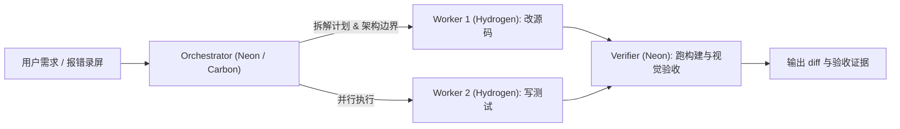

[返回 Gemini 专页](/gemini/) | [下一章：多模态规约与自定义 Skills](/gemini/ch02_multimodal_rules_skills)

# Ch.01 告别单线程 CLI：Google Antigravity 架构与 Gemini 4 模型矩阵

> 🎯 **本章解决的工程麻烦**：面对 `Antigravity App`、`Antigravity IDE`、`agy CLI` 和企业版 `gemini` CLI 四个名字，以及 Gemini 4 的四个化学元素代号，不知道该装哪一套、什么时候用订阅配额、什么时候走 API，结果要么把 Pro 配额半小时烧光，要么 12 月 1 日 Argon 涨价翻倍才发现账单失控。
>
> 💡 **实战落地收益**：明确 Antigravity 与 GCP 企业工具的选型边界，掌握 **Gemini 4（Carbon / Argon / Neon / Hydrogen）** 截至 2026 年 11 月 26 日的真实定价账本、**Orchestrator** 混排配置，以及 5 分钟将现有 Cursor / Claude / Codex 规则无损迁入 Antigravity Plugin。
>
> ⚡ **一句话结论**：单线程 CLI 只能线性串行改代码，Antigravity 把多模型路由、独立 Git Worktree 蜂群和内置浏览器视觉验证收进同一个调度平面。

大多数开发者刚接触 Google 2026 年底的编码工具链时，第一道坎卡在命名上：桌面端有 Antigravity 2.x，终端里有 `agy`，谷歌云文档里还有一套 Gemini Code Assist 和 `gemini` CLI。装错入口，后面所有关于 `/swarm`、内置浏览器巡检和 AI Studio 一键导出的工作流都跑不通。

把它们当成两套面向不同组织边界的产品，事情就清楚了。

---

## 1.1 工具链选型边界：Antigravity (`agy`) vs 企业 GCP `gemini` CLI

打个比方：GCP 的 `gemini` CLI 和 Code Assist 像大型工厂里的合规流水线，核心诉求是 IAM 审计、VPC Service Controls 内网隔离和企业计费结算；而 **Google Antigravity（桌面端 + IDE + `agy` CLI）** 是给高产出工程团队和独立开发者造的多兵种作战指挥舱。

| 维度 | Google Antigravity 2.x + `agy` CLI | GCP `gemini` CLI / Gemini Code Assist |
| :--- | :--- | :--- |
| **适用人群** | 独立开发者、产品型工程团队、多模态全栈研发 | 强合规大企业、纯 GCP IAM 管控内网 |
| **多模型混排** | 原生 **Orchestrator**（Neon/Carbon 规划 + Hydrogen 执行） | 偏固定模型端点绑定 |
| **并发架构** | 原生 **`/swarm`**（Coordinator + Git Worktrees + 对抗性 Verifier） | 单会话或外部 CI 编排 |
| **多模态与预览** | 内置浏览器子代理、原生生图、AI Studio 带上下文一键导出 | 侧重代码补全与 Cloud Shell 集成 |
| **身份与认证** | Google AI Pro / Ultra 个人订阅，或设置 `AGY_ADC_AUTH` 走企业网关 | GCP 项目账号与 Vertex AI IAM 绑定 |

日常写业务、做多模态应用、需要一边改代码一边让代理打开浏览器测响应式排版，直接装 **Antigravity + `agy` CLI**。如果公司要求所有流量必须经由内部 Vertex AI 网关审计，依然可以用 `agy`，只需开启 `AGY_ADC_AUTH` 走 Application Default Credentials，不用放弃 `/swarm` 和本地定制插件。

---

## 1.2 Gemini 4 四大金刚选型账本（2026-11-26 核对）

Gemini 4 放弃了过去 `Pro / Flash / Ultra` 容易混淆的版本号，改用化学元素区分定位，全系标配 **1M 统一上下文窗口**。下面这份价格表直接关系到你的月度账单和配额续航：

| 模型 ID | 工程定位 | 标准输入（/1M） | 缓存读取（/1M） | 输出（/1M） | 关键提醒 |
| :--- | :--- | ---: | ---: | ---: | :--- |
| `gemini-4-hydrogen` | 极速日常执行、蜂群 Worker、批处理 | \$1.50 | 缓存优惠 | \$7.50 | 1M 窗口一口价，最适合跑高频文件修改与单测修复 |
| `gemini-4-neon` | 复杂编码甜点、Orchestrator 默认协调器 | \$3.00 | \$0.15 | \$15.00 | 支持 `Low / Medium / High / XHigh` 四档思考力度 |
| `gemini-4-argon` | 企业级复杂工程与长程知识推理 | \$2.00 → **\$4.00** | \$0.10 → **\$0.20** | \$10.00 → **\$20.00** | **硬节点预警：\$2/\$10 首发价截至 2026-11-30，12 月 1 日起翻倍** |
| `gemini-4-carbon` | 旗舰深度探索、安全审计、硬核长链路排障 | \$2.00（首发档） | 缓存优惠 | \$10.00（首发档） | Pro / Ultra 订阅配额消耗最快，只用在真正卡壳的架构与根因定位 |

> **账单防踩坑**：如果你在生产脚本或 CI 中绑定了 `gemini-4-argon`，请在 **2026 年 12 月 1 日** 之前复核月预算。常规代码修改和 PR 扫描优先切到 `gemini-4-hydrogen`（\$1.50/\$7.50）或 `gemini-4-neon`，把 Argon 和 Carbon 留给高价值架构评审。

你可以直接运行配套仓库中的零依赖脚本 [check_gemini_quota.mjs](https://github.com/aipmer/codex-blue-book/blob/main/examples/gemini-antigravity-kit/scripts/check_gemini_quota.mjs) 测算 12 月前后同一批任务的真实差价：

```bash
# 对比 2026-11-28 与 2026-12-05 运行同一批 Argon 任务的费用差异
node examples/gemini-antigravity-kit/scripts/check_gemini_quota.mjs \
  --model gemini-4-argon --date 2026-11-28 \
  --input-tokens 900000 --cached-tokens 300000 --output-tokens 150000 --budget 5

node examples/gemini-antigravity-kit/scripts/check_gemini_quota.mjs \
  --model gemini-4-argon --date 2026-12-05 \
  --input-tokens 900000 --cached-tokens 300000 --output-tokens 150000 --budget 5
```

第二条命令会直接返回 `BLOCKED_OVER_BUDGET` 并以退出码 `2` 拦截，适合挂在 CI 或批处理脚本入口做硬限流。

---

## 1.3 开启 Orchestrator 智能混排与 `agy` CLI 高频命令

很多团队抱怨“Gemini 4 强是很强，但改个小按钮也要思考十几秒”。根本原因是把旗舰推理模型当成了流水线打字机。

Antigravity 2.x 的 **Orchestrator** 解决的就是这个错配问题：由 `gemini-4-neon` 或 `gemini-4-carbon` 负责读需求、拆步骤、审边界，把具体文件读写、测试补全和样式微调分发给 `gemini-4-hydrogen`。实测复杂任务整体耗时下降约 19%，同时 Google AI Pro（\$19.99/月）订阅配额续航翻倍。



在终端中管理 `agy` CLI，记住下面 6 条核心命令就能覆盖 90% 的日常研发：

```bash
# 1. 启动交互式 Antigravity CLI 指挥舱
agy

# 2. 无头模式单次执行（适合脚本与 CI 流水线）
agy -p "检查 src/api/ 下所有路由是否缺少 zod 入参校验，仅输出 Markdown 报告"

# 3. 按会话 ID 续接上次中断的长任务（不用重新喂上下文）
agy -r 20f45382-2685-415c-a5a1-9b844d5893c7

# 4. 在 TUI 内查看最新本地缓存版本变更（支持直接核对新特性）
# 进入 agy 后输入: /changelog

# 5. 查看所有可用模型与当前账号配额档位
agy models

# 6. 企业 GCP 网关走 ADC 凭据认证
AGY_ADC_AUTH=1 agy -p "审计 terraform/iam.tf 中的过宽权限"
```

CLI 配置文件统一位于 `~/.gemini/antigravity-cli/settings.json`，常用配置如下：

```json
{
  "defaultModel": "gemini-4-neon",
  "thinkingEffort": "medium",
  "orchestrator": {
    "enabled": true,
    "workerModel": "gemini-4-hydrogen"
  },
  "sandbox": {
    "autoApproveVersionControlled": true
  }
}
```

---

## 1.4 5 分钟无缝搬家：从 Cursor / Claude / Codex 迁移配置

如果你已经在旧项目里攒了一堆 `.cursor/rules`、`.claude/commands`、MCP 服务器配置和自定义 Skill，**千万不要手动一条条重写**。

Antigravity 内置了 `migrate-agent-settings` 迁移流，可以把现有工具的规则、斜杠命令、子代理定义和 MCP 打包成单个独立 Plugin，随时一键启用或关闭，不会污染原始配置目录：

```bash
# 在目标仓库根目录启动 agy，直接调用内置迁移指令
agy -p "运行 migrate-agent-settings，扫描当前项目的 .claude/、.cursor/ 与 AGENTS.md，打包为本地 Antigravity plugin，不要删除原文件"
```

迁移完成后，老仓库里原本给 Codex 或 Claude 用的团队规范依然保持原样，团队里用不同工具的同事互不干扰。

---

## 🚀 新手极速上手 3 步走

1. **安装并核验身份**：安装 Antigravity 桌面端与 `agy` CLI 后，在终端执行 `agy --version && agy models`，确认账号已看到 `gemini-4-hydrogen` 与 `gemini-4-neon`。
2. **启用混排配置**：在 `~/.gemini/antigravity-cli/settings.json` 写入上文 `orchestrator` 配置，把日常 worker 下沉给 Hydrogen。
3. **跑通第一次无头诊断**：在任意现有 Git 仓库执行 `agy -p "梳理本仓库启动命令、测试入口与三个最高风险技术债"`，观察终端分离显示的 `Thinking...` 与 `Running command...` 计时器。

---

## 🛡️ 翻车自救与避坑速查表

| 故障现象 | 致命根因 | 即刻自救方案 |
| :--- | :--- | :--- |
| Pro 订阅配额半小时见底，频繁触发冷却 | 全局默认锁死了 `gemini-4-carbon` + `XHigh` 思考档位，连改文案都在烧旗舰额度 | 切换默认模型为 `gemini-4-neon`（`medium`）并开启 Orchestrator 下放给 `gemini-4-hydrogen`；仅在复杂排障时临时点名 Carbon |
| 12 月初 API 账单突然比 11 月翻倍 | 脚本中硬编码了 `gemini-4-argon`，未留意 2026-12-01 从 \$2/\$10 恢复为 \$4/\$20 标准价 | 用 `check_gemini_quota.mjs --date 2026-12-01` 复算所有批处理任务，日常任务改走 `gemini-4-hydrogen` 并开启 Context Caching |
| 迁移 Cursor / Claude 配置后规则互相打架 | 同时保留了旧全局提示词与重复的 `.agents/rules/`，导致模型指令冲突 | 执行 `/plugin` 查看已加载插件清单，只保留一份唯一真相源（根目录 `AGENTS.md` + 路径级 `.agents/rules/`） |

---

[返回 Gemini 专页](/gemini/) | [下一章：多模态规约与自定义 Skills](/gemini/ch02_multimodal_rules_skills)
