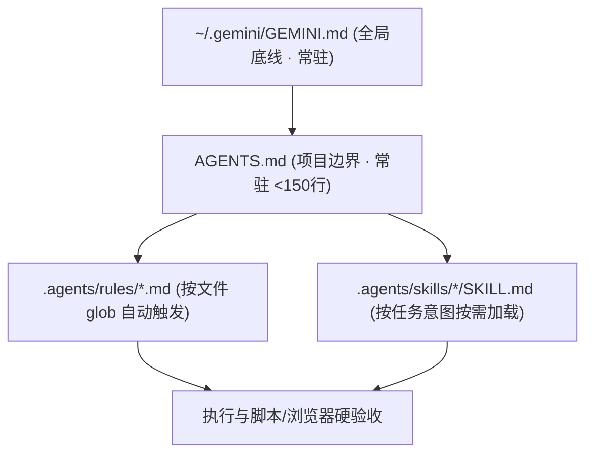

[返回 Gemini 专页](/gemini/) | [上一章：Antigravity 与 Gemini 4 选型](/gemini/ch01_antigravity_gemini4) | [下一章：AI Studio 无损导出 Antigravity](/gemini/ch03_ai_studio_handoff)

# Ch.02 多模态开发规约：AGENTS.md、.agents/rules 与自定义 Skills

> **本章解决的工程麻烦**：把所有前端样式规范、生图流程、部署命令一股脑塞进全局提示词，导致每轮对话白烧几万输入 Token；更糟的是，AI 嘴上说“页面已响应式适配”，打开手机一看表格横着撑破屏幕、标签小到 9px 根本看不清。
>
> **实战落地收益**：掌握 Antigravity 四层定制优先级（全局 → `AGENTS.md` → 路径级 `.agents/rules/` → 按需 `SKILL.md`），落盘一套可复用的多模态视觉与生图验收红线，并学会安全调度轻量子代理处理只读附件审查。
>
> **一句话结论**：好规约靠分层按需加载省上下文，靠浏览器计算值和脚本退出码卡死质量，而不是靠形容词祈祷。

多模态项目比纯后端更容易“失控”。纯后端只要编译通过、单测全绿，基本八九不离十；多模态前端项目即使 `npm run build` 零报错，依然可能出现图片路径 404、移动端溢出、小字号糊成一片、或者原图直接塞进 `public/` 把首屏拖到 12MB。

解决这些问题，靠的不是每次在聊天框里反复叮嘱，而是把规则拆进 Antigravity 的四层定制结构。

---

## 2.1 Antigravity 四层定制体系与加载优先级

把 Antigravity 的规则系统想象成医院的分诊台：

1. **全局规则（`~/.gemini/GEMINI.md`）**：相当于“院规”，只放所有仓库通用的底线（例如：中文回复、绝不打印密钥、改代码前先看 `git status`），控制在 80–120 行以内。
2. **项目根契约（`AGENTS.md`）**：相当于“科室章程”，声明当前仓库的构建命令、目录边界、架构红线，且被 Codex、Kimi Code、Antigravity 原生共用（Claude Code 通过 `@AGENTS.md` 复用）。
3. **路径级规则（`.agents/rules/*.md`）**：相当于“手术室专项须知”，通过 YAML `globs` 精确绑定目录——只有当智能体编辑 `src/components/**` 时才自动注入前端视觉红线，改后端 SQL 时零上下文开销。
4. **按需技能包（`.agents/skills/<name>/SKILL.md`）**：相当于“标准作业手册（SOP）”，平时只暴露 2 行的 `name + description` 元数据，命中任务场景时才按需加载完整步骤与配套脚本。



可以直接查看配套模板 [examples/gemini-antigravity-kit/.agents/rules/ui-multimodal.md](https://github.com/aipmer/codex-blue-book/blob/main/examples/gemini-antigravity-kit/.agents/rules/ui-multimodal.md)，它的触发范围被精准锁在前端与静态资源目录：

```markdown
---
description: Enforce responsive typography, zero overflow, and media hygiene on frontend components
globs:
  - "src/components/**"
  - "src/app/**"
  - "public/**"
---

# UI & Multimodal Asset Rules

1. **No microscopic labels**: Computed `font-size` for visible body, badge, table, and code text must stay `>= 12px`.
2. **Zero horizontal overflow**: Tables and code blocks inside narrow containers must use `overflow-x: auto` on a wrapper rather than stretching `documentElement.scrollWidth`.
3. **Structured multimodal outputs**: Any Gemini 4 vision/video extraction endpoint must declare an explicit `responseSchema` (JSON Schema) and validate output before persisting.
4. **Asset separation**: Store unoptimized source PNGs/MP4s in `assets-src/`; commit only compressed WebP/JPEG/MP4 runtime files under `public/`.
5. **Proof of visual pass**: After layout edits, capture computed overflow and min-font telemetry at `390x844`, `768x1024`, and `1440x900`.
```

---

## 2.2 把视觉验收与媒体管线写成可执行 Skill

文字规则写得再严，如果缺少标准化检查步骤，模型依然容易“看一眼代码就宣布修复成功”。把多模态验收做成 `.agents/skills/visual-audit/SKILL.md` 后，只要任务涉及布局或媒体变更，Antigravity 就会按固定清单拉起本地预览并量取真实 DOM 计算值：

```markdown
---
name: visual-audit
description: Run a deterministic 3-viewport browser audit (390px, 768px, 1440px) checking horizontal overflow, minimum computed font size (>= 12px), and broken images before marking a frontend task done.
---

# Visual Audit Procedure

1. Start the local preview server on a dedicated port (e.g., `127.0.0.1:4173`) and confirm HTTP 200.
2. Inspect target routes at `390x844`, `768x1024`, and `1440x900`.
3. Assert all three invariants:
   - `document.documentElement.scrollWidth - document.documentElement.clientWidth === 0`
   - Minimum visible text `parseFloat(getComputedStyle(el).fontSize) >= 12`
   - Every visible `` satisfies `img.complete && img.naturalWidth > 0`
4. Fix shared CSS/component root causes; never mask clipping with `overflow-x: hidden` on `body`.
```

对于原生生图产出的封面、插画或图标，务必遵守 **原始素材与运行时资产分离** 原则：
- 生成原图先落盘在 `assets-src/` 或临时产物目录，用 `read_file` 肉眼确认构图、文字拼写和边距；
- 再用 `sips`（macOS）或 `sharp` 统一裁切压缩至目标像素（例如封面 `1024×576`、OG 分享图 `1200×630`、WebP/JPEG 质量 `85–90`）后写入 `public/`；
- 这样单页体积可控，且未来需要改版重裁时仍保留无损原档。

```bash
# macOS 一行把原生生成的高清大图裁切压缩为标准 1200x630 OG 图
sips -c 630 1200 -s format jpeg -s formatOptions 88 \
  assets-src/hero-raw.png --out public/social/og-cover.jpg
```

---

## 2.3 轻量子代理与只读附件审查的隔离边界

多模态项目经常需要同时审 20 页 PDF 需求文档、十几张竞品截图或上千行日志。如果直接全塞进主编码会话，不仅撑爆主上下文注意力，还会让后续写代码变慢变贵。

正确的做法是把**只读理解任务**与**写代码任务**物理隔离：
- **在 Antigravity 内部**：将文档摘要、截图对比、规范初审委派给轻量只读子代理（如 `research` 或 `daily-flash`），只把精炼后的 JSON 结论或差异清单带回主会话；
- **在外部脚本 / 跨工具流水线中**：通过只读模式传入附件路径（权限严格限制在只读，不赋予 Shell、写入、部署或外部发送权限），且绝不把 `.env`、生产 Cookie 或无关仓库路径塞进提示词参数。

---

## 新手极速上手 3 步走

1. **导出标准骨架**：访问本站 [AI 协作规则生成器](/generator)，切换到 **Gemini Antigravity** 标签页，勾选你的技术栈并下载 `AGENTS.md` + `.agents/rules/`。
2. **拷贝配套视觉 Skill**：将 [examples/gemini-antigravity-kit/.agents](https://github.com/aipmer/codex-blue-book/blob/main/examples/gemini-antigravity-kit/.agents/skills/visual-audit/SKILL.md) 复制到你的项目根目录。
3. **验证规则生效**：在终端运行 `agy -p "列出你当前加载的项目规则与可用 Skills，并用一句话说明 frontend 目录的字号红线"`，确认模型精准复述 `>= 12px` 与三视口零溢出规则。

---

## 翻车自救与避坑速查表

| 故障现象 | 致命根因 | 即刻自救方案 |
| :--- | :--- | :--- |
| `.agents/rules/ui-multimodal.md` 写了却从未生效 | YAML frontmatter 中的 `globs` 路径拼错，或缩进不合法导致解析静默跳过 | 用 `node -e` 或 `python3 -c "import yaml"` 校验 frontmatter 语法，并确保 `globs` 与实际目录名（如 `app/` vs `src/app/`）完全一致 |
| 明明设置了全局 `13px`，代码块文字仍被查出 `11.375px` | 样式表里嵌套了 `code { font-size: 0.875em; }`，相对父容器二次缩放跌破 12px | 为目标代码块显式写死绝对字号（如 `font-size: 13px;`），再用浏览器 `getComputedStyle` 复测 |
| 构建完 `public/` 暴涨到几十 MB | 把 AI 原生生成的 4K PNG 原图直接放进 `public/images/`，未走压缩裁切管线 | 将原图移出至 `assets-src/`（加入 `.gitignore` 或 LFS），脚本统一压成 WebP/JPEG 后再写入 `public/` | ---

[返回 Gemini 专页](/gemini/) | [上一章：Antigravity 与 Gemini 4 选型](/gemini/ch01_antigravity_gemini4) | [下一章：AI Studio 无损导出 Antigravity](/gemini/ch03_ai_studio_handoff)
