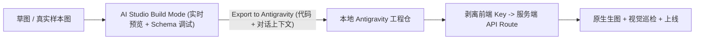

[返回 Gemini 专页](/gemini/) | [上一章：多模态规约与自定义 Skills](/gemini/ch02_multimodal_rules_skills) | [下一章：音视频理解与 Gemini Live API](/gemini/ch04_video_live_api)

# Ch.03 从灵感到工程仓：Google AI Studio Build Mode 无损接力流

> **本章解决的工程麻烦**：在网页 Playground 里调出惊艳的多模态 Demo 后，一导出代码就变成“失忆压缩包”——本地 IDE 不知道你之前为什么选这个 Prompt、试错踩过哪些坑，只能从头解释一遍；而且前端把 `GEMINI_API_KEY` 直接暴露在浏览器源码里，根本不敢上线。
>
> **实战落地收益**：跑通 **AI Studio Build Mode → Export to Antigravity** 全上下文无损接力流，20 分钟完成多模态原型验证，再用 15 分钟在本地完成服务端代理加固、原生生图资产落地与结构化输出封装。
>
> **一句话结论**：AI Studio 负责以最低摩擦把脑子里的画面跑出来，Antigravity 负责把玩具原型锻造成能收费的生产仓库。

过去做多模态产品，最浪费时间的一步叫“从 Demo 搬家到工程仓”。你在浏览器里花两小时把系统提示词、图片输入格式和 JSON Schema 调通了，结果下载 ZIP 解压进本地仓库后，所有迭代上下文瞬间清零。

Google 把 **AI Studio Build Mode** 和 **Antigravity** 之间那道墙打通之后，这条链路变成了真正的接力赛。

---

## 3.1 AI Studio Build Mode：20 分钟验证多模态可行性

AI Studio Build Mode 不是传统的纯文本聊天框，而是一个带实时预览沙盒和模型参数面板的网页工坊。最适合用它干三件事：

1. **草图 / 截图直出交互原型**：直接把白板手绘稿、Figma 截图或竞品页面拖进输入框，选择 `gemini-4-neon`（`medium` 思考档位），让它一次性生成可点击的前端页面与交互状态。
2. **多模态 Prompt 边界摸底**：在真正写后端数据库之前，先拖入 5 张极端样本图（光线暗、文字歪斜、局部遮挡），用 **Structured Outputs（JSON Schema）** 验证提取准确率到底够不够商业上线门槛。
3. **Token 账本预演**：在右侧实时观察不同图片分辨率和上下文缓存下的输入 Token 消耗，确认单次调用毛利算得过来再开写正式代码。



---

## 3.2 杀手级衔接：Export to Antigravity 与安全加固

当 Build Mode 里的原型已经跑通核心体验，点击右上角 **Export to Antigravity**。它做的不只是导出静态文件，而是把三样东西一起交接给本地 Antigravity：
- 完整项目目录树与依赖清单（`package.json`、`tsconfig.json`、组件代码）；
- 原型阶段的系统提示词与 `responseSchema` 定义；
- 关键对话上下文与架构意图摘要，让本地智能体一接手就明白“为什么这里用了 2 FPS 抽帧而不是 5 FPS”。

**落入本地仓库后的第一件必做大事：立刻清除客户端直连 Key。**
AI Studio 原型为了零门槛演示，有时会把调用写在前端组件里。上线前必须让 Antigravity 将所有 `@google/genai` 调用迁移至服务端路由（Next.js Route Handler / Cloud Run / Express），并强制开启 JSON Schema 强类型校验。

下面是一段直接可运行在 Next.js App Router（`src/app/api/analyze-ui/route.ts`）中的 Gemini 4 多模态视觉诊断接口：

```typescript
import { GoogleGenAI, Type } from "@google/genai";
import { NextResponse } from "next/server";

const ai = new GoogleGenAI({ apiKey: process.env.GEMINI_API_KEY });

const auditSchema = {
  type: Type.OBJECT,
  properties: {
    overallScore: { type: Type.NUMBER },
    issues: {
      type: Type.ARRAY,
      items: {
        type: Type.OBJECT,
        properties: {
          severity: { type: Type.STRING, enum: ["high", "medium", "low"] },
          region: { type: Type.STRING },
          diagnosis: { type: Type.STRING },
          cssFix: { type: Type.STRING }
        },
        required: ["severity", "region", "diagnosis", "cssFix"]
      }
    }
  },
  required: ["overallScore", "issues"]
};

export async function POST(req: Request) {
  if (!process.env.GEMINI_API_KEY) {
    return NextResponse.json({ error: "Server GEMINI_API_KEY not configured" }, { status: 500 });
  }

  const { imageBase64, mimeType = "image/png" } = await req.json();
  if (!imageBase64 || typeof imageBase64 !== "string") {
    return NextResponse.json({ error: "Missing imageBase64 payload" }, { status: 400 });
  }

  const response = await ai.models.generateContent({
    model: "gemini-4-hydrogen",
    contents: [{
        role: "user",
        parts: [{
            inlineData: {
              mimeType,
              data: imageBase64
            }
          },
          {
            text: "Inspect this mobile UI screenshot for text clipping, low contrast, tiny labels (<12px), and overflow. Return concrete CSS fixes."
          }]
      }],
    config: {
      responseMimeType: "application/json",
      responseSchema: auditSchema,
      temperature: 0.2
    }
  });

  return NextResponse.json(JSON.parse(response.text || "{}"));
}
```

注意三个生产细节：
1. 环境变量严格命名为 `GEMINI_API_KEY`，**严禁**加 `NEXT_PUBLIC_` 或 `VITE_` 前缀；
2. 常规视觉初筛优先使用 `gemini-4-hydrogen`（\$1.50/\$7.50），复杂设计评审才按需升档 `gemini-4-neon`；
3. `responseMimeType: "application/json"` 配 `responseSchema`，省掉脆弱的正则剥离 ```` ```json ```` 代码。

---

## 3.3 开发流内嵌原生生图与视觉资产精修

前端开发最容易卡壳的不是写 React 状态，而是“占位灰框太丑，找设计师排期要等三天”。在 Antigravity 里，可以把**品牌插画、空状态配图、OG 社交分享图**直接纳入同一条交付流水线：

1. **先定视觉语言锚点**：在提示词中锁死色板（例如深海蓝 `#0F172A`、亮青 `#22D3EE`）、比例（`16:9` 或 `1200×630`）和构图留白，避免每张图画风打架；
2. **肉眼验收拼写与边界**：生图模型在英文小字和中文笔画上仍可能偶发畸变，必须实际打开产物图检查无误再进入发布目录；
3. **统一裁切压缩**：用脚本批量转成目标尺寸与 WebP/JPEG，并核对页面 `` 的 `naturalWidth` 与 `aspect-ratio`，彻底消除页面加载跳动（CLS）。

---

## 新手极速上手 3 步走

1. **在 AI Studio 跑通最小多模态原型**：打开 Google AI Studio Build Mode，上传一张你的产品首页截图，用 `gemini-4-neon` 调试上面的 `auditSchema`，确认返回 JSON 字段准确。
2. **一键导入本地**：点击 **Export to Antigravity** 打开本地工程，创建 `.env.local` 填入 `GEMINI_API_KEY=...`（确认 `.env.local` 已在 `.gitignore` 中）。
3. **验证服务端代理**：启动本地服务，执行 `curl -X POST http://127.0.0.1:3000/api/analyze-ui` 传入测试图 Base64，确认返回结构化 JSON 且浏览器 Network 面板中完全看不到 API Key。

---

## 翻车自救与避坑速查表

| 故障现象 | 致命根因 | 即刻自救方案 |
| :--- | :--- | :--- |
| 导出后构建报错，前端 bundle 把 `GEMINI_API_KEY` 打进了静态 JS | 沿用了原型阶段的客户端环境变量（如 `VITE_GEMINI_API_KEY`） | 立刻删除前端环境变量并吊销轮换旧 Key；改为服务端 API Route 读取 `process.env.GEMINI_API_KEY` |
| 大图片直接 Base64 POST 触发 `413 Payload Too Large` | 原图动辄 6–10MB，超出 Next.js / Vercel 默认请求体上限（4.5MB） | 前端上传前用 `<canvas>` 缩放长边至 `<= 1600px` 并压缩为 JPEG（0.82），或先直传对象存储再由服务端拉取 |
| 同一套 Prompt 在本地比 AI Studio 效果差 | 导出后漏搬了 `systemInstruction` 或默认 `temperature` 从 `0.2` 变回了 `1.0` | 在本地代码显式写死 `systemInstruction`、`temperature` 与 `responseSchema`，不依赖 SDK 默认值 | ---

[返回 Gemini 专页](/gemini/) | [上一章：多模态规约与自定义 Skills](/gemini/ch02_multimodal_rules_skills) | [下一章：音视频理解与 Gemini Live API](/gemini/ch04_video_live_api)
