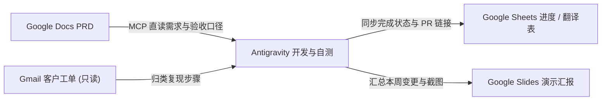

[返回 Gemini 专页](/gemini/) | [上一章：音视频理解与 Gemini Live API](/gemini/ch04_video_live_api) | [下一章：Google Colab 代理扩展 云端算力外挂](/gemini/ch06_colab_agy_pipelines)

# Ch.05 办公流即研发流：Google Workspace MCP 深度自动化实战

> **本章解决的工程麻烦**：产品需求写在 Google Docs、多语言文案和排期表躺在 Google Sheets、客户报错邮件堆在 Gmail、周五还要整理 Google Slides 汇报进度——开发者每天花两小时当“复制粘贴搬运工”，还动不动贴错版本。
>
> **实战落地收益**：在 Antigravity 中通过 **Google Workspace MCP** 一次性打通 Docs / Sheets / Slides / Drive / Gmail，建立“PRD 自动转代码任务 → 改完自动回写排期表 → 一键出周报幻灯片”的闭环，并掌握 Workspace Add-ons 的商业化开发路径。
>
> **一句话结论**：代码仓库只是研发的一半，另一半业务真相全在办公套件里；接上 Workspace MCP，代理才算真正看见全局。

绝大多数团队的研发瓶颈根本不在写代码的速度，而在“文档、表格、邮件、代码”四张皮之间的人工同步损耗。产品经理在 Docs 里改了一行计费规则，研发群里没人看见；开发修完 8 个 Bug，还得挨个打开 Sheets 手动改状态、切到 Gmail 回客户。

在 Google 生态里，**Google Workspace MCP** 把这些高频办公动作变成了智能体可直接调用、且带细粒度 OAuth 授权边界的标准工具。

---

## 5.1 接入 Google Workspace MCP 与最小权限边界

在 Antigravity 里配置 Workspace 集成有两种最稳妥的方式：
1. 直接从 Antigravity Marketplace 安装官方 **Google Docs / Google Sheets / Google Slides / Gmail** 插件，在 Plugins Manager 中完成 OAuth 授权（不接触原始 Refresh Token，凭据由本机受控钥匙串管理）；
2. 或在团队定制的 MCP 配置中挂载只读/按需写权限的 Workspace MCP Server，明确区分“默认可读”与“必须人工确认才能发信/覆盖表格”。

```json
{
  "mcpServers": {
    "google-workspace": {
      "command": "npx",
      "args": ["-y", "@google/workspace-mcp-server"],
      "env": {
        "WORKSPACE_ALLOWED_SCOPES": "docs.readonly,sheets.readwrite,slides.readwrite,gmail.readonly"
      }
    }
  }
}
```

> **安全红线**：给编码代理挂载 Gmail 时，默认只开 `gmail.readonly` 或 `gmail.compose`（仅起草草稿），**切勿默认开启无确认自动发送（`gmail.send`）**。写好的客户回复让代理存成草稿，由人扫一眼再点发送，既省 90% 功夫又不会发错事故邮件。

---

## 5.2 三条高杠杆双向自动化工作流

接通 Workspace MCP 后，最值得第一时间落地的不是炫技，而是下面三条每天都在重复的脏活：



### 工作流 A：直读 Docs PRD 生成验收清单与路由骨架
不用把 15 页 Docs 导出 PDF 再上传，直接把文档链接交给 `agy`：

```bash
agy -p "通过 Google Docs MCP 读取文档 https://docs.google.com/document/d/EXAMPLE_DOC_ID/edit ，提取其中第 3 节的计费状态机与边界条件，在仓库内生成 src/billing/state-machine.ts 及 Vitest 单元测试，并列出 PRD 中存在歧义的 3 个问题"
```

### 工作流 B：代码多语言词条与 Sheets 资产表双向同步
做海外 SaaS 时，运营习惯在 Google Sheets 改翻译文案。用 Antigravity 配合 Sheets MCP，可以一键把表格里的已审词条同步回 `locales/en.json` 和 `locales/ja.json`，同时把代码里新增的未翻译键写回表格标黄提醒运营：

```typescript
// scripts/sync_i18n_diff.mjs — 对比本地 JSON 与 Sheets 拉取结果，输出增量待译列表
import fs from "node:fs";

export function computeMissingKeys(sourcePath, targetPath) {
  const source = JSON.parse(fs.readFileSync(sourcePath, "utf8"));
  const target = JSON.parse(fs.readFileSync(targetPath, "utf8"));
  return Object.entries(source)
    .filter(([key]) => !(key in target) || String(target[key]).trim() === "")
    .map(([key, zhValue]) => ({ key, zhValue, status: "NEEDS_TRANSLATION" }));
}

if (process.argv[1]?.endsWith("sync_i18n_diff.mjs")) {
  const [src, dst] = process.argv.slice(2);
  if (!src || !dst) {
    console.error("Usage: node scripts/sync_i18n_diff.mjs <source.json> <target.json>");
    process.exit(1);
  }
  console.log(JSON.stringify(computeMissingKeys(src, dst), null, 2));
}
```

### 工作流 C：周五自动从 Git 日志生成 Slides 迭代简报
通过一条指令把本周合并的 `git log --since="7 days ago"`、核心性能指标和本地截图汇总，由 Slides MCP 自动写入既定母版生成 5 页管理层简报，彻底告别周五下午加班贴图。

---

## 5.3 从内部提效到外部收钱：开发 Workspace Add-ons 侧边栏插件

当你把某套 Docs / Sheets 自动化跑顺了（比如“跨境电商 Sheets 一键生成多语合规商品描述”或“律所 Docs 合同风险条款批注”），直接把它包装成 **Google Workspace Add-on** 上架 Google Workspace Marketplace，就是天然自带高付费意愿 B 端流量的变现通道。

核心最小结构（Apps Script + 外部 Cloud Run Gemini 4 接口）：

```javascript
// Code.gs — Google Sheets 侧边栏调用自有 Cloud Run + Gemini 4 后端
function onOpen() {
  SpreadsheetApp.getUi()
    .createMenu("Gemini Audit")
    .addItem("检查选中区域合规性", "auditSelectedRange")
    .addToUi();
}

function auditSelectedRange() {
  const sheet = SpreadsheetApp.getActiveSheet();
  const values = sheet.getActiveRange().getValues();
  const token = ScriptApp.getIdentityToken();

  const res = UrlFetchApp.fetch("https://api.yourdomain.com/v1/sheets-audit", {
    method: "post",
    contentType: "application/json",
    headers: { Authorization: "Bearer " + token },
    payload: JSON.stringify({ rows: values }),
    muteHttpExceptions: true
  });

  if (res.getResponseCode() !== 200) {
    SpreadsheetApp.getUi().alert("服务暂时不可用: " + res.getContentText());
    return;
  }
  const data = JSON.parse(res.getContentText());
  SpreadsheetApp.getUi().alert("发现 " + data.flaggedCount + " 处需复核项，已写入备注。");
}
```

把重逻辑和 `GEMINI_API_KEY` 放在你自己的 Cloud Run 后端，Apps Script 只做轻量 UI 入口和身份透传——既保护提示词与密钥资产，又能统一接入 Stripe 订阅配额。

---

## 新手极速上手 3 步走

1. **挂载单点权限**：在 Antigravity 安装 Google Docs 与 Sheets 插件并登录工作账号，暂不开启 Gmail 自动发信权限。
2. **实测一次 PRD 直读**：选一份你正在做的真实 Google Doc，让 Antigravity 提取接口字段并生成 TypeScript 类型定义文件，核对是否遗漏约束。
3. **验证只写草稿护栏**：让代理读取一封测试反馈邮件并生成“回复草稿”，确认它只保存在 Gmail 草稿箱而未擅自发出。

---

## 翻车自救与避坑速查表

| 故障现象 | 致命根因 | 即刻自救方案 |
| :--- | :--- | :--- |
| MCP 报错 `403 insufficientPermissions` | OAuth 授权时只勾选了只读范围，后续却要求写入 Sheets 或新建 Slides | 重新在插件授权面板补齐对应写权限 Scope，或明确拆分为“只读诊断账号”与“写入发布账号” |
| 代理回写 Sheets 时把原表公式覆盖成了纯文本 | 直接整表覆写了含公式的列，而不是限定写入数据区 | 规则中规定只允许向指定非公式列（如 `A2:D100`）写值，写入前先用 `valueRenderOption=FORMULA` 检查目标区域 |
| Workspace 插件提审被 Google 拒绝 | 申请了过宽的全局 Drive 权限（`drive` 全盘读写）却未提供隐私政策与录制视频 | 收缩为 `drive.file`（仅限用户主动打开的当前文件），并补齐清晰的数据留存说明与 OAuth 演示视频 | ---

[返回 Gemini 专页](/gemini/) | [上一章：音视频理解与 Gemini Live API](/gemini/ch04_video_live_api) | [下一章：Google Colab 代理扩展 云端算力外挂](/gemini/ch06_colab_agy_pipelines)
