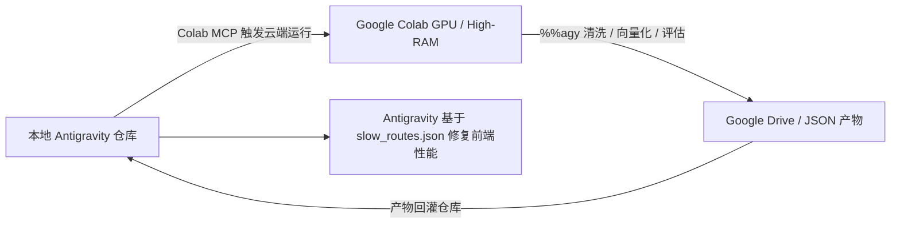

[返回 Gemini 专页](/gemini/) | [上一章：Google Workspace MCP 自动化](/gemini/ch05_workspace_mcp) | [下一章：/swarm 蜂群架构与 Alpine Peak 复盘](/gemini/ch07_swarm_alpine_peak)

# Ch.06 云端算力外挂：Google Colab（`%%agy`）数据管线与模型实验闭环

> 🎯 **本章解决的工程麻烦**：本地 MacBook 跑几万条用户遥测日志聚类、批量生成语义嵌入（Embeddings）或者微调小模型时，风扇起飞、内存爆红、Python CUDA 环境配一整天还报错；就算手动在云端跑完，结果散落在 Notebook 里，和 Git 工程仓彻底断层。
>
> 💡 **实战落地收益**：把 **Google Colab（`%%agy` 单元魔法命令 + Colab MCP Server）** 接成 Antigravity 的云端算力外挂，一条指令在云端 GPU 跑完数据清洗、评估报表与权重产物，再自动拉回本地仓库进入 CI 验收。
>
> ⚡ **一句话结论**：本地只留轻爽的代码逻辑与前端界面，把重数据清洗、向量化与 GPU 实验全部甩给 Colab，产物通过 Git 与 Drive 自动回流。

前后端全栈工程师做 AI 应用时，迟早会碰到一道硬墙：光靠调线上大模型 API 不够用了。你需要对 20 万条历史客服对话做聚类找痛点，或者对 5000 份商品手册做离线向量索引，甚至想拿 LoRA 微调一个专属分类器把推理成本砍掉 80%。

自己租一台长期开机的云 GPU 既贵又要维护 CUDA 驱动；直接在笔记本上跑又太慢。**Google Colab + `%%agy` + Colab MCP Server** 给出的解法，是让编码代理按需借用云端一次性算力容器，算完拿走产物，容器自动销毁。

---

## 6.1 激活 `%%agy` 单元魔法命令：在 Notebook 里直接调度代理

在 Google Colab 中，传统写法是开发者自己手写一长串 `pandas`、`matplotlib` 和 `torch` 代码，报一个 `KeyError` 或 `ShapeMismatch` 再复制报错去问聊天机器人。

启用 Antigravity 集成后的 **`%%agy` 单元魔法命令**，把自然语言任务、当前 Notebook 内存变量（DataFrame 列名、Tensor 形状）与单元格执行结果直接串成一个闭环：

```python
%%agy --model gemini-4-neon
读取 /content/drive/MyDrive/telemetry/nov2026_events.parquet：
1. 剔除缺失 session_id 或耗时 <= 0 的脏行，打印清洗前后行数对比；
2. 按 route 与 viewport_bucket 分组，计算 p50 / p95 LCP 与错误率；
3. 将异常路径（p95 > 2500ms 或 error_rate > 2%）导出为 /content/drive/MyDrive/telemetry/slow_routes.json，字段严格包含 route、viewport、p95_ms、error_rate、sample_count。
```

`%%agy` 执行完不只是吐一段代码，而是先检查已有 DataFrame 的真实 Schema，再生成可执行单元格并自动校验输出 JSON 是否符合要求。

如果需要在不依赖 `%%agy` 扩展的普通 CI 或无头 Colab 环境下复现同一套清洗管线，把生成出来的确定性 Python 脚本固定进仓库 `notebooks/telemetry_rollup.py`：

```python
import json
from pathlib import Path
import pandas as pd

def build_slow_routes_report(parquet_path: str, output_json: str) -> list[dict]:
    df = pd.read_parquet(parquet_path)
    cleaned = df.dropna(subset=["session_id"]).query("lcp_ms > 0").copy()

    grouped = (
        cleaned.groupby(["route", "viewport_bucket"], as_index=False)
        .agg(
            p50_ms=("lcp_ms", "median"),
            p95_ms=("lcp_ms", lambda s: float(s.quantile(0.95))),
            error_rate=("is_error", "mean"),
            sample_count=("session_id", "count"),
        )
    )

    flagged = grouped[(grouped["p95_ms"] > 2500) | (grouped["error_rate"] > 0.02)]
    records = [
        {
            "route": row.route,
            "viewport": row.viewport_bucket,
            "p95_ms": round(float(row.p95_ms), 1),
            "error_rate": round(float(row.error_rate), 4),
            "sample_count": int(row.sample_count),
        }
        for row in flagged.itertuples(index=False)
    ]

    Path(output_json).parent.mkdir(parents=True, exist_ok=True)
    Path(output_json).write_text(json.dumps(records, indent=2, ensure_ascii=False), encoding="utf-8")
    return records

if __name__ == "__main__":
    result = build_slow_routes_report("data/events.parquet", "reports/slow_routes.json")
    print(f"Flagged routes: {len(result)}")
```

---

## 6.2 Colab MCP Server：让本地 Antigravity 遥控云端算力并回灌代码仓

更进一步，挂载 **Colab MCP Server** 后，你甚至不用在浏览器和 IDE 之间来回切窗口。本地 Antigravity 代理可以直接通过 MCP 创建/执行 Colab Notebook、读取云端运行日志，并在任务完成后把结构化结果写回本地工程仓库。



实战场景：把真实线上性能遥测变成自动优化 PR。
1. Colab 跑完近 7 天 50 万条真实用户分位数据，导出 `reports/slow_routes.json`（只含聚合统计，彻底脱敏，绝不含个人邮箱或 Token）；
2. 本地 `agy` 读取 `reports/slow_routes.json`，精准定位 `p95 > 2500ms` 的三个路由；
3. 代理检查对应页面的字体加载、未压缩大图与同步脚本，提交拆包优化，并用本地浏览器复验。

---

## 6.3 一人公司的零运维离线数据工厂

对于独立开发者，Colab + Google Drive + Gemini Batch API 可以拼出成本极低的离线数据工厂，适合三类周期性重任务：

| 任务类型 | 推荐组合 | 成本与维护优势 |
| :--- | :--- | :--- |
| **每周 SEO / 搜索词聚类与内容缺口分析** | Sheets MCP → Colab `%%agy` 聚类 → 写回 Sheets | 零本地 Python 依赖冲突，免费/低价 Colab 运行时足够 |
| **知识库 10 万条文档向量化重建** | Drive 文件 → Colab GPU / Batch Embeddings → 写入向量库 | 避免本地笔记本合盖中断，天然带断点续传 |
| **多模态评测集回归跑分** | 测试集图/视频 → Colab 批量调 `gemini-4-hydrogen` → 输出评测 CSV | 每次改 Prompt 前后跑同一份评测集，用数字而非体感验收 |

---

## 🚀 新手极速上手 3 步走

1. **跑通首个脚本化统计**：将上文 `telemetry_rollup.py` 放进测试仓库，先在本地或 Colab 用 20 行模拟 Parquet/CSV 数据确认能正确输出 `slow_routes.json`。
2. **用 `%%agy` 迭代可视化**：在 Colab Notebook 新建单元格，使用 `%%agy` 生成按端分组的 P95 耗时柱状图，再把定型代码导出回仓库 `notebooks/` 目录纳入 Git 版本控制。
3. **验证产物回灌**：让本地 `agy -p "读取 reports/slow_routes.json，给出前三慢路由的排查清单"`，确认云端数据产物能直接驱动本地代码修改。

---

## 🛡️ 翻车自救与避坑速查表

| 故障现象 | 致命根因 | 即刻自救方案 |
| :--- | :--- | :--- |
| Colab 运行 90 分钟后容器回收，中间算好的向量全丢了 | 把产物写在了临时目录 `/content/`，没有持久化到 Google Drive 或对象存储 | 启动时立即 `drive.mount('/content/drive')`，所有 Checkpoint 每处理 500 条落盘一次到 Drive 或 GCS |
| Notebook 里硬编码了 `GEMINI_API_KEY`，一提交 `.ipynb` 就触发密钥泄露警报 | 直接把明文 Key 写进了代码单元格，提交时忘记清理单元格输出 | 在 Colab 统一使用左侧 **Secrets（`google.colab.userdata.get('GEMINI_API_KEY')`）**，并在仓库配置 `nbstripout` 提交钩子 |
| Colab 跑出来的 `.ipynb` 代码和本地仓库严重分叉 | 每次都在浏览器里即兴改 Notebook，从不回写 `.py` 模块 | 规定“探索在 Notebook，定型进 `scripts/*.py`”，Notebook 只 `import` 仓库里的纯 Python 函数 |

---

[返回 Gemini 专页](/gemini/) | [上一章：Google Workspace MCP 自动化](/gemini/ch05_workspace_mcp) | [下一章：/swarm 蜂群架构与 Alpine Peak 复盘](/gemini/ch07_swarm_alpine_peak)
