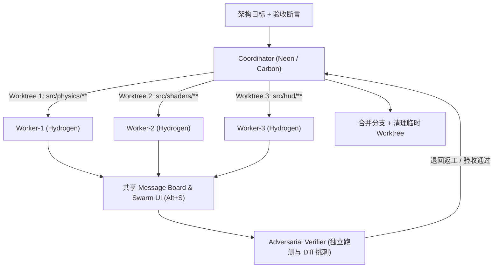

[返回 Gemini 专页](/gemini/) | [上一章：Google Colab %%agy 云端算力外挂](/gemini/ch06_colab_agy_pipelines) | [下一章：浏览器视觉走查与跨端上架](/gemini/ch08_browser_qa_cross_platform)

# Ch.07 `/swarm` 多代理蜂群架构与官方《Alpine Peak》全栈案例复盘

> 🎯 **本章解决的工程麻烦**：面对跨 4 个子系统的大型功能（后端 API、前端交互、WebGL 渲染、自动化测试），让单个智能体串行开发既慢又容易写到后面忘了前面；而自己手动开 4 个终端窗口并行写代码，最后 `git merge` 冲突解到怀疑人生。
>
> 💡 **实战落地收益**：掌握 Antigravity 原生 **`/swarm`** 蜂群调度模型（Coordinator + 独立 Git Worktree Worker + 对抗性 Verifier + 实时 Swarm UI 看板），拆解 Google 官方 **《Alpine Peak》** 3D 物理仿真工程的全链路打法。
>
> ⚡ **一句话结论**：并行多代理能不能真正提效，不取决于同时开几个窗口，而取决于文件边界是否物理互斥、以及有没有独立的对抗性验收员盯着合入质量。

如果你把单智能体开发比作“一个人依次刷墙、铺砖、装灯、验收”，那 **`/swarm`** 就是带项目经理和独立质检员的施工队：水电工、木工、油漆工各自领走互不打架的房间同时干活，干完不是自己签字过关，而是交给专挑毛病的质检员逐项复核，全部过关后项目经理统一合并交付。

---

## 7.1 `/swarm` 三角色协作模型与 Git Worktree 物理隔离

在 Antigravity 2.x 与 `agy` CLI 中输入 `/swarm` 启动蜂群后，系统会在共享留言板（Message Board）上协作运行三类职责分明的角色：

1. **Coordinator（协调员，推荐 `gemini-4-neon` 或 `gemini-4-carbon`）**：只负责拆解任务、划定每个 Worker 互斥的目录/文件所有权、分配模型档位、汇总合并分支，不和 Worker 抢写同一份业务代码。
2. **Parallel Workers（并行执行员，推荐 `gemini-4-hydrogen`）**：每个编辑型 Worker 通过 `workspace: "share"` 获得独立的 **Git Worktree** 工作副本。各自拥有独立分支、独立临时构建缓存，彻底杜绝并发改坏同一工作树。
3. **Adversarial Verifier（对抗性验收员，推荐 `gemini-4-neon` / 只读 `inherit`）**：不参与写功能代码，专门针对 Worker 的 diff 写边界测试、查类型漏洞、用浏览器跑三视口回归，专门找茬直到证据过关。



在 `agy` CLI 中，按下 **`Alt + S`** 或输入 `/swarm board` 可以打开实时蜂群监控看板，一眼看清每个成员当前处于 `working`（干活中）、`waiting`（休眠零消耗）还是 `stopped` 状态。

### 一份拿来即用的 `/swarm` 任务派发模板

千万不要只打一句“`/swarm 帮我把整个项目重构了`”——那样只会让多个 Worker 撞在同一批公共文件上。合格的 `/swarm` 启动提示词必须显式声明**三件事：互斥目录边界、模型分工、验收门槛**：

```markdown
/swarm 为本项目上线实时协作画板 v2，严格按以下分工并行推进：

- Coordinator（默认 gemini-4-neon）：先冻结 `src/shared/protocol.ts` 的消息协议类型，再拉起 3 个独立 Git worktree Worker，最后统一合并并运行全量验收。
- Worker `backend-sync`（gemini-4-hydrogen，独占 `server/sync/**`）：实现 WebSocket 房间状态广播与断线重连单测。
- Worker `canvas-render`（gemini-4-hydrogen，独占 `src/canvas/**`）：实现 60fps 离屏渲染与缩放平移手势。
- Worker `ui-toolbar`（gemini-4-hydrogen，独占 `src/components/toolbar/**`）：实现工具栏与移动端折叠面板（字号 >= 12px，390/768/1440px 零溢出）。
- Verifier `qa-adversary`（gemini-4-neon，只读）：不要直接改业务源码；等待三组提交后独立审查协议一致性、跑集成测试与三视口浏览器验收，发现任何漏洞在留言板打回对应 Worker 修复。
```

---

## 7.2 官方标杆案例复盘：《Alpine Peak》3D 仿真工程的全栈接力

Google Antigravity 演示中最具代表性的工程案例之一是 **《Alpine Peak》** 高性能 3D 雪山地形与滑雪物理仿真项目。把它拆开来看，它完美串联了本书前六章讲到的全部 Google 生态杠杆，而不是孤立炫技：

1. **阶段一 · AI Studio 快速起盘**：先用 AI Studio Build Mode 结合地形参考图，在浏览器里快速验证等距视角、雪坡光照基调和 Three.js 场景骨架，随后一键 **Export to Antigravity** 把项目连带设计意图带回本地。
2. **阶段二 · Antigravity `/swarm` 并发攻关**：
   - `terrain-worker`（Hydrogen）在独立 worktree 中攻克程序化高度图生成与 LOD 网格分块；
   - `shader-worker`（Hydrogen）专注雪面次表面散射着色器、动态雪辙与阴影性能预算；
   - `physics-worker`（Carbon / Neon）调校坡度摩擦力、起跳抛物线与碰撞箱；
   - `perf-verifier` 持续在内置浏览器中采样真实 FPS、Draw Call 数量与内存占用，一旦帧率跌破阈值立即打回着色器分支优化。
3. **阶段三 · Colab + Workspace 闭环**：把海量仿真遥测与关卡难度曲线抛给 Colab 批量拟合参数，把验收报告与版本里程碑通过 Workspace MCP 回写至团队 Sheets 跟踪表。

从中可以提炼出一条适用于任何团队的黄金铁律：**共享接口协议先由 Coordinator 冻结，并行 Worker 只动各自垂直切片，性能/视觉指标交由独立 Verifier 用真实浏览器数据一票否决。**

---

## 7.3 蜂群防卡死与冲突消解实用清单

多代理跑久了最常见两类问题：一是某个 Worker 陷入原地打转导致全队空等，二是合入阶段出现接口不兼容。用四条硬纪律兜底：

1. **先冻契约再发散**：任何涉及跨模块通信的 TypeScript Interface / Protobuf / SQL Schema，必须在开启并行前由 Coordinator 定稿提交到基线分支。
2. **明确写者唯一性**：任何时刻，同一个文件或同一个外部测试端口只能有一个 Worker 拥有写权限；共用配置（如 `package.json`）一律由 Coordinator 在汇总阶段统一修改。
3. **善用休眠成本模型**：Antigravity 蜂群里处于 `waiting` 状态的成员不消耗推理 Token；只有在共享留言板被 `@mention` 时才会被系统唤醒。
4. **先合入再销毁 Worktree**：某个 Worker 的活干完并被 Verifier 放行后，Coordinator 先把它所在 worktree 分支合入主工作区并跑通测试，再销毁该 Worker 及其临时目录，避免丢失未提交改动。

---

## 🚀 新手极速上手 3 步走

1. **从小规模双 Worker 练手**：选一个既有前后端、测试脚本齐全的仓库，用 `/swarm` 拆成 `api-worker`（改 `src/api/`）和 `ui-worker`（改 `src/ui/`）外加 1 个 `verifier`，体验零冲突合并。
2. **打开 Swarm Board 实时观察**：按 `Alt + S`（或输入 `/swarm board`）观察各 Worker 的思考与命令计时、留言板交接与 Verifier 的打回记录。
3. **核对干净收尾**：合并完成后在终端执行 `git worktree list && git status`，确认所有临时 worktree 已清理且主工作区构建测试全绿。

---

## 🛡️ 翻车自救与避坑速查表

| 故障现象 | 致命根因 | 即刻自救方案 |
| :--- | :--- | :--- |
| 两个 Worker 同时修改了 `package.json` 或 `src/types.ts` 导致合并冲突 | 任务派发前未划分互斥目录，也未先由 Coordinator 冻结公共类型与依赖 | 立即暂停并行，先由 Coordinator 手动收敛 `src/types.ts` 到基线分支，再通知两个 Worker rebase 到新基线 |
| 整个蜂群半小时没动静，所有人互相干等 | 两位成员都在等对方先发消息，缺少显式唤醒链条 | 在共享留言板直接 `@coordinator` 指令汇总当前阻塞项，或让 Verifier 先验收已完成的那一组分支 |
| Verifier 说“看起来没问题”但合并后构建炸了 | Verifier 只读了静态 diff，没有真正跑构建命令或启动预览验收 | 在 Verifier 简报中强制写明必须贴出真实命令输出与退出码（`npm run build && npm test`），无执行证据禁止放行 |

---

[返回 Gemini 专页](/gemini/) | [上一章：Google Colab %%agy 云端算力外挂](/gemini/ch06_colab_agy_pipelines) | [下一章：浏览器视觉走查与跨端上架](/gemini/ch08_browser_qa_cross_platform)
