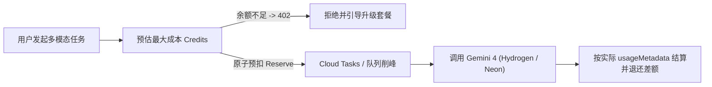

[返回 Gemini 专页](/gemini/) | [上一章：浏览器视觉走查与跨端上架](/gemini/ch08_browser_qa_cross_platform) | [下一章：2026 前沿瞭望与配额精算](/gemini/ch10_frontier_quota_spatial)

# Ch.09 商业化实战：打造基于 Google 生态的多模态出海生产力工具

> 🎯 **本章解决的工程麻烦**：辛辛苦苦做出一个多模态 SaaS，用户交了 \$19/月，结果一个人一天传 200 段高清视频把你的 Gemini API 账单刷掉 \$85，越有活跃用户亏得越惨；或者产品上线后只在社交媒体发了一条帖，第二天就没了流量。
>
> 💡 **实战落地收益**：拿出一份经过毛利测算的多模态选品矩阵、一套带 **Credits 积分折算 + 服务端硬限流 + 异步削峰** 的真实可运行计费中间件，以及 Chrome Web Store + Google Workspace Marketplace + SEO 三线冷启动路径。
>
> ⚡ **一句话结论**：多模态 SaaS 的商业护城河不在“接了 Gemini API”，而在“把按秒波动的多模态成本装进可预测的毛利模型，并寄生在现成高频入口里拿自然流量”。

纯文本套壳工具在 2026 年已经很难收上价，但**多模态 + 垂直场景工作流**依然存在大量高毛利细分切口。原因很朴素：绝大多数中小企业员工根本不会自己写脚本去截视频帧、调 JSON Schema 或打通 Google Sheets。谁把整套链路封装成“点一下按钮出结果”，谁就能收月费。

---

## 9.1 适合一人公司的三类多模态选品矩阵

挑方向别只看酷不酷，先算“客单价 ÷ 单月峰值 API 成本”是否大于 **5 倍毛利安全垫**：

| 赛道方向 | 核心多模态杠杆 | 目标付费人群 | 推荐定价与毛利逻辑 |
| :--- | :--- | :--- | :--- |
| **视觉 UI / 电商合规质检台** | 图片 + 短录屏 + Schema 结构化输出 | 独立出海站长、跨境电商运营、前端团队 | \$29–\$79/月；单次图片诊断走 `gemini-4-hydrogen` 成本不足 \$0.005，毛利 > 85% |
| **实时音视频专业陪练 / 面试助手** | Gemini Live API（16kHz 音频 + 1 FPS 画面） | 外企求职者、外贸销售、语言学习者 | 按“实时分钟包”阶梯售卖（如 \$19 含 120 分钟），严格按分钟扣减杜绝无限畅聊亏损 |
| **Google Workspace 垂直侧边栏插件** | Docs / Sheets / Slides Add-on + 后端 Gemini 4 | 律所、财税顾问、跨境选品与 HR 团队 | \$15–\$49/席位/月；直接长在用户每天必开的 Sheets/Docs 里，留存远高于独立网页 |

---

## 9.2 多模态计费风控：积分折算、预扣费与异步削峰

多模态计费最容易翻车的坑是**“先调用模型，再统计用量”**。恶意用户或误操作脚本只要并发发 50 个长视频请求，就能在数据库扣完余额前瞬间击穿你的 API 额度。

生产级计费必须采用 **预估冻结（Reserve）→ 执行调用 → 按真实 `usageMetadata` 多退少补（Settle）** 的三段式事务：



下面是一个可直接落入 Node.js / TypeScript 后端的多模态积分折算与原子预扣模块（`src/billing/credits.ts`）：

```typescript
export interface MediaEstimateInput {
  model: "gemini-4-hydrogen" | "gemini-4-neon" | "gemini-4-carbon";
  promptChars: number;
  imageCount?: number;
  videoSeconds?: number;
  maxOutputTokens: number;
}

// 1 Credit = $0.001 USD（保留 4x 安全边际以覆盖基础设施、支付手续费与毛利）
const USD_PER_1M: Record<MediaEstimateInput["model"], { in: number; out: number }> = {
  "gemini-4-hydrogen": { in: 1.5, out: 7.5 },
  "gemini-4-neon": { in: 3.0, out: 15.0 },
  "gemini-4-carbon": { in: 2.0, out: 10.0 }
};

export function estimateRequiredCredits(input: MediaEstimateInput): number {
  const textTokens = Math.ceil(input.promptChars / 3.2);
  const imageTokens = (input.imageCount ?? 0) * 258;
  const videoTokens = Math.ceil((input.videoSeconds ?? 0) * 290);
  const totalInput = textTokens + imageTokens + videoTokens;

  const rate = USD_PER_1M[input.model];
  const rawUsd =
    (totalInput / 1_000_000) * rate.in +
    (input.maxOutputTokens / 1_000_000) * rate.out;

  const retailUsd = rawUsd * 4;
  return Math.max(1, Math.ceil(retailUsd / 0.001));
}

export async function withCreditGuard<T>(
  userId: string,
  requiredCredits: number,
  ledger: {
    reserve: (uid: string, amount: number) => Promise<{ ok: boolean; txId: string }>;
    settle: (txId: string, actualCredits: number) => Promise<void>;
    refund: (txId: string) => Promise<void>;
  },
  work: () => Promise<{ result: T; actualCredits: number }>
): Promise<T> {
  const hold = await ledger.reserve(userId, requiredCredits);
  if (!hold.ok) {
    const err = new Error("INSUFFICIENT_CREDITS");
    (err as Error & { status?: number }).status = 402;
    throw err;
  }
  try {
    const { result, actualCredits } = await work();
    await ledger.settle(hold.txId, Math.min(actualCredits, requiredCredits));
    return result;
  } catch (error) {
    await ledger.refund(hold.txId);
    throw error;
  }
}
```

把 `estimateRequiredCredits` 接在每个多模态接口最前面，再在数据库层给 `user_wallets.balance` 加 `CHECK (balance >= 0)` 约束，哪怕遭遇并发刷接口也不可能产生负余额资损。

---

## 9.3 三线低成本冷启动获客闭环

独立开发者没有大预算买信息流广告，利用 Google 自家生态的分发杠杆是最稳妥的冷启动路线：

1. **Chrome Web Store + Google Workspace Marketplace 双商店自然搜索**：在扩展标题、副标题与首屏截图里精准对齐用户痛点关键词（如 `Sheets Compliance Auditor`、`Video Bug Repro Summarizer`），这两处商店的搜索转化率远高于纯落地页。
2. **免费轻量在线工具 + GEO/SEO 双收割**：把主产品的某个高频子能力拆成一个免登录免费页（例如免费版“移动端截图排版体检”或“Gemini 4 Token 成本计算器”），配齐 `sitemap.xml`、`robots.txt`、`llms.txt` 与清晰的 JSON-LD，既吃 Google 传统搜索长尾词，也吃 AI 搜索引擎（ChatGPT Search / Perplexity / Google AI Overviews）的引用推荐。
3. **内置分享水印与结果页回流**：生成的质检报告或分析卡片提供公开只读短链，页脚留克制的产品入口，让客户把报告发给同事或老板时自动完成二次传播。

---

## 🚀 新手极速上手 3 步走

1. **先算账再写代码**：把你打算做的多模态产品典型一次请求的图/视频时长代入 `estimateRequiredCredits` 或 [check_gemini_quota.mjs](https://github.com/aipmer/codex-blue-book/blob/main/examples/gemini-antigravity-kit/scripts/check_gemini_quota.mjs)，确认单次毛利高于 75%。
2. **上线前打通预扣费与硬上限**：为免费体验用户设死单日上限（例如每日 3 次图片体检、不开放长视频），并给付费套餐配置清晰可见的剩余 Credits 进度条。
3. **同步提交商店与 SEO 基建**：官网上线当天一并部署 `sitemap.xml`、`robots.txt`、`llms.txt` 与 Chrome / Workspace 商店列表，持续按周复盘搜索词与付费转化率。

---

## 🛡️ 翻车自救与避坑速查表

| 故障现象 | 致命根因 | 即刻自救方案 |
| :--- | :--- | :--- |
| 免费试用接口一夜间被羊毛党刷爆额度 | 未做登录鉴权、IP 速率限制与单账号日配额上限，且默认放开了视频上传 | 立刻在网关加 Cloudflare / Upstash 速率限制，免费层仅允许压缩图片并绑定验证邮箱/OAuth 账号 |
| Live API 实时语音房间出现用户忘记关页导致计费失控 | 前端页面切后台后 WebSocket 未自动断开，服务端也没设空闲超时 | 服务端设置静音 90 秒自动提示、180 秒强制关闭会话，且单次会话硬上限 15 分钟自动续签扣费 |
| 支付回调（Stripe / Lemon Squeezy）重放导致用户积分翻倍到账 | Webhook 处理逻辑缺少幂等键校验 | 在数据库建立 `billing_webhook_events(event_id PRIMARY KEY)`，所有回调在单个事务内先插入事件 ID 再加积分 |

---

[返回 Gemini 专页](/gemini/) | [上一章：浏览器视觉走查与跨端上架](/gemini/ch08_browser_qa_cross_platform) | [下一章：2026 前沿瞭望与配额精算](/gemini/ch10_frontier_quota_spatial)
