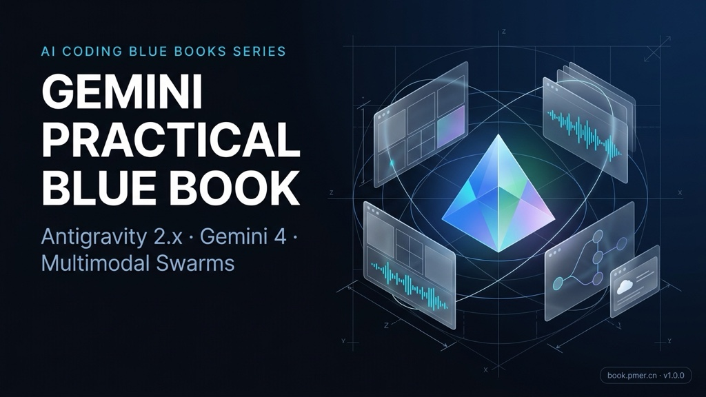

# 《Gemini 实战蓝皮书：Google 全域多模态编排与跨端交付指南》

> **版本**：v1.0.0 已上线 · 资料核对至 **2026 年 11 月 26 日**  
> **核心定位**：以 **Google Antigravity 2.x + `agy` CLI + Gemini 4（Carbon / Argon / Neon / Hydrogen）** 为主线，贯通 **AI Studio Build Mode、Google Workspace MCP、Google Colab（`%%agy`）与 `/swarm` 蜂群** 的多模态全生态研发闭环。

- [立即从第一章开始阅读](/gemini/ch01_antigravity_gemini4)
- [下载中文版 PDF](/downloads/gemini_blue_book_zh.pdf) · [Download English PDF](/downloads/gemini_blue_book_en.pdf)
- [配套 Antigravity 规约与配额门禁套件](https://github.com/aipmer/codex-blue-book/tree/main/examples/gemini-antigravity-kit)
- [生成 Antigravity `AGENTS.md` + `.agents/rules` 规约](/generator) · [四书横向对比](/compare)

---

## 全书 10 章导航

### 第一部分：Antigravity 指挥舱与 Gemini 4 选型
- [Ch.01 告别单线程 CLI：Google Antigravity 架构与 Gemini 4 模型矩阵](/gemini/ch01_antigravity_gemini4)
- [Ch.02 多模态开发规约：`AGENTS.md`、`.agents/rules` 与自定义 Skills](/gemini/ch02_multimodal_rules_skills)

### 第二部分：AI Studio × Antigravity 原生多模态流
- [Ch.03 从灵感到工程仓：Google AI Studio Build Mode 无损接力流](/gemini/ch03_ai_studio_handoff)
- [Ch.04 音视频理解与 Gemini Live API 实时交互应用落地](/gemini/ch04_video_live_api)

### 第三部分：Google Workspace × Colab 全家桶联动
- [Ch.05 办公流即研发流：Google Workspace MCP 深度自动化实战](/gemini/ch05_workspace_mcp)
- [Ch.06 云端算力外挂：Google Colab（`%%agy`）数据管线与模型实验闭环](/gemini/ch06_colab_agy_pipelines)

### 第四部分：`/swarm` 蜂群编排、视觉巡检与跨端交付
- [Ch.07 `/swarm` 多代理蜂群架构与官方《Alpine Peak》全栈案例复盘](/gemini/ch07_swarm_alpine_peak)
- [Ch.08 浏览器视觉自动走查与 Web / Chrome MV3 / 移动跨端交付](/gemini/ch08_browser_qa_cross_platform)

### 第五部分：多模态商业闭环与生态瞭望
- [Ch.09 商业化实战：打造基于 Google 生态的多模态出海生产力工具](/gemini/ch09_multimodal_commercial_saas)
- [Ch.10 2026 前沿瞭望：Gemini 4 演进路线、配额精算与跨界空间智能](/gemini/ch10_frontier_quota_spatial)
