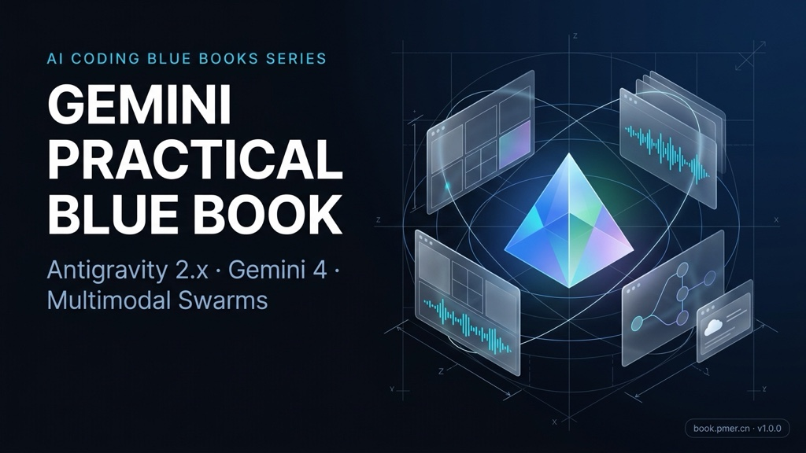
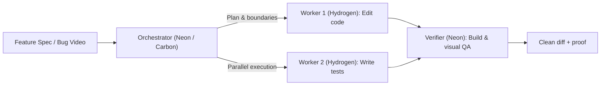
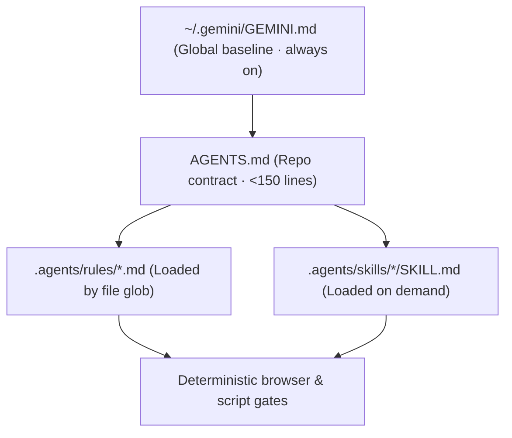
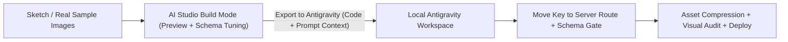
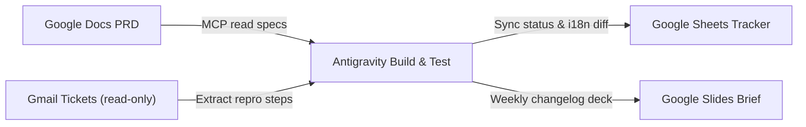
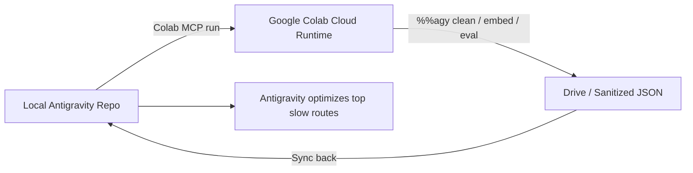
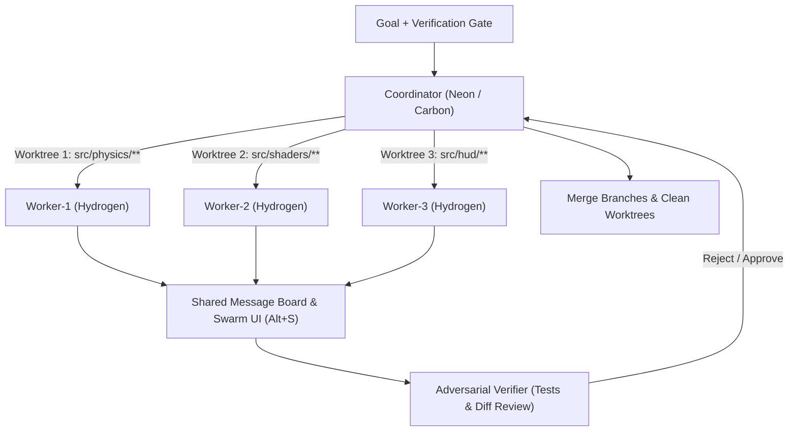
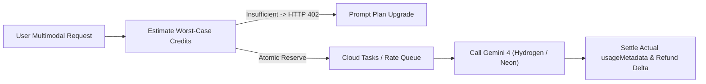

# Gemini Practical Blue Book: Multimodal Orchestration Across the Google Stack

**v1.0.0 · Sources verified November 26, 2026**




Author: [Hunk Wu](https://pmer.cn) (X: [@ai_pmer](https://x.com/ai_pmer))

[ 🌐 中文 PDF 版 ](./gemini_blue_book_zh.pdf) | [ 🌐 Online Hub ](https://book.pmer.cn/en/gemini/)

## 🧭 Table of Contents

### Part 1: Antigravity Cockpit & Gemini 4 Routing
- Ch.01 Beyond Single-Loop CLIs: Google Antigravity & Gemini 4 Model Matrix
- Ch.02 Multimodal Rules: `AGENTS.md`, `.agents/rules` & Custom Skills

### Part 2: AI Studio × Antigravity Multimodal Flows
- Ch.03 Idea to Production Repo: AI Studio Build Mode Context-Preserving Handoff
- Ch.04 Video Understanding & Gemini Live API Real-Time Applications

### Part 3: Google Workspace × Colab Leverage
- Ch.05 Workspace MCP Automation: Docs, Sheets, Slides & Commercial Add-ons
- Ch.06 Cloud Compute Offload: Google Colab (`%%agy`) & Notebook Pipelines

### Part 4: `/swarm` Orchestration & Visual QA
- Ch.07 `/swarm` Architecture & Official "Alpine Peak" Full-Stack Case Study
- Ch.08 Automated Browser Visual QA, Chrome MV3 & Firebase / Cloud Run Delivery

### Part 5: Monetization & Frontier Watch
- Ch.09 Commercial Multimodal SaaS: Credit Metering, Guardrails & Distribution
- Ch.10 2026 Frontier Watch: Quota Economics, Web 3D & Official Release Tracking

---

## 🔌 Companion Engineering Kit

*   **[Gemini Antigravity Starter Kit](https://github.com/aipmer/codex-blue-book/tree/main/examples/gemini-antigravity-kit)**: Runnable `AGENTS.md`, glob-scoped `.agents/rules/ui-multimodal.md`, `visual-audit` Skill, and zero-dependency `check_gemini_quota.mjs` budget guardrail.

*   **[Multi-Agent Rules Generator](https://book.pmer.cn/en/generator)**: Export Antigravity rules and multi-agent templates.

---

# Ch.01 Beyond Single-Loop CLIs: Google Antigravity & Gemini 4 Model Matrix

> 🎯 **Engineering pain solved**: Facing four product names (`Antigravity App`, `Antigravity IDE`, `agy CLI`, and GCP `gemini` CLI) plus four elemental Gemini 4 model tiers leads teams to install the wrong runtime, burn through Pro quotas in 30 minutes, or miss the December 1, 2026 Argon rate step-up.
>
> 💡 **What you ship**: A clear boundary between Antigravity and enterprise GCP tooling, a verified November 26, 2026 Gemini 4 pricing ledger, runnable Orchestrator settings, and a 5-minute migration path from Cursor, Claude Code, or Codex rules.
>
> ⚡ **Bottom line**: Single-loop CLIs serialize every edit through one context window; Antigravity unifies multi-model routing, Git worktree swarms, and browser visual audits under one control plane.

Most developers hit a naming wall the first day they evaluate Google's late-2026 developer stack. Desktop has Antigravity 2.x, the terminal has `agy`, and Google Cloud documentation talks about Gemini Code Assist and `gemini` CLI. Picking the wrong entry point cuts you off from `/swarm`, browser visual verification, and one-click AI Studio exports.

Treat them as two distinct products built for different organizational boundaries.

---

## 1.1 Choosing the Right Surface: Antigravity (`agy`) vs. GCP `gemini` CLI

GCP's `gemini` CLI and Code Assist target strict cloud-compliance environments centered on IAM auditing, VPC Service Controls, and centralized Vertex billing. **Google Antigravity (Desktop App + IDE + `agy` CLI)** is built for high-output product teams and solo builders shipping multimodal software.

| Dimension | Google Antigravity 2.x + `agy` CLI | GCP `gemini` CLI / Gemini Code Assist |
| :--- | :--- | :--- |
| **Primary Audience** | Indie builders, product engineering teams, multimodal apps | Strict GCP IAM-governed enterprises |
| **Multi-Model Routing** | Native **Orchestrator** (Neon/Carbon plans + Hydrogen executes) | Fixed endpoint bindings |
| **Concurrency** | Native **`/swarm`** (Coordinator + Git Worktrees + Adversarial Verifier) | Single-session or external CI scripting |
| **Multimodal & Preview** | Built-in browser subagent, native image gen, AI Studio export | Code completion and Cloud Shell workflows |
| **Auth & Identity** | Google AI Pro / Ultra subscription, or `AGY_ADC_AUTH` for enterprise gateways | GCP project IAM + Vertex AI billing |

If your company mandates traffic through an internal Vertex AI gateway, you still do not have to abandon Antigravity: set `AGY_ADC_AUTH=1` to authenticate via Application Default Credentials while keeping local plugins and `/swarm`.

---

## 1.2 Gemini 4 Pricing & Tier Ledger (Verified November 26, 2026)

Gemini 4 replaces ambiguous `Pro / Flash / Ultra` naming with four elemental tiers, all sharing a **1M-token context window**:

| Model ID | Engineering Role | Standard Input (/1M) | Cached Read (/1M) | Output (/1M) | Key Operational Note |
| :--- | :--- | ---: | ---: | ---: | :--- |
| `gemini-4-hydrogen` | High-speed execution, swarm workers, batch ops | \$1.50 | Discounted | \$7.50 | Flat 1M pricing; default workhorse for edits and test fixes |
| `gemini-4-neon` | Coding sweet spot, default Orchestrator coordinator | \$3.00 | \$0.15 | \$15.00 | Configurable `Low / Medium / High / XHigh` thinking tiers |
| `gemini-4-argon` | Enterprise engineering and deep knowledge work | \$2.00 → **\$4.00** | \$0.10 → **\$0.20** | \$10.00 → **\$20.00** | **Deadline alert**: \$2/\$10 intro rate ends **2026-11-30**; doubles **2026-12-01** |
| `gemini-4-carbon` | Flagship long-horizon reasoning & hard debugging | \$2.00 (intro tier) | Discounted | \$10.00 (intro tier) | Consumes Pro/Ultra quota fastest; reserve for tough architecture or root-cause bugs |

> **Cost guardrail**: Audit any production script pinning `gemini-4-argon` before **December 1, 2026**. Route routine PR checks and bulk edits to `gemini-4-hydrogen` (\$1.50/\$7.50) or `gemini-4-neon`, keeping Argon and Carbon for high-leverage reasoning.

Test the exact cost delta with the zero-dependency companion script [check_gemini_quota.mjs](https://github.com/aipmer/codex-blue-book/blob/main/examples/gemini-antigravity-kit/scripts/check_gemini_quota.mjs):

```bash
# Compare the same Argon workload before and after the December 1, 2026 rate change
node examples/gemini-antigravity-kit/scripts/check_gemini_quota.mjs \
  --model gemini-4-argon --date 2026-11-28 \
  --input-tokens 900000 --cached-tokens 300000 --output-tokens 150000 --budget 5

node examples/gemini-antigravity-kit/scripts/check_gemini_quota.mjs \
  --model gemini-4-argon --date 2026-12-05 \
  --input-tokens 900000 --cached-tokens 300000 --output-tokens 150000 --budget 5
```

The second command prints `BLOCKED_OVER_BUDGET` and exits with code `2`, making it drop-in ready as a CI or batch preflight gate.

---

## 1.3 Orchestrator Routing & Everyday `agy` CLI Commands

Teams complain about latency when they point a flagship reasoning model at one-line CSS tweaks. Antigravity's **Orchestrator** fixes that mismatch by pairing `gemini-4-neon` (or `carbon`) for planning and verification with `gemini-4-hydrogen` for routine file writes and test iterations—cutting end-to-end wall time by roughly 19% while stretching Google AI Pro (\$19.99/mo) quotas.



Six `agy` commands cover almost all daily terminal work:

```bash
# 1. Start the interactive Antigravity CLI TUI
agy

# 2. Headless single-shot print mode for scripts and CI
agy -p "Audit src/api/ routes for missing Zod validation and output a Markdown checklist"

# 3. Resume a prior conversation by ID without re-explaining context
agy -r 20f45382-2685-415c-a5a1-9b844d5893c7

# 4. Inspect cached release notes inside the TUI
# Inside agy, run: /changelog

# 5. List available Gemini 4 models for your current account
agy models

# 6. Authenticate against an enterprise GCP gateway via ADC
AGY_ADC_AUTH=1 agy -p "Audit terraform/iam.tf for overly broad wildcard roles"
```

Store persistent CLI defaults in `~/.gemini/antigravity-cli/settings.json`:

```json
{
  "defaultModel": "gemini-4-neon",
  "thinkingEffort": "medium",
  "orchestrator": {
    "enabled": true,
    "workerModel": "gemini-4-hydrogen"
  },
  "sandbox": {
    "autoApproveVersionControlled": true
  }
}
```

---

## 1.4 5-Minute Migration from Cursor, Claude Code, or Codex

Do not hand-port `.cursor/rules`, `.claude/commands`, or MCP server JSON by copy-pasting. Antigravity ships a built-in `migrate-agent-settings` flow that packages existing rules, skills, subagents, and MCP servers into one self-contained plugin without touching your original dotfiles:

```bash
agy -p "Run migrate-agent-settings on this repository to bundle .claude/, .cursor/, and AGENTS.md into a local Antigravity plugin without deleting source files"
```

Teammates staying on Codex or Claude Code continue reading their existing configs untouched.

---

## 🚀 3-Step Quickstart

1. **Verify CLI & models**: Run `agy --version && agy models` and confirm `gemini-4-hydrogen` and `gemini-4-neon` appear.
2. **Enable Orchestrator**: Write the `settings.json` snippet above to `~/.gemini/antigravity-cli/settings.json` so routine work offloads to Hydrogen.
3. **Run one headless audit**: Inside any Git repo, run `agy -p "Summarize build commands, test entrypoints, and top 3 technical risks"` and watch the split `Thinking...` and `Running command...` timers.

---

## 🛡️ Pitfall Recovery Table

| Failure Mode | Root Cause | Immediate Fix |
| :--- | :--- | :--- |
| Pro quota drains in 30 minutes | Default pinned to `gemini-4-carbon` with `XHigh` effort on trivial edits | Switch default to `gemini-4-neon` (`medium`) with Orchestrator offloading execution to `gemini-4-hydrogen` |
| API bill doubles in December | Production scripts hardcode `gemini-4-argon` past the Nov 30 intro rate | Run `check_gemini_quota.mjs --date 2026-12-01`, move routine jobs to `gemini-4-hydrogen`, and enable Context Caching |
| Migrated rules contradict each other | Duplicate legacy prompts coexist with newly generated `.agents/rules/` | Run `/plugin` to inspect loaded bundles and keep one source of truth (`AGENTS.md` + scoped `.agents/rules/`) |

---

---

# Ch.02 Multimodal Rules: `AGENTS.md`, `.agents/rules` & Custom Skills

> 🎯 **Engineering pain solved**: Dumping CSS conventions, image pipelines, and deployment steps into one giant global prompt wastes thousands of input tokens every turn—while agents still declare "responsive layout complete" on pages that overflow mobile screens and render 9px micro-labels.
>
> 💡 **What you ship**: A clean four-tier Antigravity rule hierarchy, a runnable path-scoped multimodal rule + `visual-audit` skill, and strict isolation boundaries for read-only subagent attachment reviews.
>
> ⚡ **Bottom line**: Good guardrails stay lean through lazy loading and enforce quality with computed browser metrics and exit codes, not adjectives.

Backend regressions usually fail loudly in compilation or unit tests. Multimodal frontend regressions fail silently: `npm run build` passes with zero warnings even when an image 404s, a table stretches a 390px phone viewport by 240px, or an unoptimized 8MB PNG stalls first paint.

Antigravity solves this by layering constraints so every rule loads only where it applies.

---

## 2.1 Four-Tier Customization Hierarchy

1. **Global baseline (`~/.gemini/GEMINI.md`)**: Repository-agnostic habits (language, never printing secrets, checking `git status` first). Keep it under 100 lines.
2. **Workspace contract (`AGENTS.md`)**: Shared build commands, directory ownership, and hard boundaries. Read natively by Antigravity, Codex, and Kimi Code (and imported by Claude Code via `@AGENTS.md`).
3. **Path-scoped rules (`.agents/rules/*.md`)**: Activated automatically only when the agent edits files matching YAML `globs`. Frontend typography constraints cost zero tokens during backend SQL work.
4. **On-demand skills (`.agents/skills/<name>/SKILL.md`)**: Only a two-line name and description sit in context until a task triggers the full procedure and companion scripts.



Inspect [examples/gemini-antigravity-kit/.agents/rules/ui-multimodal.md](https://github.com/aipmer/codex-blue-book/blob/main/examples/gemini-antigravity-kit/.agents/rules/ui-multimodal.md) for a production-ready frontend rule:

```markdown
---
description: Enforce responsive typography, zero overflow, and media hygiene on frontend components
globs:
  - "src/components/**"
  - "src/app/**"
  - "public/**"
---

# UI & Multimodal Asset Rules

1. **No microscopic labels**: Computed `font-size` for visible body, badge, table, and code text must stay `>= 12px`.
2. **Zero horizontal overflow**: Tables and code blocks inside narrow containers must use `overflow-x: auto` on a wrapper rather than stretching `documentElement.scrollWidth`.
3. **Structured multimodal outputs**: Any Gemini 4 vision/video extraction endpoint must declare an explicit `responseSchema` (JSON Schema) and validate output before persisting.
4. **Asset separation**: Store unoptimized source PNGs/MP4s in `assets-src/`; commit only compressed WebP/JPEG/MP4 runtime files under `public/`.
5. **Proof of visual pass**: After layout edits, capture computed overflow and min-font telemetry at `390x844`, `768x1024`, and `1440x900`.
```

---

## 2.2 Turning Visual Audits & Media Pipelines into Reusable Skills

Rules tell the agent *what* must hold; a `SKILL.md` tells it *how* to prove it. Pair your path rule with `.agents/skills/visual-audit/SKILL.md` so any layout edit triggers a deterministic three-viewport check (`390x844`, `768x1024`, `1440x900`) verifying zero overflow, `fontSize >= 12px`, and `img.complete && img.naturalWidth > 0`.

For generated covers, diagrams, and OG banners, keep raw sources and runtime media strictly separated:
- Save raw raster output under `assets-src/` (or an artifact directory) and visually inspect spelling and framing;
- Resize and compress deterministically before copying into `public/`:

```bash
# Crop and compress a raw generated banner into an exact 1200x630 social OG JPEG on macOS
sips -c 630 1200 -s format jpeg -s formatOptions 88 \
  assets-src/hero-raw.png --out public/social/og-cover.jpg
```

---

## 2.3 Isolating Read-Only Multimodal Reviews in Lightweight Subagents

Reviewing 20-page PDFs, a dozen competitor screenshots, or raw log bundles inside your main coding session pollutes attention and spikes token cost. Split the work:
- Delegate read-only synthesis, screenshot comparison, and spec extraction to a lightweight read-only subagent (`research` or `daily-flash`) that returns a compact structured summary;
- Never grant shell execution, file writes, or credential access to read-only review helpers, and never pass `.env` files or production cookies in prompt arguments.

---

## 🚀 3-Step Quickstart

1. **Export starter rules**: Open the [Multi-Agent Rules Generator](/en/generator), switch to the **Gemini Antigravity** tab, pick your stack, and save `AGENTS.md` + `.agents/rules/`.
2. **Install the visual audit skill**: Copy [examples/gemini-antigravity-kit/.agents](https://github.com/aipmer/codex-blue-book/blob/main/examples/gemini-antigravity-kit/.agents/skills/visual-audit/SKILL.md) into your repo root.
3. **Confirm rule activation**: Run `agy -p "List loaded project rules and state the minimum font size enforced on src/components"` and verify it cites `>= 12px` and the three-viewport check.

---

## 🛡️ Pitfall Recovery Table

| Failure Mode | Root Cause | Immediate Fix |
| :--- | :--- | :--- |
| `.agents/rules/ui-multimodal.md` never triggers | Invalid YAML frontmatter or mismatched `globs` (e.g., `src/app/**` vs `app/**`) | Validate YAML syntax and align `globs` to actual repo paths |
| Code blocks measure `11.375px` despite `13px` container | Nested theme rule applies `code { font-size: 0.875em; }` twice | Set explicit pixel size (`font-size: 13px;`) on the target code selector and re-measure in browser |
| `public/` balloons past 30MB | Uncompressed 4K generated PNGs committed directly to `public/images/` | Move raw art to `assets-src/` and commit only resized WebP/JPEG runtime assets |

---

---

# Ch.03 Idea to Production Repo: AI Studio Build Mode Context-Preserving Handoff

> 🎯 **Engineering pain solved**: Browser playgrounds produce slick demos that turn into amnesiac ZIP archives the moment you export them—your local IDE loses all prompt tuning rationale, and client components leak `GEMINI_API_KEY` straight into browser bundles.
>
> 💡 **What you ship**: A clean **AI Studio Build Mode → Export to Antigravity** relay workflow, a production Next.js server-side `@google/genai` route with strict JSON Schema output, and an inline media asset workflow.
>
> ⚡ **Bottom line**: Use AI Studio to prove multimodal feasibility at zero setup cost; use Antigravity to turn that prototype into a hardened, billable repository.

The biggest time sink in multimodal engineering used to be the handoff gap between browser prototyping and production code. Google closed that gap by connecting **AI Studio Build Mode** directly to **Antigravity**.

---

## 3.1 Validating Feasibility in 20 Minutes with AI Studio Build Mode

Before provisioning databases or auth, use Build Mode to de-risk three unknowns:
1. **Sketch-to-UI interaction**: Drop a whiteboard photo or screenshot into Build Mode with `gemini-4-neon` (`medium`) to generate a clickable prototype.
2. **Edge-case stress testing**: Feed five ugly real-world inputs (dim lighting, skewed text, cropped mobile screenshots) and verify **Structured Outputs (`responseSchema`)** accuracy before writing backend plumbing.
3. **Unit-economics preview**: Check real token counts per image/frame in the sidebar to verify your SaaS margin holds before committing engineering time.



---

## 3.2 Export to Antigravity & Immediate Security Hardening

Clicking **Export to Antigravity** transfers your file tree, package dependencies, `responseSchema`, and conversation rationale directly into a local workspace.

**Your first mandatory local action: strip every client-side API key.** Move all `@google/genai` calls behind a server-side route (`src/app/api/analyze-ui/route.ts`) using a server-only `GEMINI_API_KEY` (never `NEXT_PUBLIC_` or `VITE_`):

```typescript
import { GoogleGenAI, Type } from "@google/genai";
import { NextResponse } from "next/server";

const ai = new GoogleGenAI({ apiKey: process.env.GEMINI_API_KEY });

const auditSchema = {
  type: Type.OBJECT,
  properties: {
    overallScore: { type: Type.NUMBER },
    issues: {
      type: Type.ARRAY,
      items: {
        type: Type.OBJECT,
        properties: {
          severity: { type: Type.STRING, enum: ["high", "medium", "low"] },
          region: { type: Type.STRING },
          diagnosis: { type: Type.STRING },
          cssFix: { type: Type.STRING }
        },
        required: ["severity", "region", "diagnosis", "cssFix"]
      }
    }
  },
  required: ["overallScore", "issues"]
};

export async function POST(req: Request) {
  if (!process.env.GEMINI_API_KEY) {
    return NextResponse.json({ error: "Server GEMINI_API_KEY not configured" }, { status: 500 });
  }

  const { imageBase64, mimeType = "image/png" } = await req.json();
  if (!imageBase64 || typeof imageBase64 !== "string") {
    return NextResponse.json({ error: "Missing imageBase64 payload" }, { status: 400 });
  }

  const response = await ai.models.generateContent({
    model: "gemini-4-hydrogen",
    contents: [
      {
        role: "user",
        parts: [
          { inlineData: { mimeType, data: imageBase64 } },
          {
            text: "Inspect this mobile UI screenshot for text clipping, low contrast, tiny labels (<12px), and overflow. Return concrete CSS fixes."
          }
        ]
      }
    ],
    config: {
      responseMimeType: "application/json",
      responseSchema: auditSchema,
      temperature: 0.2
    }
  });

  return NextResponse.json(JSON.parse(response.text || "{}"));
}
```

Use `gemini-4-hydrogen` (\$1.50/\$7.50) for high-volume first-pass audits and escalate to `gemini-4-neon` only for complex multi-screen critiques.

---

## 3.3 Inline Native Image Generation for Production Polish

Avoid shipping gray placeholder boxes while waiting days for design assets. Inside Antigravity, treat brand covers, empty-state illustrations, and OG social cards as versioned pipeline artifacts:
1. Lock palette, aspect ratio (`16:9` or `1200×630`), and safe crop margins in the brief;
2. Inspect every generated image visually for typography spelling and edge clipping;
3. Compress and lock exact `aspect-ratio` dimensions in CSS to keep Cumulative Layout Shift (CLS) at zero.

---

## 🚀 3-Step Quickstart

1. **Validate schema in AI Studio**: Upload one real mobile screenshot to Build Mode, run `auditSchema` with `gemini-4-neon`, and inspect the returned JSON.
2. **Export locally**: Click **Export to Antigravity**, add `GEMINI_API_KEY` to `.env.local` (verified git-ignored), and move model calls to `/api/analyze-ui`.
3. **Verify zero key exposure**: POST a test screenshot to `http://127.0.0.1:3000/api/analyze-ui` and verify in browser DevTools that no key appears in any client JS bundle or request header.

---

## 🛡️ Pitfall Recovery Table

| Failure Mode | Root Cause | Immediate Fix |
| :--- | :--- | :--- |
| API key appears in compiled frontend JS | Prototype `VITE_GEMINI_API_KEY` left in `.env` and client bundle | Rotate the leaked key immediately and route requests through a server-only API handler |
| Base64 image POST fails with `413 Payload Too Large` | Uncompressed 8MB PNG exceeds 4.5MB serverless body limits | Downscale client-side via `<canvas>` (`<= 1600px`, JPEG 0.82) or upload to GCS/R2 first |
| Local output quality degrades vs. AI Studio | Export dropped `systemInstruction` or defaulted `temperature` to `1.0` | Pin `systemInstruction`, `temperature: 0.2`, and `responseSchema` explicitly in server code |

---

---

# Ch.04 Video Understanding & Gemini Live API Real-Time Applications

> 🎯 **Engineering pain solved**: Race-condition UI flickers cannot be explained in text bug reports, while chaining separate `STT → LLM → TTS` services for real-time voice/camera assistants introduces 3-second lag and breaks when users interrupt mid-sentence.
>
> 💡 **What you ship**: A runnable video bug-repro analyzer with exact `MM:SS` timeline schemas, a bidirectional **Gemini Live API** WebSocket connector supporting native barge-in, and three anti-hallucination guardrails.
>
> ⚡ **Bottom line**: Feed screen recordings for timing bugs and use native Live WebSockets for real-time audio/video—stop gluing three brittle media pipelines together.

Static screenshots miss the entire class of bugs that live on a timeline: state-race flickers, modal focus traps, and mobile keyboards shoving submit buttons off screen. Gemini's native video understanding and **Gemini Live API** turn continuous video and bidirectional audio into first-class developer primitives.

---

## 4.1 Video-to-Fix: Timestamped State-Machine Diagnosis

Instead of asking "what went wrong?", force the model to return a strict `MM:SS` timeline via the Files API so large MP4s stay out of JSON memory buffers:

```typescript
import { GoogleGenAI, Type } from "@google/genai";

const ai = new GoogleGenAI({ apiKey: process.env.GEMINI_API_KEY });

async function diagnoseBugVideo(videoPath: string) {
  const uploaded = await ai.files.upload({
    file: videoPath,
    config: { mimeType: "video/mp4" }
  });

  let fileState = await ai.files.get({ name: uploaded.name! });
  while (fileState.state === "PROCESSING") {
    await new Promise((r) => setTimeout(r, 2000));
    fileState = await ai.files.get({ name: uploaded.name! });
  }
  if (fileState.state !== "ACTIVE") {
    throw new Error(`Video processing failed: ${fileState.state}`);
  }

  const res = await ai.models.generateContent({
    model: "gemini-4-neon",
    contents: [
      {
        role: "user",
        parts: [
          { fileData: { fileUri: fileState.uri!, mimeType: "video/mp4" } },
          {
            text: "List every user interaction and visual anomaly with exact MM:SS timestamps, then infer the most likely frontend state or race condition root cause."
          }
        ]
      }
    ],
    config: {
      responseMimeType: "application/json",
      responseSchema: {
        type: Type.OBJECT,
        properties: {
          timeline: {
            type: Type.ARRAY,
            items: {
              type: Type.OBJECT,
              properties: {
                timestamp: { type: Type.STRING },
                action: { type: Type.STRING },
                observedUi: { type: Type.STRING }
              },
              required: ["timestamp", "action", "observedUi"]
            }
          },
          suspectedRootCause: { type: Type.STRING },
          verificationSteps: { type: Type.ARRAY, items: { type: Type.STRING } }
        },
        required: ["timeline", "suspectedRootCause", "verificationSteps"]
      }
    }
  });

  console.log(res.text);
  await ai.files.delete({ name: uploaded.name! });
}

diagnoseBugVideo("./bug-repro.mp4").catch(console.error);
```

Feed that JSON timeline into local `agy` alongside the offending component to trace the exact state update.

---

## 4.2 Gemini Live API: Real-Time Bidirectional Audio & Video

Gemini Live streams audio and JPEG frames over one stateful WebSocket and supports native **barge-in** (immediately cutting off model playback when the user speaks). Pin these exact media formats to prevent silent sessions or garbled audio:

| Channel | Required Format | Engineering Practice |
| :--- | :--- | :--- |
| **Upstream Audio** | Raw 16-bit PCM, `16kHz`, Little-Endian, mono | Capture via `AudioWorklet` in 100ms chunks |
| **Upstream Video** | JPEG frames, `<= 1 FPS`, `768px` long edge | 1 FPS handles inspection/coaching without burning bandwidth |
| **Downstream Audio** | Raw 16-bit PCM, `24kHz`, Little-Endian | Flush queued audio buffers immediately on `interrupted: true` |
| **Auth Security** | Server-minted **Ephemeral Token** | Never embed long-lived `GEMINI_API_KEY` in client WebSocket code |

```typescript
import { GoogleGenAI, Modality } from "@google/genai";

export async function startLiveAssistant(
  ephemeralToken: string,
  onAudioChunk: (pcm24kBase64: string) => void,
  onInterrupt: () => void
) {
  const ai = new GoogleGenAI({ apiKey: ephemeralToken });

  const session = await ai.live.connect({
    model: process.env.GEMINI_LIVE_MODEL || "gemini-live-2.5-flash-preview",
    config: {
      responseModalities: [Modality.AUDIO],
      systemInstruction:
        "You are a concise hardware inspection assistant. Speak in short sentences. Only report defects clearly visible in the latest camera frames."
    },
    callbacks: {
      onmessage: (msg) => {
        if (msg.serverContent?.interrupted) {
          onInterrupt();
          return;
        }
        const parts = msg.serverContent?.modelTurn?.parts || [];
        for (const part of parts) {
          if (part.inlineData?.data) onAudioChunk(part.inlineData.data);
        }
      },
      onerror: (err) => console.error("Live session error:", err),
      onclose: (ev) => console.log("Live session closed:", ev.reason)
    }
  });

  return {
    sendAudioPcm16k(base64Chunk: string) {
      session.sendRealtimeInput({
        audio: { data: base64Chunk, mimeType: "audio/pcm;rate=16000" }
      });
    },
    sendCameraFrame(jpegBase64: string) {
      session.sendRealtimeInput({
        media: { data: jpegBase64, mimeType: "image/jpeg" }
      });
    },
    close: () => session.close()
  };
}
```

---

## 4.3 Three Anti-Hallucination Guardrails for Media Apps

1. **Anchor every claim**: Require `timestamp` (video) or `bbox` (image) plus `visibility: "clear" | "uncertain"` in your JSON schema; flag `uncertain` items for human review.
2. **Ban gap-filling**: State explicitly in `systemInstruction` that unreadable text or off-frame details must return `null` rather than inferred guesses.
3. **Cap FPS and duration server-side**: Enforce `<= 1 FPS` and hard session durations, budgeting cost upfront with [check_gemini_quota.mjs](https://github.com/aipmer/codex-blue-book/blob/main/examples/gemini-antigravity-kit/scripts/check_gemini_quota.mjs) (`--video-seconds`).

---

## 🚀 3-Step Quickstart

1. **Run offline video diagnosis**: Record a 15-second UI bug repro as `bug-repro.mp4` and execute `diagnoseBugVideo` to inspect the timestamped JSON timeline.
2. **Price your video budget**: Run `node examples/gemini-antigravity-kit/scripts/check_gemini_quota.mjs --model gemini-4-hydrogen --video-seconds 300 --output-tokens 8000 --budget 1`.
3. **Test Live barge-in**: Open AI Studio Stream Realtime with mic + screen share, interrupt mid-sentence to observe latency, then integrate the WebSocket wrapper above behind ephemeral tokens.

---

## 🛡️ Pitfall Recovery Table

| Failure Mode | Root Cause | Immediate Fix |
| :--- | :--- | :--- |
| Live audio plays slow-motion or chipmunk-pitched | 24kHz server PCM played on a 16kHz or 48kHz `AudioContext` | Construct playback `AudioContext({ sampleRate: 24000 })` while resampling mic capture to `16000` |
| Old audio keeps playing after user interrupts | Client ignores `serverContent.interrupted` | Call `.stop()` on all queued `AudioBufferSourceNode` instances and reset playback cursor on interrupt |
| Long video uploads time out or spike API bills | Raw 4K 60fps capture uploaded without downsampling | Transcode first: `ffmpeg -i raw.mp4 -vf "fps=1,scale=960:-2" -c:v libx264 -crf 28 trim.mp4` |

---

---

# Ch.05 Workspace MCP Automation: Docs, Sheets, Slides & Commercial Add-ons

> 🎯 **Engineering pain solved**: PRDs sit in Google Docs, localization tables live in Sheets, bug reports pile up in Gmail, and weekly updates live in Slides—burning two hours a day on manual copy-paste and stale specs.
>
> 💡 **What you ship**: Least-privilege **Google Workspace MCP** integration inside Antigravity, three high-leverage bidirectional workflows (Docs→code, Sheets↔i18n JSON, Git→Slides), and a Cloud Run-backed Workspace Add-on skeleton.
>
> ⚡ **Bottom line**: Half of your product truth lives outside Git; connecting Workspace MCP gives your coding agent the business context without copy-paste drift.

---

## 5.1 Connecting Google Workspace MCP with Least-Privilege Scopes

Install the official Google Docs / Sheets / Slides / Gmail plugins from the Antigravity Marketplace (which isolate OAuth tokens inside your OS keychain), or mount a scoped Workspace MCP server:

```json
{
  "mcpServers": {
    "google-workspace": {
      "command": "npx",
      "args": ["-y", "@google/workspace-mcp-server"],
      "env": {
        "WORKSPACE_ALLOWED_SCOPES": "docs.readonly,sheets.readwrite,slides.readwrite,gmail.readonly"
      }
    }
  }
}
```

> **Security guardrail**: Keep Gmail at `gmail.readonly` or draft-only (`gmail.compose`) by default. Let the agent prepare replies as drafts so a human reviews every outbound customer email before clicking send.

---

## 5.2 Three High-Leverage Bidirectional Workflows



1. **Docs PRD → Typed Implementation + Ambiguity List**:
```bash
agy -p "Read Google Doc https://docs.google.com/document/d/EXAMPLE_DOC_ID/edit via Workspace MCP. Extract Section 3 billing states into src/billing/state-machine.ts with Vitest tests, and list 3 ambiguities in the PRD."
```

2. **Sheets ↔ Repo Localization Diff (`scripts/sync_i18n_diff.mjs`)**:
```typescript
import fs from "node:fs";

export function computeMissingKeys(sourcePath, targetPath) {
  const source = JSON.parse(fs.readFileSync(sourcePath, "utf8"));
  const target = JSON.parse(fs.readFileSync(targetPath, "utf8"));
  return Object.entries(source)
    .filter(([key]) => !(key in target) || String(target[key]).trim() === "")
    .map(([key, zhValue]) => ({ key, zhValue, status: "NEEDS_TRANSLATION" }));
}

if (process.argv[1]?.endsWith("sync_i18n_diff.mjs")) {
  const [src, dst] = process.argv.slice(2);
  if (!src || !dst) {
    console.error("Usage: node scripts/sync_i18n_diff.mjs <source.json> <target.json>");
    process.exit(1);
  }
  console.log(JSON.stringify(computeMissingKeys(src, dst), null, 2));
}
```

3. **Weekly Git Log → Slides Deck**: Pipe `git log --since="7 days ago"` and key benchmark deltas straight into a preset Slides template via MCP.

---

## 5.3 Packaging Internal Automation into Paid Workspace Add-ons

Once a Docs or Sheets workflow saves your team real hours, turn it into a commercial **Google Workspace Add-on** backed by your own Cloud Run Gemini 4 API (keeping prompts, keys, and Stripe billing off the Apps Script client):

```javascript
// Code.gs — Thin Sheets UI delegating audit logic to your Cloud Run Gemini 4 backend
function onOpen() {
  SpreadsheetApp.getUi()
    .createMenu("Gemini Audit")
    .addItem("Audit Selected Range", "auditSelectedRange")
    .addToUi();
}

function auditSelectedRange() {
  const sheet = SpreadsheetApp.getActiveSheet();
  const values = sheet.getActiveRange().getValues();
  const token = ScriptApp.getIdentityToken();

  const res = UrlFetchApp.fetch("https://api.yourdomain.com/v1/sheets-audit", {
    method: "post",
    contentType: "application/json",
    headers: { Authorization: "Bearer " + token },
    payload: JSON.stringify({ rows: values }),
    muteHttpExceptions: true
  });

  if (res.getResponseCode() !== 200) {
    SpreadsheetApp.getUi().alert("Service error: " + res.getContentText());
    return;
  }
  const data = JSON.parse(res.getContentText());
  SpreadsheetApp.getUi().alert("Flagged " + data.flaggedCount + " rows for review.");
}
```

---

## 🚀 3-Step Quickstart

1. **Grant minimal scopes**: Enable Google Docs and Sheets plugins in Antigravity first without outbound email send permissions.
2. **Test live PRD ingestion**: Point `agy` at one active Google Doc to generate TypeScript interfaces and verify edge cases match the spec.
3. **Verify draft-only safety**: Ask the agent to draft a reply to one test email and confirm it lands in Gmail Drafts without sending.

---

## 🛡️ Pitfall Recovery Table

| Failure Mode | Root Cause | Immediate Fix |
| :--- | :--- | :--- |
| `403 insufficientPermissions` on Sheets write | OAuth authorized with `readonly` scope only | Re-authorize the specific `sheets.readwrite` scope in Plugins Manager |
| Sheet formulas overwritten with raw text | Agent overwrote calculated columns instead of raw data ranges | Restrict write rules to non-formula columns (e.g., `A2:D100`) and inspect with `valueRenderOption=FORMULA` first |
| Marketplace OAuth review rejected | Requested broad `drive` scope without justification | Narrow scope to `drive.file` (user-opened files only) and submit a short OAuth demo video |

---

---

# Ch.06 Cloud Compute Offload: Google Colab (`%%agy`) & Notebook Pipelines

> 🎯 **Engineering pain solved**: Running 200K-row telemetry clustering, batch embeddings, or LoRA tuning on a laptop stalls local dev work and wastes hours fighting Python/CUDA dependencies—while ad-hoc cloud notebooks drift completely out of sync with Git.
>
> 💡 **What you ship**: A repeatable **Google Colab (`%%agy` + Colab MCP Server)** compute-offload workflow that executes heavy data jobs on cloud runtimes and feeds sanitized JSON reports back into your local Antigravity repository.
>
> ⚡ **Bottom line**: Keep your local repo focused on clean application code; offload heavy batch data and GPU workloads to ephemeral Colab runtimes with versioned Python scripts.

---

## 6.1 Invoking Antigravity Inside Notebooks with `%%agy`

The `%%agy` cell magic lets you write natural-language pipeline instructions directly inside a Colab cell with live awareness of in-memory DataFrame schemas and shapes:

```python
%%agy --model gemini-4-neon
Load /content/drive/MyDrive/telemetry/nov2026_events.parquet:
1. Drop rows missing session_id or with lcp_ms <= 0, printing before/after counts;
2. Group by route and viewport_bucket to compute p50/p95 LCP and error_rate;
3. Export routes where p95 > 2500ms or error_rate > 2% to /content/drive/MyDrive/telemetry/slow_routes.json.
```

Once validated interactively, commit the deterministic Python module (`notebooks/telemetry_rollup.py`) to Git so CI and teammates can reproduce it identically:

```python
import json
from pathlib import Path
import pandas as pd

def build_slow_routes_report(parquet_path: str, output_json: str) -> list[dict]:
    df = pd.read_parquet(parquet_path)
    cleaned = df.dropna(subset=["session_id"]).query("lcp_ms > 0").copy()

    grouped = (
        cleaned.groupby(["route", "viewport_bucket"], as_index=False)
        .agg(
            p50_ms=("lcp_ms", "median"),
            p95_ms=("lcp_ms", lambda s: float(s.quantile(0.95))),
            error_rate=("is_error", "mean"),
            sample_count=("session_id", "count"),
        )
    )

    flagged = grouped[(grouped["p95_ms"] > 2500) | (grouped["error_rate"] > 0.02)]
    records = [
        {
            "route": row.route,
            "viewport": row.viewport_bucket,
            "p95_ms": round(float(row.p95_ms), 1),
            "error_rate": round(float(row.error_rate), 4),
            "sample_count": int(row.sample_count),
        }
        for row in flagged.itertuples(index=False)
    ]

    Path(output_json).parent.mkdir(parents=True, exist_ok=True)
    Path(output_json).write_text(json.dumps(records, indent=2, ensure_ascii=False), encoding="utf-8")
    return records

if __name__ == "__main__":
    result = build_slow_routes_report("data/events.parquet", "reports/slow_routes.json")
    print(f"Flagged routes: {len(result)}")
```

---

## 6.2 Closing the Loop with Colab MCP Server

Mounting the **Colab MCP Server** lets local Antigravity trigger cloud notebook execution, read logs, and pull aggregated artifacts back into the repo without manual downloads:



---

## 6.3 Low-Maintenance Offline Data Factory for Solo Builders

| Recurring Workload | Recommended Stack | Why It Wins |
| :--- | :--- | :--- |
| **Weekly SEO / search query clustering** | Sheets MCP → Colab `%%agy` → write back to Sheets | Zero local Python env churn |
| **100K-doc vector re-indexing** | Drive corpus → Colab GPU / Batch Embeddings | Survives laptop sleep with resumable Drive checkpoints |
| **Multimodal prompt regression evals** | Eval images/videos → Colab batch `gemini-4-hydrogen` → CSV diff | Quantitative pass/fail scores before every prompt rollout |

---

## 🚀 3-Step Quickstart

1. **Test the deterministic script**: Save `telemetry_rollup.py`, run it on sample Parquet/CSV telemetry, and confirm valid JSON output.
2. **Iterate visually with `%%agy`**: Generate P95 breakdown charts in Colab, then export clean transformation logic back into `notebooks/*.py`.
3. **Close the code loop**: Run `agy -p "Read reports/slow_routes.json and list concrete frontend fixes for the top 3 slowest routes"`.

---

## 🛡️ Pitfall Recovery Table

| Failure Mode | Root Cause | Immediate Fix |
| :--- | :--- | :--- |
| Colab disconnects at 90 minutes and loses progress | Intermediate outputs written to ephemeral `/content/` | Mount `/content/drive` at cell 1 and checkpoint every 500 records to Drive or GCS |
| `.ipynb` commit leaks `GEMINI_API_KEY` | Raw secret pasted into cell code or captured in stdout | Read secrets via `google.colab.userdata.get('GEMINI_API_KEY')` and enable `nbstripout` |
| Cloud notebooks diverge from Git repo | One-off browser edits never synced back to `.py` files | Enforce "explore in notebook, freeze in `scripts/*.py`"; notebooks import versioned modules only |

---

---

# Ch.07 `/swarm` Architecture & Official "Alpine Peak" Full-Stack Case Study

> 🎯 **Engineering pain solved**: Serializing a four-subsystem feature through one agent is slow and loses context, while opening four terminal tabs by hand produces painful Git merge conflicts.
>
> 💡 **What you ship**: A clean mental model and copy-paste kickoff template for Antigravity **`/swarm`** (Coordinator + isolated Git worktrees + Adversarial Verifier + `Alt+S` Swarm Board), plus an end-to-end breakdown of Google's **Alpine Peak** 3D simulation showcase.
>
> ⚡ **Bottom line**: Parallel agents only speed up shipping when file ownership is physically disjoint and an independent verifier challenges every diff with real test evidence.

---

## 7.1 The Three-Role `/swarm` Model & Git Worktree Isolation

Typing `/swarm` in Antigravity 2.x or `agy` CLI spins up a shared Message Board coordinating three specialized roles:

1. **Coordinator (`gemini-4-neon` or `gemini-4-carbon`)**: Freezes shared interfaces first, assigns non-overlapping directory ownership, merges verified worktrees, and never races workers on the same files.
2. **Parallel Workers (`gemini-4-hydrogen`, `workspace: "share"`)**: Each authoring worker runs inside its own isolated **Git worktree**, keeping branches, build outputs, and dirty edits completely separate.
3. **Adversarial Verifier (`gemini-4-neon`, read-only `inherit`)**: Writes no feature code; actively challenges worker diffs by running builds, boundary tests, and multi-viewport browser audits, rejecting incomplete work back on the board.



Press **`Alt + S`** (or run `/swarm board`) inside `agy` to monitor every member's live state (`working`, zero-cost `waiting`, or `stopped`).

### Production `/swarm` Kickoff Template

```markdown
/swarm Ship Real-Time Canvas v2 with strict file isolation:

- Coordinator (gemini-4-neon): Freeze message types in `src/shared/protocol.ts` first, then spawn 3 Git worktree workers, merge verified branches, and run full checks.
- Worker `backend-sync` (gemini-4-hydrogen, owns `server/sync/**`): Implement WebSocket room broadcast and reconnect unit tests.
- Worker `canvas-render` (gemini-4-hydrogen, owns `src/canvas/**`): Implement 60fps offscreen canvas pan/zoom rendering.
- Worker `ui-toolbar` (gemini-4-hydrogen, owns `src/components/toolbar/**`): Build toolbar + mobile drawer (font >= 12px, 0 overflow at 390/768/1440px).
- Verifier `qa-adversary` (gemini-4-neon, read-only): Never edit source; verify protocol parity, run full test suite and 3-viewport browser checks, and bounce defects back to the owning worker.
```

---

## 7.2 Case Study Dissection: Official "Alpine Peak" 3D Simulation

Google's **Alpine Peak** 3D ski-terrain simulation demonstrates how the full stack clicks together rather than acting as isolated demos:

1. **Phase 1 — AI Studio Rapid Framing**: Generate initial isometric terrain geometry, snow lighting mood, and Three.js scaffold in Build Mode, then **Export to Antigravity** with full prompt rationale intact.
2. **Phase 2 — Antigravity `/swarm` Parallel Optimization**:
   - `terrain-worker` (Hydrogen) builds procedural heightmaps and LOD chunking in an isolated worktree;
   - `shader-worker` (Hydrogen) tunes snow scattering, ski trails, and shadow budgets;
   - `physics-worker` (Carbon/Neon) calibrates slope friction, jump arcs, and collision bounds;
   - `perf-verifier` measures live FPS, draw calls, and memory inside the built-in browser, rejecting any shader diff that drops frame budget.
3. **Phase 3 — Colab + Workspace Sync**: Offload difficulty-curve telemetry fitting to Colab and sync release checklists to Sheets via Workspace MCP.

---

## 7.3 Four Anti-Deadlock Rules for Swarms

1. **Freeze shared contracts before fanning out**: Commit shared interfaces/schemas to the base branch before launching parallel workers.
2. **Single writer per resource**: Never assign two workers to the same file, `package.json`, or dev port; let the Coordinator handle shared manifest edits at merge time.
3. **Leverage zero-cost `waiting` state**: Idle members sleep on the board at zero token cost until `@mention`ed.
4. **Land before `kill`**: Always merge a worker's branch and verify tests on main before terminating the worker and deleting its worktree.

---

## 🚀 3-Step Quickstart

1. **Start small (2 workers + 1 verifier)**: Split a feature across `src/api/` and `src/ui/` with one read-only verifier to practice conflict-free merging.
2. **Inspect the live Swarm Board**: Press `Alt + S` (`/swarm board`) to track thinking/tool timings and message handoffs.
3. **Confirm clean teardown**: Run `git worktree list && git status` after merge to verify zero orphaned worktrees remain.

---

## 🛡️ Pitfall Recovery Table

| Failure Mode | Root Cause | Immediate Fix |
| :--- | :--- | :--- |
| Merge conflicts on `package.json` or `src/types.ts` | Shared files edited simultaneously by two workers | Pause workers, let Coordinator land shared types on base branch, then rebase workers |
| Entire swarm sits idle waiting on each other | Missing `@mention` wakeup chain between members | Post on the board targeting `@coordinator` to inspect blockers or release finished branches to the verifier |
| Verifier approves diff that breaks the build | Verifier only skimmed static diff without running commands | Require explicit command output and exit code `0` (`npm run build && npm test`) in the verifier brief |

---

---

# Ch.08 Automated Browser Visual QA, Chrome MV3 & Firebase / Cloud Run Delivery

> 🎯 **Engineering pain solved**: Desktop layouts ship with hidden 390px mobile overflows and sub-12px labels, Chrome MV3 extensions break on service-worker sleep or fail Web Store review, and deployments skip real post-deploy health verification.
>
> 💡 **What you ship**: A copy-paste 3-viewport browser audit probe, a compliant Chrome MV3 Side Panel extension using local Chrome Built-in AI with Gemini 4 cloud fallback, and a Secret-Manager-backed Firebase + Cloud Run deploy flow.
>
> ⚡ **Bottom line**: A green build is not visual sign-off—wire computed browser measurements, minimal extension scopes, and live HTTP checks into every release.

---

## 8.1 Computed-CSS Browser Audits Across Three Viewports

Run this zero-dependency probe inside your Antigravity browser subagent across `390x844` (mobile), `768x1024` (tablet), and `1440x900` (desktop) to verify `overflow === 0`, `minFont >= 12`, and zero broken images:

```javascript
(() => {
  const overflow = document.documentElement.scrollWidth - document.documentElement.clientWidth;
  let minFont = 999;
  let minFontTarget = "";

  for (const el of document.querySelectorAll("body *")) {
    const s = getComputedStyle(el);
    if (s.display === "none" || s.visibility === "hidden" || parseFloat(s.opacity) === 0) continue;
    const rect = el.getBoundingClientRect();
    if (rect.width === 0 || rect.height === 0) continue;
    const hasText = [...el.childNodes].some((n) => n.nodeType === 3 && n.textContent.trim().length > 0);
    if (!hasText) continue;
    const size = parseFloat(s.fontSize);
    if (size > 0 && size < minFont) {
      minFont = size;
      minFontTarget = `${el.tagName}.${String(el.className).slice(0, 24)}:${el.textContent.trim().slice(0, 18)}`;
    }
  }

  const brokenImages = [...document.querySelectorAll("img")]
    .filter((img) => img.offsetParent !== null && (!img.complete || img.naturalWidth === 0))
    .map((img) => img.getAttribute("src"));

  return { overflow, minFont: Number(minFont.toFixed(2)), minFontTarget, brokenImages };
})();
```

Fix shared container root causes (`min-width: 0`, `overflow-wrap: anywhere`, scrollable table wrappers)—never slap `overflow-x: hidden` on `body` to hide clipped text.

---

## 8.2 Chrome Manifest V3 Side Panel + Built-in AI Fallback

Follow MV3 rules strictly: no remote JS/`eval()`, persist state in `chrome.storage` (never global variables in ephemeral service workers), and request `activeTab` instead of `<all_urls>`:

```json
{
  "manifest_version": 3,
  "name": "Page Audit Sidekick",
  "version": "1.0.0",
  "description": "Summarize the active tab locally with Chrome Built-in AI or your Cloud Run Gemini 4 gateway.",
  "permissions": ["sidePanel", "activeTab", "storage"],
  "host_permissions": ["https://api.yourdomain.com/*"],
  "background": {
    "service_worker": "background.js",
    "type": "module"
  },
  "side_panel": {
    "default_path": "sidepanel.html"
  },
  "action": {
    "default_title": "Open Page Audit Sidekick"
  }
}
```

Use Chrome's on-device **Built-in AI (`Summarizer`)** when available for zero-cost local inference, falling back seamlessly to your Cloud Run `gemini-4-hydrogen` endpoint:

```javascript
async function summarizePageText(pageText, userToken) {
  if ("Summarizer" in self) {
    const availability = await self.Summarizer.availability();
    if (availability === "available") {
      const summarizer = await self.Summarizer.create({ type: "key-points", length: "medium" });
      try {
        return { engine: "chrome-built-in", summary: await summarizer.summarize(pageText) };
      } finally {
        summarizer.destroy();
      }
    }
  }

  const res = await fetch("https://api.yourdomain.com/v1/summarize", {
    method: "POST",
    headers: { "Content-Type": "application/json", Authorization: `Bearer ${userToken}` },
    body: JSON.stringify({ text: pageText.slice(0, 40000) })
  });
  if (!res.ok) throw new Error(`Cloud fallback failed: ${res.status}`);
  const data = await res.json();
  return { engine: "gemini-4-hydrogen", summary: data.summary };
}
```

---

## 8.3 Global Delivery with Firebase Hosting + Cloud Run

Serve static frontend assets from Firebase Hosting and run memory-intensive video transcoding or Live token minting on scale-to-zero Cloud Run backed by Secret Manager:

```bash
gcloud run deploy multimodal-api \
  --source . \
  --region us-central1 \
  --allow-unauthenticated \
  --memory 1Gi \
  --timeout 120 \
  --set-secrets="GEMINI_API_KEY=gemini-api-key:latest"

firebase deploy --only hosting

# Independently verify production live status after deployment
curl -fsS -I https://your-app.web.app/ | head -n 5
curl -fsS https://your-app.web.app/api/health
```

---

## 🚀 3-Step Quickstart

1. **Run the 3-viewport probe**: Verify `overflow === 0` and `minFont >= 12` at `390/768/1440px` locally before deploying.
2. **Load unpacked MV3 extension**: Load `manifest.json` in `chrome://extensions` with Developer Mode enabled and confirm zero CSP console warnings.
3. **Verify live production**: After `gcloud run deploy` and `firebase deploy`, confirm HTTP 200 on both `/` and `/api/health` in an incognito browser session.

---

## 🛡️ Pitfall Recovery Table

| Failure Mode | Root Cause | Immediate Fix |
| :--- | :--- | :--- |
| Extension drops auth state after 30s idle | MV3 service worker terminated in-memory variables | Persist tokens in `chrome.storage.session` / `local` and replace `setInterval` with `chrome.alarms` |
| 2-minute video request fails at 60s on Cloud Run | Default request timeout too short for synchronous media work | Raise `--timeout 120`, or upload directly to GCS and process asynchronously via queue |
| Mobile flex row pushes CTA button off-screen | Missing `min-width: 0` or `overflow-wrap: anywhere` on flex children | Fix shared flex CSS and re-run the `390px` viewport probe |

---

---

# Ch.09 Commercial Multimodal SaaS: Credit Metering, Guardrails & Distribution

> 🎯 **Engineering pain solved**: Flat \$19/month "unlimited" multimodal plans get wiped out when one power user uploads 200 HD videos and runs up an \$85 Gemini API bill—while standalone web apps struggle to get noticed after launch day.
>
> 💡 **What you ship**: A margin-verified multimodal product matrix, a runnable TypeScript **Reserve → Execute → Settle** credit-metering guard, and a three-channel distribution loop across Chrome Web Store, Workspace Marketplace, and GEO/SEO.
>
> ⚡ **Bottom line**: Durable multimodal SaaS turns volatile per-second media costs into predictable unit margins and embeds inside high-intent daily surfaces.

---

## 9.1 Three High-Margin Multimodal Product Niches

Require at least a **5x safety cushion** between monthly subscription price and realistic peak API spend:

| Niche | Core Multimodal Lever | Target Buyers | Pricing & Margin Model |
| :--- | :--- | :--- | :--- |
| **Visual UI & Listing Compliance Auditor** | Images + short recordings + JSON Schema | Indie founders, e-commerce ops, frontend teams | \$29–\$79/mo; single image check on `gemini-4-hydrogen` costs < \$0.005 (>85% gross margin) |
| **Real-Time Audio/Video Coaching & QA** | Gemini Live API (16kHz PCM + 1 FPS frames) | Interview prep, sales teams, field technicians | Metered minute packs (e.g., \$19 for 120 live minutes)—never "unlimited live streaming" |
| **Vertical Google Workspace Add-ons** | Docs / Sheets / Slides sidebar + Cloud Run | Legal, finance, HR, cross-border catalog teams | \$15–\$49/seat/mo with high retention inside daily office tools |

---

## 9.2 Reserve → Execute → Settle Credit Metering (`src/billing/credits.ts`)

Never deduct usage *after* calling the model—concurrent requests will race past zero balance before writes commit. Use atomic reservation first, then settle against real `usageMetadata`:



```typescript
export interface MediaEstimateInput {
  model: "gemini-4-hydrogen" | "gemini-4-neon" | "gemini-4-carbon";
  promptChars: number;
  imageCount?: number;
  videoSeconds?: number;
  maxOutputTokens: number;
}

// 1 Credit = $0.001 USD (4x retail safety margin covering infra, payment fees, and gross margin)
const USD_PER_1M: Record<MediaEstimateInput["model"], { in: number; out: number }> = {
  "gemini-4-hydrogen": { in: 1.5, out: 7.5 },
  "gemini-4-neon": { in: 3.0, out: 15.0 },
  "gemini-4-carbon": { in: 2.0, out: 10.0 }
};

export function estimateRequiredCredits(input: MediaEstimateInput): number {
  const textTokens = Math.ceil(input.promptChars / 3.2);
  const imageTokens = (input.imageCount ?? 0) * 258;
  const videoTokens = Math.ceil((input.videoSeconds ?? 0) * 290);
  const totalInput = textTokens + imageTokens + videoTokens;

  const rate = USD_PER_1M[input.model];
  const rawUsd =
    (totalInput / 1_000_000) * rate.in +
    (input.maxOutputTokens / 1_000_000) * rate.out;

  return Math.max(1, Math.ceil((rawUsd * 4) / 0.001));
}

export async function withCreditGuard<T>(
  userId: string,
  requiredCredits: number,
  ledger: {
    reserve: (uid: string, amount: number) => Promise<{ ok: boolean; txId: string }>;
    settle: (txId: string, actualCredits: number) => Promise<void>;
    refund: (txId: string) => Promise<void>;
  },
  work: () => Promise<{ result: T; actualCredits: number }>
): Promise<T> {
  const hold = await ledger.reserve(userId, requiredCredits);
  if (!hold.ok) {
    const err = new Error("INSUFFICIENT_CREDITS");
    (err as Error & { status?: number }).status = 402;
    throw err;
  }
  try {
    const { result, actualCredits } = await work();
    await ledger.settle(hold.txId, Math.min(actualCredits, requiredCredits));
    return result;
  } catch (error) {
    await ledger.refund(hold.txId);
    throw error;
  }
}
```

Pair this with a database constraint `CHECK (balance >= 0)` on `user_wallets` so concurrent bursts cannot force negative balances.

---

## 9.3 Three-Channel Organic Distribution Loop

1. **Chrome Web Store + Google Workspace Marketplace**: Target problem-first store keywords (`Sheets Compliance Auditor`, `Video Bug Repro Summarizer`) where buyer intent is already high.
2. **Free Micro-Tools + GEO/SEO**: Extract one login-free slice of your app (such as a mobile screenshot layout checker or Gemini 4 token calculator) backed by `sitemap.xml`, `robots.txt`, `llms.txt`, and JSON-LD to capture both Google Search and AI answer citations.
3. **Shareable Read-Only Result Cards**: Give every audit report a clean share URL with subtle footer attribution so internal team sharing drives organic signups.

---

## 🚀 3-Step Quickstart

1. **Model unit economics first**: Run typical media workloads through `estimateRequiredCredits` or [check_gemini_quota.mjs](https://github.com/aipmer/codex-blue-book/blob/main/examples/gemini-antigravity-kit/scripts/check_gemini_quota.mjs) and verify >75% gross margin.
2. **Ship hard caps on day one**: Gate free tiers to small compressed images with strict daily quotas; expose live remaining credits in the UI.
3. **Publish across search + marketplaces together**: Launch your marketing site (`sitemap.xml` + `llms.txt`) alongside your Chrome or Workspace Marketplace listing.

---

## 🛡️ Pitfall Recovery Table

| Failure Mode | Root Cause | Immediate Fix |
| :--- | :--- | :--- |
| Free endpoint drained overnight by bots | Anonymous access with no rate limit and unrestricted video uploads | Enforce verified OAuth login + edge rate limits; restrict free tier to compressed images |
| Backgrounded browser tab leaves Live session billing indefinitely | Missing server-side silence and hard session timeouts | Close Live sockets automatically after 180s silence and enforce 15-minute metered renewals |
| Retried Stripe webhooks double-credit wallets | Webhook handler lacks idempotency key tracking | Insert `event_id` into `billing_webhook_events(event_id PRIMARY KEY)` inside the same DB transaction |

---

---

# Ch.10 2026 Frontier Watch: Quota Economics, Web 3D & Official Release Tracking

> 🎯 **Engineering pain solved**: Mixing personal Google AI Pro/Ultra subscriptions with production API workloads causes sudden rate limits or policy violations, while chasing noisy social-media hype derails roadmap focus.
>
> 💡 **What you ship**: A clean hybrid billing split (subscriptions for coding, metered API + Context Caching for production), pragmatic performance guardrails for Web 3D spatial features, and a 10-minute weekly official release-tracking routine.
>
> ⚡ **Bottom line**: Long-term leverage comes from disciplined quota economics and verified upgrades—not blindly flipping production defaults every launch day.

---

## 10.1 Hybrid Billing Split: Subscriptions vs. Metered Gemini API

Keep developer tooling spend and production runtime spend strictly separated:

| Workload | Recommended Channel | Cost & Reliability Rationale |
| :--- | :--- | :--- |
| **Daily local coding, debugging, plugins** | **Google AI Pro (\$19.99/mo)** + Orchestrator (Neon + Hydrogen) | Predictable flat fee; offloading ~70% of routine edits to Hydrogen doubles effective quota |
| **Heavy `/swarm` refactors & high concurrency** | **Google AI Ultra** or enterprise **`AGY_ADC_AUTH`** | Larger concurrency and flagship Carbon/Neon burst budgets |
| **Production SaaS APIs, CI, batch media** | **Gemini API / Vertex AI pay-as-you-go** (never proxy personal plans) | Clean SLA, project isolation, `gemini-4-hydrogen` (\$1.50/\$7.50) baseline + Context Caching |
| **2026-12-01 Argon rate transition** | Audit every `gemini-4-argon` endpoint | Intro \$2/\$10 rate ends Nov 30; migrate routine calls to Hydrogen/Neon before standard \$4/\$20 pricing kicks in |

Target a healthy solo-builder ratio: predictable fixed tooling cost plus production API spend capped at **15%–20% of paid SaaS revenue** via your credit guard.

---

## 10.2 Practical Boundaries for Web 3D & Spatial Intelligence

AI Studio and Gemini 4 have made browser-based **Three.js / WebGPU 3D configurators, interactive terrain simulations (like Alpine Peak), and spatial layout checks** realistic for small teams. Focus on three revenue-bearing use cases—interactive product 3D viewers, floorplan/grid layout audits, and interactive visual sandboxes—while enforcing strict performance budgets:
- Dynamic `import("three")` on the target route or user interaction—never bundle Three.js into the global layout;
- Cap texture dimensions (`<= 1024px`) and test real FPS on mid-range mobile devices before shipping.

---

## 10.3 A 10-Minute Weekly Official Tracking Routine

Skip secondhand hype threads. Verify changes weekly from three primary sources:
1. **Local CLI changelog**: Run `/changelog` inside `agy` to check newly added flags, sandbox defaults, and deprecations.
2. **Antigravity Markdown docs mirror**: Fetch `https://antigravity.google/llms.txt` and `https://antigravity.google/docs/changelog.md` for lightweight raw Markdown updates.
3. **Model & pricing authorities**: Follow `ai.google.dev` pricing/release notes plus official X accounts `@GoogleAI` and `@GoogleDeepMind`.

Run a lightweight sanity check before adopting any new CLI release or model ID across your team:

```bash
agy --version
agy models
node examples/gemini-antigravity-kit/scripts/check_gemini_quota.mjs \
  --model gemini-4-hydrogen --input-tokens 500000 --output-tokens 80000 --budget 2
```

---

## 🚀 3-Step Quickstart

1. **Audit your billing split**: Confirm local dev uses subscriptions/ADC while every live server reads its own `GEMINI_API_KEY`, and check for any `gemini-4-argon` jobs ahead of December 1, 2026.
2. **Bookmark primary mirrors**: Save `https://antigravity.google/llms.txt` and the Gemini API pricing page for monthly model reviews.
3. **Pair your second agent**: Review the [2026 Four-Agent Comparison Matrix](/en/compare) to decide when to pair **Gemini Antigravity** with **Codex**, **Claude Code**, or **Kimi Code**.

---

## 🛡️ Pitfall Recovery Table

| Failure Mode | Root Cause | Immediate Fix |
| :--- | :--- | :--- |
| Switching production straight to a day-one preview model breaks JSON parsing | Preview endpoints shift formatting and rate limits without warning | Keep production pinned to stable/verified IDs and canary new models at 5% traffic first |
| Adding a 3D product preview tanks Lighthouse score site-wide | `three` statically imported in root layout bundle | Lazy-load 3D bundles per route or on click and enforce initial JS size budgets |
| CI scripts fail after upgrading global `agy` CLI | Deprecated flags changed without checking `/changelog` | Run `agy --help` and `/changelog`, and pin CI pipelines to tested stable flags |

---

---
