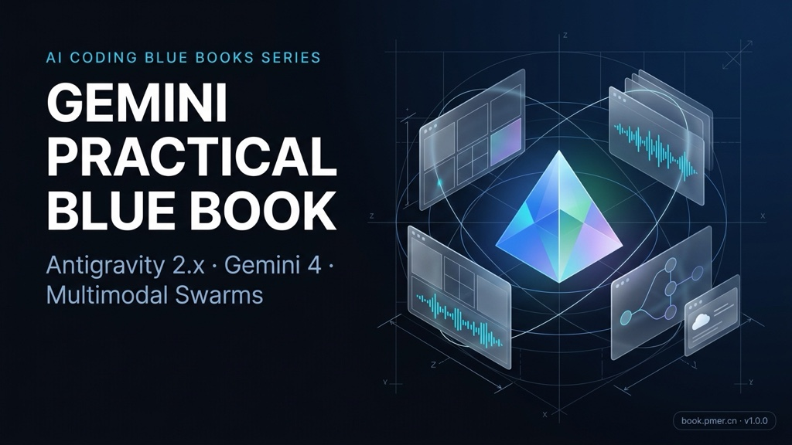
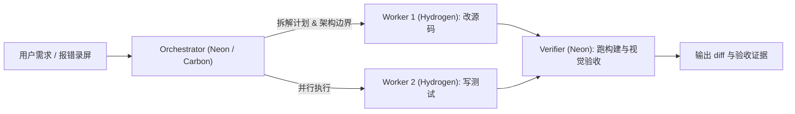
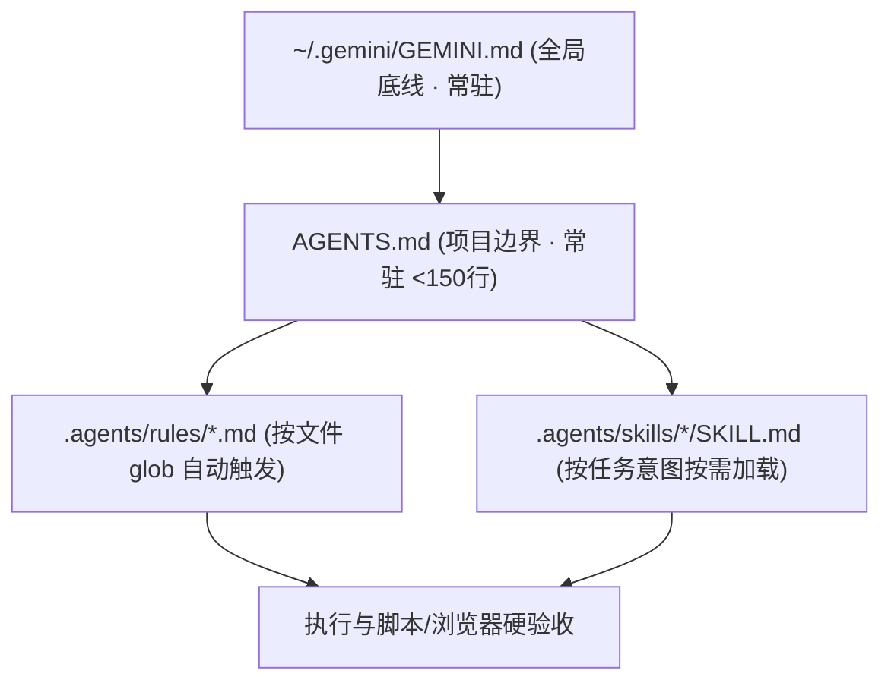
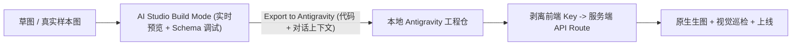
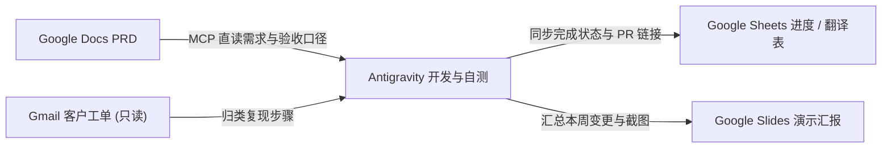
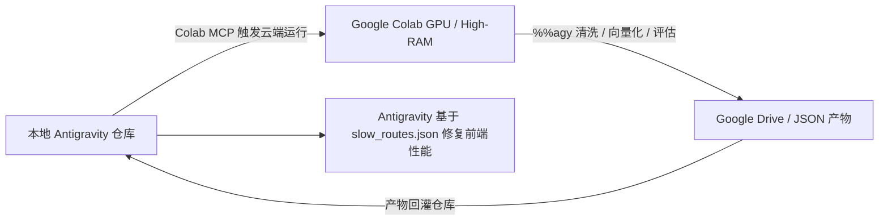
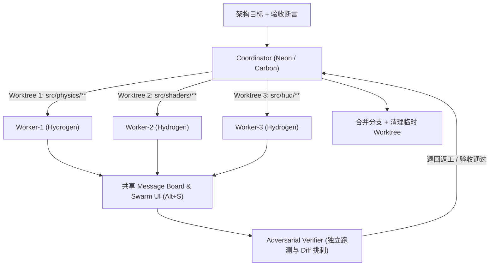
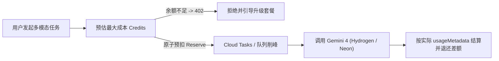

# 《Gemini 实战蓝皮书：Google 全域多模态编排与跨端交付指南》

**v1.0.0 · 资料核对至 2026 年 11 月 26 日**




主理人: [Hunk Wu](https://pmer.cn) (X: [@ai_pmer](https://x.com/ai_pmer))

[ 🌐 English PDF Version ](./gemini_blue_book_en.pdf) | [ 🌐 在线阅读站 ](https://book.pmer.cn/gemini/)

## 🧭 目录 (Table of Contents)

### 第一部分：Antigravity 指挥舱与 Gemini 4 选型
- Ch.01 告别单线程 CLI：Google Antigravity 架构与 Gemini 4 模型矩阵
- Ch.02 多模态开发规约：`AGENTS.md`、`.agents/rules` 与自定义 Skills

### 第二部分：AI Studio × Antigravity 原生多模态流
- Ch.03 从灵感到工程仓：Google AI Studio Build Mode 无损接力流
- Ch.04 音视频理解与 Gemini Live API 实时交互应用落地

### 第三部分：Google Workspace × Colab 全家桶联动
- Ch.05 办公流即研发流：Google Workspace MCP 深度自动化实战
- Ch.06 云端算力外挂：Google Colab（`%%agy`）数据管线与模型实验闭环

### 第四部分：`/swarm` 蜂群编排、视觉巡检与跨端交付
- Ch.07 `/swarm` 多代理蜂群架构与官方《Alpine Peak》全栈案例复盘
- Ch.08 浏览器视觉自动走查与 Web / Chrome MV3 / 移动跨端交付

### 第五部分：多模态商业闭环与生态瞭望
- Ch.09 商业化实战：打造基于 Google 生态的多模态出海生产力工具
- Ch.10 2026 前沿瞭望：Gemini 4 演进路线、配额精算与跨界空间智能

---

## 🔌 配套开源套件

*   **[Gemini Antigravity Starter Kit](https://github.com/aipmer/codex-blue-book/tree/main/examples/gemini-antigravity-kit)**：包含 `AGENTS.md`、路径级 `.agents/rules/ui-multimodal.md`、三视口 `visual-audit` Skill 及零依赖 Gemini 4 配额预算门禁脚本 `check_gemini_quota.mjs`。

*   **[多智能体通用规约生成器](https://book.pmer.cn/generator)**：一键导出 Antigravity `AGENTS.md` + `.agents/rules/`。

---

# Ch.01 告别单线程 CLI：Google Antigravity 架构与 Gemini 4 模型矩阵

> 🎯 **本章解决的工程麻烦**：面对 `Antigravity App`、`Antigravity IDE`、`agy CLI` 和企业版 `gemini` CLI 四个名字，以及 Gemini 4 的四个化学元素代号，不知道该装哪一套、什么时候用订阅配额、什么时候走 API，结果要么把 Pro 配额半小时烧光，要么 12 月 1 日 Argon 涨价翻倍才发现账单失控。
>
> 💡 **实战落地收益**：明确 Antigravity 与 GCP 企业工具的选型边界，掌握 **Gemini 4（Carbon / Argon / Neon / Hydrogen）** 截至 2026 年 11 月 26 日的真实定价账本、**Orchestrator** 混排配置，以及 5 分钟将现有 Cursor / Claude / Codex 规则无损迁入 Antigravity Plugin。
>
> ⚡ **一句话结论**：单线程 CLI 只能线性串行改代码，Antigravity 把多模型路由、独立 Git Worktree 蜂群和内置浏览器视觉验证收进同一个调度平面。

大多数开发者刚接触 Google 2026 年底的编码工具链时，第一道坎卡在命名上：桌面端有 Antigravity 2.x，终端里有 `agy`，谷歌云文档里还有一套 Gemini Code Assist 和 `gemini` CLI。装错入口，后面所有关于 `/swarm`、内置浏览器巡检和 AI Studio 一键导出的工作流都跑不通。

把它们当成两套面向不同组织边界的产品，事情就清楚了。

---

## 1.1 工具链选型边界：Antigravity (`agy`) vs 企业 GCP `gemini` CLI

打个比方：GCP 的 `gemini` CLI 和 Code Assist 像大型工厂里的合规流水线，核心诉求是 IAM 审计、VPC Service Controls 内网隔离和企业计费结算；而 **Google Antigravity（桌面端 + IDE + `agy` CLI）** 是给高产出工程团队和独立开发者造的多兵种作战指挥舱。

| 维度 | Google Antigravity 2.x + `agy` CLI | GCP `gemini` CLI / Gemini Code Assist |
| :--- | :--- | :--- |
| **适用人群** | 独立开发者、产品型工程团队、多模态全栈研发 | 强合规大企业、纯 GCP IAM 管控内网 |
| **多模型混排** | 原生 **Orchestrator**（Neon/Carbon 规划 + Hydrogen 执行） | 偏固定模型端点绑定 |
| **并发架构** | 原生 **`/swarm`**（Coordinator + Git Worktrees + 对抗性 Verifier） | 单会话或外部 CI 编排 |
| **多模态与预览** | 内置浏览器子代理、原生生图、AI Studio 带上下文一键导出 | 侧重代码补全与 Cloud Shell 集成 |
| **身份与认证** | Google AI Pro / Ultra 个人订阅，或设置 `AGY_ADC_AUTH` 走企业网关 | GCP 项目账号与 Vertex AI IAM 绑定 |

日常写业务、做多模态应用、需要一边改代码一边让代理打开浏览器测响应式排版，直接装 **Antigravity + `agy` CLI**。如果公司要求所有流量必须经由内部 Vertex AI 网关审计，依然可以用 `agy`，只需开启 `AGY_ADC_AUTH` 走 Application Default Credentials，不用放弃 `/swarm` 和本地定制插件。

---

## 1.2 Gemini 4 四大金刚选型账本（2026-11-26 核对）

Gemini 4 放弃了过去 `Pro / Flash / Ultra` 容易混淆的版本号，改用化学元素区分定位，全系标配 **1M 统一上下文窗口**。下面这份价格表直接关系到你的月度账单和配额续航：

| 模型 ID | 工程定位 | 标准输入（/1M） | 缓存读取（/1M） | 输出（/1M） | 关键提醒 |
| :--- | :--- | ---: | ---: | ---: | :--- |
| `gemini-4-hydrogen` | 极速日常执行、蜂群 Worker、批处理 | \$1.50 | 缓存优惠 | \$7.50 | 1M 窗口一口价，最适合跑高频文件修改与单测修复 |
| `gemini-4-neon` | 复杂编码甜点、Orchestrator 默认协调器 | \$3.00 | \$0.15 | \$15.00 | 支持 `Low / Medium / High / XHigh` 四档思考力度 |
| `gemini-4-argon` | 企业级复杂工程与长程知识推理 | \$2.00 → **\$4.00** | \$0.10 → **\$0.20** | \$10.00 → **\$20.00** | **硬节点预警：\$2/\$10 首发价截至 2026-11-30，12 月 1 日起翻倍** |
| `gemini-4-carbon` | 旗舰深度探索、安全审计、硬核长链路排障 | \$2.00（首发档） | 缓存优惠 | \$10.00（首发档） | Pro / Ultra 订阅配额消耗最快，只用在真正卡壳的架构与根因定位 |

> **账单防踩坑**：如果你在生产脚本或 CI 中绑定了 `gemini-4-argon`，请在 **2026 年 12 月 1 日** 之前复核月预算。常规代码修改和 PR 扫描优先切到 `gemini-4-hydrogen`（\$1.50/\$7.50）或 `gemini-4-neon`，把 Argon 和 Carbon 留给高价值架构评审。

你可以直接运行配套仓库中的零依赖脚本 [check_gemini_quota.mjs](https://github.com/aipmer/codex-blue-book/blob/main/examples/gemini-antigravity-kit/scripts/check_gemini_quota.mjs) 测算 12 月前后同一批任务的真实差价：

```bash
# 对比 2026-11-28 与 2026-12-05 运行同一批 Argon 任务的费用差异
node examples/gemini-antigravity-kit/scripts/check_gemini_quota.mjs \
  --model gemini-4-argon --date 2026-11-28 \
  --input-tokens 900000 --cached-tokens 300000 --output-tokens 150000 --budget 5

node examples/gemini-antigravity-kit/scripts/check_gemini_quota.mjs \
  --model gemini-4-argon --date 2026-12-05 \
  --input-tokens 900000 --cached-tokens 300000 --output-tokens 150000 --budget 5
```

第二条命令会直接返回 `BLOCKED_OVER_BUDGET` 并以退出码 `2` 拦截，适合挂在 CI 或批处理脚本入口做硬限流。

---

## 1.3 开启 Orchestrator 智能混排与 `agy` CLI 高频命令

很多团队抱怨“Gemini 4 强是很强，但改个小按钮也要思考十几秒”。根本原因是把旗舰推理模型当成了流水线打字机。

Antigravity 2.x 的 **Orchestrator** 解决的就是这个错配问题：由 `gemini-4-neon` 或 `gemini-4-carbon` 负责读需求、拆步骤、审边界，把具体文件读写、测试补全和样式微调分发给 `gemini-4-hydrogen`。实测复杂任务整体耗时下降约 19%，同时 Google AI Pro（\$19.99/月）订阅配额续航翻倍。



在终端中管理 `agy` CLI，记住下面 6 条核心命令就能覆盖 90% 的日常研发：

```bash
# 1. 启动交互式 Antigravity CLI 指挥舱
agy

# 2. 无头模式单次执行（适合脚本与 CI 流水线）
agy -p "检查 src/api/ 下所有路由是否缺少 zod 入参校验，仅输出 Markdown 报告"

# 3. 按会话 ID 续接上次中断的长任务（不用重新喂上下文）
agy -r 20f45382-2685-415c-a5a1-9b844d5893c7

# 4. 在 TUI 内查看最新本地缓存版本变更（支持直接核对新特性）
# 进入 agy 后输入: /changelog

# 5. 查看所有可用模型与当前账号配额档位
agy models

# 6. 企业 GCP 网关走 ADC 凭据认证
AGY_ADC_AUTH=1 agy -p "审计 terraform/iam.tf 中的过宽权限"
```

CLI 配置文件统一位于 `~/.gemini/antigravity-cli/settings.json`，常用配置如下：

```json
{
  "defaultModel": "gemini-4-neon",
  "thinkingEffort": "medium",
  "orchestrator": {
    "enabled": true,
    "workerModel": "gemini-4-hydrogen"
  },
  "sandbox": {
    "autoApproveVersionControlled": true
  }
}
```

---

## 1.4 5 分钟无缝搬家：从 Cursor / Claude / Codex 迁移配置

如果你已经在旧项目里攒了一堆 `.cursor/rules`、`.claude/commands`、MCP 服务器配置和自定义 Skill，**千万不要手动一条条重写**。

Antigravity 内置了 `migrate-agent-settings` 迁移流，可以把现有工具的规则、斜杠命令、子代理定义和 MCP 打包成单个独立 Plugin，随时一键启用或关闭，不会污染原始配置目录：

```bash
# 在目标仓库根目录启动 agy，直接调用内置迁移指令
agy -p "运行 migrate-agent-settings，扫描当前项目的 .claude/、.cursor/ 与 AGENTS.md，打包为本地 Antigravity plugin，不要删除原文件"
```

迁移完成后，老仓库里原本给 Codex 或 Claude 用的团队规范依然保持原样，团队里用不同工具的同事互不干扰。

---

## 🚀 新手极速上手 3 步走

1. **安装并核验身份**：安装 Antigravity 桌面端与 `agy` CLI 后，在终端执行 `agy --version && agy models`，确认账号已看到 `gemini-4-hydrogen` 与 `gemini-4-neon`。
2. **启用混排配置**：在 `~/.gemini/antigravity-cli/settings.json` 写入上文 `orchestrator` 配置，把日常 worker 下沉给 Hydrogen。
3. **跑通第一次无头诊断**：在任意现有 Git 仓库执行 `agy -p "梳理本仓库启动命令、测试入口与三个最高风险技术债"`，观察终端分离显示的 `Thinking...` 与 `Running command...` 计时器。

---

## 🛡️ 翻车自救与避坑速查表

| 故障现象 | 致命根因 | 即刻自救方案 |
| :--- | :--- | :--- |
| Pro 订阅配额半小时见底，频繁触发冷却 | 全局默认锁死了 `gemini-4-carbon` + `XHigh` 思考档位，连改文案都在烧旗舰额度 | 切换默认模型为 `gemini-4-neon`（`medium`）并开启 Orchestrator 下放给 `gemini-4-hydrogen`；仅在复杂排障时临时点名 Carbon |
| 12 月初 API 账单突然比 11 月翻倍 | 脚本中硬编码了 `gemini-4-argon`，未留意 2026-12-01 从 \$2/\$10 恢复为 \$4/\$20 标准价 | 用 `check_gemini_quota.mjs --date 2026-12-01` 复算所有批处理任务，日常任务改走 `gemini-4-hydrogen` 并开启 Context Caching |
| 迁移 Cursor / Claude 配置后规则互相打架 | 同时保留了旧全局提示词与重复的 `.agents/rules/`，导致模型指令冲突 | 执行 `/plugin` 查看已加载插件清单，只保留一份唯一真相源（根目录 `AGENTS.md` + 路径级 `.agents/rules/`） |

---

---

# Ch.02 多模态开发规约：AGENTS.md、.agents/rules 与自定义 Skills

> 🎯 **本章解决的工程麻烦**：把所有前端样式规范、生图流程、部署命令一股脑塞进全局提示词，导致每轮对话白烧几万输入 Token；更糟的是，AI 嘴上说“页面已响应式适配”，打开手机一看表格横着撑破屏幕、标签小到 9px 根本看不清。
>
> 💡 **实战落地收益**：掌握 Antigravity 四层定制优先级（全局 → `AGENTS.md` → 路径级 `.agents/rules/` → 按需 `SKILL.md`），落盘一套可复用的多模态视觉与生图验收红线，并学会安全调度轻量子代理处理只读附件审查。
>
> ⚡ **一句话结论**：好规约靠分层按需加载省上下文，靠浏览器计算值和脚本退出码卡死质量，而不是靠形容词祈祷。

多模态项目比纯后端更容易“失控”。纯后端只要编译通过、单测全绿，基本八九不离十；多模态前端项目即使 `npm run build` 零报错，依然可能出现图片路径 404、移动端溢出、小字号糊成一片、或者原图直接塞进 `public/` 把首屏拖到 12MB。

解决这些问题，靠的不是每次在聊天框里反复叮嘱，而是把规则拆进 Antigravity 的四层定制结构。

---

## 2.1 Antigravity 四层定制体系与加载优先级

把 Antigravity 的规则系统想象成医院的分诊台：

1. **全局规则（`~/.gemini/GEMINI.md`）**：相当于“院规”，只放所有仓库通用的底线（例如：中文回复、绝不打印密钥、改代码前先看 `git status`），控制在 80–120 行以内。
2. **项目根契约（`AGENTS.md`）**：相当于“科室章程”，声明当前仓库的构建命令、目录边界、架构红线，且被 Codex、Kimi Code、Antigravity 原生共用（Claude Code 通过 `@AGENTS.md` 复用）。
3. **路径级规则（`.agents/rules/*.md`）**：相当于“手术室专项须知”，通过 YAML `globs` 精确绑定目录——只有当智能体编辑 `src/components/**` 时才自动注入前端视觉红线，改后端 SQL 时零上下文开销。
4. **按需技能包（`.agents/skills/<name>/SKILL.md`）**：相当于“标准作业手册（SOP）”，平时只暴露 2 行的 `name + description` 元数据，命中任务场景时才按需加载完整步骤与配套脚本。



可以直接查看配套模板 [examples/gemini-antigravity-kit/.agents/rules/ui-multimodal.md](https://github.com/aipmer/codex-blue-book/blob/main/examples/gemini-antigravity-kit/.agents/rules/ui-multimodal.md)，它的触发范围被精准锁在前端与静态资源目录：

```markdown
---
description: Enforce responsive typography, zero overflow, and media hygiene on frontend components
globs:
  - "src/components/**"
  - "src/app/**"
  - "public/**"
---

# UI & Multimodal Asset Rules

1. **No microscopic labels**: Computed `font-size` for visible body, badge, table, and code text must stay `>= 12px`.
2. **Zero horizontal overflow**: Tables and code blocks inside narrow containers must use `overflow-x: auto` on a wrapper rather than stretching `documentElement.scrollWidth`.
3. **Structured multimodal outputs**: Any Gemini 4 vision/video extraction endpoint must declare an explicit `responseSchema` (JSON Schema) and validate output before persisting.
4. **Asset separation**: Store unoptimized source PNGs/MP4s in `assets-src/`; commit only compressed WebP/JPEG/MP4 runtime files under `public/`.
5. **Proof of visual pass**: After layout edits, capture computed overflow and min-font telemetry at `390x844`, `768x1024`, and `1440x900`.
```

---

## 2.2 把视觉验收与媒体管线写成可执行 Skill

文字规则写得再严，如果缺少标准化检查步骤，模型依然容易“看一眼代码就宣布修复成功”。把多模态验收做成 `.agents/skills/visual-audit/SKILL.md` 后，只要任务涉及布局或媒体变更，Antigravity 就会按固定清单拉起本地预览并量取真实 DOM 计算值：

```markdown
---
name: visual-audit
description: Run a deterministic 3-viewport browser audit (390px, 768px, 1440px) checking horizontal overflow, minimum computed font size (>= 12px), and broken images before marking a frontend task done.
---

# Visual Audit Procedure

1. Start the local preview server on a dedicated port (e.g., `127.0.0.1:4173`) and confirm HTTP 200.
2. Inspect target routes at `390x844`, `768x1024`, and `1440x900`.
3. Assert all three invariants:
   - `document.documentElement.scrollWidth - document.documentElement.clientWidth === 0`
   - Minimum visible text `parseFloat(getComputedStyle(el).fontSize) >= 12`
   - Every visible `` satisfies `img.complete && img.naturalWidth > 0`
4. Fix shared CSS/component root causes; never mask clipping with `overflow-x: hidden` on `body`.
```

对于原生生图产出的封面、插画或图标，务必遵守 **原始素材与运行时资产分离** 原则：
- 生成原图先落盘在 `assets-src/` 或临时产物目录，用 `read_file` 肉眼确认构图、文字拼写和边距；
- 再用 `sips`（macOS）或 `sharp` 统一裁切压缩至目标像素（例如封面 `1024×576`、OG 分享图 `1200×630`、WebP/JPEG 质量 `85–90`）后写入 `public/`；
- 这样单页体积可控，且未来需要改版重裁时仍保留无损原档。

```bash
# macOS 一行把原生生成的高清大图裁切压缩为标准 1200x630 OG 图
sips -c 630 1200 -s format jpeg -s formatOptions 88 \
  assets-src/hero-raw.png --out public/social/og-cover.jpg
```

---

## 2.3 轻量子代理与只读附件审查的隔离边界

多模态项目经常需要同时审 20 页 PDF 需求文档、十几张竞品截图或上千行日志。如果直接全塞进主编码会话，不仅撑爆主上下文注意力，还会让后续写代码变慢变贵。

正确的做法是把**只读理解任务**与**写代码任务**物理隔离：
- **在 Antigravity 内部**：将文档摘要、截图对比、规范初审委派给轻量只读子代理（如 `research` 或 `daily-flash`），只把精炼后的 JSON 结论或差异清单带回主会话；
- **在外部脚本 / 跨工具流水线中**：通过只读模式传入附件路径（权限严格限制在只读，不赋予 Shell、写入、部署或外部发送权限），且绝不把 `.env`、生产 Cookie 或无关仓库路径塞进提示词参数。

---

## 🚀 新手极速上手 3 步走

1. **导出标准骨架**：访问本站 [多智能体通用规约生成器](/generator)，切换到 **Gemini Antigravity** 标签页，勾选你的技术栈并下载 `AGENTS.md` + `.agents/rules/`。
2. **拷贝配套视觉 Skill**：将 [examples/gemini-antigravity-kit/.agents](https://github.com/aipmer/codex-blue-book/blob/main/examples/gemini-antigravity-kit/.agents/skills/visual-audit/SKILL.md) 复制到你的项目根目录。
3. **验证规则生效**：在终端运行 `agy -p "列出你当前加载的项目规则与可用 Skills，并用一句话说明 frontend 目录的字号红线"`，确认模型精准复述 `>= 12px` 与三视口零溢出规则。

---

## 🛡️ 翻车自救与避坑速查表

| 故障现象 | 致命根因 | 即刻自救方案 |
| :--- | :--- | :--- |
| `.agents/rules/ui-multimodal.md` 写了却从未生效 | YAML frontmatter 中的 `globs` 路径拼错，或缩进不合法导致解析静默跳过 | 用 `node -e` 或 `python3 -c "import yaml"` 校验 frontmatter 语法，并确保 `globs` 与实际目录名（如 `app/` vs `src/app/`）完全一致 |
| 明明设置了全局 `13px`，代码块文字仍被查出 `11.375px` | 样式表里嵌套了 `code { font-size: 0.875em; }`，相对父容器二次缩放跌破 12px | 为目标代码块显式写死绝对字号（如 `font-size: 13px;`），再用浏览器 `getComputedStyle` 复测 |
| 构建完 `public/` 暴涨到几十 MB | 把 AI 原生生成的 4K PNG 原图直接放进 `public/images/`，未走压缩裁切管线 | 将原图移出至 `assets-src/`（加入 `.gitignore` 或 LFS），脚本统一压成 WebP/JPEG 后再写入 `public/` |

---

---

# Ch.03 从灵感到工程仓：Google AI Studio Build Mode 无损接力流

> 🎯 **本章解决的工程麻烦**：在网页 Playground 里调出惊艳的多模态 Demo 后，一导出代码就变成“失忆压缩包”——本地 IDE 不知道你之前为什么选这个 Prompt、试错踩过哪些坑，只能从头解释一遍；而且前端把 `GEMINI_API_KEY` 直接暴露在浏览器源码里，根本不敢上线。
>
> 💡 **实战落地收益**：跑通 **AI Studio Build Mode → Export to Antigravity** 全上下文无损接力流，20 分钟完成多模态原型验证，再用 15 分钟在本地完成服务端代理加固、原生生图资产落地与结构化输出封装。
>
> ⚡ **一句话结论**：AI Studio 负责以最低摩擦把脑子里的画面跑出来，Antigravity 负责把玩具原型锻造成能收费的生产仓库。

过去做多模态产品，最浪费时间的一步叫“从 Demo 搬家到工程仓”。你在浏览器里花两小时把系统提示词、图片输入格式和 JSON Schema 调通了，结果下载 ZIP 解压进本地仓库后，所有迭代上下文瞬间清零。

Google 把 **AI Studio Build Mode** 和 **Antigravity** 之间那道墙打通之后，这条链路变成了真正的接力赛。

---

## 3.1 AI Studio Build Mode：20 分钟验证多模态可行性

AI Studio Build Mode 不是传统的纯文本聊天框，而是一个带实时预览沙盒和模型参数面板的网页工坊。最适合用它干三件事：

1. **草图 / 截图直出交互原型**：直接把白板手绘稿、Figma 截图或竞品页面拖进输入框，选择 `gemini-4-neon`（`medium` 思考档位），让它一次性生成可点击的前端页面与交互状态。
2. **多模态 Prompt 边界摸底**：在真正写后端数据库之前，先拖入 5 张极端样本图（光线暗、文字歪斜、局部遮挡），用 **Structured Outputs（JSON Schema）** 验证提取准确率到底够不够商业上线门槛。
3. **Token 账本预演**：在右侧实时观察不同图片分辨率和上下文缓存下的输入 Token 消耗，确认单次调用毛利算得过来再开写正式代码。



---

## 3.2 杀手级衔接：Export to Antigravity 与安全加固

当 Build Mode 里的原型已经跑通核心体验，点击右上角 **Export to Antigravity**。它做的不只是导出静态文件，而是把三样东西一起交接给本地 Antigravity：
- 完整项目目录树与依赖清单（`package.json`、`tsconfig.json`、组件代码）；
- 原型阶段的系统提示词与 `responseSchema` 定义；
- 关键对话上下文与架构意图摘要，让本地智能体一接手就明白“为什么这里用了 2 FPS 抽帧而不是 5 FPS”。

**落入本地仓库后的第一件必做大事：立刻清除客户端直连 Key。**
AI Studio 原型为了零门槛演示，有时会把调用写在前端组件里。上线前必须让 Antigravity 将所有 `@google/genai` 调用迁移至服务端路由（Next.js Route Handler / Cloud Run / Express），并强制开启 JSON Schema 强类型校验。

下面是一段直接可运行在 Next.js App Router（`src/app/api/analyze-ui/route.ts`）中的 Gemini 4 多模态视觉诊断接口：

```typescript
import { GoogleGenAI, Type } from "@google/genai";
import { NextResponse } from "next/server";

const ai = new GoogleGenAI({ apiKey: process.env.GEMINI_API_KEY });

const auditSchema = {
  type: Type.OBJECT,
  properties: {
    overallScore: { type: Type.NUMBER },
    issues: {
      type: Type.ARRAY,
      items: {
        type: Type.OBJECT,
        properties: {
          severity: { type: Type.STRING, enum: ["high", "medium", "low"] },
          region: { type: Type.STRING },
          diagnosis: { type: Type.STRING },
          cssFix: { type: Type.STRING }
        },
        required: ["severity", "region", "diagnosis", "cssFix"]
      }
    }
  },
  required: ["overallScore", "issues"]
};

export async function POST(req: Request) {
  if (!process.env.GEMINI_API_KEY) {
    return NextResponse.json({ error: "Server GEMINI_API_KEY not configured" }, { status: 500 });
  }

  const { imageBase64, mimeType = "image/png" } = await req.json();
  if (!imageBase64 || typeof imageBase64 !== "string") {
    return NextResponse.json({ error: "Missing imageBase64 payload" }, { status: 400 });
  }

  const response = await ai.models.generateContent({
    model: "gemini-4-hydrogen",
    contents: [
      {
        role: "user",
        parts: [
          {
            inlineData: {
              mimeType,
              data: imageBase64
            }
          },
          {
            text: "Inspect this mobile UI screenshot for text clipping, low contrast, tiny labels (<12px), and overflow. Return concrete CSS fixes."
          }
        ]
      }
    ],
    config: {
      responseMimeType: "application/json",
      responseSchema: auditSchema,
      temperature: 0.2
    }
  });

  return NextResponse.json(JSON.parse(response.text || "{}"));
}
```

注意三个生产细节：
1. 环境变量严格命名为 `GEMINI_API_KEY`，**严禁**加 `NEXT_PUBLIC_` 或 `VITE_` 前缀；
2. 常规视觉初筛优先使用 `gemini-4-hydrogen`（\$1.50/\$7.50），复杂设计评审才按需升档 `gemini-4-neon`；
3. `responseMimeType: "application/json"` 配 `responseSchema`，省掉脆弱的正则剥离 ```` ```json ```` 代码。

---

## 3.3 开发流内嵌原生生图与视觉资产精修

前端开发最容易卡壳的不是写 React 状态，而是“占位灰框太丑，找设计师排期要等三天”。在 Antigravity 里，可以把**品牌插画、空状态配图、OG 社交分享图**直接纳入同一条交付流水线：

1. **先定视觉语言锚点**：在提示词中锁死色板（例如深海蓝 `#0F172A`、亮青 `#22D3EE`）、比例（`16:9` 或 `1200×630`）和构图留白，避免每张图画风打架；
2. **肉眼验收拼写与边界**：生图模型在英文小字和中文笔画上仍可能偶发畸变，必须实际打开产物图检查无误再进入发布目录；
3. **统一裁切压缩**：用脚本批量转成目标尺寸与 WebP/JPEG，并核对页面 `` 的 `naturalWidth` 与 `aspect-ratio`，彻底消除页面加载跳动（CLS）。

---

## 🚀 新手极速上手 3 步走

1. **在 AI Studio 跑通最小多模态原型**：打开 Google AI Studio Build Mode，上传一张你的产品首页截图，用 `gemini-4-neon` 调试上面的 `auditSchema`，确认返回 JSON 字段准确。
2. **一键导入本地**：点击 **Export to Antigravity** 打开本地工程，创建 `.env.local` 填入 `GEMINI_API_KEY=...`（确认 `.env.local` 已在 `.gitignore` 中）。
3. **验证服务端代理**：启动本地服务，执行 `curl -X POST http://127.0.0.1:3000/api/analyze-ui` 传入测试图 Base64，确认返回结构化 JSON 且浏览器 Network 面板中完全看不到 API Key。

---

## 🛡️ 翻车自救与避坑速查表

| 故障现象 | 致命根因 | 即刻自救方案 |
| :--- | :--- | :--- |
| 导出后构建报错，前端 bundle 把 `GEMINI_API_KEY` 打进了静态 JS | 沿用了原型阶段的客户端环境变量（如 `VITE_GEMINI_API_KEY`） | 立刻删除前端环境变量并吊销轮换旧 Key；改为服务端 API Route 读取 `process.env.GEMINI_API_KEY` |
| 大图片直接 Base64 POST 触发 `413 Payload Too Large` | 原图动辄 6–10MB，超出 Next.js / Vercel 默认请求体上限（4.5MB） | 前端上传前用 `<canvas>` 缩放长边至 `<= 1600px` 并压缩为 JPEG（0.82），或先直传对象存储再由服务端拉取 |
| 同一套 Prompt 在本地比 AI Studio 效果差 | 导出后漏搬了 `systemInstruction` 或默认 `temperature` 从 `0.2` 变回了 `1.0` | 在本地代码显式写死 `systemInstruction`、`temperature` 与 `responseSchema`，不依赖 SDK 默认值 |

---

---

# Ch.04 音视频理解与 Gemini Live API 实时交互应用落地

> 🎯 **本章解决的工程麻烦**：用户只发来一段 25 秒的手机录屏说“点两次筛选按钮列表就闪一下变白”，写文字复现步骤根本讲不清时序；或者想做实时语音+摄像头指导助手，结果走传统“ASR → 文本模型 → TTS”三段拼接，延迟高达 3 秒、用户一插话系统还在自说自话。
>
> 💡 **实战落地收益**：掌握 Gemini 4 原生视频理解的“录屏直出修复补丁”工作流，用 `@google/genai` 搭通 **Gemini Live API** 双向 PCM 音频 + 1 FPS 视频帧实时管线，并用时间戳锚定与结构化 Schema 压制多模态幻觉。
>
> ⚡ **一句话结论**：文字讲不清的交互时序直接喂视频，对延迟敏感的音视频对话直接走原生 Live WebSocket，不再拼三段胶水服务。

文本模型看 UI 故障，好比让医生只听电话描述来判断皮疹。很多前端和移动端最难复现的 Bug——竞态闪烁、动画卡帧、键盘弹出把提交按钮顶出视口——全发生在时间轴上，单张静态截图根本抓不住。

Gemini 系列的原生视频理解和 **Gemini Live API**，把“看连续画面 + 听声音 + 实时打断回应”变成了可以直接编码调用的标准能力。

---

## 4.1 录屏驱动排障：用时间轴定位前端竞态 Bug

遇到偶发 UI 闪烁或交互错乱，把复现录屏（MP4/WebM，建议控制在 15–60 秒）和相关组件代码一起喂给 Antigravity 或 Gemini API。关键技巧不是问“哪里错了”，而是强制要求输出**带精确时间戳的状态转移表**。

下面是一段可直接运行的 Node.js 离线录屏诊断脚本（使用 Files API 上传视频，避免把大体积二进制塞进内存 Base64）：

```typescript
import { GoogleGenAI, Type } from "@google/genai";

const ai = new GoogleGenAI({ apiKey: process.env.GEMINI_API_KEY });

async function diagnoseBugVideo(videoPath: string) {
  const uploaded = await ai.files.upload({
    file: videoPath,
    config: { mimeType: "video/mp4" }
  });

  // 等待服务端完成视频分帧索引
  let fileState = await ai.files.get({ name: uploaded.name! });
  while (fileState.state === "PROCESSING") {
    await new Promise((r) => setTimeout(r, 2000));
    fileState = await ai.files.get({ name: uploaded.name! });
  }
  if (fileState.state !== "ACTIVE") {
    throw new Error(`Video processing failed: ${fileState.state}`);
  }

  const res = await ai.models.generateContent({
    model: "gemini-4-neon",
    contents: [
      {
        role: "user",
        parts: [
          { fileData: { fileUri: fileState.uri!, mimeType: "video/mp4" } },
          {
            text: "List every user interaction and visual anomaly with exact MM:SS timestamps, then infer the most likely frontend state or race condition root cause."
          }
        ]
      }
    ],
    config: {
      responseMimeType: "application/json",
      responseSchema: {
        type: Type.OBJECT,
        properties: {
          timeline: {
            type: Type.ARRAY,
            items: {
              type: Type.OBJECT,
              properties: {
                timestamp: { type: Type.STRING },
                action: { type: Type.STRING },
                observedUi: { type: Type.STRING }
              },
              required: ["timestamp", "action", "observedUi"]
            }
          },
          suspectedRootCause: { type: Type.STRING },
          verificationSteps: { type: Type.ARRAY, items: { type: Type.STRING } }
        },
        required: ["timeline", "suspectedRootCause", "verificationSteps"]
      }
    }
  });

  console.log(res.text);
  await ai.files.delete({ name: uploaded.name! });
}

diagnoseBugVideo("./bug-repro.mp4").catch(console.error);
```

拿到带 `MM:SS` 时间轴的结构化报告后，直接丢给本地 `agy` 结合 `git blame` 与组件源码查证，比人工反复拖动进度条快一个量级，最后顺手调用 `ai.files.delete` 清理云端临时文件。

---

## 4.2 Gemini Live API 实战：低延迟双向音视频架构

传统实时语音助手需要串联 `麦克风 → STT 语音转文字 → LLM 推理 → TTS 语音合成 → 扬声器`，不仅首字延迟动辄 2–3 秒，而且无法感知用户的语气停顿与画面变化。

**Gemini Live API** 通过单条有状态 **WebSocket** 同时承载音频输入、视频帧输入与原生音频流输出，并内建 **Barge-in（实时打断）** 机制——用户一开口，服务端自动截断正在播报的音频流，立刻响应新指令。

核心流媒体规格必须严格对齐，否则服务端会静音或断连：

| 通道 | 推荐编码规格 | 工程实践说明 |
| :--- | :--- | :--- |
| **上行音频** | Raw 16-bit PCM, `16kHz`, Little-Endian, 单声道 | 前端用 `AudioWorklet` 按 100ms 切片推送，勿用主线程 `ScriptProcessorNode` |
| **上行视频** | JPEG 抽帧，`<= 1 FPS`，长边 `768px` | 绝大多数陪练/质检场景 1 FPS 足够清晰，盲目推 15 FPS 只会爆账单与带宽 |
| **下行音频** | Raw 16-bit PCM, `24kHz`, Little-Endian | 客户端维护抖动缓冲队列；收到 `interrupted: true` 时立即清空播放队列 |
| **鉴权安全** | 后端签发 **Ephemeral Token（短效令牌）** | 浏览器绝不直连暴露长效 `GEMINI_API_KEY`，由服务端签发分钟级会话 Token |

下面是一段标准 Live Session 连接与打断处理核心逻辑（`@google/genai`）：

```typescript
import { GoogleGenAI, Modality } from "@google/genai";

export async function startLiveAssistant(ephemeralToken: string, onAudioChunk: (pcm24kBase64: string) => void, onInterrupt: () => void) {
  const ai = new GoogleGenAI({ apiKey: ephemeralToken });

  const session = await ai.live.connect({
    model: "gemini-live-2.5-flash-preview",
    config: {
      responseModalities: [Modality.AUDIO],
      systemInstruction:
        "You are a concise hardware inspection assistant. Speak in short sentences. Only report defects clearly visible in the latest camera frames."
    },
    callbacks: {
      onmessage: (msg) => {
        if (msg.serverContent?.interrupted) {
          onInterrupt();
          return;
        }
        const parts = msg.serverContent?.modelTurn?.parts || [];
        for (const part of parts) {
          if (part.inlineData?.data) {
            onAudioChunk(part.inlineData.data);
          }
        }
      },
      onerror: (err) => console.error("Live session error:", err),
      onclose: (ev) => console.log("Live session closed:", ev.reason)
    }
  });

  return {
    sendAudioPcm16k(base64Chunk: string) {
      session.sendRealtimeInput({
        audio: { data: base64Chunk, mimeType: "audio/pcm;rate=16000" }
      });
    },
    sendCameraFrame(jpegBase64: string) {
      session.sendRealtimeInput({
        media: { data: jpegBase64, mimeType: "image/jpeg" }
      });
    },
    close: () => session.close()
  };
}
```

> **提示**：Live API 模型代号迭代快，部署前请以 Google AI Studio / Gemini API 文档当日公布的当前稳定 Live 模型 ID 为准，并通过环境变量 `GEMINI_LIVE_MODEL` 注入，避免硬编码在前端包里。

---

## 4.3 多模态幻觉防御三条铁律

音视频任务最隐蔽的风险叫“脑补细节”：画面里其实糊掉了，模型却根据常识顺嘴编出一段看似合理的文字或报错码。上线前强制加三道防线：

1. **时间戳 + 置信度锚定**：在 `responseSchema` 中要求每条发现必须附带 `timestamp`（视频）或 `bbox`（图片）以及 `visibility: "clear" | "uncertain"`；凡 `uncertain` 一律要求人工复核或提示用户把镜头拉近。
2. **禁止画面外推**：在系统指令里显式写死“未在画面或音频中直接观测到的文字、数字或状态，一律返回 `null`，禁止猜测补全”。
3. **帧率与时长硬限流**：服务端网关按用户配额限制单次 Live 会话最长持续时间（如 10 分钟自动平滑重连）和视频帧率上限（1 FPS），配合 [check_gemini_quota.mjs](https://github.com/aipmer/codex-blue-book/blob/main/examples/gemini-antigravity-kit/scripts/check_gemini_quota.mjs) 里的 `--video-seconds` 预先算清每分钟毛利。

---

## 🚀 新手极速上手 3 步走

1. **跑通离线视频排障**：用系统自带录屏录一段 15 秒网页操作视频保存为 `bug-repro.mp4`，设置 `GEMINI_API_KEY` 后运行上文 `diagnoseBugVideo` 脚本，查看 JSON 时间轴输出。
2. **测算音视频成本**：执行 `node examples/gemini-antigravity-kit/scripts/check_gemini_quota.mjs --model gemini-4-hydrogen --video-seconds 300 --output-tokens 8000 --budget 1`，提前摸清 5 分钟视频理解的准确成本。
3. **验证 Live 打断体验**：在 AI Studio 的 Stream Realtime 面板打开麦克风与共享屏幕，中途直接插话打断模型回答，确认音频中断响应时间与清晰度，再按 4.2 节接入自己产品。

---

## 🛡️ 翻车自救与避坑速查表

| 故障现象 | 致命根因 | 即刻自救方案 |
| :--- | :--- | :--- |
| Live API 播报像机器人慢放或尖声加速 | 把服务端返回的 `24kHz` PCM 按 `16kHz` 或 `48kHz` 喂给了 Web Audio `AudioContext` | 创建播放上下文时显式指定 `sampleRate: 24000`，上行采集单独做重采样到 `16000` |
| 用户打断说话后，旧回答还在继续念完 | 未监听 `serverContent.interrupted` 事件，本地已排队的 `AudioBufferSourceNode` 没有立刻停止 | 收到 `interrupted` 标志时，遍历调用队列中所有待播节点的 `.stop()` 并重置播放时间戳 |
| 长视频分析直接报错超时或账单暴涨 | 未压缩原始 4K 60fps 录屏，或对 1 小时视频全量高帧率扫描 | 先用 `ffmpeg -i raw.mp4 -vf "fps=1,scale=960:-2" -c:v libx264 -crf 28 trim.mp4` 降采样再上传 |

---

---

# Ch.05 办公流即研发流：Google Workspace MCP 深度自动化实战

> 🎯 **本章解决的工程麻烦**：产品需求写在 Google Docs、多语言文案和排期表躺在 Google Sheets、客户报错邮件堆在 Gmail、周五还要整理 Google Slides 汇报进度——开发者每天花两小时当“复制粘贴搬运工”，还动不动贴错版本。
>
> 💡 **实战落地收益**：在 Antigravity 中通过 **Google Workspace MCP** 一次性打通 Docs / Sheets / Slides / Drive / Gmail，建立“PRD 自动转代码任务 → 改完自动回写排期表 → 一键出周报幻灯片”的闭环，并掌握 Workspace Add-ons 的商业化开发路径。
>
> ⚡ **一句话结论**：代码仓库只是研发的一半，另一半业务真相全在办公套件里；接上 Workspace MCP，代理才算真正看见全局。

绝大多数团队的研发瓶颈根本不在写代码的速度，而在“文档、表格、邮件、代码”四张皮之间的人工同步损耗。产品经理在 Docs 里改了一行计费规则，研发群里没人看见；开发修完 8 个 Bug，还得挨个打开 Sheets 手动改状态、切到 Gmail 回客户。

在 Google 生态里，**Google Workspace MCP** 把这些高频办公动作变成了智能体可直接调用、且带细粒度 OAuth 授权边界的标准工具。

---

## 5.1 接入 Google Workspace MCP 与最小权限边界

在 Antigravity 里配置 Workspace 集成有两种最稳妥的方式：
1. 直接从 Antigravity Marketplace 安装官方 **Google Docs / Google Sheets / Google Slides / Gmail** 插件，在 Plugins Manager 中完成 OAuth 授权（不接触原始 Refresh Token，凭据由本机受控钥匙串管理）；
2. 或在团队定制的 MCP 配置中挂载只读/按需写权限的 Workspace MCP Server，明确区分“默认可读”与“必须人工确认才能发信/覆盖表格”。

```json
{
  "mcpServers": {
    "google-workspace": {
      "command": "npx",
      "args": ["-y", "@google/workspace-mcp-server"],
      "env": {
        "WORKSPACE_ALLOWED_SCOPES": "docs.readonly,sheets.readwrite,slides.readwrite,gmail.readonly"
      }
    }
  }
}
```

> **安全红线**：给编码代理挂载 Gmail 时，默认只开 `gmail.readonly` 或 `gmail.compose`（仅起草草稿），**切勿默认开启无确认自动发送（`gmail.send`）**。写好的客户回复让代理存成草稿，由人扫一眼再点发送，既省 90% 功夫又不会发错事故邮件。

---

## 5.2 三条高杠杆双向自动化工作流

接通 Workspace MCP 后，最值得第一时间落地的不是炫技，而是下面三条每天都在重复的脏活：



### 工作流 A：直读 Docs PRD 生成验收清单与路由骨架
不用把 15 页 Docs 导出 PDF 再上传，直接把文档链接交给 `agy`：

```bash
agy -p "通过 Google Docs MCP 读取文档 https://docs.google.com/document/d/EXAMPLE_DOC_ID/edit ，提取其中第 3 节的计费状态机与边界条件，在仓库内生成 src/billing/state-machine.ts 及 Vitest 单元测试，并列出 PRD 中存在歧义的 3 个问题"
```

### 工作流 B：代码多语言词条与 Sheets 资产表双向同步
做海外 SaaS 时，运营习惯在 Google Sheets 改翻译文案。用 Antigravity 配合 Sheets MCP，可以一键把表格里的已审词条同步回 `locales/en.json` 和 `locales/ja.json`，同时把代码里新增的未翻译键写回表格标黄提醒运营：

```typescript
// scripts/sync_i18n_diff.mjs — 对比本地 JSON 与 Sheets 拉取结果，输出增量待译列表
import fs from "node:fs";

export function computeMissingKeys(sourcePath, targetPath) {
  const source = JSON.parse(fs.readFileSync(sourcePath, "utf8"));
  const target = JSON.parse(fs.readFileSync(targetPath, "utf8"));
  return Object.entries(source)
    .filter(([key]) => !(key in target) || String(target[key]).trim() === "")
    .map(([key, zhValue]) => ({ key, zhValue, status: "NEEDS_TRANSLATION" }));
}

if (process.argv[1]?.endsWith("sync_i18n_diff.mjs")) {
  const [src, dst] = process.argv.slice(2);
  if (!src || !dst) {
    console.error("Usage: node scripts/sync_i18n_diff.mjs <source.json> <target.json>");
    process.exit(1);
  }
  console.log(JSON.stringify(computeMissingKeys(src, dst), null, 2));
}
```

### 工作流 C：周五自动从 Git 日志生成 Slides 迭代简报
通过一条指令把本周合并的 `git log --since="7 days ago"`、核心性能指标和本地截图汇总，由 Slides MCP 自动写入既定母版生成 5 页管理层简报，彻底告别周五下午加班贴图。

---

## 5.3 从内部提效到外部收钱：开发 Workspace Add-ons 侧边栏插件

当你把某套 Docs / Sheets 自动化跑顺了（比如“跨境电商 Sheets 一键生成多语合规商品描述”或“律所 Docs 合同风险条款批注”），直接把它包装成 **Google Workspace Add-on** 上架 Google Workspace Marketplace，就是天然自带高付费意愿 B 端流量的变现通道。

核心最小结构（Apps Script + 外部 Cloud Run Gemini 4 接口）：

```javascript
// Code.gs — Google Sheets 侧边栏调用自有 Cloud Run + Gemini 4 后端
function onOpen() {
  SpreadsheetApp.getUi()
    .createMenu("Gemini Audit")
    .addItem("检查选中区域合规性", "auditSelectedRange")
    .addToUi();
}

function auditSelectedRange() {
  const sheet = SpreadsheetApp.getActiveSheet();
  const values = sheet.getActiveRange().getValues();
  const token = ScriptApp.getIdentityToken();

  const res = UrlFetchApp.fetch("https://api.yourdomain.com/v1/sheets-audit", {
    method: "post",
    contentType: "application/json",
    headers: { Authorization: "Bearer " + token },
    payload: JSON.stringify({ rows: values }),
    muteHttpExceptions: true
  });

  if (res.getResponseCode() !== 200) {
    SpreadsheetApp.getUi().alert("服务暂时不可用: " + res.getContentText());
    return;
  }
  const data = JSON.parse(res.getContentText());
  SpreadsheetApp.getUi().alert("发现 " + data.flaggedCount + " 处需复核项，已写入备注。");
}
```

把重逻辑和 `GEMINI_API_KEY` 放在你自己的 Cloud Run 后端，Apps Script 只做轻量 UI 入口和身份透传——既保护提示词与密钥资产，又能统一接入 Stripe 订阅配额。

---

## 🚀 新手极速上手 3 步走

1. **挂载单点权限**：在 Antigravity 安装 Google Docs 与 Sheets 插件并登录工作账号，暂不开启 Gmail 自动发信权限。
2. **实测一次 PRD 直读**：选一份你正在做的真实 Google Doc，让 Antigravity 提取接口字段并生成 TypeScript 类型定义文件，核对是否遗漏约束。
3. **验证只写草稿护栏**：让代理读取一封测试反馈邮件并生成“回复草稿”，确认它只保存在 Gmail 草稿箱而未擅自发出。

---

## 🛡️ 翻车自救与避坑速查表

| 故障现象 | 致命根因 | 即刻自救方案 |
| :--- | :--- | :--- |
| MCP 报错 `403 insufficientPermissions` | OAuth 授权时只勾选了只读范围，后续却要求写入 Sheets 或新建 Slides | 重新在插件授权面板补齐对应写权限 Scope，或明确拆分为“只读诊断账号”与“写入发布账号” |
| 代理回写 Sheets 时把原表公式覆盖成了纯文本 | 直接整表覆写了含公式的列，而不是限定写入数据区 | 规则中规定只允许向指定非公式列（如 `A2:D100`）写值，写入前先用 `valueRenderOption=FORMULA` 检查目标区域 |
| Workspace 插件提审被 Google 拒绝 | 申请了过宽的全局 Drive 权限（`drive` 全盘读写）却未提供隐私政策与录制视频 | 收缩为 `drive.file`（仅限用户主动打开的当前文件），并补齐清晰的数据留存说明与 OAuth 演示视频 |

---

---

# Ch.06 云端算力外挂：Google Colab（`%%agy`）数据管线与模型实验闭环

> 🎯 **本章解决的工程麻烦**：本地 MacBook 跑几万条用户遥测日志聚类、批量生成语义嵌入（Embeddings）或者微调小模型时，风扇起飞、内存爆红、Python CUDA 环境配一整天还报错；就算手动在云端跑完，结果散落在 Notebook 里，和 Git 工程仓彻底断层。
>
> 💡 **实战落地收益**：把 **Google Colab（`%%agy` 单元魔法命令 + Colab MCP Server）** 接成 Antigravity 的云端算力外挂，一条指令在云端 GPU 跑完数据清洗、评估报表与权重产物，再自动拉回本地仓库进入 CI 验收。
>
> ⚡ **一句话结论**：本地只留轻爽的代码逻辑与前端界面，把重数据清洗、向量化与 GPU 实验全部甩给 Colab，产物通过 Git 与 Drive 自动回流。

前后端全栈工程师做 AI 应用时，迟早会碰到一道硬墙：光靠调线上大模型 API 不够用了。你需要对 20 万条历史客服对话做聚类找痛点，或者对 5000 份商品手册做离线向量索引，甚至想拿 LoRA 微调一个专属分类器把推理成本砍掉 80%。

自己租一台长期开机的云 GPU 既贵又要维护 CUDA 驱动；直接在笔记本上跑又太慢。**Google Colab + `%%agy` + Colab MCP Server** 给出的解法，是让编码代理按需借用云端一次性算力容器，算完拿走产物，容器自动销毁。

---

## 6.1 激活 `%%agy` 单元魔法命令：在 Notebook 里直接调度代理

在 Google Colab 中，传统写法是开发者自己手写一长串 `pandas`、`matplotlib` 和 `torch` 代码，报一个 `KeyError` 或 `ShapeMismatch` 再复制报错去问聊天机器人。

启用 Antigravity 集成后的 **`%%agy` 单元魔法命令**，把自然语言任务、当前 Notebook 内存变量（DataFrame 列名、Tensor 形状）与单元格执行结果直接串成一个闭环：

```python
%%agy --model gemini-4-neon
读取 /content/drive/MyDrive/telemetry/nov2026_events.parquet：
1. 剔除缺失 session_id 或耗时 <= 0 的脏行，打印清洗前后行数对比；
2. 按 route 与 viewport_bucket 分组，计算 p50 / p95 LCP 与错误率；
3. 将异常路径（p95 > 2500ms 或 error_rate > 2%）导出为 /content/drive/MyDrive/telemetry/slow_routes.json，字段严格包含 route、viewport、p95_ms、error_rate、sample_count。
```

`%%agy` 执行完不只是吐一段代码，而是先检查已有 DataFrame 的真实 Schema，再生成可执行单元格并自动校验输出 JSON 是否符合要求。

如果需要在不依赖 `%%agy` 扩展的普通 CI 或无头 Colab 环境下复现同一套清洗管线，把生成出来的确定性 Python 脚本固定进仓库 `notebooks/telemetry_rollup.py`：

```python
import json
from pathlib import Path
import pandas as pd

def build_slow_routes_report(parquet_path: str, output_json: str) -> list[dict]:
    df = pd.read_parquet(parquet_path)
    cleaned = df.dropna(subset=["session_id"]).query("lcp_ms > 0").copy()

    grouped = (
        cleaned.groupby(["route", "viewport_bucket"], as_index=False)
        .agg(
            p50_ms=("lcp_ms", "median"),
            p95_ms=("lcp_ms", lambda s: float(s.quantile(0.95))),
            error_rate=("is_error", "mean"),
            sample_count=("session_id", "count"),
        )
    )

    flagged = grouped[(grouped["p95_ms"] > 2500) | (grouped["error_rate"] > 0.02)]
    records = [
        {
            "route": row.route,
            "viewport": row.viewport_bucket,
            "p95_ms": round(float(row.p95_ms), 1),
            "error_rate": round(float(row.error_rate), 4),
            "sample_count": int(row.sample_count),
        }
        for row in flagged.itertuples(index=False)
    ]

    Path(output_json).parent.mkdir(parents=True, exist_ok=True)
    Path(output_json).write_text(json.dumps(records, indent=2, ensure_ascii=False), encoding="utf-8")
    return records

if __name__ == "__main__":
    result = build_slow_routes_report("data/events.parquet", "reports/slow_routes.json")
    print(f"Flagged routes: {len(result)}")
```

---

## 6.2 Colab MCP Server：让本地 Antigravity 遥控云端算力并回灌代码仓

更进一步，挂载 **Colab MCP Server** 后，你甚至不用在浏览器和 IDE 之间来回切窗口。本地 Antigravity 代理可以直接通过 MCP 创建/执行 Colab Notebook、读取云端运行日志，并在任务完成后把结构化结果写回本地工程仓库。



实战场景：把真实线上性能遥测变成自动优化 PR。
1. Colab 跑完近 7 天 50 万条真实用户分位数据，导出 `reports/slow_routes.json`（只含聚合统计，彻底脱敏，绝不含个人邮箱或 Token）；
2. 本地 `agy` 读取 `reports/slow_routes.json`，精准定位 `p95 > 2500ms` 的三个路由；
3. 代理检查对应页面的字体加载、未压缩大图与同步脚本，提交拆包优化，并用本地浏览器复验。

---

## 6.3 一人公司的零运维离线数据工厂

对于独立开发者，Colab + Google Drive + Gemini Batch API 可以拼出成本极低的离线数据工厂，适合三类周期性重任务：

| 任务类型 | 推荐组合 | 成本与维护优势 |
| :--- | :--- | :--- |
| **每周 SEO / 搜索词聚类与内容缺口分析** | Sheets MCP → Colab `%%agy` 聚类 → 写回 Sheets | 零本地 Python 依赖冲突，免费/低价 Colab 运行时足够 |
| **知识库 10 万条文档向量化重建** | Drive 文件 → Colab GPU / Batch Embeddings → 写入向量库 | 避免本地笔记本合盖中断，天然带断点续传 |
| **多模态评测集回归跑分** | 测试集图/视频 → Colab 批量调 `gemini-4-hydrogen` → 输出评测 CSV | 每次改 Prompt 前后跑同一份评测集，用数字而非体感验收 |

---

## 🚀 新手极速上手 3 步走

1. **跑通首个脚本化统计**：将上文 `telemetry_rollup.py` 放进测试仓库，先在本地或 Colab 用 20 行模拟 Parquet/CSV 数据确认能正确输出 `slow_routes.json`。
2. **用 `%%agy` 迭代可视化**：在 Colab Notebook 新建单元格，使用 `%%agy` 生成按端分组的 P95 耗时柱状图，再把定型代码导出回仓库 `notebooks/` 目录纳入 Git 版本控制。
3. **验证产物回灌**：让本地 `agy -p "读取 reports/slow_routes.json，给出前三慢路由的排查清单"`，确认云端数据产物能直接驱动本地代码修改。

---

## 🛡️ 翻车自救与避坑速查表

| 故障现象 | 致命根因 | 即刻自救方案 |
| :--- | :--- | :--- |
| Colab 运行 90 分钟后容器回收，中间算好的向量全丢了 | 把产物写在了临时目录 `/content/`，没有持久化到 Google Drive 或对象存储 | 启动时立即 `drive.mount('/content/drive')`，所有 Checkpoint 每处理 500 条落盘一次到 Drive 或 GCS |
| Notebook 里硬编码了 `GEMINI_API_KEY`，一提交 `.ipynb` 就触发密钥泄露警报 | 直接把明文 Key 写进了代码单元格，提交时忘记清理单元格输出 | 在 Colab 统一使用左侧 **Secrets（`google.colab.userdata.get('GEMINI_API_KEY')`）**，并在仓库配置 `nbstripout` 提交钩子 |
| Colab 跑出来的 `.ipynb` 代码和本地仓库严重分叉 | 每次都在浏览器里即兴改 Notebook，从不回写 `.py` 模块 | 规定“探索在 Notebook，定型进 `scripts/*.py`”，Notebook 只 `import` 仓库里的纯 Python 函数 |

---

---

# Ch.07 `/swarm` 多代理蜂群架构与官方《Alpine Peak》全栈案例复盘

> 🎯 **本章解决的工程麻烦**：面对跨 4 个子系统的大型功能（后端 API、前端交互、WebGL 渲染、自动化测试），让单个智能体串行开发既慢又容易写到后面忘了前面；而自己手动开 4 个终端窗口并行写代码，最后 `git merge` 冲突解到怀疑人生。
>
> 💡 **实战落地收益**：掌握 Antigravity 原生 **`/swarm`** 蜂群调度模型（Coordinator + 独立 Git Worktree Worker + 对抗性 Verifier + 实时 Swarm UI 看板），拆解 Google 官方 **《Alpine Peak》** 3D 物理仿真工程的全链路打法。
>
> ⚡ **一句话结论**：并行多代理能不能真正提效，不取决于同时开几个窗口，而取决于文件边界是否物理互斥、以及有没有独立的对抗性验收员盯着合入质量。

如果你把单智能体开发比作“一个人依次刷墙、铺砖、装灯、验收”，那 **`/swarm`** 就是带项目经理和独立质检员的施工队：水电工、木工、油漆工各自领走互不打架的房间同时干活，干完不是自己签字过关，而是交给专挑毛病的质检员逐项复核，全部过关后项目经理统一合并交付。

---

## 7.1 `/swarm` 三角色协作模型与 Git Worktree 物理隔离

在 Antigravity 2.x 与 `agy` CLI 中输入 `/swarm` 启动蜂群后，系统会在共享留言板（Message Board）上协作运行三类职责分明的角色：

1. **Coordinator（协调员，推荐 `gemini-4-neon` 或 `gemini-4-carbon`）**：只负责拆解任务、划定每个 Worker 互斥的目录/文件所有权、分配模型档位、汇总合并分支，不和 Worker 抢写同一份业务代码。
2. **Parallel Workers（并行执行员，推荐 `gemini-4-hydrogen`）**：每个编辑型 Worker 通过 `workspace: "share"` 获得独立的 **Git Worktree** 工作副本。各自拥有独立分支、独立临时构建缓存，彻底杜绝并发改坏同一工作树。
3. **Adversarial Verifier（对抗性验收员，推荐 `gemini-4-neon` / 只读 `inherit`）**：不参与写功能代码，专门针对 Worker 的 diff 写边界测试、查类型漏洞、用浏览器跑三视口回归，专门找茬直到证据过关。



在 `agy` CLI 中，按下 **`Alt + S`** 或输入 `/swarm board` 可以打开实时蜂群监控看板，一眼看清每个成员当前处于 `working`（干活中）、`waiting`（休眠零消耗）还是 `stopped` 状态。

### 一份拿来即用的 `/swarm` 任务派发模板

千万不要只打一句“`/swarm 帮我把整个项目重构了`”——那样只会让多个 Worker 撞在同一批公共文件上。合格的 `/swarm` 启动提示词必须显式声明**三件事：互斥目录边界、模型分工、验收门槛**：

```markdown
/swarm 为本项目上线实时协作画板 v2，严格按以下分工并行推进：

- Coordinator（默认 gemini-4-neon）：先冻结 `src/shared/protocol.ts` 的消息协议类型，再拉起 3 个独立 Git worktree Worker，最后统一合并并运行全量验收。
- Worker `backend-sync`（gemini-4-hydrogen，独占 `server/sync/**`）：实现 WebSocket 房间状态广播与断线重连单测。
- Worker `canvas-render`（gemini-4-hydrogen，独占 `src/canvas/**`）：实现 60fps 离屏渲染与缩放平移手势。
- Worker `ui-toolbar`（gemini-4-hydrogen，独占 `src/components/toolbar/**`）：实现工具栏与移动端折叠面板（字号 >= 12px，390/768/1440px 零溢出）。
- Verifier `qa-adversary`（gemini-4-neon，只读）：不要直接改业务源码；等待三组提交后独立审查协议一致性、跑集成测试与三视口浏览器验收，发现任何漏洞在留言板打回对应 Worker 修复。
```

---

## 7.2 官方标杆案例复盘：《Alpine Peak》3D 仿真工程的全栈接力

Google Antigravity 演示中最具代表性的工程案例之一是 **《Alpine Peak》** 高性能 3D 雪山地形与滑雪物理仿真项目。把它拆开来看，它完美串联了本书前六章讲到的全部 Google 生态杠杆，而不是孤立炫技：

1. **阶段一 · AI Studio 快速起盘**：先用 AI Studio Build Mode 结合地形参考图，在浏览器里快速验证等距视角、雪坡光照基调和 Three.js 场景骨架，随后一键 **Export to Antigravity** 把项目连带设计意图带回本地。
2. **阶段二 · Antigravity `/swarm` 并发攻关**：
   - `terrain-worker`（Hydrogen）在独立 worktree 中攻克程序化高度图生成与 LOD 网格分块；
   - `shader-worker`（Hydrogen）专注雪面次表面散射着色器、动态雪辙与阴影性能预算；
   - `physics-worker`（Carbon / Neon）调校坡度摩擦力、起跳抛物线与碰撞箱；
   - `perf-verifier` 持续在内置浏览器中采样真实 FPS、Draw Call 数量与内存占用，一旦帧率跌破阈值立即打回着色器分支优化。
3. **阶段三 · Colab + Workspace 闭环**：把海量仿真遥测与关卡难度曲线抛给 Colab 批量拟合参数，把验收报告与版本里程碑通过 Workspace MCP 回写至团队 Sheets 跟踪表。

从中可以提炼出一条适用于任何团队的黄金铁律：**共享接口协议先由 Coordinator 冻结，并行 Worker 只动各自垂直切片，性能/视觉指标交由独立 Verifier 用真实浏览器数据一票否决。**

---

## 7.3 蜂群防卡死与冲突消解实用清单

多代理跑久了最常见两类问题：一是某个 Worker 陷入原地打转导致全队空等，二是合入阶段出现接口不兼容。用四条硬纪律兜底：

1. **先冻契约再发散**：任何涉及跨模块通信的 TypeScript Interface / Protobuf / SQL Schema，必须在开启并行前由 Coordinator 定稿提交到基线分支。
2. **明确写者唯一性**：任何时刻，同一个文件或同一个外部测试端口只能有一个 Worker 拥有写权限；共用配置（如 `package.json`）一律由 Coordinator 在汇总阶段统一修改。
3. **善用休眠成本模型**：Antigravity 蜂群里处于 `waiting` 状态的成员不消耗推理 Token；只有在共享留言板被 `@mention` 时才会被系统唤醒。
4. **先合入再销毁 Worktree**：某个 Worker 的活干完并被 Verifier 放行后，Coordinator 先把它所在 worktree 分支合入主工作区并跑通测试，再销毁该 Worker 及其临时目录，避免丢失未提交改动。

---

## 🚀 新手极速上手 3 步走

1. **从小规模双 Worker 练手**：选一个既有前后端、测试脚本齐全的仓库，用 `/swarm` 拆成 `api-worker`（改 `src/api/`）和 `ui-worker`（改 `src/ui/`）外加 1 个 `verifier`，体验零冲突合并。
2. **打开 Swarm Board 实时观察**：按 `Alt + S`（或输入 `/swarm board`）观察各 Worker 的思考与命令计时、留言板交接与 Verifier 的打回记录。
3. **核对干净收尾**：合并完成后在终端执行 `git worktree list && git status`，确认所有临时 worktree 已清理且主工作区构建测试全绿。

---

## 🛡️ 翻车自救与避坑速查表

| 故障现象 | 致命根因 | 即刻自救方案 |
| :--- | :--- | :--- |
| 两个 Worker 同时修改了 `package.json` 或 `src/types.ts` 导致合并冲突 | 任务派发前未划分互斥目录，也未先由 Coordinator 冻结公共类型与依赖 | 立即暂停并行，先由 Coordinator 手动收敛 `src/types.ts` 到基线分支，再通知两个 Worker rebase 到新基线 |
| 整个蜂群半小时没动静，所有人互相干等 | 两位成员都在等对方先发消息，缺少显式唤醒链条 | 在共享留言板直接 `@coordinator` 指令汇总当前阻塞项，或让 Verifier 先验收已完成的那一组分支 |
| Verifier 说“看起来没问题”但合并后构建炸了 | Verifier 只读了静态 diff，没有真正跑构建命令或启动预览验收 | 在 Verifier 简报中强制写明必须贴出真实命令输出与退出码（`npm run build && npm test`），无执行证据禁止放行 |

---

---

# Ch.08 浏览器视觉自动走查与 Web / Chrome MV3 / 移动跨端交付

> 🎯 **本章解决的工程麻烦**：代码在桌面 1440px 看着挺好，一发线上就被用户截图反馈“iPhone 竖屏右侧切掉一半”“平板导航换行把按钮挡住”；做 Chrome 扩展时被 Manifest V3 的 CSP 报错和 Service Worker 休眠折磨到怀疑人生；上线还要自己手配 HTTPS、鉴权和边缘缓存。
>
> 💡 **实战落地收益**：搭建“本地预览 → 浏览器子代理三视口计算值巡检 → 定位 CSS 根因并复测”的零盲区视觉闭环；按 MV3 最新规范开发可提审的 Chrome 侧边栏智能扩展；跑通 **Firebase Hosting + Cloud Run** 全球部署与线上验活。
>
> ⚡ **一句话结论**：构建通过不等于视觉验收通过；只有把浏览器真实计算值、扩展权限最小化和云端健康检查接进交付流水线，跨端才不会靠运气。

前几章解决了“写得快”，这一章解决“发出去不翻车”。Google 生态在终端交付侧有一个常被低估的组合拳：**内置浏览器自动化巡检 + Chrome Manifest V3 扩展生态 + Firebase / Cloud Run 托管底座**。

---

## 8.1 浏览器视觉自动走查：不靠肉眼猜，用计算值说话

很多开发者让 AI“检查一下页面布局”，AI 只是把 `.css` 文件读了一遍就回复“布局合理”。真正的视觉闭环必须让浏览器子代理打开真实渲染后的页面，量取三个硬指标：

1. **三视口零横向溢出**：在 `390×844`（窄屏手机）、`768×1024`（平板）和 `1440×900`（桌面）下，`document.documentElement.scrollWidth - document.documentElement.clientWidth === 0`。
2. **最小可见字号红线**：遍历所有可见文本节点，`parseFloat(getComputedStyle(el).fontSize) >= 12`。
3. **媒体完整与路由状态**：所有 `` 满足 `complete && naturalWidth > 0`；站内切换路由不触发意外整页重载，不丢失查询参数和语言状态。

下面这段浏览器端评测探针可以直接嵌入你的自动化验收脚本或 Antigravity 视觉 Skill：

```javascript
(() => {
  const overflow = document.documentElement.scrollWidth - document.documentElement.clientWidth;
  let minFont = 999;
  let minFontTarget = "";

  for (const el of document.querySelectorAll("body *")) {
    const s = getComputedStyle(el);
    if (s.display === "none" || s.visibility === "hidden" || parseFloat(s.opacity) === 0) continue;
    const rect = el.getBoundingClientRect();
    if (rect.width === 0 || rect.height === 0) continue;
    const hasText = [...el.childNodes].some((n) => n.nodeType === 3 && n.textContent.trim().length > 0);
    if (!hasText) continue;
    const size = parseFloat(s.fontSize);
    if (size > 0 && size < minFont) {
      minFont = size;
      minFontTarget = `${el.tagName}.${String(el.className).slice(0, 24)}:${el.textContent.trim().slice(0, 18)}`;
    }
  }

  const brokenImages = [...document.querySelectorAll("img")]
    .filter((img) => img.offsetParent !== null && (!img.complete || img.naturalWidth === 0))
    .map((img) => img.getAttribute("src"));

  return {
    overflow,
    minFont: Number(minFont.toFixed(2)),
    minFontTarget,
    brokenImages
  };
})();
```

> **修复铁律**：一旦测出某个容器在 `768px` 溢出，先查共享组件和 CSS 级联的共同根因（例如未设 `min-width: 0` 的 Flex 子项、无滚动包裹的宽表格、写死宽度的输入框），绝不用在 `body` 上强行加 `overflow-x: hidden` 掩盖裁切。

---

## 8.2 Chrome Manifest V3 侧边栏扩展实战（含内置 AI 降级策略）

Chrome 扩展是独立开发者冷启动最快的载体之一，但 **Manifest V3** 有三条铁律踩中一条就会被 Chrome Web Store 拒审或线上失灵：
- 禁止远程托管 JS 代码与 `eval()`；
- 后台 `service_worker` 随时会被浏览器休眠，状态必须落盘到 `chrome.storage.local` / `session`，不能存全局变量；
- 权限最小化：能用 `activeTab` 就绝不申请 `<all_urls>`。

下面是一个完整可加载、零违规权限的 Chrome Side Panel 扩展清单（`manifest.json`）：

```json
{
  "manifest_version": 3,
  "name": "Page Audit Sidekick",
  "version": "1.0.0",
  "description": "Summarize the active tab locally with Chrome Built-in AI or your Cloud Run Gemini 4 gateway.",
  "permissions": ["sidePanel", "activeTab", "storage"],
  "host_permissions": ["https://api.yourdomain.com/*"],
  "background": {
    "service_worker": "background.js",
    "type": "module"
  },
  "side_panel": {
    "default_path": "sidepanel.html"
  },
  "action": {
    "default_title": "Open Page Audit Sidekick"
  }
}
```

在 `sidepanel.js` 中，优先尝试 Chrome 浏览器端本地 **Built-in AI（Prompt API / Summarizer API）** 实现零延迟、零 API 成本处理简单摘要；当设备不支持或需要深度跨页分析时，平滑降级到你的 Cloud Run Gemini 4 接口：

```javascript
// sidepanel.js — 本地 Built-in AI 优先，云端 Gemini 4 兜底
async function summarizePageText(pageText, userToken) {
  if ("Summarizer" in self) {
    const availability = await self.Summarizer.availability();
    if (availability === "available") {
      const summarizer = await self.Summarizer.create({ type: "key-points", length: "medium" });
      try {
        return { engine: "chrome-built-in", summary: await summarizer.summarize(pageText) };
      } finally {
        summarizer.destroy();
      }
    }
  }

  const res = await fetch("https://api.yourdomain.com/v1/summarize", {
    method: "POST",
    headers: {
      "Content-Type": "application/json",
      Authorization: `Bearer ${userToken}`
    },
    body: JSON.stringify({ text: pageText.slice(0, 40000) })
  });
  if (!res.ok) throw new Error(`Cloud fallback failed: ${res.status}`);
  const data = await res.json();
  return { engine: "gemini-4-hydrogen", summary: data.summary };
}
```

---

## 8.3 Firebase + Cloud Run 极速全栈交付与线上验活

对多模态 Web / 扩展后端来说，**Firebase Hosting（全球静态 CDN + Firebase Auth / Firestore）+ Cloud Run（按请求秒级扩缩容、支持长超时 WebSocket 与 FFmpeg 视频转码）** 是最省心的 Google 原生部署组合：

- 静态前端走 Firebase Hosting，无需操心 SSL 与缓存头；
- 需要大内存视频抽帧、Live API 短效 Token 签发或 Playwright 巡检的接口走 Cloud Run，闲时缩容到 0 不花钱；
- 生产密钥统一放 **Google Secret Manager**，在部署时挂载为运行时环境变量。

```bash
# 1. 构建并部署多模态后端到 Cloud Run（注入 Secret Manager 中的 GEMINI_API_KEY）
gcloud run deploy multimodal-api \
  --source . \
  --region us-central1 \
  --allow-unauthenticated \
  --memory 1Gi \
  --timeout 120 \
  --set-secrets="GEMINI_API_KEY=gemini-api-key:latest"

# 2. 部署前端静态站点与 /api/** 反向代理重写规则
firebase deploy --only hosting

# 3. 线上生效独立核验（构建通过 ≠ 线上生效）
curl -fsS -I https://your-app.web.app/ | head -n 5
curl -fsS https://your-app.web.app/api/health
```

---

## 🚀 新手极速上手 3 步走

1. **跑一次三视口探针**：在本地项目启动预览服务，让 Antigravity 浏览器子代理依次在 `390px / 768px / 1440px` 执行 8.1 节探针，先清零所有溢出与 `<12px` 字号。
2. **加载本地 MV3 骨架**：将 `manifest.json` + `sidepanel.html` + `sidepanel.js` 放入目录，在 `chrome://extensions` 打开开发者模式点击“加载已解压的扩展程序”，验证侧边栏正常打开且零控制台 CSP 报错。
3. **验证部署与生效分离**：首次部署 Cloud Run 后，不要只看终端的 `Service URL`，务必真实 `curl` 健康检查接口并在隐身窗口打开正式域名确认鉴权与资源加载全部正常。

---

## 🛡️ 翻车自救与避坑速查表

| 故障现象 | 致命根因 | 即刻自救方案 |
| :--- | :--- | :--- |
| Chrome 扩展放后台 30 秒后登录态或定时器全丢 | MV3 `service_worker` 空闲自动销毁，状态错存在内存变量或 `setInterval` 里 | 所有状态改存 `chrome.storage.session` / `local`，定时任务改用 `chrome.alarms` API |
| Cloud Run 处理 2 分钟视频上传时在 60 秒被直接掐断 | Cloud Run 默认请求超时或前端反向代理超时偏短，且直接同步阻塞处理长视频 | 将 `--timeout` 调至 `120–300`，更长视频改为直传 GCS 后通过异步队列处理并轮询状态 |
| 移动端实测文字换行把按钮挤出屏幕，桌面端却一切正常 | Flex 容器子元素未设 `min-width: 0` 或长 URL 缺少 `overflow-wrap: anywhere` | 在共享布局样式补充 `min-width: 0; overflow-wrap: anywhere;`，再重跑 `390px` 视口探针复验 |

---

---

# Ch.09 商业化实战：打造基于 Google 生态的多模态出海生产力工具

> 🎯 **本章解决的工程麻烦**：辛辛苦苦做出一个多模态 SaaS，用户交了 \$19/月，结果一个人一天传 200 段高清视频把你的 Gemini API 账单刷掉 \$85，越有活跃用户亏得越惨；或者产品上线后只在社交媒体发了一条帖，第二天就没了流量。
>
> 💡 **实战落地收益**：拿出一份经过毛利测算的多模态选品矩阵、一套带 **Credits 积分折算 + 服务端硬限流 + 异步削峰** 的真实可运行计费中间件，以及 Chrome Web Store + Google Workspace Marketplace + SEO 三线冷启动路径。
>
> ⚡ **一句话结论**：多模态 SaaS 的商业护城河不在“接了 Gemini API”，而在“把按秒波动的多模态成本装进可预测的毛利模型，并寄生在现成高频入口里拿自然流量”。

纯文本套壳工具在 2026 年已经很难收上价，但**多模态 + 垂直场景工作流**依然存在大量高毛利细分切口。原因很朴素：绝大多数中小企业员工根本不会自己写脚本去截视频帧、调 JSON Schema 或打通 Google Sheets。谁把整套链路封装成“点一下按钮出结果”，谁就能收月费。

---

## 9.1 适合一人公司的三类多模态选品矩阵

挑方向别只看酷不酷，先算“客单价 ÷ 单月峰值 API 成本”是否大于 **5 倍毛利安全垫**：

| 赛道方向 | 核心多模态杠杆 | 目标付费人群 | 推荐定价与毛利逻辑 |
| :--- | :--- | :--- | :--- |
| **视觉 UI / 电商合规质检台** | 图片 + 短录屏 + Schema 结构化输出 | 独立出海站长、跨境电商运营、前端团队 | \$29–\$79/月；单次图片诊断走 `gemini-4-hydrogen` 成本不足 \$0.005，毛利 > 85% |
| **实时音视频专业陪练 / 面试助手** | Gemini Live API（16kHz 音频 + 1 FPS 画面） | 外企求职者、外贸销售、语言学习者 | 按“实时分钟包”阶梯售卖（如 \$19 含 120 分钟），严格按分钟扣减杜绝无限畅聊亏损 |
| **Google Workspace 垂直侧边栏插件** | Docs / Sheets / Slides Add-on + 后端 Gemini 4 | 律所、财税顾问、跨境选品与 HR 团队 | \$15–\$49/席位/月；直接长在用户每天必开的 Sheets/Docs 里，留存远高于独立网页 |

---

## 9.2 多模态计费风控：积分折算、预扣费与异步削峰

多模态计费最容易翻车的坑是**“先调用模型，再统计用量”**。恶意用户或误操作脚本只要并发发 50 个长视频请求，就能在数据库扣完余额前瞬间击穿你的 API 额度。

生产级计费必须采用 **预估冻结（Reserve）→ 执行调用 → 按真实 `usageMetadata` 多退少补（Settle）** 的三段式事务：



下面是一个可直接落入 Node.js / TypeScript 后端的多模态积分折算与原子预扣模块（`src/billing/credits.ts`）：

```typescript
export interface MediaEstimateInput {
  model: "gemini-4-hydrogen" | "gemini-4-neon" | "gemini-4-carbon";
  promptChars: number;
  imageCount?: number;
  videoSeconds?: number;
  maxOutputTokens: number;
}

// 1 Credit = $0.001 USD（保留 4x 安全边际以覆盖基础设施、支付手续费与毛利）
const USD_PER_1M: Record<MediaEstimateInput["model"], { in: number; out: number }> = {
  "gemini-4-hydrogen": { in: 1.5, out: 7.5 },
  "gemini-4-neon": { in: 3.0, out: 15.0 },
  "gemini-4-carbon": { in: 2.0, out: 10.0 }
};

export function estimateRequiredCredits(input: MediaEstimateInput): number {
  const textTokens = Math.ceil(input.promptChars / 3.2);
  const imageTokens = (input.imageCount ?? 0) * 258;
  const videoTokens = Math.ceil((input.videoSeconds ?? 0) * 290);
  const totalInput = textTokens + imageTokens + videoTokens;

  const rate = USD_PER_1M[input.model];
  const rawUsd =
    (totalInput / 1_000_000) * rate.in +
    (input.maxOutputTokens / 1_000_000) * rate.out;

  const retailUsd = rawUsd * 4;
  return Math.max(1, Math.ceil(retailUsd / 0.001));
}

export async function withCreditGuard<T>(
  userId: string,
  requiredCredits: number,
  ledger: {
    reserve: (uid: string, amount: number) => Promise<{ ok: boolean; txId: string }>;
    settle: (txId: string, actualCredits: number) => Promise<void>;
    refund: (txId: string) => Promise<void>;
  },
  work: () => Promise<{ result: T; actualCredits: number }>
): Promise<T> {
  const hold = await ledger.reserve(userId, requiredCredits);
  if (!hold.ok) {
    const err = new Error("INSUFFICIENT_CREDITS");
    (err as Error & { status?: number }).status = 402;
    throw err;
  }
  try {
    const { result, actualCredits } = await work();
    await ledger.settle(hold.txId, Math.min(actualCredits, requiredCredits));
    return result;
  } catch (error) {
    await ledger.refund(hold.txId);
    throw error;
  }
}
```

把 `estimateRequiredCredits` 接在每个多模态接口最前面，再在数据库层给 `user_wallets.balance` 加 `CHECK (balance >= 0)` 约束，哪怕遭遇并发刷接口也不可能产生负余额资损。

---

## 9.3 三线低成本冷启动获客闭环

独立开发者没有大预算买信息流广告，利用 Google 自家生态的分发杠杆是最稳妥的冷启动路线：

1. **Chrome Web Store + Google Workspace Marketplace 双商店自然搜索**：在扩展标题、副标题与首屏截图里精准对齐用户痛点关键词（如 `Sheets Compliance Auditor`、`Video Bug Repro Summarizer`），这两处商店的搜索转化率远高于纯落地页。
2. **免费轻量在线工具 + GEO/SEO 双收割**：把主产品的某个高频子能力拆成一个免登录免费页（例如免费版“移动端截图排版体检”或“Gemini 4 Token 成本计算器”），配齐 `sitemap.xml`、`robots.txt`、`llms.txt` 与清晰的 JSON-LD，既吃 Google 传统搜索长尾词，也吃 AI 搜索引擎（ChatGPT Search / Perplexity / Google AI Overviews）的引用推荐。
3. **内置分享水印与结果页回流**：生成的质检报告或分析卡片提供公开只读短链，页脚留克制的产品入口，让客户把报告发给同事或老板时自动完成二次传播。

---

## 🚀 新手极速上手 3 步走

1. **先算账再写代码**：把你打算做的多模态产品典型一次请求的图/视频时长代入 `estimateRequiredCredits` 或 [check_gemini_quota.mjs](https://github.com/aipmer/codex-blue-book/blob/main/examples/gemini-antigravity-kit/scripts/check_gemini_quota.mjs)，确认单次毛利高于 75%。
2. **上线前打通预扣费与硬上限**：为免费体验用户设死单日上限（例如每日 3 次图片体检、不开放长视频），并给付费套餐配置清晰可见的剩余 Credits 进度条。
3. **同步提交商店与 SEO 基建**：官网上线当天一并部署 `sitemap.xml`、`robots.txt`、`llms.txt` 与 Chrome / Workspace 商店列表，持续按周复盘搜索词与付费转化率。

---

## 🛡️ 翻车自救与避坑速查表

| 故障现象 | 致命根因 | 即刻自救方案 |
| :--- | :--- | :--- |
| 免费试用接口一夜间被羊毛党刷爆额度 | 未做登录鉴权、IP 速率限制与单账号日配额上限，且默认放开了视频上传 | 立刻在网关加 Cloudflare / Upstash 速率限制，免费层仅允许压缩图片并绑定验证邮箱/OAuth 账号 |
| Live API 实时语音房间出现用户忘记关页导致计费失控 | 前端页面切后台后 WebSocket 未自动断开，服务端也没设空闲超时 | 服务端设置静音 90 秒自动提示、180 秒强制关闭会话，且单次会话硬上限 15 分钟自动续签扣费 |
| 支付回调（Stripe / Lemon Squeezy）重放导致用户积分翻倍到账 | Webhook 处理逻辑缺少幂等键校验 | 在数据库建立 `billing_webhook_events(event_id PRIMARY KEY)`，所有回调在单个事务内先插入事件 ID 再加积分 |

---

---

# Ch.10 2026 前沿瞭望：Gemini 4 演进路线、配额精算与跨界空间智能

> 🎯 **本章解决的工程麻烦**：面对 Google AI Pro（\$19.99/月）、Google AI Ultra 与 Gemini API 按量计费三套体系，不清楚日常写代码、跑 `/swarm` 和上线生产服务各自该挂在哪张账单上；同时面对频繁更新的 Gemini 4 模型、Antigravity 新版和 Web 3D 空间能力，不知道怎么低成本跟进而不被噪音带偏。
>
> 💡 **实战落地收益**：建立“**编码用订阅配额 + 生产走 API 分层路由**”的混合省钱账本，掌握从 AI Studio Three.js / Web 3D 空间演示到工程落地的边界，并拿走一套可长期复用的官方一手情报核对清单。
>
> ⚡ **一句话结论**：真正拉开个人与团队差距的，不是追逐每一个新发布的概念视频，而是把订阅配额、API 缓存和稳定升级节奏管成一门长期算术。

写到这里，《Gemini 实战蓝皮书》已经把 Antigravity 2.x、Gemini 4、AI Studio、Workspace MCP、Colab `%%agy`、`/swarm` 蜂群与跨端商业化全部串成闭环。最后一章不堆口号，只讲三件决定了你未来半年“省多少钱、少踩多少坑、往哪儿延伸”的务实问题。

---

## 10.1 混合省钱架构：Pro / Ultra 订阅配额 vs Gemini API 按量计费

这是开发者问得最多的一道算术题：**“我已经开了 Google AI Pro 或 Ultra 订阅，到底什么时候用订阅，什么时候用 API Key？”**

直接给结论：**严禁混用两层角色——编码研发吃订阅，线上运行时走 API，批量重算开 Context Caching。**

| 使用场景 | 推荐计费通道 | 原因与省钱实操 |
| :--- | :--- | :--- |
| **本地日常写代码、单会话调试、轻量插件开发** | **Google AI Pro（\$19.99/月）** + Orchestrator（Neon + Hydrogen） | 月费固定可预期；开启 Orchestrator 把 70% 文件读写下沉给 Hydrogen，Pro 额度够大多数独立开发者全天高强度编码 |
| **高并发 `/swarm` 蜂群、重度长程重构** | **Google AI Ultra** 或 **Antigravity + 企业 `AGY_ADC_AUTH`** | 更高并发窗口与更充裕的 Carbon / Neon 速率配额，减少高峰期排队冷却 |
| **对外 SaaS 线上接口、CI 自动化、大批量音视频处理** | **Gemini API / Vertex AI 按量计费**（严禁拿个人订阅做服务中转） | 合法合规且具备独立 SLA、项目级配额隔离；默认 `gemini-4-hydrogen`（\$1.50/\$7.50）兜底，长系统提示词与共享文档全部挂 Context Caching |
| **2026-12-01 价格切换专项复核** | 检查所有 `gemini-4-argon` 调用点 | 2026-11-30 后 Argon 恢复 \$4/\$20 标准价；无需极限推理的线上接口提前切至 `gemini-4-hydrogen` 或 `gemini-4-neon` |

一套典型的“一人公司健康账单”结构应该是：**研发工具固定月费可控 + 线上每个付费用户的多模态 API 成本被 Credits 网关死死锁在营收的 15%–20% 以内。**

---

## 10.2 从 Web 3D 到空间智能：多模态能力的下一个实用边界

2026 下半年，AI Studio 与 Gemini 4 社区里最出圈的一类实战案例，不再是简单的待办清单，而是 **基于单图/草图的 Web 3D 交互场景、建筑空间重建与物理仿真**（如第 7 章拆解的《Alpine Peak》以及各类 Three.js / WebGPU 产品展厅）。

对务实的工程团队来说，这项能力现在就能落地在三个直接产生收入的场景，而不是停留在酷炫 Demo：
1. **交互式产品 3D 预览与配置器**：用 AI Studio 快速生成 Three.js 场景与材质光照，导回 Antigravity 接入真实 SKU 参数切换与移动端触控优化，大幅降低电商与硬件品牌的 3D 外包成本；
2. **工程图纸 / 空间布局预审**：结合原生视觉理解与坐标系输出，对室内平面图、展位布局或网页网格做自动尺寸与遮挡预检；
3. **可视化教学与物理/数据沙盒**：将抽象的金融曲线、网络拓扑或物理模型做成浏览器内可实时拖拽调参的交互式课件，配合本系列推崇的动态图表提升用户停留时长。

> **务实边界提醒**：Web 3D 交付务必守住性能预算——在手机端实测帧率与内存（限制纹理分辨率 `<= 1024px`、合并静态几何体、非首屏 Three.js 依赖严格按路由懒加载），别为了一个旋转模型把首屏 JS 撑大 2MB。

---

## 10.3 官方一手情报追踪与平滑升级手册

AI 编程工具链每隔几周就会推新模型与新原语。靠二手营销号和情绪化转发做技术决策，只会反复踩坑。建议团队把更新核对收敛为每周五花 10 分钟执行的四步例行检查：

1. **查看本地 CLI 真实变更日志**：在终端直接运行 `/changelog`（或无头打印缓存），核对当前本机版本新增的 flags、权限改动和已弃用项。
2. **核对 Antigravity 官方文档镜像**：`antigravity.google` 全站文档均提供轻量 `.md` 镜像和总索引 `https://antigravity.google/llms.txt`，用终端工具几秒就能比对最新 Skills / Hooks / MCP / Sandbox 规范变化。
3. **只跟三类一手源**：
   - 模型定价、限流与退役时间：`ai.google.dev`（Gemini API 官方定价与 Changelog）
   - 平台与 `/swarm` 更新：`antigravity.google/docs/changelog.md`
   - 重大前沿发布与工程案例：X 官方账号 `@GoogleAI`、`@GoogleDeepMind` 与 Google Developers Blog
4. **任何升级先跑回归门禁**：更新 `agy` 版本或切换默认模型 ID 后，先在测试分支跑完你的单测、视觉三视口探针与 [check_gemini_quota.mjs](https://github.com/aipmer/codex-blue-book/blob/main/examples/gemini-antigravity-kit/scripts/check_gemini_quota.mjs) 成本预演，确认行为与费用双达标再切全员默认。

```bash
# 每周例行环境与版本核对脚本
agy --version
agy models
node examples/gemini-antigravity-kit/scripts/check_gemini_quota.mjs \
  --model gemini-4-hydrogen --input-tokens 500000 --output-tokens 80000 --budget 2
```

---

## 🚀 新手极速上手 3 步走

1. **做一次账单分流体检**：检查你手头所有项目，确认开发机编码走订阅/企业网关、线上服务全部走独立服务端 `GEMINI_API_KEY`，且无任何 `gemini-4-argon` 遗留未评估 12 月 1 日调价。
2. **收藏官方一手校验入口**：把 `https://antigravity.google/llms.txt` 与 Gemini API 定价页加入团队书签，每月固定做一次模型 ID 与配额复盘。
3. **横向对比选准第二把主力工具**：回到 [2026 四大 AI 编程智能体横向选型总表](/compare)，结合你的仓库规模决定如何把 **Gemini Antigravity** 与 **Codex**（极速全栈 MVP）、**Claude Code**（Hooks 与大型存量治理）或 **Kimi Code**（高性价比 ACP 蜂群）组合使用。

---

## 🛡️ 翻车自救与避坑速查表

| 故障现象 | 致命根因 | 即刻自救方案 |
| :--- | :--- | :--- |
| 盲目把线上默认模型切换为当天新发布的 preview 版导致线上 JSON 解析大面积报错 | Preview 模型输出格式或限流档位尚未稳定，且未经回归测试直接切全量 | 生产环境只绑定稳定版或经过灰度评测的模型 ID，通过环境变量灰度切流 5% 观察 24 小时再放量 |
| 引入 Three.js 3D 预览后整站 Lighthouse 性能分暴跌 | 把 Three.js 静态 `import` 进了全局布局，导致不需要 3D 的页面首屏也下载大包 | 改为路由级动态 `import("three")` 或点击预览按钮后再加载，并监控首屏 JS 体积预算 |
| 升级工具后老脚本里的 CLI 参数报未知选项错误 | 未核对 `/changelog` 中的弃用说明就直接升级了全局 CLI | 运行 `agy --help` 与 `/changelog` 核对新参数签名，将自动化脚本锁在经过 CI 验证的稳定参数子集上 |

---

---
