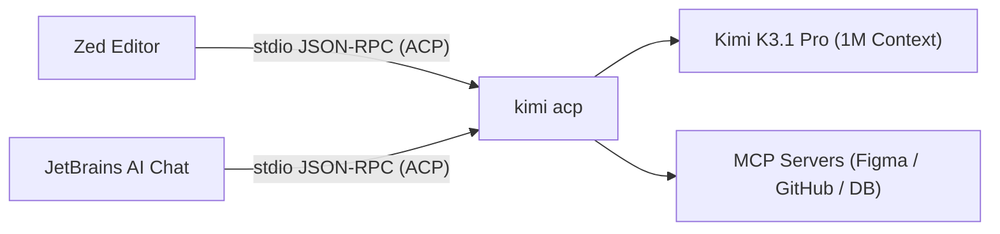

[返回 Kimi 专页](/kimi/) | [上一章：K3.1 Pro 架构与 CLI 部署](/kimi/ch01_k31_architecture_cli) | [下一章：分层子代理与 /swarm 蜂群实战](/kimi/ch03_subagents_swarm)

# Ch.02 全协议互联：`config.toml`、`kimi acp` 跨 IDE 直连与多源容灾矩阵

> 🎯 **本章解决的工程麻烦**：团队里有人死守 JetBrains（IntelliJ / WebStorm），有人迷恋 Zed，有人习惯终端 CLI——每次换工具就要重新适配一套插件；更头疼的是，单一厂商半夜触发限流或接口抖动，正在重构到一半的长会话直接卡死。
>
> 💡 **实战落地收益**：落盘标准 `~/.kimi-code/config.toml` 与 `AGENTS.md` 共享规约，用一行 **`kimi acp`** 把 Kimi Code 变成 Zed / JetBrains 原生智能体后端，并通过 **Codex Switch** 与 Bedrock / OpenRouter 建好 1 秒容灾切换防线。
>
> ⚡ **一句话结论**：不要把研发流绑死在某一个封闭 IDE 里；用 `AGENTS.md` 统一项目纪律，用 `ACP` 统一编辑器入口，用多供应商切换兜底可用性。

过去两年，AI 编程工具最大的割裂来自“一家一个封闭壳”。你在终端调顺了工具链，回到 JetBrains 又得用另一套残血补全插件。

Kimi Code 选择了一条更开放的协议路线：**`AGENTS.md` 承接项目规范 + `MCP` 承接外部数据与设计工具 + `ACP`（Agent Client Protocol）承接任何支持协议的编辑器。**

---

## 2.1 零摩擦配置：`~/.kimi-code/config.toml` 与 `AGENTS.md` 继承

Kimi Code 将运行时配置拆分为两个清爽文件：
- `~/.kimi-code/config.toml`：模型、供应商端点、权限审批档位、蜂群并发上限与 MCP 配置；
- `~/.kimi-code/tui.toml`：终端主题、快捷键与界面排版偏好。

以下是配套套件 [examples/kimi-k3-kit/config.toml](https://github.com/aipmer/codex-blue-book/blob/main/examples/kimi-k3-kit/config.toml) 的生产基线：

```toml
default_model = "kimi-k3.1-pro"
approval_mode = "always_ask"

[providers.moonshot]
base_url = "https://api.moonshot.ai/v1"
api_key_env = "MOONSHOT_API_KEY"
prompt_caching = true

[swarm]
max_concurrency = 4
worktree_isolation = true

[subagents.explore]
model = "kimi-k3.1-pro"
read_only = true

[subagents.plan]
model = "kimi-k3.1-pro"
read_only = true

[subagents.coder]
model = "kimi-k3.1-pro"
max_retries_per_error = 3

[mcp.figma]
command = "npx"
args = ["-y", "figma-developer-mcp"]
env = ["FIGMA_API_KEY"]
```

权限档位建议遵守一条铁律：日常本地仓库保持 `always_ask`（高危写文件和 Shell 命令必须人工放行）；只有在隔离容器或独立 Git Worktree 跑自动化任务时，再按需传 `--auto`。至于项目规范，直接复用仓库根目录已有的 `AGENTS.md`——Codex、Antigravity 与 Kimi Code 全部原生读取，无需写三份重复文档。

---

## 2.2 `kimi acp` 实战：一行接管 Zed 与 JetBrains 编辑器

**ACP（Agent Client Protocol）** 好比智能体世界的 LSP（Language Server Protocol）：编辑器负责展示代码树、Diff 面板、光标选区和内联接受按钮，后端智能体通过标准输入输出（stdio JSON-RPC）接管规划、读文件与跑测试。



在 **Zed** 的 `settings.json` 中注册 Kimi Code 只需几行配置：

```json
{
  "agent_servers": {
    "Kimi Code": {
      "command": "kimi",
      "args": ["acp"],
      "env": {
        "KIMI_CODE_AGENT_SWARM_MAX_CONCURRENCY": "4"
      }
    }
  }
}
```

在 **JetBrains（IntelliJ IDEA / PyCharm / WebStorm）** 的 AI Agent 设置中添加 Custom ACP Agent，填入可执行命令 `kimi` 与参数 `acp`。配置完后，无需切出 IDE 就能直接在侧边栏下发任务、逐行审核 Diff 并运行项目单测。

---

## 2.3 永不断粮防线：联动 Codex Switch 与多云兼容路由

重度写代码最怕深夜赶版本时遇到单一 API 限流或 5xx 抖动。Kimi K3.1 Pro 的 OpenAI 兼容接口天然适合作为全栈团队的“主力或热备引擎”：

1. **终端 1 秒无损切源（Codex Switch）**：配合主理人开源工具 **[Codex Switch](https://github.com/aipmer/codex-switch)**，在 OpenAI 官方、DeepSeek 与 Kimi Code 之间秒级切换配置，并自动处理推理字段差异与会话续聊，避免长上下文从零重来。
2. **多云托管备援**：Kimi K3.1 Pro 除了 Moonshot 官方接口（`api.moonshot.ai` / `api.moonshot.cn`），也已登陆 OpenRouter、DeepInfra 等主流推理平台；对有合规账单要求的海外企业，只需在 `config.toml` 中切换 `base_url` 与 `api_key_env`，业务代码一行不改。

---

## 🚀 新手极速上手 3 步走

1. **生成并落盘配置**：前往本站 [多智能体通用规约生成器](/generator) 切换到 **Kimi Code** 标签页，导出 `AGENTS.md` 与 `config.toml` 至本地。
2. **打通一个编辑器 ACP**：在 Zed 或 JetBrains 中配置 `kimi acp`，打开当前项目让它只读梳理核心路由并提出 1 处测试补充。
3. **演练一次容灾切换**：在配置中备好备用供应商环境变量（例如 OpenRouter 或 DeepInfra 托管的 K3.1 Pro），验证切源后 `kimi` 仍能正常响应。

---

## 🛡️ 翻车自救与避坑速查表

| 故障现象 | 致命根因 | 即刻自救方案 |
| :--- | :--- | :--- |
| Zed / JetBrains 启动 `kimi acp` 立即断开报错 | GUI 编辑器未继承终端 `.zshrc` 的 `PATH` 或 `MOONSHOT_API_KEY` | 在编辑器 ACP 配置中填写 `kimi` 的绝对路径（`which kimi`），并显式声明密钥读取方式 |
| 挂载 Figma MCP 后一直卡在初始化超时 | `FIGMA_API_KEY` 未导出或 `npx` 首次冷下载被网络代理阻塞 | 先在终端手动跑一次 `npx -y figma-developer-mcp --help` 预热缓存，再用 `/mcp-config` 复测连通性 |
| 跨供应商切换后历史对话报参数不合法 | 不同厂商对 `reasoning_content` 或工具调用 ID 格式校验存在细微差异 | 使用 [Codex Switch](https://github.com/aipmer/codex-switch) 自动清洗字段差异，或用 `/compact` 压缩为纯文本交接摘要后切源 |

---

[返回 Kimi 专页](/kimi/) | [上一章：K3.1 Pro 架构与 CLI 部署](/kimi/ch01_k31_architecture_cli) | [下一章：分层子代理与 /swarm 蜂群实战](/kimi/ch03_subagents_swarm)
