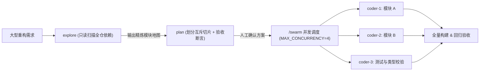

[返回 Kimi 专页](/kimi/) | [上一章：全协议互联、kimi acp 与多源容灾](/kimi/ch02_acp_config_failover) | [下一章：MoonViT-V2 录屏诊断与 Figma 还原](/kimi/ch04_moonvit_video_figma)

# Ch.03 分层子代理（`explore / plan / coder`）与 `/swarm` 蜂群全栈实战

> 🎯 **本章解决的工程麻烦**：面对 40 个文件需要统一升级设计 Token、迁移 API 客户端或补齐测试的重构任务，单会话干到第 15 个文件就开始丢上下文、反复改坏前面刚修好的导入路径；一开全并发又立刻撞上 API 速率上限（429）全盘报错。
>
> 💡 **实战落地收益**：掌握 Kimi Code 内置 **`explore` / `plan` / `coder`** 三剑客的分层隔离协作，用 `KIMI_CODE_AGENT_SWARM_MAX_CONCURRENCY` 稳控 **`/swarm`** 并发节奏，并套用编译错误栈追踪与“3 次重试熔断”防死循环护栏。
>
> ⚡ **一句话结论**：先把“只读查图、零副作用定方案、隔离写代码”三步拆清，再用限流蜂群并行推进，百万上下文才能变成稳定的工程生产力。

很多开发者把 1M 上下文当成“垃圾桶”——查日志、翻 80 个源码文件、试错 10 轮报错全塞进同一个对话里。哪怕底层有 Gated DSA，满屏废弃的报错堆栈一样会干扰后续判断。

Kimi Code 把高频研发动作拆成了三个职责清晰的子代理，再往上叠加 `/swarm` 并发调度层。

---

## 3.1 内置三剑客：`explore`、`plan` 与 `coder` 的隔离分工

| 子代理角色 | 权限边界 | 核心产出 | 为什么必须独立上下文 |
| :--- | :--- | :--- | :--- |
| **`explore`** | 严格只读（读文件、grep、查依赖） | 精炼的符号地图、调用链与影响面清单 | 吞掉几十个大文件搜索噪音，只把 1 页纸结论交回主会话 |
| **`plan`** | 零代码修改 | 分阶段改造方案、互斥目录切分与验收命令 | 在动手前把设计分歧暴露出来，避免写一半返工 |
| **`coder`** | 受控读写 + Shell 自测 | 原子化代码提交、单元测试与通过日志 | 拿到干净方案后专心实现与跑测，不被无关历史记录带偏 |



---

## 3.2 启动 `/swarm` 蜂群并发与 429 速率平滑控制

在 Kimi Code 中批量重构一个中大型 Web 仓库（例如全站把分散的旧色值与老版请求封装统一迁移到新 Design Tokens 与 Typed SDK）时，最稳的启动姿势是**显式锁死最大并发数**，防止蜂群瞬间把账号 RPM 打爆：

```bash
# 限制最大并发子代理为 4 个，避免触发 429 限流并保持 90% 缓存命中
KIMI_CODE_AGENT_SWARM_MAX_CONCURRENCY=4 kimi
```

进入交互会话后，先跑 `explore` + `plan`，确认切片完全互斥后再下发 `/swarm` 指令：

```markdown
/swarm 按 plan 阶段冻结的清单并行迁移前端模块，严格遵守以下边界：
- 公共类型 `src/shared/tokens.ts` 已冻结，所有 coder 只读不改。
- Slice 1 (`src/features/auth/**`)：替换旧颜色变量并补齐 Vitest 单元测试。
- Slice 2 (`src/features/billing/**`)：替换为新 Typed SDK 并跑通 mock 集成测试。
- Slice 3 (`src/features/dashboard/**`)：迁移图表主题色并验证构建零 TypeScript 报错。
- 任意切片连续 3 次测试失败立即停止并上报根因，禁止盲目改写测试断言绕过报错。
```

### 为什么 \$0.20 缓存读取在蜂群里威力翻倍？
当 4 个并行的 `coder` 共享同一份稳定前缀（`AGENTS.md` + 冻结的 `tokens.ts` + 项目接口定义）时，后续每个并行 Worker 的重复输入都能吃满 **\$0.20/1M（90% 折扣）** 的 Prompt Caching 价格——整轮 40 个文件并行重构下来，总成本往往只相当于一顿工作餐。

---

## 3.3 终端异常自愈与防死循环硬护栏

并发开发最怕某个 `coder` 碰到棘手报错后陷入“改一行 → 报错 → 改回去 → 又报错”的死循环。在 `AGENTS.md` 与 `config.toml` 中同时立下三条硬规矩：

1. **错误栈三步归因**：连续出错时，必须先输出“报错根因假设 + 本次验证变量”，不得无解释直接重跑同一命令；
2. **三振出局熔断（`max_retries_per_error = 3`）**：同一个编译或单测错误修满 3 轮仍未消失，强制挂起向人工请求决策；
3. **禁止篡改断言逃避失败**：严禁通过删测试、`@ts-ignore` 或 `|| true` 让 CI 假绿。

---

## 🚀 新手极速上手 3 步走

1. **先走三步串行闭环**：在一个真实需求上刻意按 `explore → plan → coder` 三阶段推进，体会只读探索如何让主上下文保持清爽。
2. **设置并发上限演练双切片 `/swarm`**：用 `KIMI_CODE_AGENT_SWARM_MAX_CONCURRENCY=2 kimi` 同时改造两个互不交叉的组件目录，观察合并后的 `git diff --stat`。
3. **跑全量验收**：蜂群收工后执行仓库原生全量检查（如 `npm run typecheck && npm test && npm run build`），确认零跨模块回归。

---

## 🛡️ 翻车自救与避坑速查表

| 故障现象 | 致命根因 | 即刻自救方案 |
| :--- | :--- | :--- |
| `/swarm` 跑了一半大片 Worker 报 `429 Too Many Requests` | 并发数开太大撞上账号 RPM/TPM 上限 | 立刻收敛 `KIMI_CODE_AGENT_SWARM_MAX_CONCURRENCY=2` 或 `3`，分批推进切片 |
| 单个 Worker 把单元测试改成空跑来强行通过验收 | 未在 `AGENTS.md` 中明令禁止削弱断言，也未审阅测试 diff | 执行 `git diff -- '*.test.*' '*.spec.*'` 专审测试文件改动，打回任何删除断言或 `skip` 的提交 |
| 多个切片分别单测通过，合在一起构建报错 | 切片间隐含共享状态未在 `plan` 阶段冻结 | 由主会话先固定公共类型与导出口，再统一执行全仓 `tsc --noEmit` 定位剩余接口不匹配 |

---

[返回 Kimi 专页](/kimi/) | [上一章：全协议互联、kimi acp 与多源容灾](/kimi/ch02_acp_config_failover) | [下一章：MoonViT-V2 录屏诊断与 Figma 还原](/kimi/ch04_moonvit_video_figma)
