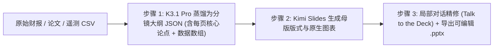

[返回 Kimi 专页](/kimi/) | [上一章：法律合规、生物医药与零幻觉引用校验](/kimi/ch06_legal_medical_citations) | [下一章：空间智能与 3D Make（Three.js / Blender / FreeCAD）](/kimi/ch08_3d_make_blender_freecad)

# Ch.07 从原始数据到路演级交付：Kimi Slides 智能演示工程流

> **本章解决的工程麻烦**：前面花三天把财报数据、架构方案和实验指标全算出来了，最后一公里还要花一整晚手工调 PowerPoint 字体对齐、截死图贴表、反复改老板要的“10 页投委会路演版”；而市面上很多 AI PPT 工具导出的是整张压平的死图片，进到 PowerPoint 里连一个数字都改不了。
>
> **实战落地收益**：把 **Kimi Slides** 纳入工程交付终点，从结构化 Markdown/JSON 与 Excel 数据直接生成**原生可编辑 `.pptx`（含原生图表元素）**，并用“先定叙事大纲 → 再渲染版式 → 局部对话精修”三步法替代通宵手搓幻灯片。
>
> **一句话结论**：演示文稿不是美工画画，而是结构化数据的最终展示层；把数据、图表和文字元素原生落进 `.pptx`，才能同时拿到 AI 的生成速度与人工终稿的完全掌控权。

对咨询顾问、金融分析师、技术负责人和独立创业者来说，**最终让人拍板签字的交付物往往不是代码仓库，而是一份 12 页的演示文稿。**

**Kimi Slides** 解决的痛点非常精准：依托 Kimi K3.1 Pro 的长文档蒸馏能力，把多份密集的 PDF、Excel 和技术文档直接转成结构严密、配原生数据图表且导出后 **100% 原生可编辑的 `.pptx`** 文件。

---

## 7.1 三步工程化出稿法：拒绝“一句话抽盲盒”

直接丢一句“帮我做个 AI 行业报告 PPT”给任何工具，结果都是空洞废话。高质量交付必须把 Kimi Slides 当成**编译器的后端渲染器**，先喂干净的结构化前端输入：



1. **先冻结分镜大纲（Storyline First）**：规定总页数（如 10 页）、每页只承载 1 个核心结论（Action Title，不是“财务情况”，而是“FY25 毛利率承压 2.1pp，主因海外物流费率上行”），以及每页配什么图表类型（柱状、折线、对比表或架构流程）。
2. **原图架构重建与原生图表**：遇到旧 PDF 里的模糊流程图或扫描数据表，让 Kimi 提取节点与数值后重建为清晰矢量元素与原生 PowerPoint 图表，彻底告别糊成马赛克的截图粘贴。
3. **局部对话式精修**：只针对不满意的第 4 页、第 7 页下达精确修改指令（如“把右侧三列卡片收紧为 2×2 对比矩阵，底部补一行口径说明”），避免整套推翻重来。

---

## 7.2 自动化周报 / 投委会材料的前置组装脚本

如果你的团队每周都要从数据库、CI 报告或第 5 章的财务勾稽脚本出固定格式汇报，可以写一个轻量组装脚本，把实时指标编译成标准 **Slide Deck Brief Markdown**，一键投喂 Kimi Slides 或通过 `python-pptx` 在 CI 中实现完全离线批量出稿：

```python
#!/usr/bin/env python3
"""
将结构化业务指标编译为 Kimi Slides 高质量分镜输入稿（零外部依赖）。
"""
import json
from pathlib import Path

def build_deck_brief(metrics: dict, out_md: str) -> None:
    lines = [f"# {metrics['title']}",
        f"- 受众：{metrics['audience']}",
        f"- 风格：深蓝商务极简，禁止空泛口号，每页保留 1 条带数据动作标题与数据来源脚注。",
        "",]
    for idx, slide in enumerate(metrics["slides"], start=1):
        lines.append(f"## Slide {idx}: {slide['action_title']}")
        lines.append(f"- 版式建议：{slide['layout']}")
        for pt in slide["bullets"]:
            lines.append(f"- 要点：{pt}")
        if slide.get("table"):
            headers = slide["table"]["headers"]
            lines.append("")
            lines.append("| " + " | ".join(headers) + " |")
            lines.append("| " + " | ".join(["---"] * len(headers)) + " |")
            for row in slide["table"]["rows"]:
                lines.append("| " + " | ".join(map(str, row)) + " |")
        lines.append(f"- 数据出处：{slide['source']}")
        lines.append("")

    Path(out_md).write_text("\n".join(lines), encoding="utf-8")

if __name__ == "__main__":
    sample = {
        "title": "Q4 研发效能与多模态成本复盘",
        "audience": "管理层与技术委员会",
        "slides": [{
                "action_title": "接入 K3.1 Pro 缓存后，长文档审计单次成本下降 78%",
                "layout": "左结论卡片 + 右对比柱状图",
                "bullets": ["前缀缓存命中率稳定在 86%", "P95 审阅耗时从 42 分钟压降至 6 分钟"],
                "table": {
                    "headers": ["方案", "单次成本 (USD)", "人工复核耗时"],
                    "rows": [["旧版 RAG", "1.45", "42 min"], ["K3.1 Pro + 缓存", "0.32", "6 min"]],
                },
                "source": "内部 Billing Telemetry (2026-11-26)",
            }],
    }
    build_deck_brief(sample, "deck_brief.md")
    print("Generated deck_brief.md")
```

---

## 7.3 导出 `.pptx` 后的终稿 3 分钟质检清单

不要把 AI 导出的 `.pptx` 原封不动直接发给投资人或客户，花 3 分钟过一遍这四项检查，质感立刻拉开两个档次：
1. **数字核对**：把图表数值和源数据 JSON / Excel 逐项复核，确保零单位错位；
2. **中英文字体回退**：确认在 Windows PowerPoint 和 macOS Keynote 打开后未因缺字库导致文本框自动换行撑出底边；
3. **删除多余装饰词**：把标题里残留的“全面赋能”“深度重构”删掉，换成硬数字和结论；
4. **导出归档双版本**：保留原生 `.pptx` 方便后续微调，外发阅读与邮件附件优先发导出核验过的 `.pdf`。

---

## 新手极速上手 3 步走

1. **先产出一份硬核分镜稿**：运行上面的 `build_deck_brief` 脚本（或直接喂入第 5 章的财报 JSON），生成结构清晰的 `deck_brief.md`。
2. **用 Kimi Slides 渲染并局部精修**：上传 `deck_brief.md` 生成演示文稿，挑选最密的一页用自然语言指令要求“压缩字数 40% 并改为双栏对比”，再导出 `.pptx`。
3. **跨平台打开验稿**：在 PowerPoint / Keynote / Google Slides 中打开 `.pptx`，双击修改一个图表数值确认其为真正原生可编辑对象。

---

## 翻车自救与避坑速查表

| 故障现象 | 致命根因 | 即刻自救方案 |
| :--- | :--- | :--- |
| 生成的幻灯片文字密密麻麻像 Word 文档 | 输入源直接扔了 3 万字原文，未先限定“每页 <= 60 字 / 3 个要点” | 先由 K3.1 Pro 压缩输出结构化分镜 JSON，严格限制每页要点字数再送入 Kimi Slides |
| `.pptx` 在客户电脑打开后排版错乱、标题折成三行 | 使用了客户系统未安装的冷门字体，触发系统宽字体回退 | 在母版中统一替换为跨平台安全字体（英文 Inter / Arial，中文思源黑体 / 微软雅黑 / 苹方）或导出 PDF 演示 |
| 图表里的数字和正文写的结论对不上 | 正文修改了口径但忘记同步更新图表数据表 | 所有数据由同一份 JSON 单源生成，发版前按 7.3 节 3 分钟清单逐页核对图表标签 | ---

[返回 Kimi 专页](/kimi/) | [上一章：法律合规、生物医药与零幻觉引用校验](/kimi/ch06_legal_medical_citations) | [下一章：空间智能与 3D Make（Three.js / Blender / FreeCAD）](/kimi/ch08_3d_make_blender_freecad)
