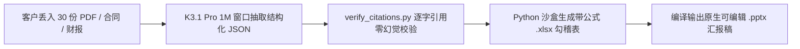

[返回 Kimi 专页](/kimi/) | [上一章：空间智能与 3D Make（Three.js / Blender / FreeCAD）](/kimi/ch08_3d_make_blender_freecad) | [下一章：2026 前沿瞭望与四模型混合军团](/kimi/ch10_four_agent_hybrid_frontier)

# Ch.09 政企合规与商业化落地：vLLM / SGLang 私有化部署与垂直 Agent 产品化

> 🎯 **本章解决的工程麻烦**：拿到银行、律所、三甲医院或大型制造业的高客单价大单，客户一句话就能把闭源公有云方案否决——“核心合同、病历和 CAD 图纸绝对不能出内网”；或者自己上线了垂直 SaaS，却被客户质疑只是随时可能断供的公有云套壳。
>
> 💡 **实战落地收益**：掌握基于 Hugging Face 开源权重的 **vLLM / SGLang 私有化部署拓扑**（区分中小团队 K2.5 轻量集群与大型机构 K3.1 Pro 多机 MoE 集群），并给出一套“**百万字审计 + 自动建表 + 原生 `.pptx` 交付**”的高毛利垂直工作台变现架构。
>
> ⚡ **一句话结论**：开源权重给你的不仅是低推理成本，更是打进政企与强监管行业的一张入场门票——同一个 OpenAI 兼容代码库，公有云卖 SaaS，内网卖私有化部署授权。

在四大主流编程智能体家族里，OpenAI、Anthropic 和 Google 的旗舰模型均为纯闭源 API；**Kimi K3 / K3.1 Pro 是唯一同步开放旗舰 MoE 权重且原生带 1M 上下文与视觉能力的选手**。

这带来一条极具杀伤力的商业路径：**“一套代码，两种卖法”**——中小客户走云端多租户 SaaS（调用 Moonshot API，享受 \$2/\$10 与 \$0.20 缓存高毛利），大客户走内网私有化交付（部署到客户自有 GPU 集群，按年收软件授权与实施服务费）。

---

## 9.1 开源权重私有化选型：vLLM / SGLang 部署架构

在规划内网 GPU 集群前，先按客户预算与实际模型体量实事求是地分级（切勿拿消费级单卡硬扛 2.8T MoE）：

| 客户规模与算力预算 | 推荐开源基座 | 典型部署形态 | 适用业务场景 |
| :--- | :--- | :--- | :--- |
| **大型金融机构 / 央国企 / 云厂商专有区** | **Kimi K3.1 Pro**（~2.8T MoE / FP8 量化权重） | 多节点 H200 / B200 集群 + **vLLM / SGLang**（TP + EP 专家并行 + Prefix Caching） | 全行级投研审计、百万字合规与跨仓库内部编程中台 |
| **中型律所 / 研发中心 / 区域医院** | **Kimi K2.5** 或领域微调版 | 单机 8×H100 / H20 + **SGLang / vLLM** | 部门级合同审查、病历结构化与内部知识库问答 |
| **无自建 GPU 但要求数据不入公网** | 专属 VPC 托管端点（云上隔离实例） | 客户云账号内按小时拉起专用推理实例 | 阶段性并购尽调项目、年度审计高峰期弹性扩容 |

> **授权合规提醒**：上线商业产品前，务必核对 Hugging Face 上 `moonshotai/` 对应仓库当日的 **Open-Weights License 条款**（重点核查高营收/大月活场景的署名与商用边界），保留完整合规备案记录。

以下是使用 **vLLM** 启动兼容 OpenAI `/v1/chat/completions` 接口、并开启前缀缓存与工具调用解析的标准内网启动模板（以实际拉取的本地权重路径与集群并行度为准）：

```bash
# 私有化内网推理网关启动示例（按集群实际 GPU 数量调整 --tensor-parallel-size / --data-parallel-size）
vllm serve /models/moonshotai/Kimi-K3.1-Pro \
  --served-model-name kimi-k3.1-pro \
  --host 127.0.0.1 \
  --port 8000 \
  --tensor-parallel-size 8 \
  --enable-expert-parallel \
  --enable-prefix-caching \
  --enable-auto-tool-choice \
  --tool-call-parser kimi_k2 \
  --max-model-len 262144 \
  --api-key "${INTERNAL_VLLM_KEY}"
```

一旦内网网关跑起来，你的业务代码和员工电脑上的 **Kimi Code CLI** 完全无需重写，只需把 `~/.kimi-code/config.toml` 的 `base_url` 指向内网网关地址：

```toml
default_model = "kimi-k3.1-pro"

[providers.moonshot]
base_url = "https://llm-gateway.corp.internal/v1"
api_key_env = "INTERNAL_VLLM_KEY"
prompt_caching = true
```

---

## 9.2 封装高客单价垂直工作台：三件套组合拳

单卖一个“长文档聊天框”在 2026 年已经卖不出溢价。把本书第 5、6、7 章的能力拧成一条**端到端结果交付流水线**，客单价可以直接从 \$20/月跃升到 \$299–\$2,000/月（或私有化年费）：



三个定价与留存支点：
1. **按交付案件 / 席位收费，不按 Token 暴露底层价**：向客户交付的是“一份经过逐字引用核验的并购尽调包（含 Excel + PPT）”，客户愿意按案件付 \$500–\$2,000，而非计较底层花了 \$0.80 的算力；
2. **审计留痕即壁垒**：把每次抽取的原文锚点、校验日志、人工签字记录全部存入不可篡改审计表，满足金融/医疗内审刚需；
3. **云端试用 → 私有化升单**：先用公开脱敏样本在云端 SaaS 让客户 10 分钟看到效果，谈妥后无缝交付 Docker / Helm 镜像接入客户内网推理集群。

---

## 🚀 新手极速上手 3 步走

1. **验证 OpenAI 兼容层零耦合**：把你的垂直工作台后端改造成只读取 `LLM_BASE_URL`、`LLM_API_KEY`、`LLM_MODEL` 三个环境变量，确认无需改代码即可在 Moonshot 官方 API 与本地测试网关之间秒切。
2. **压测前缀缓存收益**：对同一批 200K Token 合同反复发起 5 个不同维度的审计请求，记录开/关 `--enable-prefix-caching` 前后的首字延迟（TTFT）与吞吐对比。
3. **打包最小可交付 Demo**：串联 `抽取 JSON → verify_citations.py → financial_audit.py → deck_brief.md` 跑通一条全链路样本，直接拿着成套产物（JSON + 审计表 + PPT）去见第一批种子 B 端客户。

---

## 🛡️ 翻车自救与避坑速查表

| 故障现象 | 致命根因 | 即刻自救方案 |
| :--- | :--- | :--- |
| 私有化集群拉起 1M 上下文后显存瞬间 OOM 崩溃 | `--max-model-len` 直接拉满 1M 但 KV Cache 显存与并发槽位估算不足 | 先按实际业务分布设 `--max-model-len 262144` 并启用 FP8 KV Cache 与 `--gpu-memory-utilization 0.90`，再按实测并发逐步上调 |
| 客户内网安全扫描报出出网外连告警 | 容器启动时试图从 Hugging Face Hub 在线下载 tokenizer 或依赖脚本 | 提前在内网制品库完整落盘模型权重、tokenizer 与离线容器镜像，运行时设置 `HF_HUB_OFFLINE=1` 彻底断网验证 |
| 工具调用在私有化 vLLM 上返回纯文本而非 `tool_calls` | 启动参数漏加 `--enable-auto-tool-choice` 或 `--tool-call-parser` 与模型版本不匹配 | 核对所用 vLLM/SGLang 版本与 K3.1 Pro 官方模型卡推荐的 parser 名称，并用单条函数调用 curl 验收后再接入 Kimi Code |

---

[返回 Kimi 专页](/kimi/) | [上一章：空间智能与 3D Make（Three.js / Blender / FreeCAD）](/kimi/ch08_3d_make_blender_freecad) | [下一章：2026 前沿瞭望与四模型混合军团](/kimi/ch10_four_agent_hybrid_frontier)
