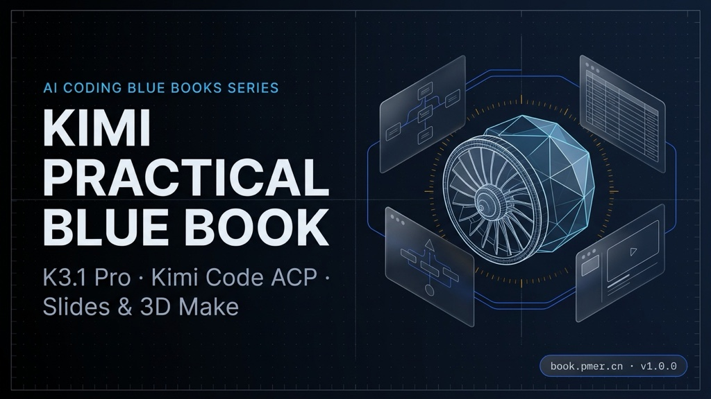

# 《Kimi 实战蓝皮书：K3.1 全栈蜂群、垂直行业深水区与 PPT/3D 跃迁指南》

> **版本**：v1.0.0 已上线 · 资料核对至 **2026 年 11 月 26 日**  
> **核心定位**：围绕 **Kimi K3.1 Pro**（~2.8T MoE、1M 上下文、MoonViT-V2、开源权重）与 **Kimi Code（`kimi` / `kimi web` / `kimi acp` / `/swarm`）**，深耕**跨 IDE 蜂群、金融/法律/医药垂直深水区、Kimi Slides 原生 PPT 与 3D Make 空间编码**。

- [立即从第一章开始阅读](/kimi/ch01_k31_architecture_cli)
- [下载中文版 PDF](/downloads/kimi_blue_book_zh.pdf) · [Download English PDF](/downloads/kimi_blue_book_en.pdf)
- [配套 Kimi 配置、引用校验与 FreeCAD 套件](https://github.com/aipmer/codex-blue-book/tree/main/examples/kimi-k3-kit)
- [生成 Kimi `AGENTS.md` + `config.toml` 规约](/generator) · [四书横向对比](/compare)

---

## 全书 10 章导航

### 第一部分：K3.1 基座全景与 Kimi Code 三态指挥舱
- [Ch.01 3 万亿参数开源新纪元：Kimi K3 / K3.1 Pro 架构与选型心智](/kimi/ch01_k31_architecture_cli)
- [Ch.02 全协议互联：`config.toml`、`kimi acp` 跨 IDE 直连与多源容灾矩阵](/kimi/ch02_acp_config_failover)

### 第二部分：蜂群并发研发与视觉录屏排障
- [Ch.03 分层子代理（`explore / plan / coder`）与 `/swarm` 蜂群全栈实战](/kimi/ch03_subagents_swarm)
- [Ch.04 MoonViT-V2 视觉工程流：录屏诊断、Figma 还原与前端精修](/kimi/ch04_moonvit_video_figma)

### 第三部分：高壁垒垂直行业深水区（金融 · 法律 · 医药）
- [Ch.05 金融投研与量化工程实战：百万 Token 财报审计与自动建模](/kimi/ch05_finance_audit_modeling)
- [Ch.06 法律合规与生物医药实战：超长文献交叉推理与零幻觉引用校验](/kimi/ch06_legal_medical_citations)

### 第四部分：Kimi Slides 与 3D Make 空间编码跃迁
- [Ch.07 从原始数据到路演级交付：Kimi Slides 智能演示工程流](/kimi/ch07_kimi_slides_decks)
- [Ch.08 空间智能与 3D Make 实战：从 Web 3D 交互、Blender 到 FreeCAD 机械装配](/kimi/ch08_3d_make_blender_freecad)

### 第五部分：开源私有化与全球商业闭环
- [Ch.09 政企合规与商业化落地：vLLM / SGLang 私有化部署与垂直 Agent 产品化](/kimi/ch09_vllm_self_hosting_saas)
- [Ch.10 2026 前沿瞭望：四模型混合军团协同策略与官方情报追踪](/kimi/ch10_four_agent_hybrid_frontier)
