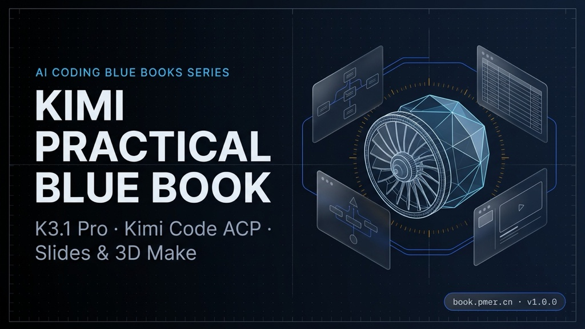
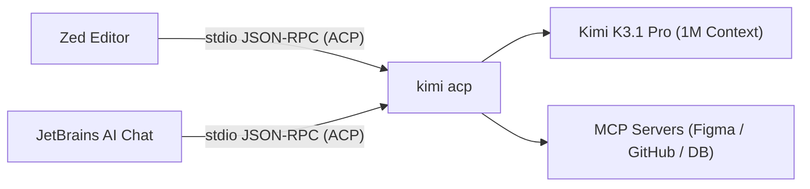
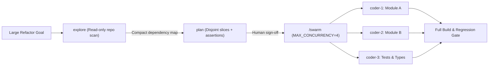
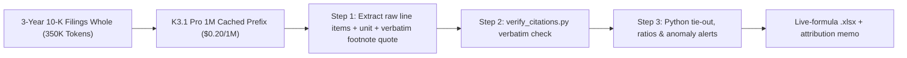
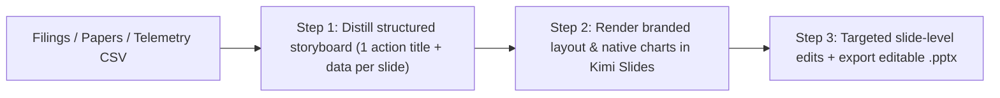
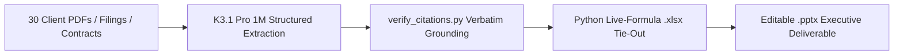
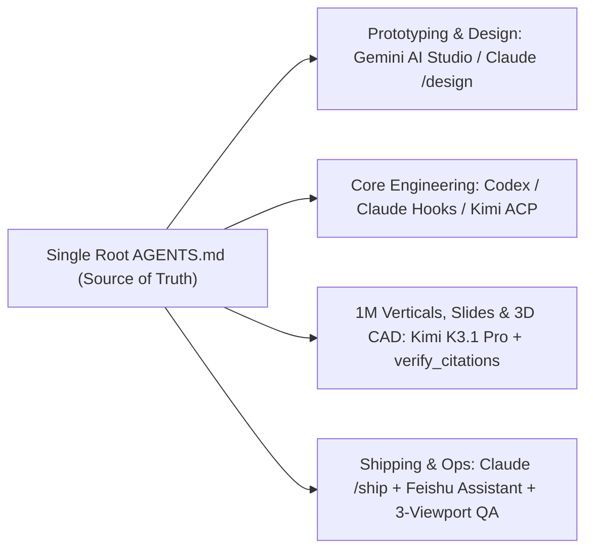

# Kimi Practical Blue Book: K3.1 Swarms, Regulated Verticals & Slides/3D Workflows

**v1.0.0 · Sources verified November 26, 2026**




Author: [Hunk Wu](https://pmer.cn) (X: [@ai_pmer](https://x.com/ai_pmer))

[ 🌐 中文 PDF 版 ](./kimi_blue_book_zh.pdf) | [ 🌐 Online Hub ](https://book.pmer.cn/en/kimi/)

## 🧭 Table of Contents

### Part 1: K3.1 Foundation & Multi-Mode Cockpit
- Ch.01 The 2.8T Open-Weight Generation: Kimi K3.1 Pro & Kimi Code CLI
- Ch.02 Protocol-First Connectivity: `config.toml`, `kimi acp` & Multi-Provider Failover

### Part 2: Swarm Engineering & Video Debugging
- Ch.03 Tiered Subagents (`explore / plan / coder`) & `/swarm` Parallel Refactors
- Ch.04 MoonViT-V2 Visual Engineering: Video-to-Fix & Figma MCP Fidelity

### Part 3: Regulated Vertical Workflows (Finance · Legal · Medical)
- Ch.05 Financial Research & Modeling: 1M-Context Audits & Formula Spreadsheets
- Ch.06 Legal Compliance & Biomedical Evidence: Zero-Hallucination Citation Gates

### Part 4: Kimi Slides & 3D Make Spatial Coding
- Ch.07 Executive Delivery with Kimi Slides: Structured Data to Editable `.pptx`
- Ch.08 Spatial Coding & 3D Make: Three.js, Headless Blender & Parametric FreeCAD

### Part 5: Open-Weight Self-Hosting & Hybrid Series Finale
- Ch.09 Enterprise Self-Hosting with vLLM / SGLang & Vertical Agent SaaS
- Ch.10 2026 Frontier Finale: Four-Agent Hybrid Strategy & Official Tracking

---

## 🔌 Companion Engineering Kit

*   **[Kimi K3.1 Starter Kit](https://github.com/aipmer/codex-blue-book/tree/main/examples/kimi-k3-kit)**: Production `config.toml`, zero-hallucination `verify_citations.py` gate, and parametric `freecad_turbine_blade.py` CAD generator.

*   **[Multi-Agent Rules Generator](https://book.pmer.cn/en/generator)**: Export Kimi `AGENTS.md` + `config.toml`.

---

# Ch.01 The 2.8T Open-Weight Generation: Kimi K3.1 Pro & Kimi Code CLI

> 🎯 **Engineering pain solved**: Treating Kimi as a consumer web chat tool misses its real engineering leverage—an open-weight ~2.8T MoE model priced at \$2/\$10 (\$0.20 cached) paired with a fast TypeScript **Kimi Code CLI** (`kimi` / `kimi web` / `kimi acp`).
>
> 💡 **What you ship**: A verified November 26, 2026 architecture and pricing ledger comparing `kimi-k3.1-pro`, `kimi-k3`, and `kimi-k2.5`, plus a working local `kimi` TUI and `kimi web` setup.
>
> ⚡ **Bottom line**: Kimi pairs flagship open weights, 90%-discounted 1M-token caching, cross-IDE ACP, and native Slides/3D pipelines inside one cost-efficient stack.

---

## 1.1 Three Architectural Pillars of Kimi K3.1 Pro

1. **Sparse MoE capacity (~2.8T total / ~104B active)**: Holds deep coding, financial, legal, and 3D CAD priors while activating only ~104B parameters per pass.
2. **1,048,576 (1M) native context via Gated DSA**: Gated DeepSeek Sparse Attention keeps KV-cache overhead and attention decay under control when ingesting multi-year filings or medium-sized codebases whole.
3. **MoonViT-V2 native-resolution vision encoder**: Encodes high-density UI screenshots and video recordings directly into multimodal space without destructive downscaling.

---

## 1.2 Generation & Pricing Ledger (Verified November 26, 2026)

| Model / Tier | Architecture & Weights | Input (/1M) | Cached Read (/1M) | Output (/1M) | Best Engineering Fit |
| :--- | :--- | ---: | ---: | ---: | :--- |
| **`kimi-k3.1-pro`** | ~2.8T MoE (104B active), 1M context, **Open Weights** | **\$2.00** | **\$0.20** (90% off) | **\$10.00** | Default for coding, `/swarm`, finance/legal audits, and 3D spatial coding |
| `kimi-k3.1-pro-highspeed` | Low-latency tier | ~\$4.00 | Discounted | ~\$20.00 | Latency-critical interactive coding and live demos |
| `kimi-k3` (predecessor) | 1M context, Open Weights | \$3.00 | \$0.30 | \$15.00 | Legacy benchmark comparisons and narrow exact-recall pipelines |
| `kimi-k2.5` | Lighter open weights | Lower GPU floor | Supported | Self-hosted | Department-scale offline clusters and domain LoRA fine-tuning |

> **Immediate savings**: Any pipeline still pinned to `kimi-k3` (\$3/\$15) should evaluate upgrading to `kimi-k3.1-pro` (\$2/\$10, \$0.20 cached)—cutting cost by a third while upgrading sparse attention and coding/spatial capability.

---

## 1.3 Installing TypeScript Kimi Code CLI (`kimi` & `kimi web`)

Rewritten in TypeScript for fast startup and isolated subagent orchestration, **Kimi Code** runs in three modes—interactive terminal (`kimi`), local browser dashboard (`kimi web`), and editor protocol daemon (`kimi acp`):

```bash
# 1. Install TypeScript Kimi Code CLI (Node.js >= 20)
npm install -g @moonshot-ai/kimi-code

# 2. Export API key from your local secrets environment
export MOONSHOT_API_KEY="sk-your-moonshot-key"

# 3. Verify installation and launch in a repository root
kimi --version
cd /path/to/your-repo
kimi

# 4. Or launch the local visual session dashboard (loopback only)
kimi web --port 4310
```

---

## 🚀 3-Step Quickstart

1. **Verify CLI & caching**: Run `kimi --version` and execute one read-only architecture summary in a test repo.
2. **Try `kimi web`**: Launch `kimi web` to inspect side-by-side diffs and tool timelines in your browser.
3. **Apply the baseline config**: Copy [examples/kimi-k3-kit/config.toml](https://github.com/aipmer/codex-blue-book/blob/main/examples/kimi-k3-kit/config.toml) to `~/.kimi-code/config.toml` with `prompt_caching = true`.

---

## 🛡️ Pitfall Recovery Table

| Failure Mode | Root Cause | Immediate Fix |
| :--- | :--- | :--- |
| `kimi` throws Python traceback or lacks `acp` subcommand | Legacy Python `kimi-cli` precedes TypeScript CLI in `PATH` | Run `which -a kimi`, uninstall the legacy pip binary, and keep the npm/official TS binary |
| Multi-turn bill misses the \$0.20 cached read tier | Dynamic timestamps or random IDs injected at the top of system prompts bust prefix cache | Keep static `AGENTS.md` and reference docs at the prompt prefix; append dynamic queries at the end |
| `kimi web` unreachable from another device | Binds to `127.0.0.1` by default for safety | Never expose `0.0.0.0` directly; tunnel securely via `ssh -L 4310:127.0.0.1:4310` |

---

---

# Ch.02 Protocol-First Connectivity: `config.toml`, `kimi acp` & Multi-Provider Failover

> 🎯 **Engineering pain solved**: Teams split across Zed, JetBrains, and terminal CLIs waste days maintaining incompatible editor plugins—and stall completely whenever a single model provider hits a late-night rate limit.
>
> 💡 **What you ship**: A clean `~/.kimi-code/config.toml` paired with root `AGENTS.md`, one-line **`kimi acp`** integration for Zed/JetBrains, and instant multi-provider failover using **Codex Switch** or OpenAI-compatible endpoints.
>
> ⚡ **Bottom line**: Lock project rules in `AGENTS.md`, connect any IDE over open `ACP`, and keep a warm backup provider ready so quotas never block a release.

---

## 2.1 `~/.kimi-code/config.toml` & Shared `AGENTS.md`

Kimi Code separates runtime behavior (`~/.kimi-code/config.toml`) from UI styling (`~/.kimi-code/tui.toml`) and reads root `AGENTS.md` natively—zero duplicate rule files alongside Codex or Antigravity:

```toml
default_model = "kimi-k3.1-pro"
approval_mode = "always_ask"

[providers.moonshot]
base_url = "https://api.moonshot.ai/v1"
api_key_env = "MOONSHOT_API_KEY"
prompt_caching = true

[swarm]
max_concurrency = 4
worktree_isolation = true

[subagents.explore]
model = "kimi-k3.1-pro"
read_only = true

[subagents.plan]
model = "kimi-k3.1-pro"
read_only = true

[subagents.coder]
model = "kimi-k3.1-pro"
max_retries_per_error = 3

[mcp.figma]
command = "npx"
args = ["-y", "figma-developer-mcp"]
env = ["FIGMA_API_KEY"]
```

Keep `approval_mode = "always_ask"` on local workspaces; pass `--auto` only inside isolated containers or disposable Git worktrees.

---

## 2.2 `kimi acp`: Driving Zed & JetBrains Over JSON-RPC

**Agent Client Protocol (ACP)** acts like LSP for coding agents: your editor owns code navigation, inline diffs, and approvals while `kimi acp` runs planning, editing, and shell tools over stdio JSON-RPC.



Register Kimi Code in **Zed** (`settings.json`):

```json
{
  "agent_servers": {
    "Kimi Code": {
      "command": "kimi",
      "args": ["acp"],
      "env": {
        "KIMI_CODE_AGENT_SWARM_MAX_CONCURRENCY": "4"
      }
    }
  }
}
```

In **JetBrains IDEs**, add a Custom ACP Agent pointing to `kimi` with argument `acp`.

---

## 2.3 Zero-Downtime Failover: Codex Switch & Multi-Cloud Endpoints

1. **1-second terminal failover**: Pair with **[Codex Switch](https://github.com/aipmer/codex-switch)** to switch across OpenAI, DeepSeek, and Kimi Code mid-session while preserving conversation continuity.
2. **Multi-host K3.1 Pro endpoints**: Beyond `api.moonshot.ai`, K3.1 Pro is hosted on OpenRouter and DeepInfra—swapping `base_url` and `api_key_env` in `config.toml` changes providers with zero application code changes.

---

## 🚀 3-Step Quickstart

1. **Generate configs**: Open the [Multi-Agent Rules Generator](/en/generator), select **Kimi Code**, and export `AGENTS.md` + `config.toml`.
2. **Connect one IDE over ACP**: Wire `kimi acp` into Zed or JetBrains and run a read-only route audit.
3. **Test failover**: Configure a secondary OpenAI-compatible provider key and verify switching takes under 5 seconds.

---

## 🛡️ Pitfall Recovery Table

| Failure Mode | Root Cause | Immediate Fix |
| :--- | :--- | :--- |
| `kimi acp` exits immediately inside Zed/JetBrains | GUI app did not inherit `.zshrc` `PATH` or `MOONSHOT_API_KEY` | Set the absolute path from `which kimi` in editor ACP settings and pass env vars explicitly |
| Figma MCP hangs on startup | `FIGMA_API_KEY` missing or first `npx` fetch blocked by proxy | Pre-warm with `npx -y figma-developer-mcp --help` in terminal, then re-test via `/mcp-config` |
| Cross-provider session resume fails schema validation | Reasoning-field formatting differs slightly across providers | Use [Codex Switch](https://github.com/aipmer/codex-switch) normalization or run `/compact` to carry a clean summary |

---

---

# Ch.03 Tiered Subagents (`explore / plan / coder`) & `/swarm` Parallel Refactors

> 🎯 **Engineering pain solved**: Refactoring 40 files in a single chat fills context with stale stack traces and breaks earlier edits—while uncapped parallel agents immediately trigger `429` rate limits.
>
> 💡 **What you ship**: A disciplined `explore → plan → coder` workflow, rate-controlled `/swarm` execution (`KIMI_CODE_AGENT_SWARM_MAX_CONCURRENCY`), and a three-strike loop breaker.
>
> ⚡ **Bottom line**: Isolate noisy exploration from code editing, freeze shared types before fanning out, and let 90%-discounted prefix caching multiply swarm ROI.

---

## 3.1 Separating `explore`, `plan`, and `coder`

| Subagent | Permission Scope | Primary Deliverable | Why Context Isolation Matters |
| :--- | :--- | :--- | :--- |
| **`explore`** | Read-only | Symbol map, dependency graph, blast radius | Absorbs raw search noise; returns a concise 1-page map |
| **`plan`** | Zero writes | Phased rollout plan, disjoint directory slices, test commands | Surfaces architectural conflicts before touching source files |
| **`coder`** | Scoped writes + shell tests | Atomic diff + passing test output | Executes cleanly against frozen specs without stale chatter |



---

## 3.2 Throttled `/swarm` Execution & Cached-Prefix Economics

Cap parallel workers explicitly to avoid `429` storms while keeping all workers hitting the same **\$0.20/1M cached prefix** (`AGENTS.md` + frozen shared interfaces):

```bash
KIMI_CODE_AGENT_SWARM_MAX_CONCURRENCY=4 kimi
```

```markdown
/swarm Execute the approved design-token migration plan across disjoint slices:
- Shared contract `src/shared/tokens.ts` is frozen (read-only for all coders).
- Slice 1 (`src/features/auth/**`): Replace legacy hex values and add Vitest coverage.
- Slice 2 (`src/features/billing/**`): Migrate to typed SDK client and pass mock integration tests.
- Slice 3 (`src/features/dashboard/**`): Align chart tokens with zero TypeScript errors.
- Halt after 3 consecutive identical test failures and report root cause; never weaken assertions.
```

---

## 3.3 Three-Strike Loop Protection

Enforce three guardrails in `AGENTS.md` and `config.toml`:
1. State root-cause hypothesis before every retry;
2. Hard-stop after `max_retries_per_error = 3` on the same failure;
3. Forbid `@ts-ignore`, `.skip()`, or `|| true` workarounds to fake green CI.

---

## 🚀 3-Step Quickstart

1. **Practice the 3-step handoff**: Run `explore → plan → coder` sequentially on one medium PR.
2. **Launch a 2-slice swarm**: Run `KIMI_CODE_AGENT_SWARM_MAX_CONCURRENCY=2 kimi` on two non-overlapping directories and inspect `git diff --stat`.
3. **Run unified verification**: Finish with `npm run typecheck && npm test && npm run build`.

---

## 🛡️ Pitfall Recovery Table

| Failure Mode | Root Cause | Immediate Fix |
| :--- | :--- | :--- |
| Swarm workers flood `429 Too Many Requests` | Uncapped concurrency exceeds account RPM/TPM | Set `KIMI_CODE_AGENT_SWARM_MAX_CONCURRENCY=2` or `3` and batch slices |
| Worker deletes failing unit tests to pass | Test diff not audited and weakening assertions not explicitly forbidden | Audit `git diff -- '*.test.*' '*.spec.*'` and reject skipped assertions |
| Slices pass locally but fail combined build | Shared exports changed mid-swarm without freezing contracts | Freeze shared types on base branch first, then run repo-wide `tsc --noEmit` |

---

---

# Ch.04 MoonViT-V2 Visual Engineering: Video-to-Fix & Figma MCP Fidelity

> 🎯 **Engineering pain solved**: Transient flicker and layout-shift bugs take paragraphs to explain in tickets, while slicing complex Figma mocks by eyeballing screenshots misses spacing tokens and accessibility labels.
>
> 💡 **What you ship**: A compact **Video-to-Fix** workflow leveraging **MoonViT-V2** native resolution, a structured **Figma MCP → CSS token** prompt pattern, and a runnable Playwright responsive + a11y gate.
>
> ⚡ **Bottom line**: Native-resolution video input captures timing bugs static screenshots miss, and Figma MCP gives exact design tokens without guesswork.

---

## 4.1 Video-to-Fix Debugging with MoonViT-V2

Downscale high-bitrate Retina captures before handing them to Kimi Code so uploads stay fast while keeping UI text razor-sharp:

```bash
ffmpeg -i raw-repro.mov -vf "scale='min(1280,iw)':-2,fps=4" \
  -c:v libx264 -crf 24 -an bug-repro.mp4
```

Then pair the clip with the owning components:

```markdown
Inspect `./bug-repro.mp4` between 00:04 and 00:09 where the filter drawer jumps:
1. Log frame-by-frame layout shifts and scrollbar changes;
2. Cross-check `src/components/FilterDrawer.tsx` and `src/styles/drawer.css` for scroll-lock or portal timing bugs;
3. Apply the minimal CSS/JS fix and add a Playwright regression test.
```

---

## 4.2 Figma MCP + Design Tokens for Responsive Fidelity

Combine structured Figma node data (exact spacing, typography scale, Auto Layout) with rendered browser previews:

```markdown
Read Figma node `https://www.figma.com/design/FILE_KEY/App?node-id=123-456` via Figma MCP:
1. Map all colors, spacing, and typography to existing variables in `src/styles/tokens.css` (zero stray hex literals);
2. Use semantic HTML (`<nav>`, `<main>`, `<button>`) with `aria-label` and `:focus-visible` rings;
3. Guarantee zero horizontal overflow and `>= 12px` text across 390px, 768px, and 1440px.
```

---

## 4.3 Automated Responsive & Accessibility Gate (`scripts/check_ui_a11y.mjs`)

```javascript
import { chromium } from "playwright";

const URL = process.argv[2] || "http://127.0.0.1:4173/";
const VIEWPORTS = [
  { name: "mobile", width: 390, height: 844 },
  { name: "tablet", width: 768, height: 1024 },
  { name: "desktop", width: 1440, height: 900 }
];

const browser = await chromium.launch();
const page = await browser.newPage();
let failed = false;

for (const vp of VIEWPORTS) {
  await page.setViewportSize({ width: vp.width, height: vp.height });
  await page.goto(URL, { waitUntil: "load" });
  const res = await page.evaluate(() => {
    const overflow = document.documentElement.scrollWidth - document.documentElement.clientWidth;
    const missingAlt = [...document.querySelectorAll("img")]
      .filter((img) => img.offsetParent !== null && !img.getAttribute("alt")).length;
    const unlabeledButtons = [...document.querySelectorAll("button")]
      .filter((b) => b.offsetParent !== null && !b.textContent?.trim() && !b.getAttribute("aria-label")).length;
    return { overflow, missingAlt, unlabeledButtons };
  });
  console.log(vp.name, res);
  if (res.overflow > 0 || res.missingAlt > 0 || res.unlabeledButtons > 0) failed = true;
}

await browser.close();
process.exit(failed ? 1 : 0);
```

---

## 🚀 3-Step Quickstart

1. **Test Video-to-Fix**: Compress one 15-second UI bug recording with `ffmpeg` and pass it to Kimi Code alongside the component file.
2. **Convert one Figma component**: Extract via Figma MCP into your existing CSS tokens rather than raw hex values.
3. **Wire `check_ui_a11y.mjs` into CI**: Block PRs that introduce mobile overflow, missing `alt`, or unlabeled icon buttons.

---

## 🛡️ Pitfall Recovery Table

| Failure Mode | Root Cause | Immediate Fix |
| :--- | :--- | :--- |
| 4K Retina `.mov` upload times out | Raw 60fps capture exceeds 50MB | Transcode to `1280px` wide, `4 fps`, `-an` with `ffmpeg` before uploading |
| Figma export looks crisp on desktop but breaks on 390px mobile | Fixed pixel widths copied literally from desktop frames | Replace rigid widths with `max-width`, `width: 100%`, and `minmax(0, 1fr)` grids |
| Icon buttons fail keyboard & screen-reader audits | Clickable `<div>` used instead of native `<button>` | Enforce `<button type="button" aria-label="...">` across interactive icons |

---

---

# Ch.05 Financial Research & Modeling: 1M-Context Audits & Formula Spreadsheets

> 🎯 **Engineering pain solved**: Chunked RAG splits income-statement tables away from Footnote 14 goodwill impairments, while asking LLMs to do mental arithmetic silently corrupts gross margins and free cash flow.
>
> 💡 **What you ship**: A zero-arithmetic-hallucination financial pipeline combining **Kimi K3.1 Pro 1M cached context (\$0.20/1M)** for full-filing extraction with deterministic Python balance-sheet tie-outs and live-formula `.xlsx` models.
>
> ⚡ **Bottom line**: Let K3.1 Pro read entire filings and surface footnote discrepancies; let deterministic Python execute every single sum, growth rate, and backtest.

---

## 5.1 Whole-Filing Context vs. Fragmented RAG

Three consecutive 10-K filings typically total **250K–600K tokens**—fitting comfortably inside K3.1 Pro's 1M window. Once loaded, every follow-up audit query hits the **\$0.20/1M cached read tier**, eliminating chunk-boundary blindness at a fraction of traditional multi-query RAG costs.



---

## 5.2 Deterministic Financial Tie-Out & Anomaly Scanner (`scripts/financial_audit.py`)

```python
#!/usr/bin/env python3
import json
from dataclasses import dataclass

@dataclass
class PeriodMetrics:
    period: str
    revenue: float
    cogs: float
    operating_cash_flow: float
    capex: float
    total_assets: float
    total_liabilities: float
    total_equity: float
    receivables: float

def analyze_periods(periods: list[PeriodMetrics]) -> dict:
    report, alerts = [], []
    for i, cur in enumerate(periods):
        gross_margin = (cur.revenue - cur.cogs) / cur.revenue if cur.revenue else 0.0
        fcf = cur.operating_cash_flow - cur.capex
        bs_gap = abs(cur.total_assets - (cur.total_liabilities + cur.total_equity))
        dso_ratio = cur.receivables / cur.revenue if cur.revenue else 0.0

        row = {
            "period": cur.period,
            "gross_margin_pct": round(gross_margin * 100, 2),
            "free_cash_flow": round(fcf, 2),
            "balance_sheet_gap": round(bs_gap, 4),
            "receivables_to_revenue_pct": round(dso_ratio * 100, 2),
        }
        if bs_gap > 1.0:
            alerts.append(f"[{cur.period}] Balance sheet does not tie: gap={bs_gap:.2f}")
        if i > 0:
            prev = periods[i - 1]
            rev_g = (cur.revenue - prev.revenue) / prev.revenue if prev.revenue else 0.0
            rec_g = (cur.receivables - prev.receivables) / prev.receivables if prev.receivables else 0.0
            row["revenue_yoy_pct"] = round(rev_g * 100, 2)
            row["receivables_yoy_pct"] = round(rec_g * 100, 2)
            if rec_g - rev_g > 0.15:
                alerts.append(
                    f"[{cur.period}] Receivables growth ({rec_g:.1%}) outpaced revenue growth ({rev_g:.1%}) by >15pp."
                )
        report.append(row)
    return {"metrics": report, "alerts": alerts}

if __name__ == "__main__":
    sample = [
        PeriodMetrics("FY2024", 1200.0, 540.0, 260.0, 75.0, 2100.0, 950.0, 1150.0, 180.0),
        PeriodMetrics("FY2025", 1380.0, 648.6, 215.0, 90.0, 2420.0, 1140.0, 1280.0, 255.0),
    ]
    print(json.dumps(analyze_periods(sample), indent=2))
```

When Python flags an alert (such as receivables outgrowing revenue by 26.7 percentage points), query the already-cached K3.1 Pro session to pull exact MD&A credit-policy footnotes for pennies.

---

## 5.3 Live-Formula Excel Deliverables

Enforce two rules when generating spreadsheets with `openpyxl`:
1. Keep raw extracted inputs separate from formula cells—every subtotal, YoY growth rate, and DCF output must be a real Excel formula (`=SUM(...)`, `=(C10-B10)/B10`), never a hardcoded float;
2. Recalculate headlessly before delivery to confirm zero `#REF!`, `#DIV/0!`, or `#VALUE!` errors.

---

## 🚀 3-Step Quickstart

1. **Run `financial_audit.py`**: Confirm it flags the receivables-vs-revenue divergence automatically.
2. **Extract one real public 10-K**: Load the full text into `kimi-k3.1-pro` with caching enabled, extract raw JSON line items + verbatim quotes, and verify quotes via [verify_citations.py](https://github.com/aipmer/codex-blue-book/blob/main/examples/kimi-k3-kit/scripts/verify_citations.py).
3. **Export live `.xlsx`**: Generate a formula-driven 3-year comparison workbook and verify zero formula errors.

---

## 🛡️ Pitfall Recovery Table

| Failure Mode | Root Cause | Immediate Fix |
| :--- | :--- | :--- |
| YoY numbers off by 1,000× | One filing reports `in thousands`, the next `in millions` | Require explicit `unit_multiplier` and `currency` in extraction JSON and normalize in Python |
| Non-GAAP adjustments mixed into GAAP operating profit | Prompt omitted GAAP vs. Non-GAAP separation | Extract `gaap_operating_income` and `non_gaap_adjustments[]` separately and verify reconciliation sums |
| PDF financial columns scrambled into one line | Plain-text PDF dump stripped table structure | Parse filings with table-preserving Markdown extractors or visually verify key tables with MoonViT-V2 |

---

---

# Ch.06 Legal Compliance & Biomedical Evidence: Zero-Hallucination Citation Gates

> 🎯 **Engineering pain solved**: In 120-page M&A agreements or multi-trial clinical reviews, clause exceptions hide across separate appendices—and a single fabricated citation destroys legal or medical credibility.
>
> 💡 **What you ship**: A hybrid **K3 / K3.1 Pro** long-document audit pattern backed by the runnable zero-dependency script `verify_citations.py`, blocking any output whose quotes do not appear verbatim in source filings.
>
> ⚡ **Bottom line**: In regulated law and biomedicine, unverified AI claims are worth zero; use K3.1 Pro to surface cross-document conflicts and deterministic code to enforce verbatim source grounding.

---

## 6.1 Cross-Contract Legal & Tax Diligence

High-impact legal risk rarely sits inside a single paragraph—it arises when Schedule B quietly carves an overseas subsidiary out of Section 8.2's liability cap. Loading the full transaction bundle (MSA + DPA + side letters) into K3.1 Pro's 1M context lets you pair:
- Exact-recall scanning of defined terms and statutory boilerplate;
- Cross-clause conflict reasoning with `kimi-k3.1-pro` (\$2/\$10, \$0.20 cached), requiring every finding to include a verbatim `quote` of at least 12 characters.

---

## 6.2 Biomedical & Clinical Evidence Chains

For drug-development literature reviews, pharmacovigilance, and trial protocol comparisons (where K3.1 Pro excels on benchmarks like *BioMysteryBench*):
1. Extract structured fields per paper: sample size (`n`), dosing regimen, primary endpoint, adverse events, and exact page/paragraph quote;
2. Cross-reference eligibility criteria and conflicting secondary endpoints inside one cached 1M session;
3. Route the verified evidence matrix and unresolved conflicts to clinical specialists for sign-off—never auto-issue medical conclusions.

---

## 6.3 Deterministic Verbatim Gate: `verify_citations.py`

Insert [examples/kimi-k3-kit/scripts/verify_citations.py](https://github.com/aipmer/codex-blue-book/blob/main/examples/kimi-k3-kit/scripts/verify_citations.py) between model output and report rendering. Every `{claim, quote}` entry is whitespace-normalized and checked verbatim against the source filing; any hallucinated or paraphrased quote fails with exit code `2`:

```bash
# 1. Run built-in pass/fail self-test
python3 examples/kimi-k3-kit/scripts/verify_citations.py --self-test

# 2. Enforce verbatim grounding on a real contract audit
python3 examples/kimi-k3-kit/scripts/verify_citations.py \
  --source filings/acquisition_msa.txt \
  --report outputs/kimi_risk_findings.json
```

When exit code `2` triggers, feed only the failed items back to the cached K3.1 Pro session to locate the exact verbatim span—or delete the unsupported claim if none exists.

---

## 🚀 3-Step Quickstart

1. **Run the self-test**: Execute `python3 examples/kimi-k3-kit/scripts/verify_citations.py --self-test` and verify valid quotes pass while fabricated quotes fail.
2. **Audit one public Terms of Service**: Ask `kimi-k3.1-pro` for `[{"claim", "quote"}]` covering termination, liability caps, and data ownership, then run `verify_citations.py` to confirm 100% verbatim match.
3. **Add human-review tiers**: Tag findings `High (sign-off required)`, `Medium (spot-check)`, and `Unverified (quarantined)`.

---

## 🛡️ Pitfall Recovery Table

| Failure Mode | Root Cause | Immediate Fix |
| :--- | :--- | :--- |
| Valid finding rejected by `verify_citations.py` | Model spliced non-contiguous phrases with `...` or curved quotes | Forbid ellipses inside `quote` in your prompt and normalize punctuation before matching |
| Scanned contract PDFs produce garbled clauses | Low-grade OCR dropped columns or stamped regions | Re-run with layout-aware OCR or verify signature/table pages visually via MoonViT-V2 |
| Law firm or hospital forbids public cloud APIs | Strict NDA, data residency, or HIPAA rules | Deploy K3.1 Pro / K2.5 open weights on-prem inside the client's air-gapped VPC (Ch.09) |

---

---

# Ch.07 Executive Delivery with Kimi Slides: Structured Data to Editable `.pptx`

> 🎯 **Engineering pain solved**: Teams spend days producing rigorous financial or engineering analysis, then lose an entire evening formatting slides—or get burned by AI deck tools that export flattened uneditable images.
>
> 💡 **What you ship**: A repeatable **Storyline Brief → Kimi Slides Native `.pptx` → Targeted Refinement** workflow plus a zero-dependency Python brief compiler that turns live metrics into board-ready slide specs.
>
> ⚡ **Bottom line**: Treat slide decks as a presentation layer compiled from verified JSON—exporting native editable `.pptx` charts and text gives you AI speed without sacrificing final human control.

---

## 7.1 Three-Step Engineered Deck Pipeline



1. **Freeze the storyline first**: Enforce one data-backed Action Title per slide (e.g., *"K3.1 Pro prefix caching cut audit cost 78%"* instead of *"Cost Overview"*).
2. **Rebuild diagrams & charts natively**: Replace blurry PDF screenshots with native PowerPoint charts and clean vector boxes.
3. **Iterate per slide**: Refine individual dense slides via targeted instructions rather than regenerating the entire deck.

---

## 7.2 Automated Deck Brief Compiler (`build_deck_brief.py`)

```python
#!/usr/bin/env python3
import json
from pathlib import Path

def build_deck_brief(metrics: dict, out_md: str) -> None:
    lines = [
        f"# {metrics['title']}",
        f"- Audience: {metrics['audience']}",
        "- Style: Clean navy executive layout. One data-backed action title and source footnote per slide.",
        "",
    ]
    for idx, slide in enumerate(metrics["slides"], start=1):
        lines.append(f"## Slide {idx}: {slide['action_title']}")
        lines.append(f"- Layout: {slide['layout']}")
        for pt in slide["bullets"]:
            lines.append(f"- Bullet: {pt}")
        if slide.get("table"):
            headers = slide["table"]["headers"]
            lines.append("")
            lines.append("| " + " | ".join(headers) + " |")
            lines.append("| " + " | ".join(["---"] * len(headers)) + " |")
            for row in slide["table"]["rows"]:
                lines.append("| " + " | ".join(map(str, row)) + " |")
        lines.append(f"- Source: {slide['source']}")
        lines.append("")
    Path(out_md).write_text("\n".join(lines), encoding="utf-8")

if __name__ == "__main__":
    sample = {
        "title": "Q4 Engineering Velocity & Multimodal Cost Review",
        "audience": "Executive & Architecture Committee",
        "slides": [
            {
                "action_title": "K3.1 Pro prefix caching cut long-document audit cost by 78%",
                "layout": "Left summary card + right comparison bar chart",
                "bullets": ["86% steady-state prefix cache hit rate", "P95 review time reduced from 42m to 6m"],
                "table": {
                    "headers": ["Approach", "Cost / Audit (USD)", "Human Review"],
                    "rows": [["Legacy RAG", "1.45", "42 min"], ["K3.1 Pro + Cache", "0.32", "6 min"]],
                },
                "source": "Internal Billing Telemetry (2026-11-26)",
            }
        ],
    }
    build_deck_brief(sample, "deck_brief.md")
    print("Generated deck_brief.md")
```

---

## 7.3 3-Minute Pre-Send `.pptx` QA Checklist

1. Cross-check every chart figure against source JSON/Excel;
2. Verify cross-OS font fallback (Windows PowerPoint & macOS Keynote) causes zero text-box overflow;
3. Strip generic buzzwords and leave concrete numbers;
4. Keep `.pptx` for internal editing and send verified `.pdf` for external distribution.

---

## 🚀 3-Step Quickstart

1. **Compile a real brief**: Run `build_deck_brief.py` (or pipe Ch.05 audit JSON) to produce `deck_brief.md`.
2. **Generate & refine in Kimi Slides**: Upload `deck_brief.md`, tighten the densest slide by 40%, and export `.pptx`.
3. **Confirm native editability**: Open in PowerPoint/Keynote/Google Slides and edit one chart data cell directly.

---

## 🛡️ Pitfall Recovery Table

| Failure Mode | Root Cause | Immediate Fix |
| :--- | :--- | :--- |
| Slides look like dense walls of text | Raw 30K-word doc fed directly without per-slide word budgets | Distill into a structured storyboard (`<= 60 words / 3 bullets` per slide) before rendering |
| Titles wrap awkwardly on a client's Windows laptop | Non-standard font triggered wide fallback metrics | Lock master fonts to cross-platform families (Inter / Arial / Noto Sans) or send PDF |
| Chart numbers disagree with headline text | Headline edited without updating underlying chart table | Generate both headline and chart arrays from one canonical JSON file |

---

---

# Ch.08 Spatial Coding & 3D Make: Three.js, Headless Blender & Parametric FreeCAD

> 🎯 **Engineering pain solved**: Text-to-mesh generators output messy, uneditable triangle soups with arbitrary dimensions—useless for precision CAD assemblies or budgeted WebGL scenes—while hand-writing `bpy` or FreeCAD Python scripts takes specialized geometry skills.
>
> 💡 **What you ship**: Three reproducible spatial-coding pipelines powered by **Kimi K3.1 Pro + 3D Make**: WebGL **Three.js**, headless **Blender (`bpy`)** with MoonViT-V2 visual self-review, and a runnable **FreeCAD** parametric turbine rotor generator (`.step` / `.stl`).
>
> ⚡ **Bottom line**: Code-generated 3D assets give you exact millimeter tolerances, Git version control, and instant parameter sweeps—turning 3D into an engineering pipeline instead of lottery meshes.

---

## 8.1 Choosing the Right 3D Pipeline

| Deliverable | Target Engine & Format | Why Kimi K3.1 Pro / 3D Make Excels |
| :--- | :--- | :--- |
| **Interactive web configurator / showcase** | **Three.js / React Three Fiber** (WebGL / GLB) | Generates camera rigs, lighting budgets, and responsive state bindings |
| **Architectural / environment rendering** | **Headless Blender (`bpy`)** (`.blend` / `.glb` / Cycles PNG) | Procedural terrain, shaders, lighting, and automated multi-angle preview renders |
| **Mechanical CAD / 3D-printable parts** | **Python + FreeCAD** (`.step` / `.stl` / `.3mf`) | Exact B-Rep solids, watertight boolean unions, and parametric dimension updates |

---

## 8.2 Headless Blender (`bpy`) + MoonViT-V2 Visual Loop

Inspired by official K3.1 Pro procedural environment showcases, generate a headless `bpy` script, render a fast Cycles preview (`blender --background --python ...`), and feed `preview_render.png` back into Kimi Code so MoonViT-V2 flags floating meshes, clipping, or blown highlights:

```python
# Run: blender --background --python blender_scene_check.py
import bpy
import math

bpy.ops.wm.read_factory_settings(use_empty=True)

bpy.ops.mesh.primitive_grid_add(x_subdivisions=48, y_subdivisions=48, size=12.0, location=(0, 0, 0))
terrain = bpy.context.active_object
terrain.name = "CanyonTerrain"
for v in terrain.data.vertices:
    x, y = v.co.x, v.co.y
    v.co.z = max(-0.4, abs(x) * 0.45 + 0.25 * math.sin(x * 1.1) * math.cos(y * 0.9) - 1.2)

bpy.ops.mesh.primitive_plane_add(size=12.0, location=(0, 0, -0.25))
bpy.context.active_object.name = "StreamSurface"

bpy.ops.object.light_add(type="SUN", location=(6, -6, 10))
sun = bpy.context.active_object
sun.data.energy = 3.5
sun.rotation_euler = (math.radians(48), math.radians(15), math.radians(32))

bpy.ops.object.camera_add(location=(0, -9.5, 4.2), rotation=(math.radians(68), 0, 0))
bpy.context.scene.camera = bpy.context.active_object

scene = bpy.context.scene
scene.render.engine = "CYCLES"
scene.cycles.samples = 24
scene.render.resolution_x = 960
scene.render.resolution_y = 540
scene.render.filepath = "//preview_render.png"
bpy.ops.render.render(write_still=True)
```

---

## 8.3 Parametric FreeCAD Turbine Rotor (`freecad_turbine_blade.py`)

For 3D-printable and CNC-ready parts, B-Rep solids eliminate non-manifold mesh holes. The companion script [examples/kimi-k3-kit/scripts/freecad_turbine_blade.py](https://github.com/aipmer/codex-blue-book/blob/main/examples/kimi-k3-kit/scripts/freecad_turbine_blade.py) validates blade chord and minimum wall thickness (`>= 1.6mm`) in plain Python before exporting watertight `.step` or `.stl` via `freecadcmd`:

```bash
# 1. Pure-Python parametric geometry pre-check
python3 examples/kimi-k3-kit/scripts/freecad_turbine_blade.py \
  --dry-run --blades 12 --hub-radius 28 --outer-radius 85 --pitch-deg 28

# 2. Headless FreeCAD STEP & 3D-printable STL export
freecadcmd examples/kimi-k3-kit/scripts/freecad_turbine_blade.py \
  --blades 12 --hub-radius 28 --outer-radius 85 --out turbine_rotor.step

freecadcmd examples/kimi-k3-kit/scripts/freecad_turbine_blade.py \
  --blades 12 --hub-radius 28 --outer-radius 85 --out turbine_rotor.stl
```

---

## 🚀 3-Step Quickstart

1. **Validate parametric math**: Run `freecad_turbine_blade.py --dry-run` with `--blades 16 --outer-radius 100` to verify automatic chord/spacing recalculation.
2. **Prototype visually in 3D Make**: Block out proportions from a sketch or prompt in Kimi 3D Make, then port into versioned scripts.
3. **Close the render-audit loop**: Render front and isometric views headlessly and have MoonViT-V2 inspect intersections and base-plane contact.

---

## 🛡️ Pitfall Recovery Table

| Failure Mode | Root Cause | Immediate Fix |
| :--- | :--- | :--- |
| Slicer rejects `.stl` with non-manifold edges | Parts touch face-to-face without solid boolean union | Overlap blades into hub by `1–2mm` and call `rotor.fuse(blade)` before exporting |
| `bpy` script fails with `AttributeError` in Blender 4.x | Deprecated Blender 3.x Principled BSDF socket names | Pin your exact `blender --version` in prompts and test via `--background` immediately |
| Mobile browser freezes on Three.js product page | Uncompressed 500K-triangle mesh loaded in root bundle | Decimate/compress with `gltf-transform` (`< 50K` tris, Draco/KTX2) and lazy-load via dynamic `import()` |

---

---

# Ch.09 Enterprise Self-Hosting with vLLM / SGLang & Vertical Agent SaaS

> 🎯 **Engineering pain solved**: Regulated enterprise deals die on day one when legal or security blocks public-cloud LLM APIs, while thin chat wrappers struggle to command premium pricing.
>
> 💡 **What you ship**: Realistic **vLLM / SGLang** open-weight deployment sizing for K3.1 Pro and K2.5, zero-code-change internal endpoint wiring for Kimi Code CLI, and a high-ticket vertical deliverable architecture.
>
> ⚡ **Bottom line**: Open weights let one OpenAI-compatible codebase serve both high-margin cloud SaaS and air-gapped enterprise deployments.

---

## 9.1 Sizing Open-Weight Clusters (vLLM / SGLang)

| Organization Tier | Open-Weight Model | Typical Infrastructure | Target Workload |
| :--- | :--- | :--- | :--- |
| **Large bank / enterprise platform** | **Kimi K3.1 Pro** (~2.8T MoE FP8) | Multi-node H200 / B200 + **vLLM / SGLang** (TP + EP + Prefix Caching) | Firm-wide research, 1M compliance audits, internal coding hub |
| **Mid-size law firm / hospital / R&D lab** | **Kimi K2.5** (or fine-tuned domain variant) | Single-node 8×H100 / H20 + **SGLang / vLLM** | Contract review, clinical extraction, private knowledge base |
| **Project-based strict isolation** | Dedicated customer VPC endpoint | On-demand isolated cloud GPU instances | M&A diligence sprints and peak annual audit windows |

> **License check**: Always review the current **Open-Weights License** on Hugging Face `moonshotai/` for scale-based attribution terms prior to commercial rollout.

Launch an internal OpenAI-compatible gateway with prefix caching and tool parsing enabled (adjust `--tensor-parallel-size` and parser flags to match your cluster and vLLM version):

```bash
vllm serve /models/moonshotai/Kimi-K3.1-Pro \
  --served-model-name kimi-k3.1-pro \
  --host 127.0.0.1 \
  --port 8000 \
  --tensor-parallel-size 8 \
  --enable-expert-parallel \
  --enable-prefix-caching \
  --enable-auto-tool-choice \
  --tool-call-parser kimi_k2 \
  --max-model-len 262144 \
  --api-key "${INTERNAL_VLLM_KEY}"
```

Point Kimi Code CLI at the private gateway via `~/.kimi-code/config.toml`—zero application rewrites:

```toml
default_model = "kimi-k3.1-pro"

[providers.moonshot]
base_url = "https://llm-gateway.corp.internal/v1"
api_key_env = "INTERNAL_VLLM_KEY"
prompt_caching = true
```

---

## 9.2 Packaging High-Ticket Vertical Workspaces



Charge **per diligence case or per seat (\$299–\$2,000/mo or annual on-prem license)** for verified end-to-end packages—backed by immutable audit logs of source quotes and human sign-offs—rather than selling commodity chat tokens.

---

## 🚀 3-Step Quickstart

1. **Decouple provider config**: Read `LLM_BASE_URL`, `LLM_API_KEY`, and `LLM_MODEL` from env so cloud and private gateways swap cleanly.
2. **Benchmark prefix caching**: Run 5 sequential queries on one 200K-token filing and compare TTFT with and without `--enable-prefix-caching`.
3. **Ship one end-to-end demo bundle**: Chain JSON extraction → `verify_citations.py` → `financial_audit.py` → `deck_brief.md` to pitch pilot B2B buyers with tangible deliverables.

---

## 🛡️ Pitfall Recovery Table

| Failure Mode | Root Cause | Immediate Fix |
| :--- | :--- | :--- |
| Immediate GPU OOM when enabling 1M context | KV cache allocation exceeds VRAM under high concurrency | Start with `--max-model-len 262144`, enable FP8 KV cache + `--gpu-memory-utilization 0.90`, and scale with telemetry |
| Air-gapped security scanner flags outbound HTTPS calls | Container tried to fetch tokenizer files from Hugging Face Hub at boot | Pre-stage full weights and tokenizer locally and run with `HF_HUB_OFFLINE=1` |
| Tool calls return raw text instead of structured `tool_calls` | Missing `--enable-auto-tool-choice` or mismatched `--tool-call-parser` | Verify parser compatibility against the K3.1 Pro model card and smoke-test one tool call via `curl` |

---

---

# Ch.10 2026 Frontier Finale: Four-Agent Hybrid Strategy & Official Tracking

> 🎯 **Engineering pain solved**: After mastering all four ecosystems, teams wonder whether to bet exclusively on one vendor or mix tools—and how to mix without creating conflicting rules, merge collisions, and runaway bills.
>
> 💡 **What you ship**: A pragmatic **Four-Agent Hybrid Playbook** unified by one root `AGENTS.md`, three anti-chaos team guardrails, and an official primary-source tracking table across all four vendors.
>
> ⚡ **Bottom line**: Mature engineering teams avoid model tribalism—keep one source of truth in `AGENTS.md` and route each stage to the agent with the highest determinism and ROI.

---

## 10.1 Running All Four Agents Under One `AGENTS.md`

Maintain shared repository boundaries once in root **`AGENTS.md`** (native in Codex, Gemini Antigravity, and Kimi Code; imported by Claude Code via one-line `@AGENTS.md` inside `CLAUDE.md`), then route by engineering stage:

| Stage | Primary Agent | Why It Wins Here |
| :--- | :--- | :--- |
| **0→1 MVPs, local tunneling & mobile duty alerts** | **OpenAI Codex** (GPT-6.2 + Feishu Assistant) | Fast full-stack shipping, mobile approvals, Codex Switch failover |
| **High-risk legacy refactors, deterministic CI & `/design`** | **Claude Code** (Claude 5.5 + Hooks + `/ship`) | Hard `PreToolUse` command gates, `/design` artboards, PR Steward |
| **Multimodal apps, Workspace/Colab & visual QA** | **Gemini Antigravity** (Gemini 4 + `/swarm`) | AI Studio context handoff, Orchestrator speed, Workspace MCP & Colab `%%agy` |
| **High-ROI IDE swarms, verticals, Slides, 3D CAD & on-prem** | **Kimi Code** (K3.1 Pro + `kimi acp` + open weights) | \$2/\$0.20/\$10 pricing, Zed/JetBrains ACP, finance/legal/medical, Slides/FreeCAD & self-hosting |



---

## 10.2 Three Guardrails That Keep Multi-Agent Teams Sane

1. **One writer per directory at any time**: Isolate concurrent agents via Git worktrees or mutually exclusive directory ownership.
2. **Vendor-neutral verification scripts**: Encode tests, lint, link checks, 3-viewport probes, and citation verifiers as standard repo commands (`npm run` / `python3`) so every agent clears the same bar.
3. **Monthly lifecycle & pricing reviews**: Track upcoming vendor deadlines—**2026-11-30** OpenAI `/v1/prompts` & Agent Builder deprecation, **2026-12-01** Gemini 4 Argon rate doubling to \$4/\$20, and **2026-12-23** GPT-5.6 Sol/Terra Codex retirement—and keep developer subscriptions strictly separated from production API keys.

---

## 10.3 Official Primary-Source Tracking Ledger

| Ecosystem | Official X Accounts | Primary Docs & Model Cards |
| :--- | :--- | :--- |
| **Kimi / Moonshot** | `@Kimi_Moonshot` | `kimi.com` · `platform.moonshot.ai` · Hugging Face `moonshotai/` |
| **OpenAI Codex** | `@OpenAIDevs` · `@OpenAI` | `learn.chatgpt.com/docs/changelog` · `developers.openai.com/api/docs/deprecations` |
| **Anthropic Claude** | `@AnthropicAI` · `@claudeai` | `docs.anthropic.com` · `anthropic.com/news` |
| **Google Gemini / Antigravity** | `@GoogleAI` · `@GoogleDeepMind` | `antigravity.google/llms.txt` · `ai.google.dev` |

---

## 🚀 Series Finale 3-Step Action Plan

1. **Standardize your root rules**: Generate a clean `AGENTS.md` plus tool-specific add-ons in the [Multi-Agent Rules Generator](/en/generator).
2. **Adopt one high-ROI bottleneck first**: Start with the single workflow that saves your team the most pain this week (citation verification, deterministic Hooks, ACP IDE swarms, or 3-viewport visual QA).
3. **Revisit the matrix as your stack grows**: Use the [2026 Four-Agent Comparison Matrix](/en/compare) and bilingual PDFs whenever your next project shifts requirements.

---

## 🛡️ Pitfall Recovery Table

| Failure Mode | Root Cause | Immediate Fix |
| :--- | :--- | :--- |
| Four tools drift into four incompatible code styles | Missing shared `AGENTS.md` and automated formatting gate | Commit one root `AGENTS.md`, import it via `@AGENTS.md` in `CLAUDE.md`, and enforce formatting in CI |
| Unattended agent triggers accidental production push or email | External side effects not separated from local sandbox work | Require explicit human confirmation before `git push`, production deploys, payments, or outbound messages |
| Production breaks months later from retired model IDs | Model slugs hardcoded across application files | Centralize model routing in config/env variables and audit vendor deprecation schedules monthly |

---

---
